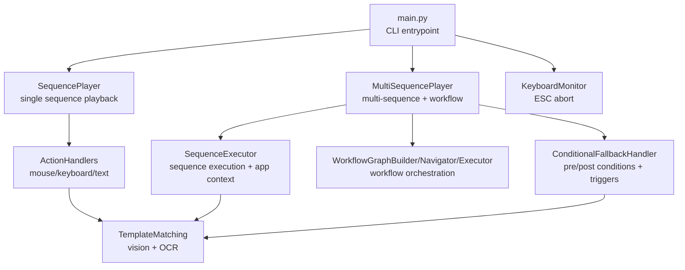
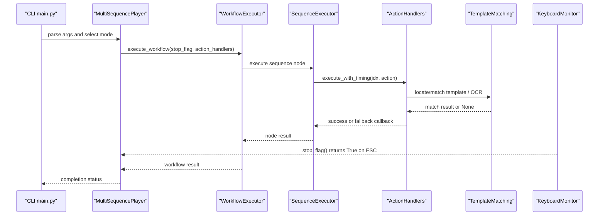
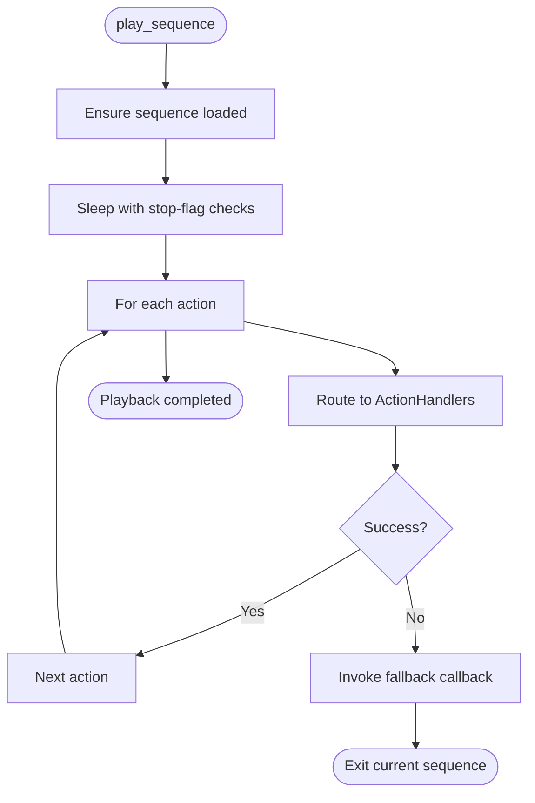
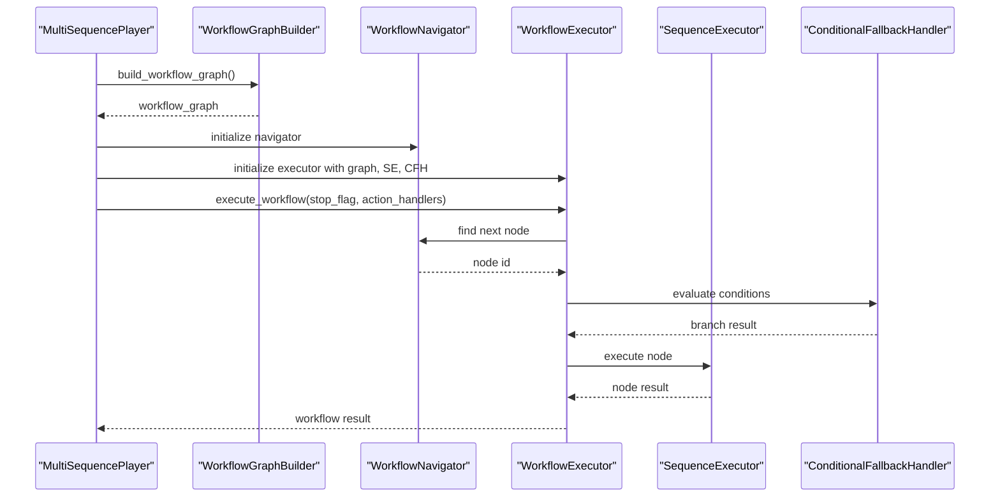
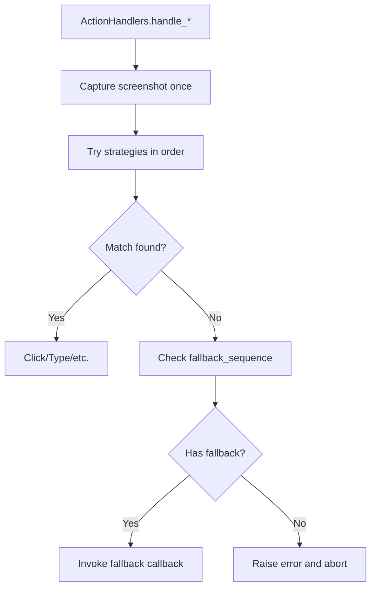
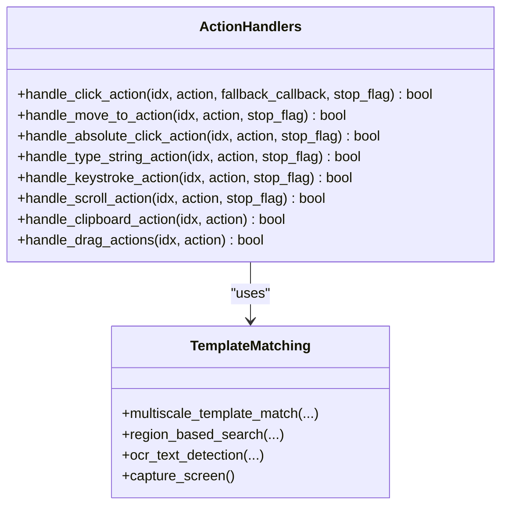
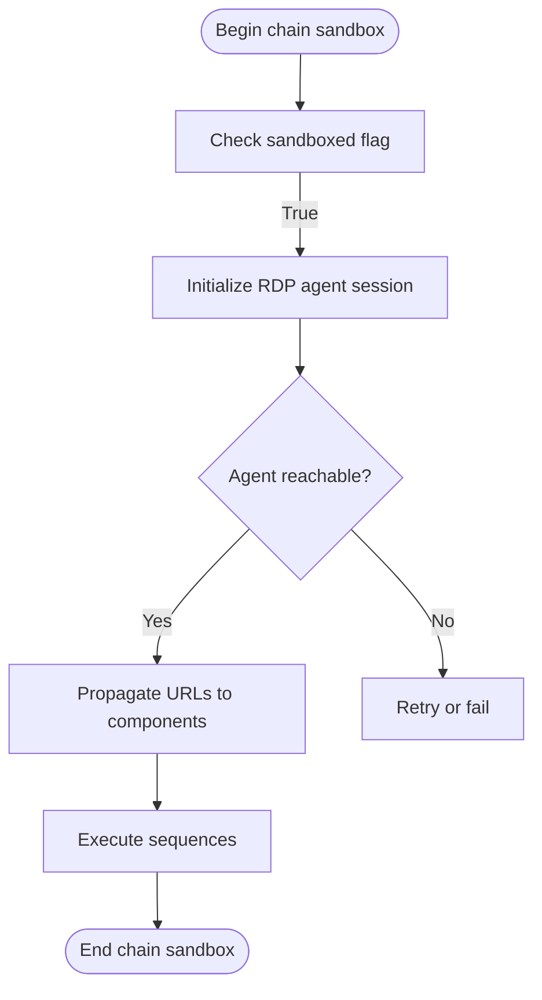
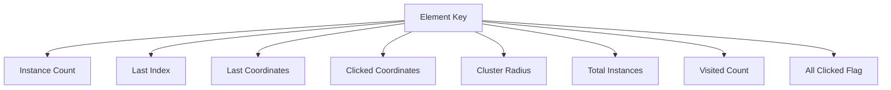
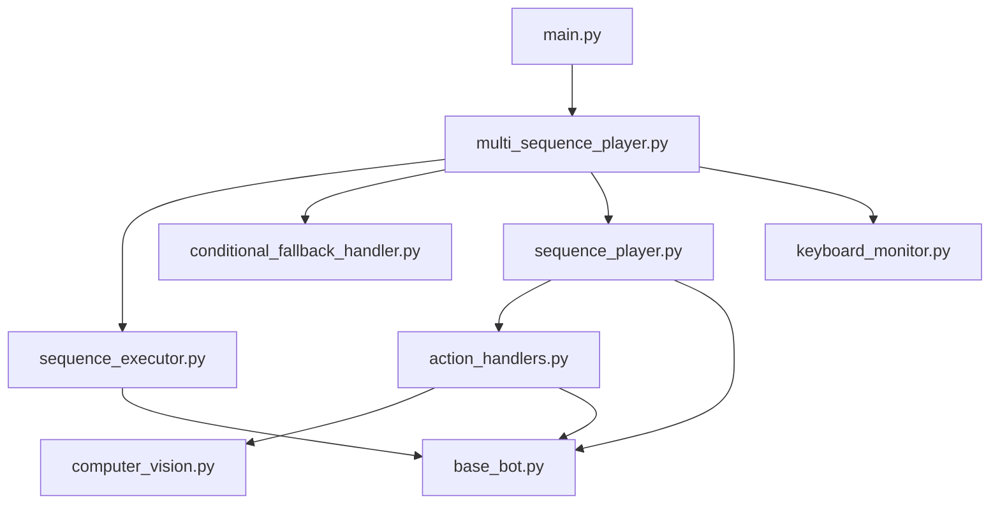

# Playback Engine

<cite>
**Referenced Files in This Document**
- [main.py](file://LoOper/player/main.py)
- [multi_sequence_player.py](file://LoOper/player/multi_sequence_player.py)
- [sequence_player.py](file://LoOper/player/sequence_player.py)
- [action_handlers.py](file://LoOper/player/action_handlers.py)
- [base_bot.py](file://LoOper/player/base_bot.py)
- [config.py](file://LoOper/player/config.py)
- [computer_vision.py](file://LoOper/player/computer_vision.py)
- [conditional_fallback_handler.py](file://LoOper/player/multi_sequence/conditional_fallback_handler.py)
- [sequence_executor.py](file://LoOper/player/multi_sequence/sequence_executor.py)
- [workflow_graph.py](file://LoOper/player/multi_sequence/workflow_graph.py)
- [keyboard_monitor.py](file://LoOper/player/keyboard_monitor.py)
</cite>

## Table of Contents
1. [Introduction](#introduction)
2. [Project Structure](#project-structure)
3. [Core Components](#core-components)
4. [Architecture Overview](#architecture-overview)
5. [Detailed Component Analysis](#detailed-component-analysis)
6. [Dependency Analysis](#dependency-analysis)
7. [Performance Considerations](#performance-considerations)
8. [Troubleshooting Guide](#troubleshooting-guide)
9. [Conclusion](#conclusion)
10. [Appendices](#appendices)

## Introduction
This document describes the playback engine responsible for dual-mode execution: single sequence playback and multi-sequence workflow playback with conditional fallbacks. It explains how sequences are executed, how multiple sequences are orchestrated with dependencies, how fallback mechanisms are implemented, and how ESC-key cancellation enables safe termination. It also documents action handlers for mouse and keyboard control, text input handling, application context management, and selection memory preservation. Practical examples, error recovery strategies, performance optimizations, and integration points with computer vision are included, along with guidance for extending the engine with new action types and custom execution strategies.

## Project Structure
The playback engine resides under the LoOper/player package and is composed of:
- Entry point and orchestration: main entry that parses CLI arguments and selects the appropriate player.
- Single sequence playback: SequencePlayer loads and executes recorded action sequences.
- Multi-sequence playback: MultiSequencePlayer orchestrates chains of sequences with workflow execution, conditional fallbacks, and LLM/TTS integration.
- Action execution: ActionHandlers encapsulate mouse, keyboard, clipboard, drag-and-drop, and type-string actions with robust fallback and retry logic.
- Computer vision: TemplateMatching and OCR utilities integrate with UI element detection and text validation.
- Application context and sandboxing: SequenceExecutor manages application foregrounding, sandbox sessions, and RDP agent integration.
- Keyboard monitoring: KeyboardMonitor provides ESC-triggered cancellation across long-running operations.



**Diagram sources**
- [main.py:18-108](file://LoOper/player/main.py#L18-L108)
- [multi_sequence_player.py:32-135](file://LoOper/player/multi_sequence_player.py#L32-L135)
- [sequence_player.py:136-252](file://LoOper/player/sequence_player.py#L136-L252)
- [action_handlers.py:26-1058](file://LoOper/player/action_handlers.py#L26-L1058)
- [computer_vision.py:47-606](file://LoOper/player/computer_vision.py#L47-L606)
- [sequence_executor.py:17-800](file://LoOper/player/multi_sequence/sequence_executor.py#L17-L800)
- [conditional_fallback_handler.py:20-208](file://LoOper/player/multi_sequence/conditional_fallback_handler.py#L20-L208)
- [workflow_graph.py:1-10](file://LoOper/player/multi_sequence/workflow_graph.py#L1-L10)
- [keyboard_monitor.py:13-150](file://LoOper/player/keyboard_monitor.py#L13-L150)

**Section sources**
- [main.py:18-108](file://LoOper/player/main.py#L18-L108)
- [multi_sequence_player.py:32-135](file://LoOper/player/multi_sequence_player.py#L32-L135)
- [sequence_player.py:136-252](file://LoOper/player/sequence_player.py#L136-L252)
- [action_handlers.py:26-1058](file://LoOper/player/action_handlers.py#L26-L1058)
- [computer_vision.py:47-606](file://LoOper/player/computer_vision.py#L47-L606)
- [sequence_executor.py:17-800](file://LoOper/player/multi_sequence/sequence_executor.py#L17-L800)
- [conditional_fallback_handler.py:20-208](file://LoOper/player/multi_sequence/conditional_fallback_handler.py#L20-L208)
- [workflow_graph.py:1-10](file://LoOper/player/multi_sequence/workflow_graph.py#L1-L10)
- [keyboard_monitor.py:13-150](file://LoOper/player/keyboard_monitor.py#L13-L150)

## Core Components
- SequencePlayer: Loads and executes a single recorded sequence with caching, optimized JSON loading, and interruption-friendly delays. It routes actions to ActionHandlers and preserves selection memory across actions.
- MultiSequencePlayer: Orchestrates multi-sequence chains with workflow execution, conditional fallbacks, and LLM/TTS nodes. It propagates selection memory and application context across sequences and fallbacks.
- ActionHandlers: Implements click, move-to, absolute click, type-string, keystroke, scroll, clipboard, and drag actions with robust fallback to fallback sequences, multi-strategy template matching, and OCR-based validation.
- ConditionalFallbackHandler: Provides modularized pre/post sequence conditions using presence/absence/OCR triggers and conditional loops.
- SequenceExecutor: Manages application context, foregrounding, sandbox/RDP agent initialization, and chain sandbox lifecycle.
- Computer vision: TemplateMatching supports multi-scale matching, region-based search, and OCR text detection/extraction with adaptive strategies and caching.
- KeyboardMonitor: Provides ESC-triggered cancellation via a stop flag function for interruption-friendly loops and retries.

**Section sources**
- [sequence_player.py:136-252](file://LoOper/player/sequence_player.py#L136-L252)
- [multi_sequence_player.py:32-135](file://LoOper/player/multi_sequence_player.py#L32-L135)
- [action_handlers.py:26-1058](file://LoOper/player/action_handlers.py#L26-L1058)
- [conditional_fallback_handler.py:20-208](file://LoOper/player/multi_sequence/conditional_fallback_handler.py#L20-L208)
- [sequence_executor.py:17-800](file://LoOper/player/multi_sequence/sequence_executor.py#L17-L800)
- [computer_vision.py:47-606](file://LoOper/player/computer_vision.py#L47-L606)
- [keyboard_monitor.py:13-150](file://LoOper/player/keyboard_monitor.py#L13-L150)

## Architecture Overview
The engine supports two execution modes:
- Single sequence mode: SequencePlayer reads a JSON sequence and executes actions with fallback callbacks and ESC cancellation.
- Multi-sequence mode: MultiSequencePlayer builds a workflow graph from sequences and conditional nodes, executes with SequenceExecutor and ConditionalFallbackHandler, and supports LLM/TTS nodes.



**Diagram sources**
- [main.py:58-101](file://LoOper/player/main.py#L58-L101)
- [multi_sequence_player.py:304-325](file://LoOper/player/multi_sequence_player.py#L304-L325)
- [sequence_executor.py:17-800](file://LoOper/player/multi_sequence/sequence_executor.py#L17-L800)
- [action_handlers.py:207-283](file://LoOper/player/action_handlers.py#L207-L283)
- [computer_vision.py:198-450](file://LoOper/player/computer_vision.py#L198-L450)
- [keyboard_monitor.py:141-150](file://LoOper/player/keyboard_monitor.py#L141-L150)

## Detailed Component Analysis

### Sequence Playback Engine
SequencePlayer encapsulates:
- Lazy or eager sequence loading with a thread-safe cache and optimized JSON loading.
- Interruption-friendly delays and stop-flag checks before each action.
- Routing to ActionHandlers for each action type.
- Screenshot capture after each action for verification and debugging.
- Selection memory propagation to ensure deterministic candidate selection across actions.



**Diagram sources**
- [sequence_player.py:202-252](file://LoOper/player/sequence_player.py#L202-L252)
- [action_handlers.py:207-283](file://LoOper/player/action_handlers.py#L207-L283)

**Section sources**
- [sequence_player.py:136-252](file://LoOper/player/sequence_player.py#L136-L252)
- [base_bot.py:207-283](file://LoOper/player/base_bot.py#L207-L283)

### Multi-Sequence Execution with Dependency Resolution
MultiSequencePlayer builds a workflow graph from sequences and conditional nodes, initializes modular components, and executes either in legacy linear mode or modern workflow mode:
- Legacy mode: Iterates sequences with pre/post conditions, loop counts, and extra delays, injecting fallback sequences into actions.
- Workflow mode: Uses WorkflowExecutor to navigate nodes, evaluate branches, and manage skipped nodes.



**Diagram sources**
- [multi_sequence_player.py:94-118](file://LoOper/player/multi_sequence_player.py#L94-L118)
- [workflow_graph.py:7-9](file://LoOper/player/multi_sequence/workflow_graph.py#L7-L9)
- [sequence_executor.py:17-800](file://LoOper/player/multi_sequence/sequence_executor.py#L17-L800)
- [conditional_fallback_handler.py:20-208](file://LoOper/player/multi_sequence/conditional_fallback_handler.py#L20-L208)

**Section sources**
- [multi_sequence_player.py:32-135](file://LoOper/player/multi_sequence_player.py#L32-L135)
- [workflow_graph.py:7-9](file://LoOper/player/multi_sequence/workflow_graph.py#L7-L9)

### Fallback Mechanism Implementation
Fallbacks are implemented at two levels:
- Action-level fallback injection: MultiSequencePlayer injects fallback sequences into actions based on chain-level and action-specific configurations.
- Visual matching fallback: ActionHandlers attempt multiple template matching strategies and, if all fail, trigger the fallback callback with the fallback sequence path.



**Diagram sources**
- [multi_sequence_player.py:402-456](file://LoOper/player/multi_sequence_player.py#L402-L456)
- [action_handlers.py:593-604](file://LoOper/player/action_handlers.py#L593-L604)

**Section sources**
- [multi_sequence_player.py:402-456](file://LoOper/player/multi_sequence_player.py#L402-L456)
- [action_handlers.py:133-604](file://LoOper/player/action_handlers.py#L133-L604)

### ESC-Key Cancellation for Safe Operation Termination
Two complementary approaches are used:
- CLI-level listener: main.py starts a keyboard listener that sets a threading.Event when ESC is pressed; stop_flag functions check this event.
- Global keyboard monitor: KeyboardMonitor provides a reusable stop flag function for long-running operations.

```mermaid
sequenceDiagram
participant User as "User"
participant KL as "Keyboard Listener (main.py)"
participant Flag as "stop_flag()"
participant Loop as "Playback Loop"
User->>KL : Press ESC
KL->>Flag : set stop flag
Flag-->>Loop : True
Loop-->>Loop : Break and cleanup
```

**Diagram sources**
- [main.py:44-53](file://LoOper/player/main.py#L44-L53)
- [main.py:37-50](file://LoOper/player/main.py#L37-L50)
- [keyboard_monitor.py:141-150](file://LoOper/player/keyboard_monitor.py#L141-L150)

**Section sources**
- [main.py:37-105](file://LoOper/player/main.py#L37-L105)
- [keyboard_monitor.py:13-150](file://LoOper/player/keyboard_monitor.py#L13-L150)

### Action Handlers: Mouse, Keyboard, Text Input
ActionHandlers centralize action execution:
- Click actions: Robust template matching with multi-strategy search, retry logic, and fallback invocation.
- Type-string actions: Batched typing, character-by-character mode, clipboard fallback for Unicode and large text, and post-type delays.
- Keystroke, scroll, clipboard, and drag actions: Implemented with human-like behavior and optional agent/VNC bridge support.



**Diagram sources**
- [action_handlers.py:26-1058](file://LoOper/player/action_handlers.py#L26-L1058)
- [computer_vision.py:47-606](file://LoOper/player/computer_vision.py#L47-L606)

**Section sources**
- [action_handlers.py:133-800](file://LoOper/player/action_handlers.py#L133-L800)
- [computer_vision.py:198-606](file://LoOper/player/computer_vision.py#L198-L606)

### Application Context Management and Sandbox Integration
SequenceExecutor manages application context and sandboxing:
- Foreground detection and window focus for native apps.
- Sandbox/RDP agent initialization, URL propagation, and lifecycle management.
- Chain-level sandbox session handling to avoid premature teardown when importing chains.



**Diagram sources**
- [sequence_executor.py:778-800](file://LoOper/player/multi_sequence/sequence_executor.py#L778-L800)
- [sequence_executor.py:122-777](file://LoOper/player/multi_sequence/sequence_executor.py#L122-L777)

**Section sources**
- [sequence_executor.py:17-800](file://LoOper/player/multi_sequence/sequence_executor.py#L17-L800)

### Selection Memory Preservation
Selection memory ensures deterministic candidate selection across actions and sequences:
- Each element key maps to state including instance count, last index, last coordinates, clicked history, cluster radius, and total visited count.
- Memory is propagated from MultiSequencePlayer to SequenceExecutor and ConditionalFallbackHandler to maintain continuity.



**Diagram sources**
- [base_bot.py:41-44](file://LoOper/player/base_bot.py#L41-L44)
- [multi_sequence_player.py:120-135](file://LoOper/player/multi_sequence_player.py#L120-L135)
- [action_handlers.py:300-431](file://LoOper/player/action_handlers.py#L300-L431)

**Section sources**
- [base_bot.py:41-44](file://LoOper/player/base_bot.py#L41-L44)
- [multi_sequence_player.py:120-135](file://LoOper/player/multi_sequence_player.py#L120-L135)
- [action_handlers.py:300-431](file://LoOper/player/action_handlers.py#L300-L431)

### Practical Examples of Playback Workflows
- Single sequence playback: Load a JSON sequence and execute actions with ESC cancellation and fallback callbacks.
- Legacy chain playback: Iterate sequences with loop counts, extra delays, and pre/post conditions.
- Workflow chain playback: Build a workflow graph from sequences and conditional nodes, evaluate branches, and execute nodes with shared selection memory and application context.

**Section sources**
- [sequence_player.py:202-252](file://LoOper/player/sequence_player.py#L202-L252)
- [multi_sequence_player.py:361-487](file://LoOper/player/multi_sequence_player.py#L361-L487)
- [multi_sequence_player.py:304-325](file://LoOper/player/multi_sequence_player.py#L304-L325)

### Error Recovery Strategies
- Retry with exponential backoff for certain operations.
- Fallback sequences for failed visual matching.
- OCR-based validation to confirm outcomes.
- ESC-triggered cancellation to abort long-running operations safely.
- Cleanup of temporal screenshots and sandbox sessions.

**Section sources**
- [base_bot.py:95-117](file://LoOper/player/base_bot.py#L95-L117)
- [action_handlers.py:593-604](file://LoOper/player/action_handlers.py#L593-L604)
- [computer_vision.py:452-550](file://LoOper/player/computer_vision.py#L452-L550)
- [main.py:88-101](file://LoOper/player/main.py#L88-L101)
- [multi_sequence_player.py:326-358](file://LoOper/player/multi_sequence_player.py#L326-L358)

### Performance Optimization Techniques
- Sequence caching with LRU eviction and timestamp-based invalidation.
- Optimized JSON loading with buffer sizing and streaming for large files.
- Single screenshot capture reused across multiple search strategies.
- Adaptive multi-scale template matching with attempt-based scaling.
- Interruptible sleeps and stop-flag checks in tight loops.
- Template cache clearing and cleanup of temporal artifacts.

**Section sources**
- [sequence_player.py:14-92](file://LoOper/player/sequence_player.py#L14-L92)
- [sequence_player.py:98-134](file://LoOper/player/sequence_player.py#L98-L134)
- [action_handlers.py:197-221](file://LoOper/player/action_handlers.py#L197-L221)
- [computer_vision.py:198-332](file://LoOper/player/computer_vision.py#L198-L332)
- [computer_vision.py:86-91](file://LoOper/player/computer_vision.py#L86-L91)

### Integration with Computer Vision for UI Interaction
- TemplateMatching provides multi-scale and region-based search with grayscale and color variants.
- OCR integration for text detection and extraction with configurable confidence thresholds.
- Sandbox-aware screenshot capture with caching and deduplication.

**Section sources**
- [computer_vision.py:198-606](file://LoOper/player/computer_vision.py#L198-L606)
- [action_handlers.py:231-511](file://LoOper/player/action_handlers.py#L231-L511)

### Memory Sharing Between Executions
- Selection memory is shared across sequences and fallbacks to ensure consistent candidate selection.
- Application context and sandbox URLs are propagated to downstream components.

**Section sources**
- [multi_sequence_player.py:120-135](file://LoOper/player/multi_sequence_player.py#L120-L135)
- [sequence_executor.py:778-800](file://LoOper/player/multi_sequence/sequence_executor.py#L778-L800)

### Extending Playback Capabilities
- Adding new action types: Extend ActionHandlers with a new handler method and route from execute_with_timing.
- Custom execution strategies: Implement new node executors or triggers in the workflow subsystem and wire them into the workflow graph builder and navigator.
- Integrating new vision strategies: Add new methods to TemplateMatching and update ActionHandlers to use them.

**Section sources**
- [action_handlers.py:207-283](file://LoOper/player/action_handlers.py#L207-L283)
- [sequence_executor.py:17-800](file://LoOper/player/multi_sequence/sequence_executor.py#L17-L800)
- [conditional_fallback_handler.py:20-208](file://LoOper/player/multi_sequence/conditional_fallback_handler.py#L20-L208)

## Dependency Analysis
The following diagram shows key dependencies among core components:



**Diagram sources**
- [main.py:18-108](file://LoOper/player/main.py#L18-L108)
- [multi_sequence_player.py:32-135](file://LoOper/player/multi_sequence_player.py#L32-L135)
- [sequence_player.py:136-252](file://LoOper/player/sequence_player.py#L136-L252)
- [action_handlers.py:26-1058](file://LoOper/player/action_handlers.py#L26-L1058)
- [base_bot.py:22-299](file://LoOper/player/base_bot.py#L22-L299)
- [computer_vision.py:47-606](file://LoOper/player/computer_vision.py#L47-L606)
- [sequence_executor.py:17-800](file://LoOper/player/multi_sequence/sequence_executor.py#L17-L800)
- [conditional_fallback_handler.py:20-208](file://LoOper/player/multi_sequence/conditional_fallback_handler.py#L20-L208)
- [keyboard_monitor.py:13-150](file://LoOper/player/keyboard_monitor.py#L13-L150)

**Section sources**
- [main.py:18-108](file://LoOper/player/main.py#L18-L108)
- [multi_sequence_player.py:32-135](file://LoOper/player/multi_sequence_player.py#L32-L135)
- [sequence_player.py:136-252](file://LoOper/player/sequence_player.py#L136-L252)
- [action_handlers.py:26-1058](file://LoOper/player/action_handlers.py#L26-L1058)
- [base_bot.py:22-299](file://LoOper/player/base_bot.py#L22-L299)
- [computer_vision.py:47-606](file://LoOper/player/computer_vision.py#L47-L606)
- [sequence_executor.py:17-800](file://LoOper/player/multi_sequence/sequence_executor.py#L17-L800)
- [conditional_fallback_handler.py:20-208](file://LoOper/player/multi_sequence/conditional_fallback_handler.py#L20-L208)
- [keyboard_monitor.py:13-150](file://LoOper/player/keyboard_monitor.py#L13-L150)

## Performance Considerations
- Prefer single screenshot capture per action attempt to reduce overhead.
- Use adaptive multi-scale matching to balance speed and accuracy.
- Keep selection memory small and scoped to avoid excessive memory usage.
- Use interruptible sleeps and stop flags to keep long loops responsive.
- Cache templates and sequences judiciously to minimize I/O.

[No sources needed since this section provides general guidance]

## Troubleshooting Guide
Common issues and resolutions:
- Visual matching failures: Enable fallback sequences and adjust confidence thresholds; verify template quality and lighting.
- OCR not available: Install PaddleOCR dependencies; fallback to template matching.
- ESC abort not working: Ensure keyboard listener is active; verify stop_flag is checked frequently.
- Sandbox connectivity: Confirm agent URL propagation and reachability; check firewall and ports.
- Clipboard paste failures: Fallback to character-by-character typing; ensure Unicode support.

**Section sources**
- [action_handlers.py:593-604](file://LoOper/player/action_handlers.py#L593-L604)
- [config.py:21-31](file://LoOper/player/config.py#L21-L31)
- [main.py:44-53](file://LoOper/player/main.py#L44-L53)
- [sequence_executor.py:630-687](file://LoOper/player/multi_sequence/sequence_executor.py#L630-L687)

## Conclusion
The playback engine combines robust single-sequence execution with powerful multi-sequence workflows, integrating computer vision, fallback mechanisms, and ESC-key cancellation for safe and reliable automation. Its modular design facilitates extension with new action types and execution strategies while maintaining performance and resilience through caching, adaptive algorithms, and careful resource management.

[No sources needed since this section summarizes without analyzing specific files]

## Appendices
- Configuration and logging: Centralized logging setup and optional computer vision/OCR availability detection.
- Cleanup: Automatic cleanup of temporal screenshots and sandbox sessions.

**Section sources**
- [config.py:32-46](file://LoOper/player/config.py#L32-L46)
- [base_bot.py:285-299](file://LoOper/player/base_bot.py#L285-L299)
- [multi_sequence_player.py:326-358](file://LoOper/player/multi_sequence_player.py#L326-L358)