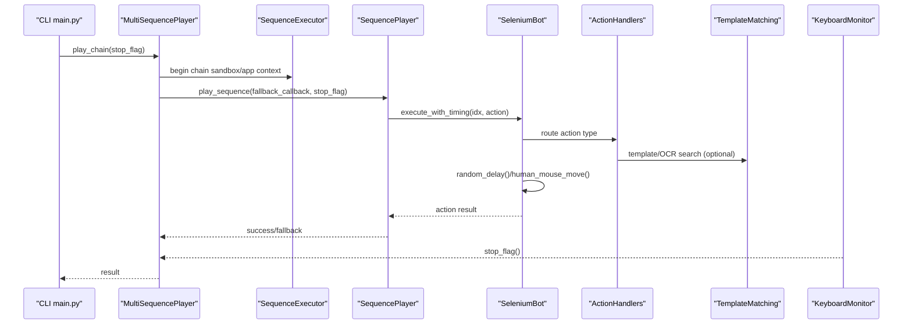
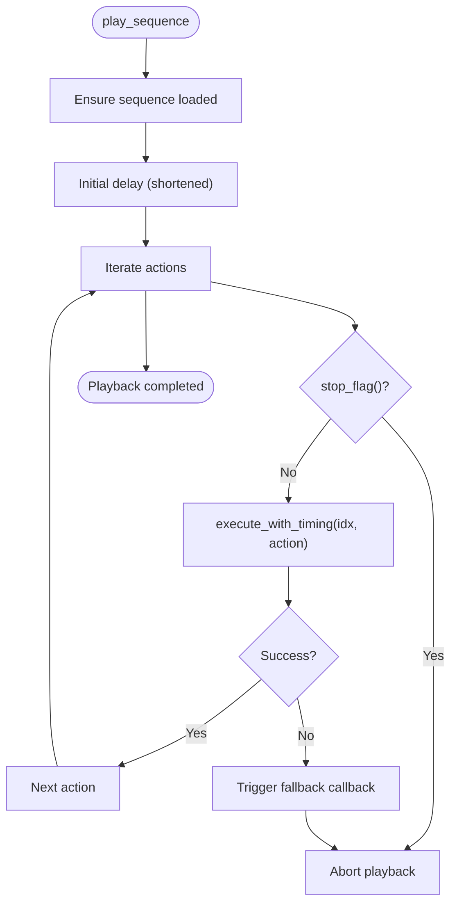
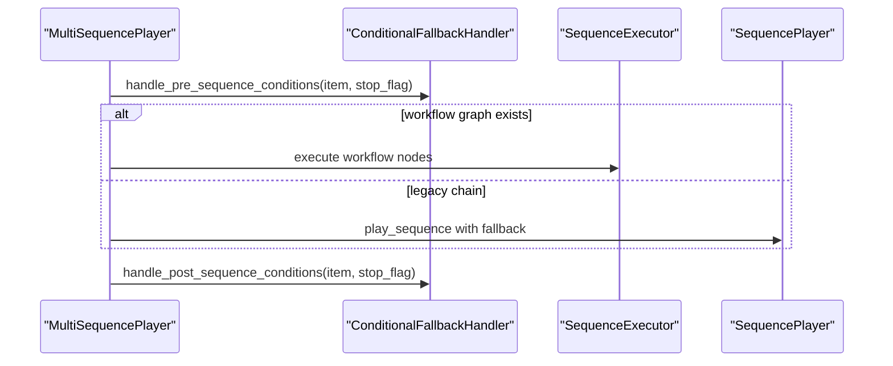
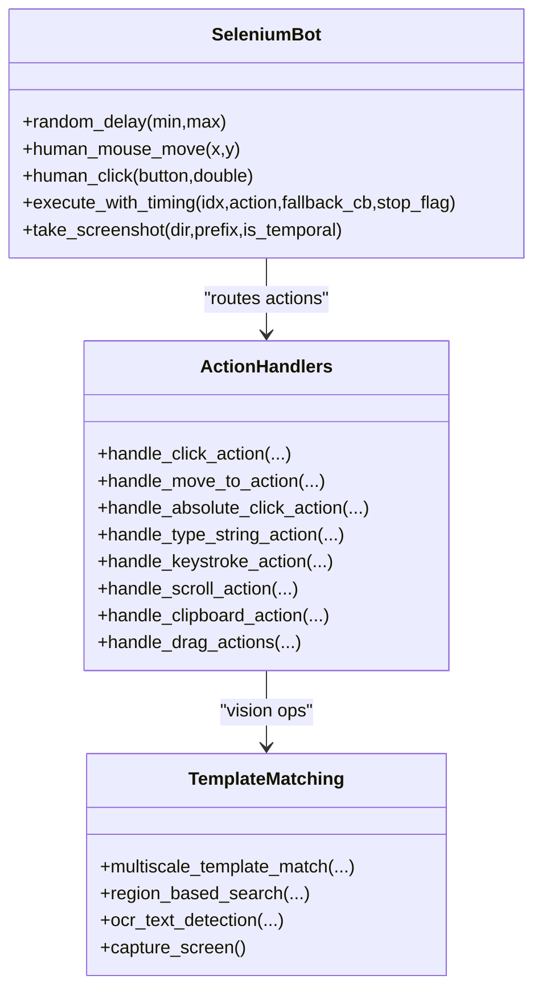
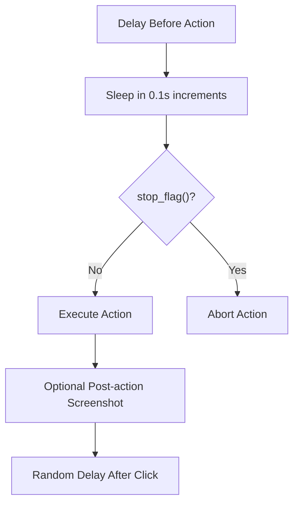
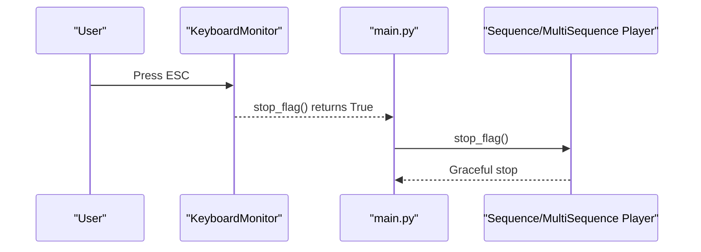
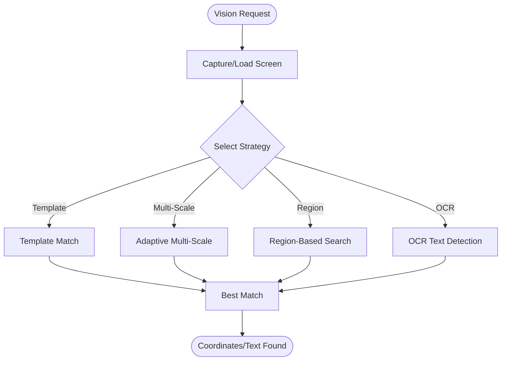
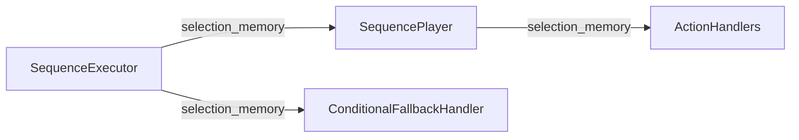
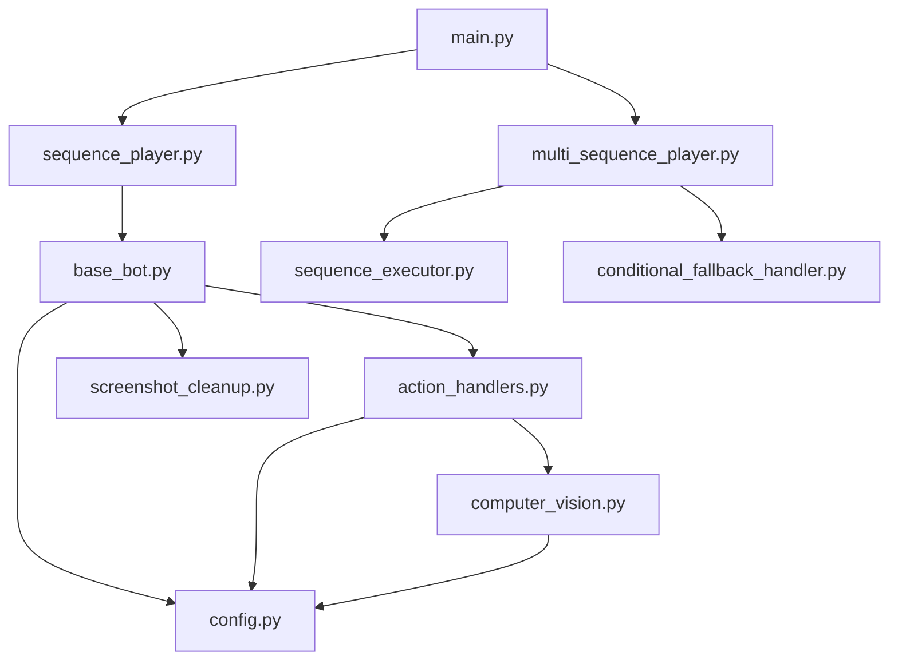

# Sequence Player

<cite>
**Referenced Files in This Document**
- [sequence_player.py](file://LoOper/player/sequence_player.py)
- [multi_sequence_player.py](file://LoOper/player/multi_sequence_player.py)
- [action_handlers.py](file://LoOper/player/action_handlers.py)
- [base_bot.py](file://LoOper/player/base_bot.py)
- [computer_vision.py](file://LoOper/player/computer_vision.py)
- [config.py](file://LoOper/player/config.py)
- [screenshot_cleanup.py](file://LoOper/player/screenshot_cleanup.py)
- [sequence_executor.py](file://LoOper/player/multi_sequence/sequence_executor.py)
- [conditional_fallback_handler.py](file://LoOper/player/multi_sequence/conditional_fallback_handler.py)
- [keyboard_monitor.py](file://LoOper/player/keyboard_monitor.py)
- [main.py](file://LoOper/player/main.py)
- [keyboard_handler.py](file://LoOper/recorder/keyboard_handler.py)
- [mouse_handler.py](file://LoOper/recorder/mouse_handler.py)
</cite>

## Table of Contents
1. [Introduction](#introduction)
2. [Project Structure](#project-structure)
3. [Core Components](#core-components)
4. [Architecture Overview](#architecture-overview)
5. [Detailed Component Analysis](#detailed-component-analysis)
6. [Dependency Analysis](#dependency-analysis)
7. [Performance Considerations](#performance-considerations)
8. [Troubleshooting Guide](#troubleshooting-guide)
9. [Conclusion](#conclusion)
10. [Appendices](#appendices)

## Introduction
This document describes the sequence player component responsible for executing recorded automation sequences and coordinating multi-sequence workflows. It explains the action execution engine, timing and synchronization mechanisms, ESC-key cancellation for safe operation termination, and integration with computer vision for UI interaction. It also covers memory sharing between executions, error handling and fallback strategies, and guidance for extending action types and optimizing playback performance.

## Project Structure
The sequence player is implemented across several modules:
- Single sequence playback: [sequence_player.py](file://LoOper/player/sequence_player.py)
- Multi-sequence orchestration: [multi_sequence_player.py](file://LoOper/player/multi_sequence_player.py)
- Action execution handlers: [action_handlers.py](file://LoOper/player/action_handlers.py)
- Base bot and timing: [base_bot.py](file://LoOper/player/base_bot.py)
- Computer vision and OCR: [computer_vision.py](file://LoOper/player/computer_vision.py)
- Configuration and logging: [config.py](file://LoOper/player/config.py)
- Screenshot cleanup utilities: [screenshot_cleanup.py](file://LoOper/player/screenshot_cleanup.py)
- Modular multi-sequence executors: [sequence_executor.py](file://LoOper/player/multi_sequence/sequence_executor.py), [conditional_fallback_handler.py](file://LoOper/player/multi_sequence/conditional_fallback_handler.py)
- ESC-key cancellation: [keyboard_monitor.py](file://LoOper/player/keyboard_monitor.py)
- CLI entry point: [main.py](file://LoOper/player/main.py)
- Recorder helpers (for context): [keyboard_handler.py](file://LoOper/recorder/keyboard_handler.py), [mouse_handler.py](file://LoOper/recorder/mouse_handler.py)

```mermaid
graph TB
subgraph "CLI"
M["main.py"]
end
subgraph "Players"
SP["SequencePlayer<br/>single sequence"]
MSP["MultiSequencePlayer<br/>multi-sequence chain"]
end
subgraph "Core Engine"
SB["SeleniumBot<br/>timing, delays, handlers"]
AH["ActionHandlers<br/>mouse/keyboard/text"]
CV["TemplateMatching<br/>vision/OCR"]
subgraph "Memory & IO"
SM["selection_memory"]
SC["ScreenshotCleanup"]
end
subgraph "Modular Executors"
SE["SequenceExecutor"]
CFH["ConditionalFallbackHandler"]
end
M --> SP
M --> MSP
SP --> SB
MSP --> SE
MSP --> CFH
SB --> AH
AH --> CV
SB --> SM
SB --> SC
```

**Diagram sources**
- [main.py:18-108](file://LoOper/player/main.py#L18-L108)
- [sequence_player.py:136-252](file://LoOper/player/sequence_player.py#L136-L252)
- [multi_sequence_player.py:32-532](file://LoOper/player/multi_sequence_player.py#L32-L532)
- [base_bot.py:22-299](file://LoOper/player/base_bot.py#L22-L299)
- [action_handlers.py:26-800](file://LoOper/player/action_handlers.py#L26-L800)
- [computer_vision.py:47-606](file://LoOper/player/computer_vision.py#L47-L606)
- [sequence_executor.py:17-800](file://LoOper/player/multi_sequence/sequence_executor.py#L17-L800)
- [conditional_fallback_handler.py:20-208](file://LoOper/player/multi_sequence/conditional_fallback_handler.py#L20-L208)
- [screenshot_cleanup.py:6-125](file://LoOper/player/screenshot_cleanup.py#L6-L125)

**Section sources**
- [main.py:18-108](file://LoOper/player/main.py#L18-L108)
- [sequence_player.py:136-252](file://LoOper/player/sequence_player.py#L136-L252)
- [multi_sequence_player.py:32-532](file://LoOper/player/multi_sequence_player.py#L32-L532)
- [base_bot.py:22-299](file://LoOper/player/base_bot.py#L22-L299)
- [action_handlers.py:26-800](file://LoOper/player/action_handlers.py#L26-L800)
- [computer_vision.py:47-606](file://LoOper/player/computer_vision.py#L47-L606)
- [sequence_executor.py:17-800](file://LoOper/player/multi_sequence/sequence_executor.py#L17-L800)
- [conditional_fallback_handler.py:20-208](file://LoOper/player/multi_sequence/conditional_fallback_handler.py#L20-L208)
- [screenshot_cleanup.py:6-125](file://LoOper/player/screenshot_cleanup.py#L6-L125)

## Core Components
- SequencePlayer: loads and plays a single JSON sequence with caching, optimized JSON loading, and fallback-triggered aborts.
- MultiSequencePlayer: orchestrates multi-sequence chains with conditional fallbacks, workflow graph execution, and sandboxed app context management.
- SeleniumBot: provides timing, delays, human-like mouse movement, and routes actions to handlers.
- ActionHandlers: executes mouse, keyboard, text input, and clipboard actions with computer vision integration and sandbox/VNC bridging.
- TemplateMatching: multi-scale template matching, region-based search, OCR text detection, and adaptive strategies.
- ScreenshotCleanup: centralized management of temporal screenshots for debugging and cleanup.
- SequenceExecutor and ConditionalFallbackHandler: modular components for app context switching, sandbox lifecycle, and conditional triggers.
- KeyboardMonitor: ESC-key cancellation for safe termination.

**Section sources**
- [sequence_player.py:136-252](file://LoOper/player/sequence_player.py#L136-L252)
- [multi_sequence_player.py:32-532](file://LoOper/player/multi_sequence_player.py#L32-L532)
- [base_bot.py:22-299](file://LoOper/player/base_bot.py#L22-L299)
- [action_handlers.py:26-800](file://LoOper/player/action_handlers.py#L26-L800)
- [computer_vision.py:47-606](file://LoOper/player/computer_vision.py#L47-L606)
- [screenshot_cleanup.py:6-125](file://LoOper/player/screenshot_cleanup.py#L6-L125)
- [sequence_executor.py:17-800](file://LoOper/player/multi_sequence/sequence_executor.py#L17-L800)
- [conditional_fallback_handler.py:20-208](file://LoOper/player/multi_sequence/conditional_fallback_handler.py#L20-L208)
- [keyboard_monitor.py:13-150](file://LoOper/player/keyboard_monitor.py#L13-L150)

## Architecture Overview
The sequence player architecture separates concerns across loaders, executors, handlers, and vision components. Timing and synchronization are enforced via controlled delays and incremental sleeps to allow ESC cancellation. Computer vision is integrated for robust UI element matching and OCR-based validation. Memory is shared across sequences to maintain deterministic selection ordering.



**Diagram sources**
- [main.py:58-108](file://LoOper/player/main.py#L58-L108)
- [multi_sequence_player.py:192-358](file://LoOper/player/multi_sequence_player.py#L192-L358)
- [sequence_player.py:202-252](file://LoOper/player/sequence_player.py#L202-L252)
- [base_bot.py:207-284](file://LoOper/player/base_bot.py#L207-L284)
- [action_handlers.py:133-604](file://LoOper/player/action_handlers.py#L133-L604)
- [computer_vision.py:198-450](file://LoOper/player/computer_vision.py#L198-L450)
- [keyboard_monitor.py:141-150](file://LoOper/player/keyboard_monitor.py#L141-L150)

## Detailed Component Analysis

### SequencePlayer: Single Sequence Execution Engine
- Loads JSON sequences with caching and optimized buffered I/O.
- Validates action structure and supports lazy loading.
- Executes actions with timing control and fallback-triggered aborts.
- Integrates with selection memory to avoid random clicks when multiple matches exist.



**Diagram sources**
- [sequence_player.py:202-252](file://LoOper/player/sequence_player.py#L202-L252)
- [base_bot.py:207-284](file://LoOper/player/base_bot.py#L207-L284)

**Section sources**
- [sequence_player.py:136-252](file://LoOper/player/sequence_player.py#L136-L252)
- [base_bot.py:207-284](file://LoOper/player/base_bot.py#L207-L284)

### MultiSequencePlayer: Multi-Sequence Chain Orchestration
- Supports legacy list format and new dict-based workflow format.
- Preloads chains and caches sequences for performance.
- Manages conditional fallbacks, app context switching, and sandbox lifecycle.
- Shares selection memory across sequences and conditional fallbacks.



**Diagram sources**
- [multi_sequence_player.py:32-532](file://LoOper/player/multi_sequence_player.py#L32-L532)
- [conditional_fallback_handler.py:100-184](file://LoOper/player/multi_sequence/conditional_fallback_handler.py#L100-L184)
- [sequence_executor.py:17-800](file://LoOper/player/multi_sequence/sequence_executor.py#L17-L800)

**Section sources**
- [multi_sequence_player.py:32-532](file://LoOper/player/multi_sequence_player.py#L32-L532)
- [conditional_fallback_handler.py:20-208](file://LoOper/player/multi_sequence/conditional_fallback_handler.py#L20-L208)
- [sequence_executor.py:17-800](file://LoOper/player/multi_sequence/sequence_executor.py#L17-L800)

### Action Execution Engine: Mouse, Keyboard, Text Input
- Mouse: click, double-click, absolute click, move-to, drag-start/drag-end/drag-drop.
- Keyboard: keystrokes, hotkeys, modifier-aware actions, clipboard operations.
- Text input: character-by-character or batched typing, Unicode-safe clipboard fallback, post-type delays.
- Vision integration: template matching, multi-scale matching, region-based search, OCR text detection.



**Diagram sources**
- [base_bot.py:22-299](file://LoOper/player/base_bot.py#L22-L299)
- [action_handlers.py:26-800](file://LoOper/player/action_handlers.py#L26-L800)
- [computer_vision.py:47-606](file://LoOper/player/computer_vision.py#L47-L606)

**Section sources**
- [base_bot.py:22-299](file://LoOper/player/base_bot.py#L22-L299)
- [action_handlers.py:26-800](file://LoOper/player/action_handlers.py#L26-L800)
- [computer_vision.py:47-606](file://LoOper/player/computer_vision.py#L47-L606)

### Timing and Synchronization Mechanisms
- Controlled delays: configurable delay-before per action, randomized delays between clicks, and incremental sleeps to allow ESC cancellation.
- Human-like motion: curved mouse paths with noise and micro-delays for realism.
- Incremental waits: sleep in small chunks to periodically check stop flags.



**Diagram sources**
- [base_bot.py:207-284](file://LoOper/player/base_bot.py#L207-L284)

**Section sources**
- [base_bot.py:207-284](file://LoOper/player/base_bot.py#L207-L284)

### ESC-Key Cancellation for Safe Operation Termination
- KeyboardMonitor continuously monitors ESC key in a dedicated thread.
- Provides a stop_flag function that can be passed to players and handlers.
- CLI integrates a threading.Event and pynput Listener to signal cancellation.



**Diagram sources**
- [keyboard_monitor.py:13-150](file://LoOper/player/keyboard_monitor.py#L13-L150)
- [main.py:37-54](file://LoOper/player/main.py#L37-L54)

**Section sources**
- [keyboard_monitor.py:13-150](file://LoOper/player/keyboard_monitor.py#L13-L150)
- [main.py:37-54](file://LoOper/player/main.py#L37-L54)

### Computer Vision Integration for UI Interaction
- TemplateMatching: multi-scale matching with adaptive scale selection, region-based search, and grayscale/color variants.
- OCR: text detection and extraction with confidence thresholds and balanced matching logic.
- Sandbox agent integration: remote screenshot capture and action forwarding for isolated environments.



**Diagram sources**
- [computer_vision.py:198-450](file://LoOper/player/computer_vision.py#L198-L450)

**Section sources**
- [computer_vision.py:47-606](file://LoOper/player/computer_vision.py#L47-L606)

### Memory Sharing Between Executions
- selection_memory: per-element selection state persisted across actions and sequences to avoid random clicks and maintain deterministic behavior.
- Shared across SequencePlayer instances and SequenceExecutor to ensure continuity in multi-sequence chains.



**Diagram sources**
- [sequence_executor.py:20-25](file://LoOper/player/multi_sequence/sequence_executor.py#L20-L25)
- [sequence_player.py:150-154](file://LoOper/player/sequence_player.py#L150-L154)
- [action_handlers.py:38-42](file://LoOper/player/action_handlers.py#L38-L42)

**Section sources**
- [sequence_executor.py:20-25](file://LoOper/player/multi_sequence/sequence_executor.py#L20-L25)
- [sequence_player.py:150-154](file://LoOper/player/sequence_player.py#L150-L154)
- [action_handlers.py:38-42](file://LoOper/player/action_handlers.py#L38-L42)

### Practical Examples of Sequence Execution Workflows
- Single sequence playback: load JSON, iterate actions, apply delays, execute handlers, capture screenshots.
- Multi-sequence chain: pre-load chain, resolve app context, execute nodes, handle conditional branches, run fallbacks, share selection memory.
- ESC cancellation: start monitoring, pass stop_flag to all components, abort gracefully.

**Section sources**
- [sequence_player.py:202-252](file://LoOper/player/sequence_player.py#L202-L252)
- [multi_sequence_player.py:192-358](file://LoOper/player/multi_sequence_player.py#L192-L358)
- [keyboard_monitor.py:141-150](file://LoOper/player/keyboard_monitor.py#L141-L150)

### Error Handling and Fallback Strategies
- Fallback-triggered aborts: when visual matching fails, trigger fallback sequence and return to caller.
- Retry strategies: multiple search strategies with decreasing confidence thresholds and incremental delays.
- Robust fallback injection: inject fallback sequences into actions from chain-level and action-specific configs.
- OCR and template matching fallbacks: use pyautogui region search when OpenCV is unavailable.

**Section sources**
- [sequence_player.py:242-249](file://LoOper/player/sequence_player.py#L242-L249)
- [action_handlers.py:593-604](file://LoOper/player/action_handlers.py#L593-L604)
- [computer_vision.py:334-450](file://LoOper/player/computer_vision.py#L334-L450)

### Performance Optimization Techniques
- Sequence caching: LRU-style cache with file timestamp invalidation.
- Optimized JSON loading: buffered I/O and streaming for large files.
- Incremental waits: small sleep increments to allow ESC cancellation without blocking.
- Template cache: per-process template cache to reduce disk I/O.
- Adaptive multi-scale matching: adjust scale set based on attempt history.

**Section sources**
- [sequence_player.py:14-92](file://LoOper/player/sequence_player.py#L14-L92)
- [sequence_player.py:98-134](file://LoOper/player/sequence_player.py#L98-L134)
- [computer_vision.py:52-91](file://LoOper/player/computer_vision.py#L52-L91)
- [computer_vision.py:198-332](file://LoOper/player/computer_vision.py#L198-L332)

### Extending Action Types and Custom Execution Strategies
- Extend ActionHandlers: add new action types by implementing a handler method and routing in execute_with_timing.
- Custom timing strategies: override random_delay or implement custom delays per action.
- Custom fallbacks: implement custom fallback callbacks and integrate with ConditionalFallbackHandler.
- Vision strategies: add new search strategies in TemplateMatching and route from ActionHandlers.

**Section sources**
- [base_bot.py:207-284](file://LoOper/player/base_bot.py#L207-L284)
- [action_handlers.py:26-800](file://LoOper/player/action_handlers.py#L26-L800)
- [computer_vision.py:198-450](file://LoOper/player/computer_vision.py#L198-L450)

## Dependency Analysis
The sequence player components depend on each other as follows:
- CLI depends on players.
- Players depend on SeleniumBot and ActionHandlers.
- ActionHandlers depend on TemplateMatching and configuration.
- MultiSequencePlayer depends on SequenceExecutor and ConditionalFallbackHandler.
- All components depend on configuration and logging.



**Diagram sources**
- [main.py:18-108](file://LoOper/player/main.py#L18-L108)
- [sequence_player.py:136-252](file://LoOper/player/sequence_player.py#L136-L252)
- [multi_sequence_player.py:32-532](file://LoOper/player/multi_sequence_player.py#L32-L532)
- [base_bot.py:22-299](file://LoOper/player/base_bot.py#L22-L299)
- [action_handlers.py:26-800](file://LoOper/player/action_handlers.py#L26-L800)
- [computer_vision.py:47-606](file://LoOper/player/computer_vision.py#L47-L606)
- [sequence_executor.py:17-800](file://LoOper/player/multi_sequence/sequence_executor.py#L17-L800)
- [conditional_fallback_handler.py:20-208](file://LoOper/player/multi_sequence/conditional_fallback_handler.py#L20-L208)
- [config.py:1-46](file://LoOper/player/config.py#L1-L46)
- [screenshot_cleanup.py:6-125](file://LoOper/player/screenshot_cleanup.py#L6-L125)

**Section sources**
- [main.py:18-108](file://LoOper/player/main.py#L18-L108)
- [sequence_player.py:136-252](file://LoOper/player/sequence_player.py#L136-L252)
- [multi_sequence_player.py:32-532](file://LoOper/player/multi_sequence_player.py#L32-L532)
- [base_bot.py:22-299](file://LoOper/player/base_bot.py#L22-L299)
- [action_handlers.py:26-800](file://LoOper/player/action_handlers.py#L26-L800)
- [computer_vision.py:47-606](file://LoOper/player/computer_vision.py#L47-L606)
- [sequence_executor.py:17-800](file://LoOper/player/multi_sequence/sequence_executor.py#L17-L800)
- [conditional_fallback_handler.py:20-208](file://LoOper/player/multi_sequence/conditional_fallback_handler.py#L20-L208)
- [config.py:1-46](file://LoOper/player/config.py#L1-L46)
- [screenshot_cleanup.py:6-125](file://LoOper/player/screenshot_cleanup.py#L6-L125)

## Performance Considerations
- Use SequenceCache to avoid repeated file loads and parsing.
- Prefer buffered JSON loading for large sequences.
- Use incremental waits to keep ESC cancellation responsive.
- Leverage TemplateMatching’s adaptive multi-scale strategy to balance speed and accuracy.
- Minimize screenshot captures by sharing a single screenshot across multiple search attempts.

[No sources needed since this section provides general guidance]

## Troubleshooting Guide
- ESC cancellation not working: ensure KeyboardMonitor is started and stop_flag is passed to all components.
- Visual matching failures: verify template images exist, adjust confidence thresholds, and confirm sandbox agent availability.
- OCR not available: install PaddleOCR and ensure environment variables are set.
- Memory leaks: use ScreenshotCleanup to manage temporal screenshots and call cleanup routines on shutdown.

**Section sources**
- [keyboard_monitor.py:13-150](file://LoOper/player/keyboard_monitor.py#L13-L150)
- [computer_vision.py:12-31](file://LoOper/player/computer_vision.py#L12-L31)
- [screenshot_cleanup.py:6-125](file://LoOper/player/screenshot_cleanup.py#L6-L125)

## Conclusion
The sequence player provides a robust, extensible framework for desktop automation with strong timing controls, ESC-key cancellation, and computer vision integration. Its modular design enables multi-sequence workflows, conditional fallbacks, and sandboxed execution while maintaining deterministic behavior through shared selection memory.

## Appendices
- Recorder helpers demonstrate how actions are captured for sequences (keyboard typing and mouse clicks/drag operations).

**Section sources**
- [keyboard_handler.py:1-197](file://LoOper/recorder/keyboard_handler.py#L1-L197)
- [mouse_handler.py:1-167](file://LoOper/recorder/mouse_handler.py#L1-L167)