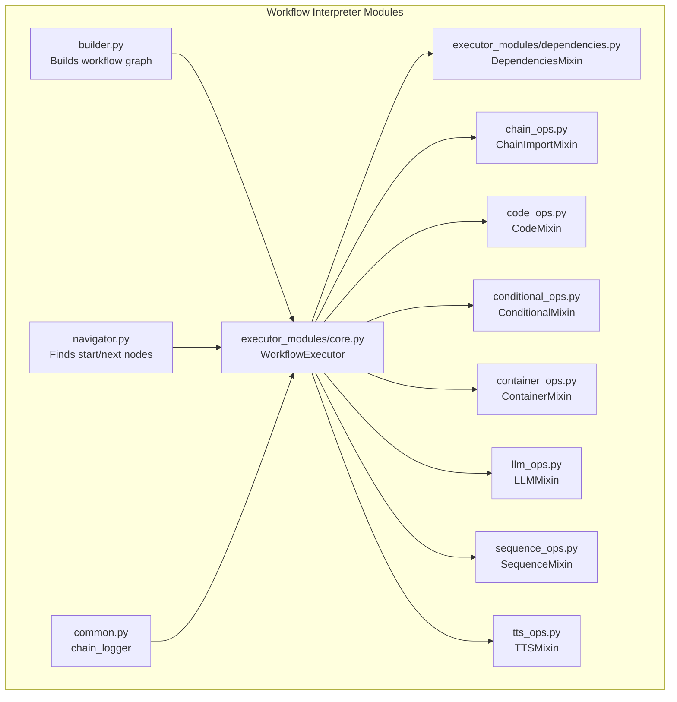
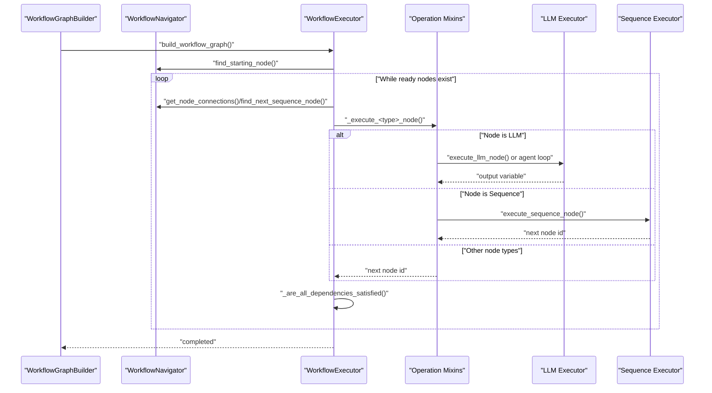
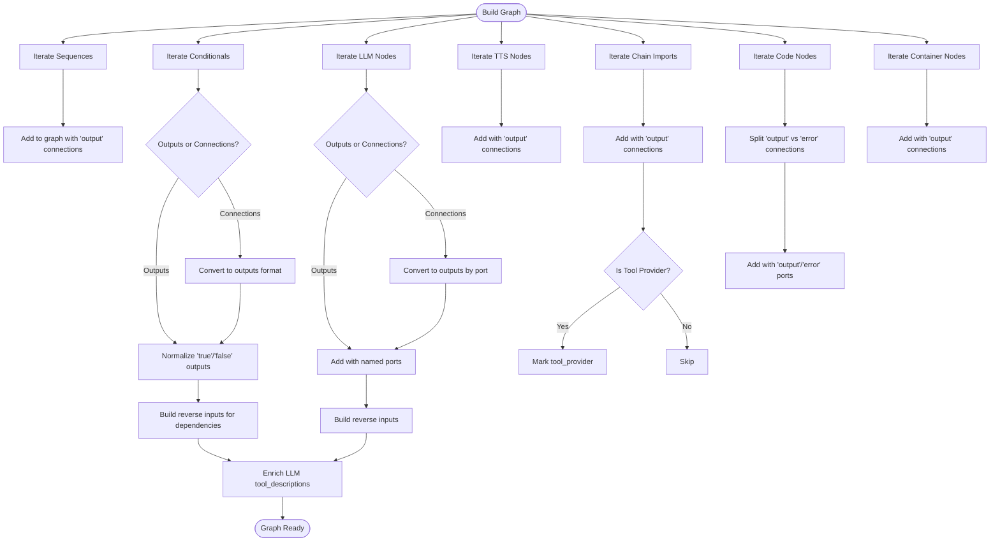
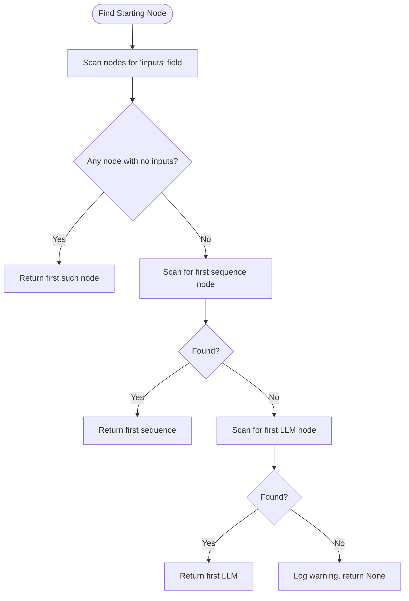
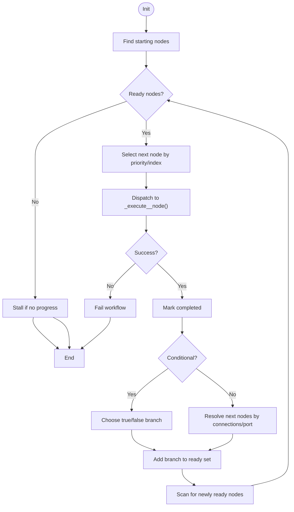
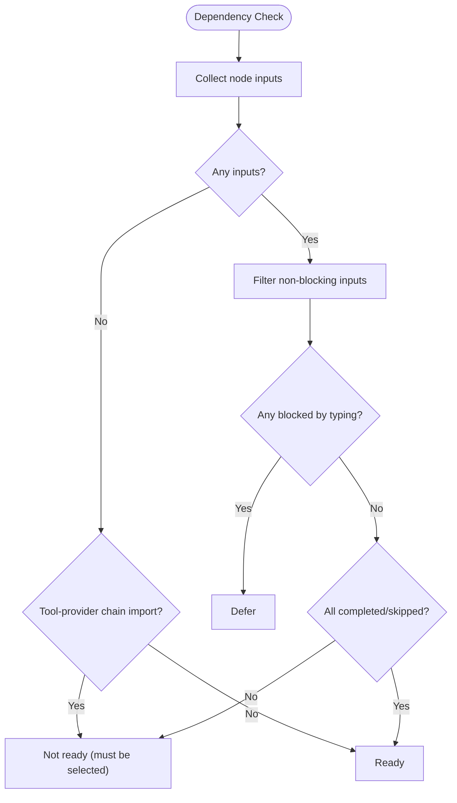
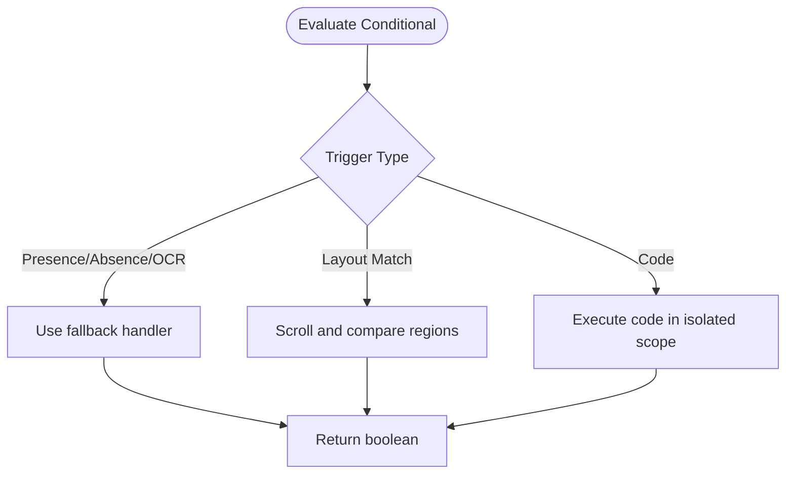
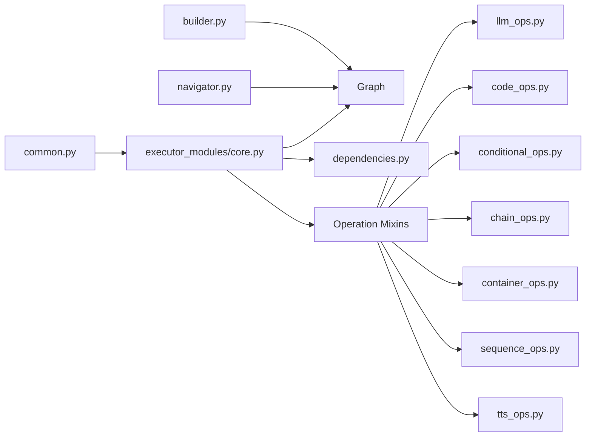

# Workflow Interpreter

<cite>
**Referenced Files in This Document**
- [__init__.py](file://LoOper/player/multi_sequence/worflow_interpreter_modules/__init__.py)
- [builder.py](file://LoOper/player/multi_sequence/worflow_interpreter_modules/builder.py)
- [common.py](file://LoOper/player/multi_sequence/worflow_interpreter_modules/common.py)
- [executor.py](file://LoOper/player/multi_sequence/worflow_interpreter_modules/executor.py)
- [navigator.py](file://LoOper/player/multi_sequence/worflow_interpreter_modules/navigator.py)
- [core.py](file://LoOper/player/multi_sequence/worflow_interpreter_modules/executor_modules/core.py)
- [dependencies.py](file://LoOper/player/multi_sequence/worflow_interpreter_modules/executor_modules/dependencies.py)
- [chain_ops.py](file://LoOper/player/multi_sequence/worflow_interpreter_modules/executor_modules/chain_ops.py)
- [code_ops.py](file://LoOper/player/multi_sequence/worflow_interpreter_modules/executor_modules/code_ops.py)
- [conditional_ops.py](file://LoOper/player/multi_sequence/worflow_interpreter_modules/executor_modules/conditional_ops.py)
- [container_ops.py](file://LoOper/player/multi_sequence/worflow_interpreter_modules/executor_modules/container_ops.py)
- [llm_ops.py](file://LoOper/player/multi_sequence/worflow_interpreter_modules/executor_modules/llm_ops.py)
- [sequence_ops.py](file://LoOper/player/multi_sequence/worflow_interpreter_modules/executor_modules/sequence_ops.py)
- [tts_ops.py](file://LoOper/player/multi_sequence/worflow_interpreter_modules/executor_modules/tts_ops.py)
</cite>

## Table of Contents
1. [Introduction](#introduction)
2. [Project Structure](#project-structure)
3. [Core Components](#core-components)
4. [Architecture Overview](#architecture-overview)
5. [Detailed Component Analysis](#detailed-component-analysis)
6. [Dependency Analysis](#dependency-analysis)
7. [Performance Considerations](#performance-considerations)
8. [Troubleshooting Guide](#troubleshooting-guide)
9. [Conclusion](#conclusion)
10. [Appendices](#appendices)

## Introduction
This document describes the workflow interpreter component responsible for orchestrating automated workflows composed of diverse node types. It covers the architecture for building and navigating workflow graphs, the execution engine that resolves dependencies and controls flow, and the execution modules for chains, code, conditionals, containers, LLMs, sequences, and TTS. It also documents error handling, performance characteristics, integration with computer vision and UI interaction, fallback strategies, and guidance for extending the system with new operation types.

## Project Structure
The workflow interpreter lives under the multi-sequence player’s workflow interpreter modules. It is organized into:
- Graph builder: constructs a normalized graph from sequences and conditional nodes, plus other node types.
- Navigator: locates starting nodes and determines next nodes based on connections.
- Executor: orchestrates execution with dependency resolution, readiness checks, and branching.
- Operation mixins: per-node-type execution logic (chain, code, conditional, container, LLM, sequence, TTS).

**Diagram sources**
- [builder.py:15-489](file://LoOper/player/multi_sequence/worflow_interpreter_modules/builder.py#L15-L489)
- [navigator.py:9-145](file://LoOper/player/multi_sequence/worflow_interpreter_modules/navigator.py#L9-L145)
- [core.py:14-437](file://LoOper/player/multi_sequence/worflow_interpreter_modules/executor_modules/core.py#L14-L437)
- [dependencies.py:4-358](file://LoOper/player/multi_sequence/worflow_interpreter_modules/executor_modules/dependencies.py#L4-L358)
- [chain_ops.py:6-309](file://LoOper/player/multi_sequence/worflow_interpreter_modules/executor_modules/chain_ops.py#L6-L309)
- [code_ops.py:8-800](file://LoOper/player/multi_sequence/worflow_interpreter_modules/executor_modules/code_ops.py#L8-L800)
- [conditional_ops.py:4-800](file://LoOper/player/multi_sequence/worflow_interpreter_modules/executor_modules/conditional_ops.py#L4-L800)
- [container_ops.py:7-110](file://LoOper/player/multi_sequence/worflow_interpreter_modules/executor_modules/container_ops.py#L7-L110)
- [llm_ops.py:7-365](file://LoOper/player/multi_sequence/worflow_interpreter_modules/executor_modules/llm_ops.py#L7-L365)
- [sequence_ops.py:1-20](file://LoOper/player/multi_sequence/worflow_interpreter_modules/executor_modules/sequence_ops.py#L1-L20)
- [tts_ops.py:3-44](file://LoOper/player/multi_sequence/worflow_interpreter_modules/executor_modules/tts_ops.py#L3-L44)
- [common.py:6-25](file://LoOper/player/multi_sequence/worflow_interpreter_modules/common.py#L6-L25)

**Section sources**
- [__init__.py:1-5](file://LoOper/player/multi_sequence/worflow_interpreter_modules/__init__.py#L1-L5)
- [builder.py:15-489](file://LoOper/player/multi_sequence/worflow_interpreter_modules/builder.py#L15-L489)
- [navigator.py:9-145](file://LoOper/player/multi_sequence/worflow_interpreter_modules/navigator.py#L9-L145)
- [core.py:14-437](file://LoOper/player/multi_sequence/worflow_interpreter_modules/executor_modules/core.py#L14-L437)
- [dependencies.py:4-358](file://LoOper/player/multi_sequence/worflow_interpreter_modules/executor_modules/dependencies.py#L4-L358)
- [common.py:6-25](file://LoOper/player/multi_sequence/worflow_interpreter_modules/common.py#L6-L25)

## Core Components
- WorkflowGraphBuilder: Converts heterogeneous node definitions (sequences, conditionals, LLMs, TTS, chain imports, code, containers) into a unified graph with normalized connections and inputs. It supports both legacy and modern connection formats and enriches LLM nodes with tool descriptions from connected tool providers.
- WorkflowNavigator: Locates the starting node (no inputs), resolves next nodes after sequence nodes, and enumerates nodes by type. It also exposes connection queries for branching decisions.
- WorkflowExecutor: Orchestrates execution with readiness queues, dependency satisfaction, conditional branching, LLM tool orchestration, and special handling for LLM typing and chained LLM concatenation. It records summaries of executed nodes and applies extra delays.
- DependenciesMixin: Implements discovery of starting nodes, readiness scanning, conditional branch filtering, and LLM input gating to prevent interleaving of LLM outputs with downstream non-LLM work.

Key execution modules:
- ChainImportMixin: Loads and executes imported chains, supports loops and optional sandboxing, and aggregates tool results.
- CodeMixin: Manages runtime environments, installs dependencies, executes code in-process or as persistent subprocesses, captures stdout/stderr, and supports retry on error.
- ConditionalMixin: Evaluates presence/absence/OCR triggers, layout-match conditions, and code-based conditions; ensures app focus when required.
- ContainerMixin: Boots VMs via QEMU with configurable resources and optional VNC exposure.
- LLMMixin: Executes LLM nodes with optional agent loop for tool use and routing; handles TTS redirection and tool description injection.
- SequenceMixin: Delegates sequence execution to the sequence executor with optional global app context override.
- TTSMixin: Invokes standalone TTS execution and advances the workflow.

**Section sources**
- [builder.py:15-489](file://LoOper/player/multi_sequence/worflow_interpreter_modules/builder.py#L15-L489)
- [navigator.py:9-145](file://LoOper/player/multi_sequence/worflow_interpreter_modules/navigator.py#L9-L145)
- [core.py:14-437](file://LoOper/player/multi_sequence/worflow_interpreter_modules/executor_modules/core.py#L14-L437)
- [dependencies.py:4-358](file://LoOper/player/multi_sequence/worflow_interpreter_modules/executor_modules/dependencies.py#L4-L358)
- [chain_ops.py:6-309](file://LoOper/player/multi_sequence/worflow_interpreter_modules/executor_modules/chain_ops.py#L6-L309)
- [code_ops.py:8-800](file://LoOper/player/multi_sequence/worflow_interpreter_modules/executor_modules/code_ops.py#L8-L800)
- [conditional_ops.py:4-800](file://LoOper/player/multi_sequence/worflow_interpreter_modules/executor_modules/conditional_ops.py#L4-L800)
- [container_ops.py:7-110](file://LoOper/player/multi_sequence/worflow_interpreter_modules/executor_modules/container_ops.py#L7-L110)
- [llm_ops.py:7-365](file://LoOper/player/multi_sequence/worflow_interpreter_modules/executor_modules/llm_ops.py#L7-L365)
- [sequence_ops.py:1-20](file://LoOper/player/multi_sequence/worflow_interpreter_modules/executor_modules/sequence_ops.py#L1-L20)
- [tts_ops.py:3-44](file://LoOper/player/multi_sequence/worflow_interpreter_modules/executor_modules/tts_ops.py#L3-L44)

## Architecture Overview
The workflow interpreter is a layered system:
- Graph construction normalizes node definitions and builds adjacency lists with inputs and outputs.
- Navigation resolves start and next nodes for deterministic progression.
- Execution enforces dependency satisfaction, conditional branching, and LLM-aware sequencing.
- Operation mixins encapsulate node-specific behavior and integrate with shared state and fallback handlers.

**Diagram sources**
- [builder.py:15-489](file://LoOper/player/multi_sequence/worflow_interpreter_modules/builder.py#L15-L489)
- [navigator.py:9-145](file://LoOper/player/multi_sequence/worflow_interpreter_modules/navigator.py#L9-L145)
- [core.py:51-316](file://LoOper/player/multi_sequence/worflow_interpreter_modules/executor_modules/core.py#L51-L316)
- [dependencies.py:205-336](file://LoOper/player/multi_sequence/worflow_interpreter_modules/executor_modules/dependencies.py#L205-L336)
- [llm_ops.py:8-54](file://LoOper/player/multi_sequence/worflow_interpreter_modules/executor_modules/llm_ops.py#L8-L54)
- [sequence_ops.py:1-20](file://LoOper/player/multi_sequence/worflow_interpreter_modules/executor_modules/sequence_ops.py#L1-L20)

## Detailed Component Analysis

### WorkflowGraphBuilder
Responsibilities:
- Normalize node definitions across sequence, conditional, LLM, TTS, chain-import, code, and container nodes.
- Convert legacy “connections” to modern “outputs” format and vice versa.
- Build reverse “inputs” for dependency tracking and merge tool descriptions into LLM configurations.
- Detect tool-provider chain imports and mark them for selection by LLMs.

Key behaviors:
- Supports both legacy and modern node formats.
- Ensures target IDs are strings and ports are normalized.
- Enriches LLM nodes with tool_descriptions from connected chain-import tool providers.

**Diagram sources**
- [builder.py:15-489](file://LoOper/player/multi_sequence/worflow_interpreter_modules/builder.py#L15-L489)

**Section sources**
- [builder.py:15-489](file://LoOper/player/multi_sequence/worflow_interpreter_modules/builder.py#L15-L489)

### WorkflowNavigator
Responsibilities:
- Locate starting nodes: prefer nodes with no inputs, otherwise first sequence, otherwise first LLM.
- After a sequence node, resolve the next node via explicit output connections, connected inputs, or linear index.
- Query connections by node ID and output type.
- Enumerate nodes by type for diagnostics and UI.

**Diagram sources**
- [navigator.py:9-45](file://LoOper/player/multi_sequence/worflow_interpreter_modules/navigator.py#L9-L45)

**Section sources**
- [navigator.py:9-145](file://LoOper/player/multi_sequence/worflow_interpreter_modules/navigator.py#L9-L145)

### WorkflowExecutor
Responsibilities:
- Execute the workflow with a readiness queue and dependency checks.
- Handle conditional branching and LLM tool orchestration.
- Defer execution while LLM is “typing” to avoid interleaving outputs.
- Record last node summaries and apply extra delays.

Execution highlights:
- Readiness: nodes become ready when all dependencies are satisfied and none are skipped.
- Branching: conditional nodes store last result and chosen branch; only the chosen path proceeds.
- LLM chaining: defer downstream non-LLM outputs when upstream LLM has pending non-LLM outputs; allow direct LLM concatenation when appropriate.
- Priority: code, sequence, conditional, tts, chain_import, llm.

**Diagram sources**
- [core.py:51-316](file://LoOper/player/multi_sequence/worflow_interpreter_modules/executor_modules/core.py#L51-L316)
- [core.py:397-420](file://LoOper/player/multi_sequence/worflow_interpreter_modules/executor_modules/core.py#L397-L420)

**Section sources**
- [core.py:51-316](file://LoOper/player/multi_sequence/worflow_interpreter_modules/executor_modules/core.py#L51-L316)
- [core.py:397-420](file://LoOper/player/multi_sequence/worflow_interpreter_modules/executor_modules/core.py#L397-L420)

### DependenciesMixin
Responsibilities:
- Discover starting nodes, including LLMs with only non-blocking inputs (e.g., tools/context).
- Compute readiness: filter out skipped and conditional inputs; gate by upstream LLM typing; defer LLM targets when upstream LLM has pending non-LLM outputs.
- Detect direct LLM concatenation to optimize scheduling.

**Diagram sources**
- [dependencies.py:205-336](file://LoOper/player/multi_sequence/worflow_interpreter_modules/executor_modules/dependencies.py#L205-L336)

**Section sources**
- [dependencies.py:4-358](file://LoOper/player/multi_sequence/worflow_interpreter_modules/executor_modules/dependencies.py#L4-L358)

### ChainImportMixin
Responsibilities:
- Load and execute imported chains from disk, supporting loops and optional sandboxing.
- Inherit or override global app context for sandboxing.
- Aggregate tool results and expose them to downstream LLMs.

Execution flow:
- Resolve chain file path (multiple candidates).
- For each loop, construct a new MultiSequencePlayer, inherit selection memory, and execute play_chain.
- On success, record last_node_summary and tool results; on failure, continue to next loop.

**Section sources**
- [chain_ops.py:6-309](file://LoOper/player/multi_sequence/worflow_interpreter_modules/executor_modules/chain_ops.py#L6-L309)

### CodeMixin
Responsibilities:
- Manage a per-chain runtime directory and virtual environment.
- Install dependencies extracted from code and capture pip errors.
- Execute code in-process or as persistent subprocesses; detect GUI loops and keep them running.
- Capture stdout/stderr, store results, and support error port routing with retry limits.

Execution flow:
- Initialize runtime and venv lazily.
- Resolve inputs from prior nodes and optional overrides.
- Detect and strip markdown code blocks from LLM-generated code; extract aliases.
- Save code to file if requested and preload modules into execution scope.
- Choose execution strategy: in-process or persistent subprocess; enforce timeouts.
- On error, record terminal output and route to error port with retry.

**Section sources**
- [code_ops.py:8-800](file://LoOper/player/multi_sequence/worflow_interpreter_modules/executor_modules/code_ops.py#L8-L800)

### ConditionalMixin
Responsibilities:
- Evaluate presence/absence/OCR triggers using fallback handler’s template matcher and OCR engine.
- Evaluate layout-match conditions with scrolling exploration and BFS-like navigation.
- Evaluate code-based conditions with isolated execution scope and timeout.
- Ensure target app is open and focused when required.

**Diagram sources**
- [conditional_ops.py:245-334](file://LoOper/player/multi_sequence/worflow_interpreter_modules/executor_modules/conditional_ops.py#L245-L334)
- [conditional_ops.py:336-683](file://LoOper/player/multi_sequence/worflow_interpreter_modules/executor_modules/conditional_ops.py#L336-L683)
- [conditional_ops.py:685-800](file://LoOper/player/multi_sequence/worflow_interpreter_modules/executor_modules/conditional_ops.py#L685-L800)

**Section sources**
- [conditional_ops.py:4-800](file://LoOper/player/multi_sequence/worflow_interpreter_modules/executor_modules/conditional_ops.py#L4-L800)

### ContainerMixin
Responsibilities:
- Boot VMs via QEMU with configurable memory/CPU and optional VNC display.
- Store process metadata and monitor for early exits.

**Section sources**
- [container_ops.py:7-110](file://LoOper/player/multi_sequence/worflow_interpreter_modules/executor_modules/container_ops.py#L7-L110)

### LLMMixin
Responsibilities:
- Detect agent tools (code nodes) and routing tools (chain imports) connected to LLM inputs.
- Inject chain descriptions into LLM tool_descriptions.
- Redirect LLM output to TTS when connected and disable write_text to avoid duplication.
- Execute agent loop with ReAct-style reasoning, dynamic Python tool creation, and tool invocation.

**Section sources**
- [llm_ops.py:7-365](file://LoOper/player/multi_sequence/worflow_interpreter_modules/executor_modules/llm_ops.py#L7-L365)

### SequenceMixin
Responsibilities:
- Delegate sequence execution to the sequence executor and propagate global app context override.

**Section sources**
- [sequence_ops.py:1-20](file://LoOper/player/multi_sequence/worflow_interpreter_modules/executor_modules/sequence_ops.py#L1-L20)

### TTSMixin
Responsibilities:
- Execute TTS using the LLM executor’s standalone TTS capability and advance to the next node.

**Section sources**
- [tts_ops.py:3-44](file://LoOper/player/multi_sequence/worflow_interpreter_modules/executor_modules/tts_ops.py#L3-L44)

## Dependency Analysis
The workflow interpreter exhibits a clean layered design:
- builder.py depends on node definitions and produces a normalized graph.
- navigator.py depends on the graph to locate start and next nodes.
- executor_modules/core.py composes multiple mixins and coordinates execution.
- dependencies.py provides shared dependency resolution logic used by the executor.
- Operation mixins depend on shared state (llm_executor.variables), fallback handlers, and path resolvers.

**Diagram sources**
- [builder.py:15-489](file://LoOper/player/multi_sequence/worflow_interpreter_modules/builder.py#L15-L489)
- [navigator.py:9-145](file://LoOper/player/multi_sequence/worflow_interpreter_modules/navigator.py#L9-L145)
- [core.py:14-437](file://LoOper/player/multi_sequence/worflow_interpreter_modules/executor_modules/core.py#L14-L437)
- [dependencies.py:4-358](file://LoOper/player/multi_sequence/worflow_interpreter_modules/executor_modules/dependencies.py#L4-L358)
- [common.py:6-25](file://LoOper/player/multi_sequence/worflow_interpreter_modules/common.py#L6-L25)

**Section sources**
- [core.py:14-437](file://LoOper/player/multi_sequence/worflow_interpreter_modules/executor_modules/core.py#L14-L437)
- [dependencies.py:4-358](file://LoOper/player/multi_sequence/worflow_interpreter_modules/executor_modules/dependencies.py#L4-L358)

## Performance Considerations
- Lazy initialization: runtime environment and venv are created only when needed to reduce startup overhead.
- Deferring execution while LLM is typing prevents interleaved outputs and reduces contention.
- Direct LLM concatenation optimization avoids unnecessary scheduling when upstream LLM has no pending non-LLM outputs.
- Path resolution and file existence checks are performed carefully to minimize I/O overhead.
- Persistent code execution uses subprocess with controlled lifecycle and termination to avoid resource leaks.

[No sources needed since this section provides general guidance]

## Troubleshooting Guide
Common issues and strategies:
- Workflow stalls: occurs when no nodes are ready; check dependency satisfaction and skipped nodes.
- Conditional gating: if expected app is not open/focused, ensure global_app_context_override is set and app focus logic is enabled.
- Code execution failures: review terminal output, stdout/stderr, and error port routing; retries are limited to three cycles.
- LLM tool orchestration: verify tool descriptions are injected and routing tools are properly connected.
- TTS redirection: confirm LLM write_text is disabled when TTS is connected to avoid duplicate writes.

**Section sources**
- [core.py:117-131](file://LoOper/player/multi_sequence/worflow_interpreter_modules/executor_modules/core.py#L117-L131)
- [conditional_ops.py:24-243](file://LoOper/player/multi_sequence/worflow_interpreter_modules/executor_modules/conditional_ops.py#L24-L243)
- [code_ops.py:494-510](file://LoOper/player/multi_sequence/worflow_interpreter_modules/executor_modules/code_ops.py#L494-L510)
- [llm_ops.py:101-119](file://LoOper/player/multi_sequence/worflow_interpreter_modules/executor_modules/llm_ops.py#L101-L119)
- [tts_ops.py:21-43](file://LoOper/player/multi_sequence/worflow_interpreter_modules/executor_modules/tts_ops.py#L21-L43)

## Conclusion
The workflow interpreter provides a robust, extensible foundation for orchestrating complex automation scenarios. Its modular design enables straightforward addition of new node types through dedicated mixins, while its dependency-aware execution and LLM-centric orchestration support advanced patterns like agent-driven tool use and conditional fallback handling. Integration with computer vision and UI interaction is achieved through the fallback handler and conditional evaluation subsystems.

[No sources needed since this section summarizes without analyzing specific files]

## Appendices

### Practical Examples
- Executing a chain import node: configure chain_file_path, loop_count, and optional sandboxing; the mixin loads the chain from disk and executes it for the specified number of loops.
- Running code nodes: supply code or file_path; the mixin installs dependencies, executes in-process or as a persistent subprocess, and routes to error port on failure.
- Conditional triggers: choose presence/absence/OCR or layout-match conditions; the mixin evaluates triggers and ensures app focus when required.
- LLM agent loop: connect code tools and routing tools; the LLM mixin orchestrates ReAct-style reasoning and tool invocation.
- Sequence execution: delegate to sequence executor with optional global app context override for sandboxing.
- TTS redirection: connect a TTS node downstream of an LLM node; the LLM mixin disables write_text and forwards output to TTS.

**Section sources**
- [chain_ops.py:6-309](file://LoOper/player/multi_sequence/worflow_interpreter_modules/executor_modules/chain_ops.py#L6-L309)
- [code_ops.py:8-800](file://LoOper/player/multi_sequence/worflow_interpreter_modules/executor_modules/code_ops.py#L8-L800)
- [conditional_ops.py:245-334](file://LoOper/player/multi_sequence/worflow_interpreter_modules/executor_modules/conditional_ops.py#L245-L334)
- [llm_ops.py:121-365](file://LoOper/player/multi_sequence/worflow_interpreter_modules/executor_modules/llm_ops.py#L121-L365)
- [sequence_ops.py:1-20](file://LoOper/player/multi_sequence/worflow_interpreter_modules/executor_modules/sequence_ops.py#L1-L20)
- [tts_ops.py:3-44](file://LoOper/player/multi_sequence/worflow_interpreter_modules/executor_modules/tts_ops.py#L3-L44)

### Extending Workflow Capabilities
- Adding a new operation type:
  - Create a new mixin under executor_modules with a method named _execute_<your_type>_node().
  - Register the mixin in the WorkflowExecutor class hierarchy.
  - Ensure the builder supports your node type and normalizes connections/inputs.
  - Integrate with the navigator if your node type requires special start/next logic.
- Implementing custom execution strategies:
  - Override readiness checks in DependenciesMixin if your node type has special dependency semantics.
  - Add fallback handling in ConditionalMixin if your node interacts with UI or external systems.
  - Leverage chain_logger for diagnostic output and maintain last_node_summary updates.

**Section sources**
- [core.py:14-14](file://LoOper/player/multi_sequence/worflow_interpreter_modules/executor_modules/core.py#L14-L14)
- [builder.py:15-489](file://LoOper/player/multi_sequence/worflow_interpreter_modules/builder.py#L15-L489)
- [dependencies.py:4-358](file://LoOper/player/multi_sequence/worflow_interpreter_modules/executor_modules/dependencies.py#L4-L358)
- [conditional_ops.py:4-800](file://LoOper/player/multi_sequence/worflow_interpreter_modules/executor_modules/conditional_ops.py#L4-L800)
- [common.py:6-25](file://LoOper/player/multi_sequence/worflow_interpreter_modules/common.py#L6-L25)