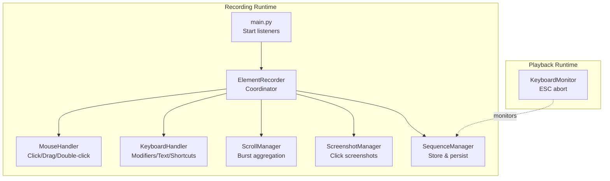
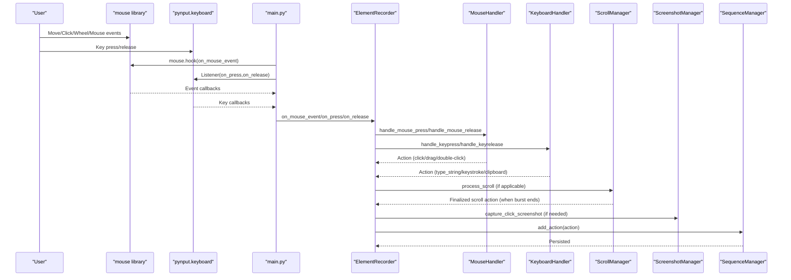
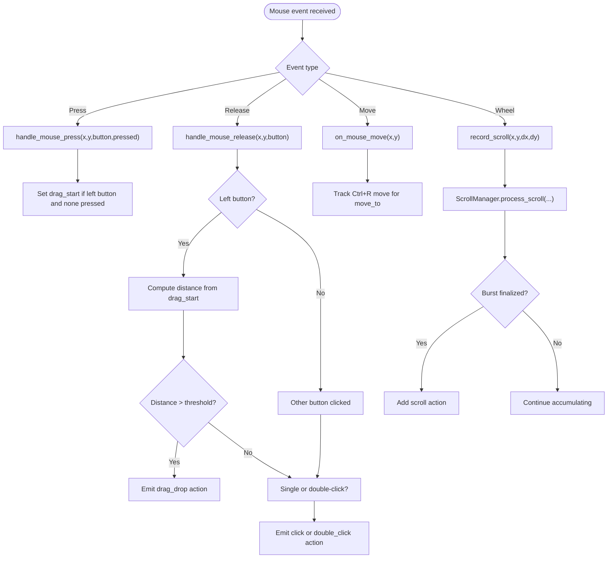
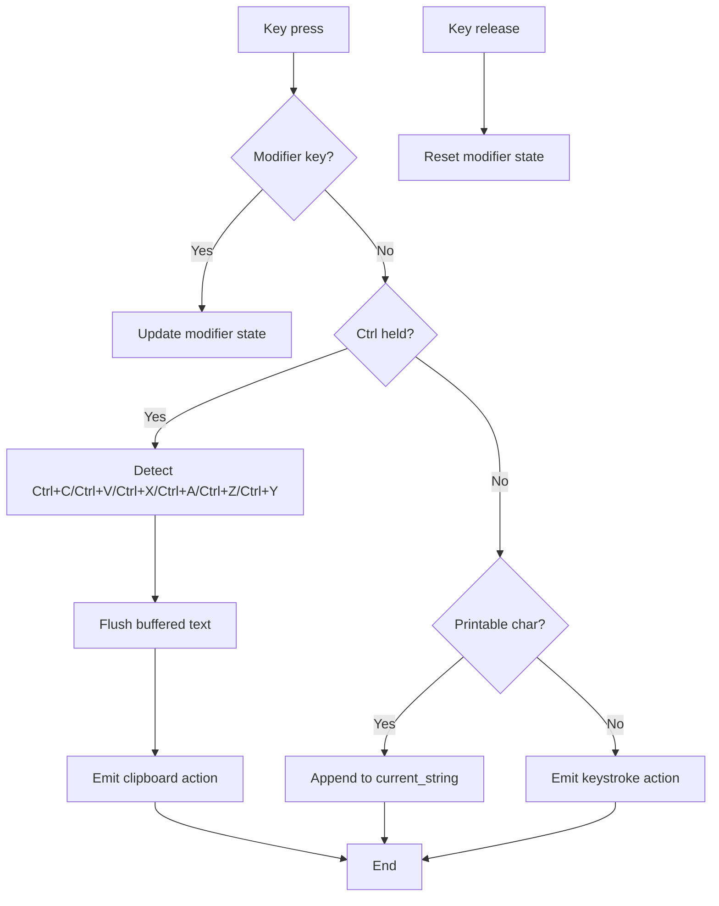
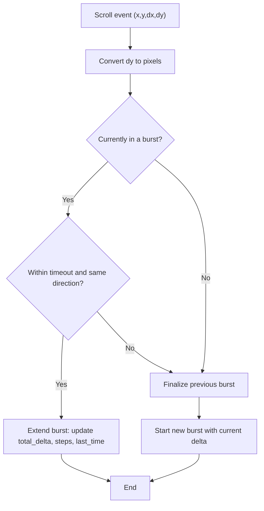
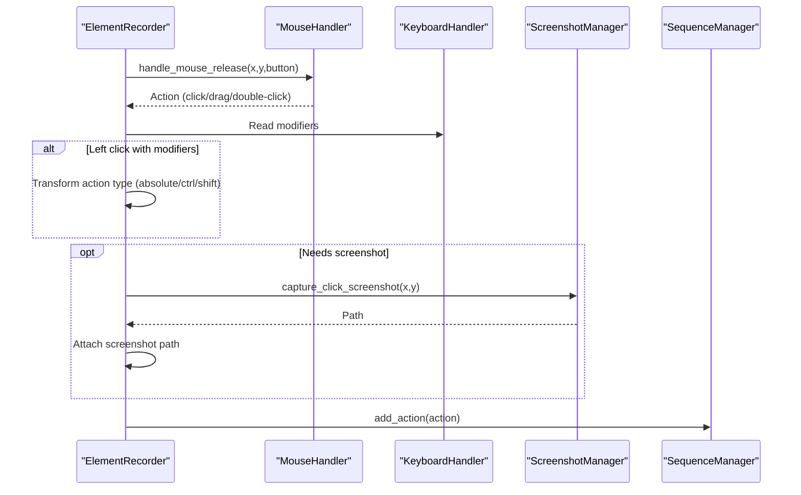
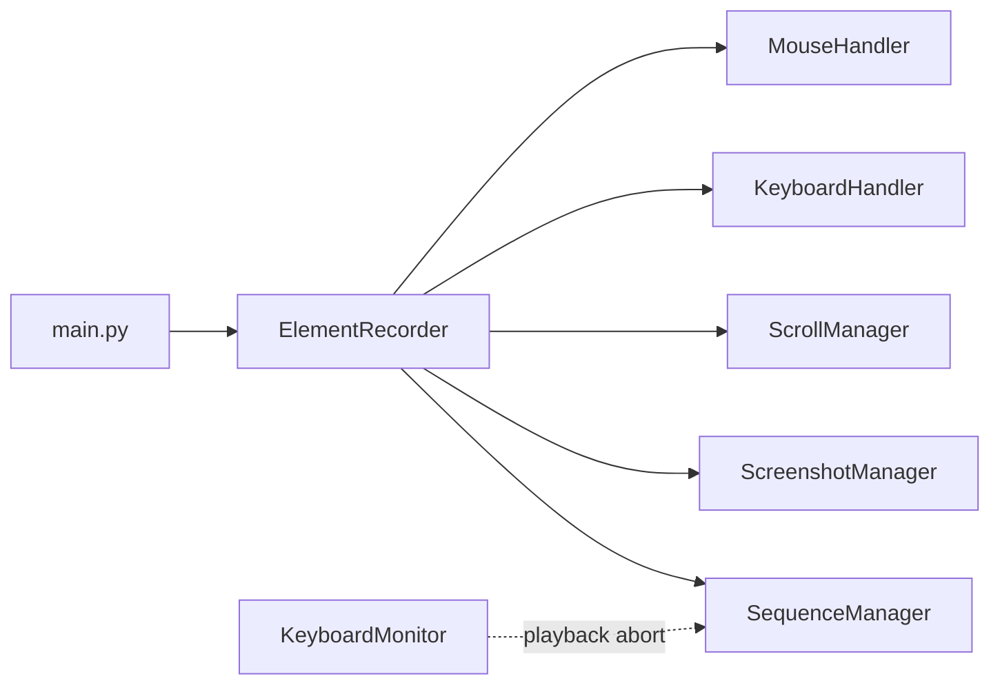
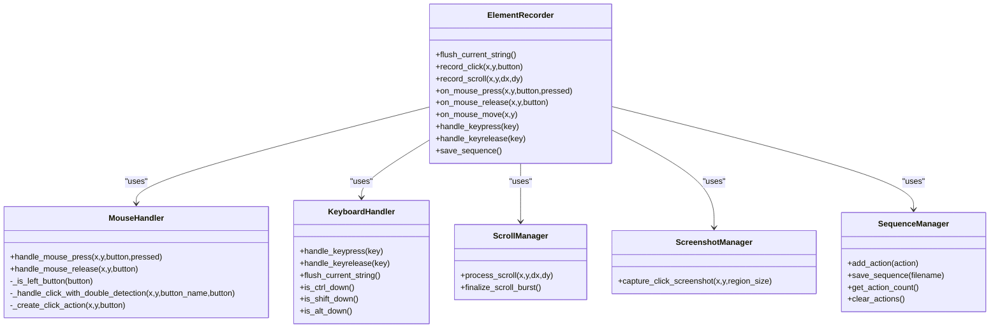

# Input Capture

<cite>
**Referenced Files in This Document**
- [main.py](file://LoOper/recorder/main.py)
- [element_recorder.py](file://LoOper/recorder/element_recorder.py)
- [mouse_handler.py](file://LoOper/recorder/mouse_handler.py)
- [keyboard_handler.py](file://LoOper/recorder/keyboard_handler.py)
- [scroll_manager.py](file://LoOper/recorder/scroll_manager.py)
- [screenshot_manager.py](file://LoOper/recorder/screenshot_manager.py)
- [sequence_manager.py](file://LoOper/recorder/sequence_manager.py)
- [keyboard_monitor.py](file://LoOper/player/keyboard_monitor.py)
</cite>

## Table of Contents
1. [Introduction](#introduction)
2. [Project Structure](#project-structure)
3. [Core Components](#core-components)
4. [Architecture Overview](#architecture-overview)
5. [Detailed Component Analysis](#detailed-component-analysis)
6. [Dependency Analysis](#dependency-analysis)
7. [Performance Considerations](#performance-considerations)
8. [Troubleshooting Guide](#troubleshooting-guide)
9. [Conclusion](#conclusion)
10. [Appendices](#appendices)

## Introduction
This document explains the input capture subsystem responsible for comprehensive mouse and keyboard event handling. It covers the mouse event processing pipeline (button press/release detection, movement tracking, and scroll event management), the keyboard event handling system (key press/release detection, modifier key tracking, and special key handling), practical examples of event callback registration and real-time processing, integration between mouse and keyboard handlers, event timing synchronization, and performance optimization strategies. Guidance is also provided for extending input capture capabilities and handling edge cases.

## Project Structure
The input capture subsystem is implemented as a modularized recorder with clear separation of concerns:
- Entry point initializes listeners and routes events to the central recorder.
- ElementRecorder orchestrates all components and integrates mouse, keyboard, scroll, and screenshot logic.
- MouseHandler manages click/drag detection and double-click logic.
- KeyboardHandler tracks modifiers, buffers typed text, and recognizes special shortcuts.
- ScrollManager aggregates scroll bursts into cohesive actions.
- ScreenshotManager captures contextual screenshots for click actions.
- SequenceManager stores actions with metadata and persists them to disk.
- KeyboardMonitor provides real-time ESC abort capability during playback.

**Diagram sources**
- [main.py:1-75](file://LoOper/recorder/main.py#L1-L75)
- [element_recorder.py:11-155](file://LoOper/recorder/element_recorder.py#L11-L155)
- [mouse_handler.py:6-167](file://LoOper/recorder/mouse_handler.py#L6-L167)
- [keyboard_handler.py:6-197](file://LoOper/recorder/keyboard_handler.py#L6-L197)
- [scroll_manager.py:4-97](file://LoOper/recorder/scroll_manager.py#L4-L97)
- [screenshot_manager.py:10-49](file://LoOper/recorder/screenshot_manager.py#L10-L49)
- [sequence_manager.py:18-178](file://LoOper/recorder/sequence_manager.py#L18-L178)
- [keyboard_monitor.py:13-150](file://LoOper/player/keyboard_monitor.py#L13-L150)

**Section sources**
- [main.py:1-75](file://LoOper/recorder/main.py#L1-L75)
- [element_recorder.py:11-155](file://LoOper/recorder/element_recorder.py#L11-L155)
- [README.md:1-86](file://LoOper/recorder/README.md#L1-L86)

## Core Components
- ElementRecorder: Central coordinator that integrates mouse, keyboard, scroll, screenshot, and sequence management. It translates raw events into structured actions and persists them.
- MouseHandler: Detects press/release, determines drag vs. click, and performs double-click detection with configurable thresholds.
- KeyboardHandler: Tracks modifier states, buffers typed text, and recognizes special shortcuts (e.g., Ctrl+C, Ctrl+V, Ctrl+A, Undo/Redo).
- ScrollManager: Aggregates rapid scroll events into bursts and finalizes them into a single scroll action with direction and cumulative position.
- ScreenshotManager: Captures small regions around click coordinates for visual context.
- SequenceManager: Stores actions with timestamps and metadata, and writes them to JSON.
- KeyboardMonitor: Background monitoring of ESC to abort playback operations.

**Section sources**
- [element_recorder.py:11-155](file://LoOper/recorder/element_recorder.py#L11-L155)
- [mouse_handler.py:6-167](file://LoOper/recorder/mouse_handler.py#L6-L167)
- [keyboard_handler.py:6-197](file://LoOper/recorder/keyboard_handler.py#L6-L197)
- [scroll_manager.py:4-97](file://LoOper/recorder/scroll_manager.py#L4-L97)
- [screenshot_manager.py:10-49](file://LoOper/recorder/screenshot_manager.py#L10-L49)
- [sequence_manager.py:18-178](file://LoOper/recorder/sequence_manager.py#L18-L178)
- [keyboard_monitor.py:13-150](file://LoOper/player/keyboard_monitor.py#L13-L150)

## Architecture Overview
The input capture pipeline begins at the entry point, which registers listeners for mouse and keyboard events. Events are routed to ElementRecorder, which delegates to specialized handlers. Handlers produce action dictionaries enriched with timestamps and, when applicable, screenshots. Actions are appended to the SequenceManager, which persists them to disk upon completion.

**Diagram sources**
- [main.py:14-70](file://LoOper/recorder/main.py#L14-L70)
- [element_recorder.py:76-122](file://LoOper/recorder/element_recorder.py#L76-L122)
- [mouse_handler.py:25-88](file://LoOper/recorder/mouse_handler.py#L25-L88)
- [keyboard_handler.py:29-158](file://LoOper/recorder/keyboard_handler.py#L29-L158)
- [scroll_manager.py:13-64](file://LoOper/recorder/scroll_manager.py#L13-L64)
- [screenshot_manager.py:21-49](file://LoOper/recorder/screenshot_manager.py#L21-L49)
- [sequence_manager.py:125-137](file://LoOper/recorder/sequence_manager.py#L125-L137)

## Detailed Component Analysis

### Mouse Event Processing Pipeline
The mouse pipeline distinguishes between press, release, move, and wheel events. Press initiates drag tracking; release resolves either a drag-drop or a click (single or double). Wheel events are aggregated into scroll bursts.

**Diagram sources**
- [main.py:14-47](file://LoOper/recorder/main.py#L14-L47)
- [element_recorder.py:76-112](file://LoOper/recorder/element_recorder.py#L76-L112)
- [mouse_handler.py:25-88](file://LoOper/recorder/mouse_handler.py#L25-L88)
- [scroll_manager.py:13-64](file://LoOper/recorder/scroll_manager.py#L13-L64)

Key behaviors:
- Drag detection: Left button press sets a drag origin; release computes Euclidean distance; only significant movement emits a drag action.
- Double-click detection: Compares elapsed time and spatial proximity against thresholds.
- Right-click and middle-click: Treated as simple clicks with button-specific action types.
- Movement tracking: While holding Ctrl+R, the system records start and last positions to emit a move-to action on release.

Practical examples:
- Registering mouse callbacks: The entry point hooks the mouse library and routes all mouse events to a single dispatcher that branches by event type.
- Real-time processing: Actions are emitted immediately when finalized (e.g., drag or scroll burst end), while intermediate states are tracked internally.

Edge cases handled:
- Missing coordinates: Falls back to current mouse position when coordinates are unavailable.
- Interrupted drag: Drag tracking resets on release regardless of distance.
- Non-left buttons: Differentiates and records appropriately.

**Section sources**
- [main.py:14-47](file://LoOper/recorder/main.py#L14-L47)
- [element_recorder.py:76-112](file://LoOper/recorder/element_recorder.py#L76-L112)
- [mouse_handler.py:18-167](file://LoOper/recorder/mouse_handler.py#L18-L167)

### Keyboard Event Handling System
The keyboard pipeline tracks modifier states, buffers typed text, and recognizes special shortcuts. It emits actions for keystrokes, clipboard operations, and control keys.

**Diagram sources**
- [keyboard_handler.py:29-158](file://LoOper/recorder/keyboard_handler.py#L29-L158)
- [element_recorder.py:114-122](file://LoOper/recorder/element_recorder.py#L114-L122)

Key behaviors:
- Modifier tracking: Maintains separate flags for left/right variants of Ctrl, Shift, and Alt.
- Text buffering: Accumulates printable characters until a non-printable key triggers emission.
- Special shortcuts: Recognizes ASCII control codes and virtual key codes for common shortcuts.
- Control keys: Emits explicit keystroke actions for non-printable keys.

Practical examples:
- Registering keyboard callbacks: The entry point starts a pynput keyboard listener with on_press and on_release handlers.
- Real-time processing: Buffered text is flushed and emitted when encountering control keys or non-printable keys.

Edge cases handled:
- Mixed modifier states: Tracks left/right variants independently.
- Fallback detection: Uses virtual key codes when ASCII control codes are not available.
- Non-printable characters: Emits keystroke actions instead of buffering.

**Section sources**
- [keyboard_handler.py:6-197](file://LoOper/recorder/keyboard_handler.py#L6-L197)
- [main.py:48-56](file://LoOper/recorder/main.py#L48-L56)

### Scroll Event Management
Scroll events are aggregated into bursts to represent continuous scrolling as a single action. Direction and cumulative position are tracked, and bursts finalize after a timeout or a direction change.

**Diagram sources**
- [scroll_manager.py:13-64](file://LoOper/recorder/scroll_manager.py#L13-L64)
- [element_recorder.py:58-75](file://LoOper/recorder/element_recorder.py#L58-L75)

Key behaviors:
- Burst aggregation: Consecutive scrolls within a short time window and same direction are combined.
- Direction handling: Switching direction terminates the current burst.
- Finalization: On burst end, a scroll action is produced with total delta, direction, start/end positions, and statistics.

Practical examples:
- Real-time grouping: Scroll actions are emitted only when a burst completes, ensuring accurate replay grouping.

Edge cases handled:
- No filtering: All scroll deltas are captured, including minimal movements.
- Cumulative position: Tracks overall scroll position across the session.

**Section sources**
- [scroll_manager.py:4-97](file://LoOper/recorder/scroll_manager.py#L4-L97)
- [element_recorder.py:58-75](file://LoOper/recorder/element_recorder.py#L58-L75)

### Integration Between Mouse and Keyboard Handlers
ElementRecorder coordinates mouse and keyboard events and applies modifier-aware transformations to actions:
- Click classification: Based on modifier keys present at release, transforms simple clicks into absolute clicks, Ctrl-clicks, or Shift-clicks.
- Screenshot integration: Click actions receive contextual screenshots when needed.
- Move-to action: When Ctrl+R is held and the mouse moves, a move-to action is emitted on release.

**Diagram sources**
- [element_recorder.py:80-103](file://LoOper/recorder/element_recorder.py#L80-L103)
- [screenshot_manager.py:21-49](file://LoOper/recorder/screenshot_manager.py#L21-L49)
- [sequence_manager.py:125-137](file://LoOper/recorder/sequence_manager.py#L125-L137)

**Section sources**
- [element_recorder.py:80-135](file://LoOper/recorder/element_recorder.py#L80-L135)

### Event Timing Synchronization
- Timestamps: Actions carry timestamps generated at emission time. Sequence metadata includes a start time and duration.
- Scroll bursts: Finalization occurs deterministically after a timeout or direction change, ensuring consistent replay timing.
- Keyboard buffering: Text is flushed on control keys or non-printable keys, aligning typed content with discrete actions.

**Section sources**
- [sequence_manager.py:21-23](file://LoOper/recorder/sequence_manager.py#L21-L23)
- [scroll_manager.py:26-44](file://LoOper/recorder/scroll_manager.py#L26-L44)
- [keyboard_handler.py:180-196](file://LoOper/recorder/keyboard_handler.py#L180-L196)

### Practical Examples

- Event callback registration:
  - Mouse: The entry point installs a single mouse hook that dispatches to dedicated handlers based on event type.
  - Keyboard: A pynput keyboard listener is started with on_press and on_release callbacks.

- Event filtering mechanisms:
  - Mouse move coordinates: Falls back to current position when coordinates are missing.
  - Scroll filtering: All scroll deltas are captured; bursts are finalized by timeout or direction change.
  - Keyboard buffering: Only printable characters are buffered; control keys trigger immediate emission.

- Real-time event processing:
  - Mouse: Drag and double-click resolution occur on release; scroll bursts finalize on timeout or direction change.
  - Keyboard: Buffered text is flushed on control keys; clipboard shortcuts emit immediately.

**Section sources**
- [main.py:14-70](file://LoOper/recorder/main.py#L14-L70)
- [mouse_handler.py:38-46](file://LoOper/recorder/mouse_handler.py#L38-L46)
- [scroll_manager.py:34-45](file://LoOper/recorder/scroll_manager.py#L34-L45)
- [keyboard_handler.py:129-154](file://LoOper/recorder/keyboard_handler.py#L129-L154)

### Extending Input Capture Capabilities
- Add new mouse buttons: Extend button name mapping and action types in the mouse handler.
- Special keyboard shortcuts: Expand shortcut detection logic in the keyboard handler with additional ASCII or VK mappings.
- Scroll sensitivity: Adjust burst timeout and direction tolerance in the scroll manager.
- Screenshot customization: Modify region size or capture strategy in the screenshot manager.
- Playback abort: Integrate KeyboardMonitor to provide ESC-based abort during playback.

Guidance:
- Keep handlers focused on a single responsibility to maintain modularity.
- Preserve timestamps and metadata for accurate replay.
- Ensure edge cases (missing coordinates, mixed modifiers) are handled consistently.

**Section sources**
- [mouse_handler.py:90-101](file://LoOper/recorder/mouse_handler.py#L90-L101)
- [keyboard_handler.py:69-128](file://LoOper/recorder/keyboard_handler.py#L69-L128)
- [scroll_manager.py:7-11](file://LoOper/recorder/scroll_manager.py#L7-L11)
- [screenshot_manager.py:21-49](file://LoOper/recorder/screenshot_manager.py#L21-L49)
- [keyboard_monitor.py:13-150](file://LoOper/player/keyboard_monitor.py#L13-L150)

## Dependency Analysis
The following diagram shows the primary dependencies among modules in the input capture subsystem.

**Diagram sources**
- [main.py:1-75](file://LoOper/recorder/main.py#L1-L75)
- [element_recorder.py:11-21](file://LoOper/recorder/element_recorder.py#L11-L21)
- [keyboard_monitor.py:13-150](file://LoOper/player/keyboard_monitor.py#L13-L150)

**Section sources**
- [main.py:1-75](file://LoOper/recorder/main.py#L1-L75)
- [element_recorder.py:11-21](file://LoOper/recorder/element_recorder.py#L11-L21)

## Performance Considerations
- Minimize UI overhead: Keep event handlers lightweight; defer heavy operations (e.g., screenshot capture) to after action emission.
- Efficient buffering: Use string buffering for text input to reduce action count.
- Burst management: Tune scroll burst timeout to balance responsiveness and grouping accuracy.
- Threading safety: KeyboardMonitor uses a lock and daemon thread to avoid blocking main execution.
- Resource cleanup: Ensure listeners are unhooked on exit to prevent resource leaks.

[No sources needed since this section provides general guidance]

## Troubleshooting Guide
Common issues and resolutions:
- Missing mouse coordinates: The pipeline falls back to current position; verify mouse library compatibility.
- Scroll not grouping: Increase burst timeout or ensure consistent direction; confirm finalization logic.
- Clipboard shortcuts not recognized: Verify ASCII control codes and VK mappings; ensure Ctrl state is tracked.
- Screenshot failures: Confirm directory permissions and PyAutoGUI availability; check for exceptions during capture.
- ESC abort not working: Ensure KeyboardMonitor is started and the stop flag is polled during playback.

**Section sources**
- [main.py:38-46](file://LoOper/recorder/main.py#L38-L46)
- [scroll_manager.py:34-45](file://LoOper/recorder/scroll_manager.py#L34-L45)
- [keyboard_handler.py:69-128](file://LoOper/recorder/keyboard_handler.py#L69-L128)
- [screenshot_manager.py:33-49](file://LoOper/recorder/screenshot_manager.py#L33-L49)
- [keyboard_monitor.py:25-74](file://LoOper/player/keyboard_monitor.py#L25-L74)

## Conclusion
The input capture subsystem provides a robust, modular foundation for capturing mouse and keyboard interactions. Its design emphasizes clear separation of concerns, deterministic event processing, and extensibility. By leveraging handlers for specialized tasks, burst management for scroll events, and timestamped actions for replay, the system delivers reliable and maintainable automation sequences.

[No sources needed since this section summarizes without analyzing specific files]

## Appendices

### Class Relationships

**Diagram sources**
- [element_recorder.py:11-155](file://LoOper/recorder/element_recorder.py#L11-L155)
- [mouse_handler.py:6-167](file://LoOper/recorder/mouse_handler.py#L6-L167)
- [keyboard_handler.py:6-197](file://LoOper/recorder/keyboard_handler.py#L6-L197)
- [scroll_manager.py:4-97](file://LoOper/recorder/scroll_manager.py#L4-L97)
- [screenshot_manager.py:10-49](file://LoOper/recorder/screenshot_manager.py#L10-L49)
- [sequence_manager.py:18-178](file://LoOper/recorder/sequence_manager.py#L18-L178)