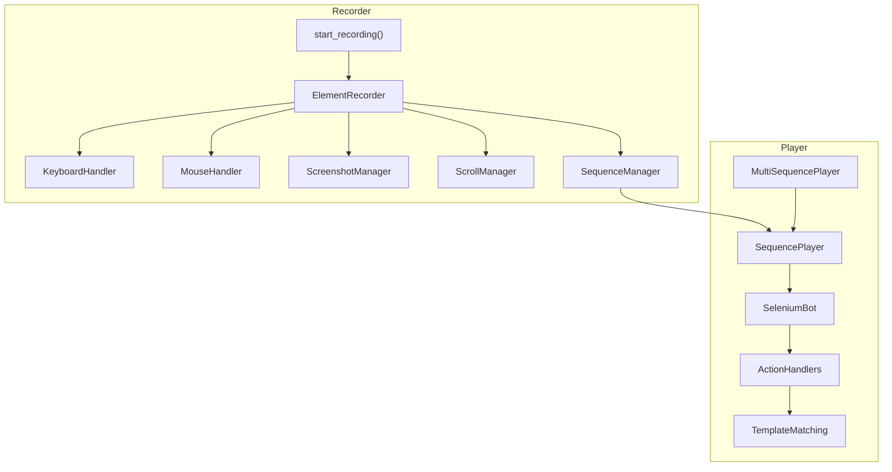
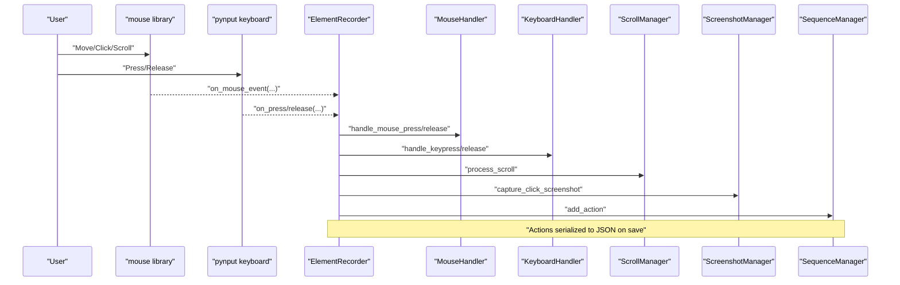
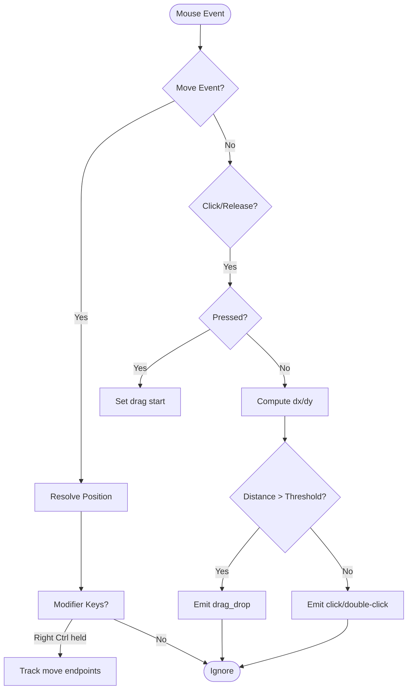
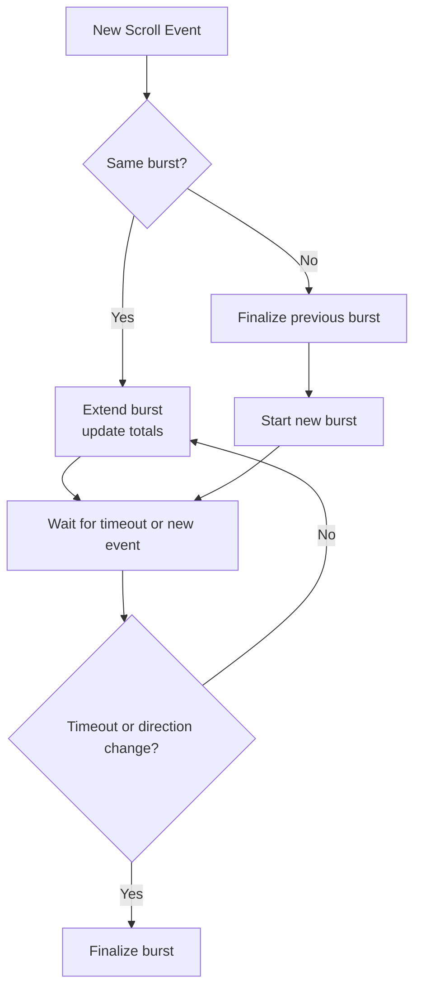
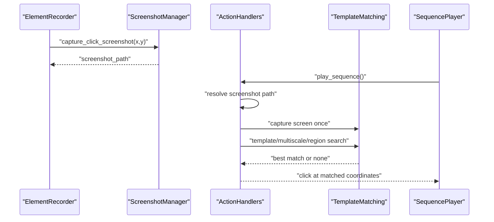
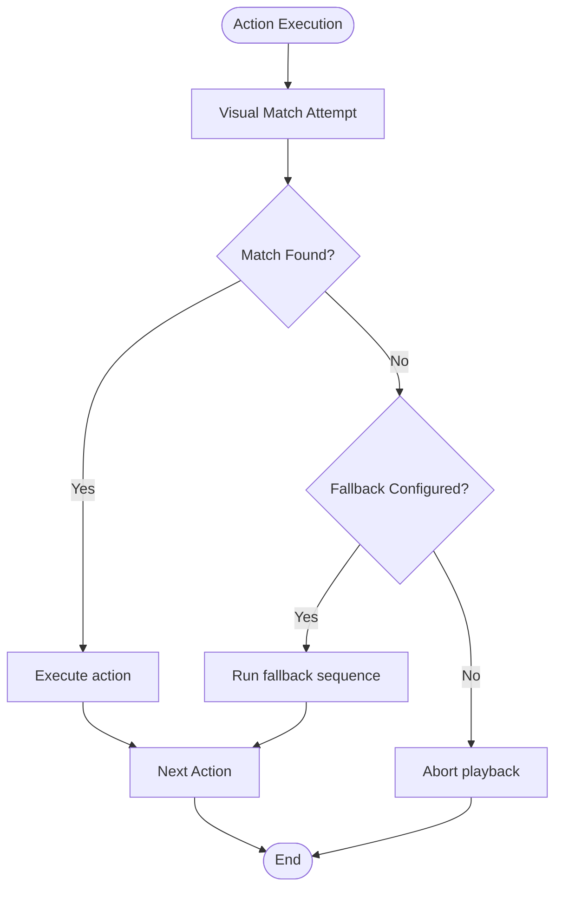
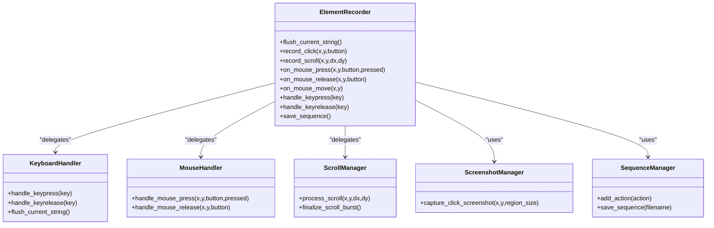
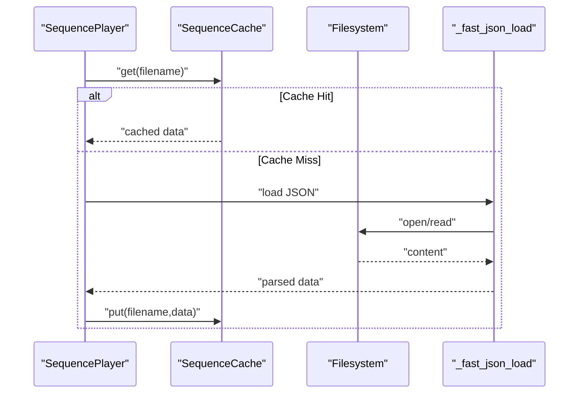
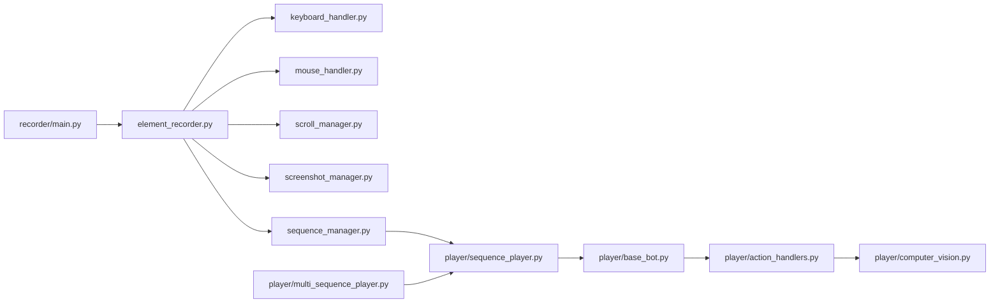

# Recording System

<cite>
**Referenced Files in This Document**
- [__init__.py](file://LoOper/recorder/__init__.py)
- [main.py](file://LoOper/recorder/main.py)
- [element_recorder.py](file://LoOper/recorder/element_recorder.py)
- [keyboard_handler.py](file://LoOper/recorder/keyboard_handler.py)
- [mouse_handler.py](file://LoOper/recorder/mouse_handler.py)
- [screenshot_manager.py](file://LoOper/recorder/screenshot_manager.py)
- [scroll_manager.py](file://LoOper/recorder/scroll_manager.py)
- [sequence_manager.py](file://LoOper/recorder/sequence_manager.py)
- [README.md](file://LoOper/recorder/README.md)
- [base_bot.py](file://LoOper/player/base_bot.py)
- [action_handlers.py](file://LoOper/player/action_handlers.py)
- [sequence_player.py](file://LoOper/player/sequence_player.py)
- [computer_vision.py](file://LoOper/player/computer_vision.py)
- [multi_sequence_player.py](file://LoOper/player/multi_sequence_player.py)
</cite>

## Table of Contents
1. [Introduction](#introduction)
2. [Project Structure](#project-structure)
3. [Core Components](#core-components)
4. [Architecture Overview](#architecture-overview)
5. [Detailed Component Analysis](#detailed-component-analysis)
6. [Dependency Analysis](#dependency-analysis)
7. [Performance Considerations](#performance-considerations)
8. [Troubleshooting Guide](#troubleshooting-guide)
9. [Conclusion](#conclusion)
10. [Appendices](#appendices)

## Introduction
This document describes the recording system responsible for capturing comprehensive desktop interactions and managing their sequencing for playback. It covers input capture for mouse and keyboard, intelligent action grouping, screenshot integration for template-based recognition, and real-time validation mechanisms. It also documents element recorder coordination, sequence serialization, and playback optimization techniques, along with practical workflows, error handling, performance strategies, memory management, and extension guidance.

## Project Structure
The recording system is modularized under the recorder package and integrates tightly with the playback engine under the player package. The recorder captures user interactions and serializes them into a structured JSON sequence. The player loads and executes these sequences with robust template-based recognition and fallback strategies.

**Diagram sources**
- [main.py:7-75](file://LoOper/recorder/main.py#L7-L75)
- [element_recorder.py:11-155](file://LoOper/recorder/element_recorder.py#L11-L155)
- [keyboard_handler.py:6-197](file://LoOper/recorder/keyboard_handler.py#L6-L197)
- [mouse_handler.py:6-167](file://LoOper/recorder/mouse_handler.py#L6-L167)
- [screenshot_manager.py:10-49](file://LoOper/recorder/screenshot_manager.py#L10-L49)
- [scroll_manager.py:4-97](file://LoOper/recorder/scroll_manager.py#L4-L97)
- [sequence_manager.py:18-178](file://LoOper/recorder/sequence_manager.py#L18-L178)
- [sequence_player.py:136-252](file://LoOper/player/sequence_player.py#L136-L252)
- [action_handlers.py:26-1058](file://LoOper/player/action_handlers.py#L26-L1058)
- [computer_vision.py:47-606](file://LoOper/player/computer_vision.py#L47-L606)
- [multi_sequence_player.py:32-532](file://LoOper/player/multi_sequence_player.py#L32-L532)

**Section sources**
- [README.md:1-86](file://LoOper/recorder/README.md#L1-L86)
- [__init__.py:1-22](file://LoOper/recorder/__init__.py#L1-L22)

## Core Components
- ElementRecorder: Central coordinator that orchestrates keyboard, mouse, scroll, screenshot, and sequence management. It translates raw events into structured actions and manages screenshot capture for click actions.
- KeyboardHandler: Tracks modifier keys, detects special Ctrl+ combinations (copy/paste/cut/select-all/undo/redo), buffers typed text, and emits keystrokes and clipboard actions.
- MouseHandler: Detects clicks vs. drags, supports double-click detection, and generates click, double-click, and drag-drop actions.
- ScrollManager: Groups scroll events into bursts with direction, cumulative positions, and timing to produce a single scroll action.
- ScreenshotManager: Captures small regions around click coordinates and saves them with unique filenames for template-based recognition.
- SequenceManager: Stores actions, attaches application context metadata, and serializes the sequence to JSON with caching invalidation.

**Section sources**
- [element_recorder.py:11-155](file://LoOper/recorder/element_recorder.py#L11-L155)
- [keyboard_handler.py:6-197](file://LoOper/recorder/keyboard_handler.py#L6-L197)
- [mouse_handler.py:6-167](file://LoOper/recorder/mouse_handler.py#L6-L167)
- [scroll_manager.py:4-97](file://LoOper/recorder/scroll_manager.py#L4-L97)
- [screenshot_manager.py:10-49](file://LoOper/recorder/screenshot_manager.py#L10-L49)
- [sequence_manager.py:18-178](file://LoOper/recorder/sequence_manager.py#L18-L178)

## Architecture Overview
The recording pipeline begins with listeners that capture mouse and keyboard events. These are routed to the ElementRecorder, which delegates to specialized handlers. Actions are appended to the SequenceManager, optionally augmented with screenshots and application context. Playback uses SequencePlayer to load and execute actions, leveraging TemplateMatching for visual validation and fallbacks.

**Diagram sources**
- [main.py:14-70](file://LoOper/recorder/main.py#L14-L70)
- [element_recorder.py:76-122](file://LoOper/recorder/element_recorder.py#L76-L122)
- [mouse_handler.py:25-88](file://LoOper/recorder/mouse_handler.py#L25-L88)
- [keyboard_handler.py:29-158](file://LoOper/recorder/keyboard_handler.py#L29-L158)
- [scroll_manager.py:13-64](file://LoOper/recorder/scroll_manager.py#L13-L64)
- [screenshot_manager.py:21-44](file://LoOper/recorder/screenshot_manager.py#L21-L44)
- [sequence_manager.py:125-136](file://LoOper/recorder/sequence_manager.py#L125-L136)

## Detailed Component Analysis

### Input Capture System: Mouse and Keyboard
- Mouse capture uses a unified listener to receive move, click, and scroll events. Drag detection distinguishes clicks from drags based on distance thresholds. Double-click detection considers time and spatial proximity. Click actions are flagged for screenshot capture unless overridden by modifier-aware transformations.
- Keyboard capture tracks modifier states and recognizes Ctrl+ combinations reliably using ASCII control codes and virtual key fallbacks. Regular typing is buffered and flushed as a single type_string action when needed.

**Diagram sources**
- [mouse_handler.py:25-88](file://LoOper/recorder/mouse_handler.py#L25-L88)

**Section sources**
- [main.py:32-47](file://LoOper/recorder/main.py#L32-L47)
- [mouse_handler.py:25-167](file://LoOper/recorder/mouse_handler.py#L25-L167)
- [keyboard_handler.py:29-158](file://LoOper/recorder/keyboard_handler.py#L29-L158)

### Intelligent Action Grouping Strategies
- Scroll bursts: Consecutive scroll events within a timeout and same direction are aggregated into a single scroll action with cumulative delta, start/end positions, and step count. This improves replay fidelity and reduces noise.
- Click grouping: Clicks are grouped with associated screenshots. Modifier-aware transformations (e.g., right Ctrl toggles absolute move-to behavior) are applied before capture.
- Typing grouping: Buffered typed text is flushed as a single type_string action, reducing action volume and improving playback throughput.

**Diagram sources**
- [scroll_manager.py:13-64](file://LoOper/recorder/scroll_manager.py#L13-L64)

**Section sources**
- [scroll_manager.py:13-97](file://LoOper/recorder/scroll_manager.py#L13-L97)
- [element_recorder.py:58-104](file://LoOper/recorder/element_recorder.py#L58-L104)

### Screenshot Integration for Template-Based Recognition
- ScreenshotManager captures a small square region around click coordinates and saves it with a unique filename. During playback, ActionHandlers resolve screenshot paths across common project layouts, capture a single screen snapshot, and apply multiple matching strategies (template matching, multi-scale, region-based) with decreasing confidence thresholds.
- Selection memory maintains per-template state to avoid random clicks among multiple instances and to support deterministic selection ordering.

**Diagram sources**
- [screenshot_manager.py:21-44](file://LoOper/recorder/screenshot_manager.py#L21-L44)
- [action_handlers.py:133-604](file://LoOper/player/action_handlers.py#L133-L604)
- [computer_vision.py:199-450](file://LoOper/player/computer_vision.py#L199-L450)

**Section sources**
- [screenshot_manager.py:10-49](file://LoOper/recorder/screenshot_manager.py#L10-L49)
- [action_handlers.py:133-604](file://LoOper/player/action_handlers.py#L133-L604)
- [computer_vision.py:47-606](file://LoOper/player/computer_vision.py#L47-L606)

### Real-Time Validation Mechanisms
- During playback, visual validation uses multiple strategies with increasing tolerance. If a match fails, a configurable fallback sequence can be triggered. Retry attempts and delays are tunable per action. Stop flags enable cooperative cancellation during long operations.
- Application context metadata (active window title, process info, rect) is attached to actions to aid validation and scoping.

**Diagram sources**
- [action_handlers.py:593-604](file://LoOper/player/action_handlers.py#L593-L604)
- [sequence_manager.py:25-124](file://LoOper/recorder/sequence_manager.py#L25-L124)

**Section sources**
- [action_handlers.py:133-604](file://LoOper/player/action_handlers.py#L133-L604)
- [sequence_manager.py:25-124](file://LoOper/recorder/sequence_manager.py#L25-L124)

### Element Recorder Coordination and Sequence Serialization
- ElementRecorder initializes and coordinates all managers, flushes pending strings, transforms actions (e.g., click modifiers), and captures screenshots for click actions. On save, it finalizes scroll bursts, attaches app context, and writes JSON with metadata and action arrays. Cache invalidation is invoked post-save to refresh dependent caches.

**Diagram sources**
- [element_recorder.py:11-155](file://LoOper/recorder/element_recorder.py#L11-L155)
- [keyboard_handler.py:6-197](file://LoOper/recorder/keyboard_handler.py#L6-L197)
- [mouse_handler.py:6-167](file://LoOper/recorder/mouse_handler.py#L6-L167)
- [scroll_manager.py:4-97](file://LoOper/recorder/scroll_manager.py#L4-L97)
- [screenshot_manager.py:10-49](file://LoOper/recorder/screenshot_manager.py#L10-L49)
- [sequence_manager.py:18-178](file://LoOper/recorder/sequence_manager.py#L18-L178)

**Section sources**
- [element_recorder.py:26-155](file://LoOper/recorder/element_recorder.py#L26-L155)
- [sequence_manager.py:138-178](file://LoOper/recorder/sequence_manager.py#L138-L178)

### Playback Optimization Techniques
- SequencePlayer uses a thread-safe cache keyed by file path and modification time to avoid repeated file loads and JSON parsing. It employs optimized JSON loading with buffer sizing and streaming for large files. Lazy loading minimizes startup overhead.
- Action execution is decoupled via ActionHandlers, enabling sandbox and VNC bridges, and applying human-like motion and timing. Scroll playback simulates user-like step sizes and pacing.
- MultiSequencePlayer preloads entire chains and referenced sequences, sharing selection memory across sequences and conditional fallbacks for deterministic behavior.

**Diagram sources**
- [sequence_player.py:14-96](file://LoOper/player/sequence_player.py#L14-L96)
- [sequence_player.py:98-134](file://LoOper/player/sequence_player.py#L98-L134)
- [sequence_player.py:162-193](file://LoOper/player/sequence_player.py#L162-L193)

**Section sources**
- [sequence_player.py:14-96](file://LoOper/player/sequence_player.py#L14-L96)
- [sequence_player.py:98-134](file://LoOper/player/sequence_player.py#L98-L134)
- [sequence_player.py:162-193](file://LoOper/player/sequence_player.py#L162-L193)
- [multi_sequence_player.py:58-71](file://LoOper/player/multi_sequence_player.py#L58-L71)

## Dependency Analysis
The recorder depends on pynput for input capture and pyautogui for screenshotting. The player depends on pyautogui and optionally OpenCV and mss for fast screen capture and template matching. ActionHandlers integrate with TemplateMatching for robust visual validation and fallback invocation.

**Diagram sources**
- [main.py:1-75](file://LoOper/recorder/main.py#L1-L75)
- [element_recorder.py:1-25](file://LoOper/recorder/element_recorder.py#L1-L25)
- [sequence_manager.py:1-16](file://LoOper/recorder/sequence_manager.py#L1-L16)
- [sequence_player.py:1-252](file://LoOper/player/sequence_player.py#L1-L252)
- [action_handlers.py:1-1058](file://LoOper/player/action_handlers.py#L1-L1058)
- [computer_vision.py:1-606](file://LoOper/player/computer_vision.py#L1-L606)
- [multi_sequence_player.py:1-532](file://LoOper/player/multi_sequence_player.py#L1-L532)

**Section sources**
- [main.py:1-75](file://LoOper/recorder/main.py#L1-L75)
- [element_recorder.py:1-25](file://LoOper/recorder/element_recorder.py#L1-L25)
- [sequence_manager.py:1-16](file://LoOper/recorder/sequence_manager.py#L1-L16)
- [sequence_player.py:1-252](file://LoOper/player/sequence_player.py#L1-L252)
- [action_handlers.py:1-1058](file://LoOper/player/action_handlers.py#L1-L1058)
- [computer_vision.py:1-606](file://LoOper/player/computer_vision.py#L1-L606)
- [multi_sequence_player.py:1-532](file://LoOper/player/multi_sequence_player.py#L1-L532)

## Performance Considerations
- Recording
  - Minimize screenshot frequency by capturing only on click actions and using small fixed-size regions.
  - Use scroll burst aggregation to reduce action count and improve replay stability.
  - Buffer typed text to reduce keystroke action volume.
- Playback
  - Enable SequenceCache to avoid repeated file loads and JSON parsing.
  - Prefer single-screen capture for template matching to reduce IO overhead.
  - Use multi-strategy matching with early exits at higher confidence thresholds to accelerate successful matches.
  - Apply human-like delays and motion curves to balance realism and speed.
- Memory Management
  - Clear selection memory between runs to avoid stale state.
  - Register and cleanup temporal screenshots to prevent disk growth.
  - Limit template cache size and clear caches when sequences change.

[No sources needed since this section provides general guidance]

## Troubleshooting Guide
- Visual matching failures
  - Verify screenshot paths exist and are resolvable across project layouts.
  - Increase retry attempts and adjust confidence thresholds for robustness.
  - Use fallback sequences for critical actions to recover automatically.
- Keyboard capture issues
  - Ensure ASCII control code and VK fallbacks are functioning; verify modifier key tracking.
  - Confirm Ctrl+C/V/X/A/Z/Y detection logic and that typed strings are flushed appropriately.
- Scroll playback anomalies
  - Validate that scroll deltas and step counts reflect recorded bursts; ensure step timing approximates original duration.
- Performance bottlenecks
  - Monitor cache hit rates and consider disabling template cache for frequent updates.
  - Reduce screenshot region size or frequency if disk IO becomes a bottleneck.
  - Use lazy loading for large sequences and preloading for chained workflows.

**Section sources**
- [action_handlers.py:133-604](file://LoOper/player/action_handlers.py#L133-L604)
- [keyboard_handler.py:69-128](file://LoOper/recorder/keyboard_handler.py#L69-L128)
- [scroll_manager.py:13-64](file://LoOper/recorder/scroll_manager.py#L13-L64)
- [sequence_player.py:14-96](file://LoOper/player/sequence_player.py#L14-L96)

## Conclusion
The recording system provides a modular, extensible foundation for capturing desktop interactions and transforming them into robust, replayable sequences. Through intelligent grouping, screenshot-backed validation, and optimized playback, it balances accuracy and performance. The design enables straightforward extensions for new input types and recognition strategies while maintaining strong integration with the playback engine.

[No sources needed since this section summarizes without analyzing specific files]

## Appendices

### Practical Recording Workflows
- Start recording, perform typical desktop tasks (typing, clicking, scrolling, copy/paste), and press ESC to save.
- Review generated JSON in the sequences directory and confirm screenshots are present for click actions.
- Run playback with optional fallback sequences for resilient execution.

**Section sources**
- [main.py:7-75](file://LoOper/recorder/main.py#L7-L75)
- [element_recorder.py:137-155](file://LoOper/recorder/element_recorder.py#L137-L155)

### Action Grouping Patterns
- Drag detection: Distance threshold determines drag vs. click.
- Double-click detection: Time and proximity thresholds define double-click.
- Scroll bursts: Aggregated into a single action with cumulative delta and step count.

**Section sources**
- [mouse_handler.py:56-146](file://LoOper/recorder/mouse_handler.py#L56-L146)
- [scroll_manager.py:13-97](file://LoOper/recorder/scroll_manager.py#L13-L97)

### Extending Recording Capabilities
- Adding new input types
  - Introduce a handler similar to KeyboardHandler/MouseHandler, emit structured actions, and integrate into ElementRecorder.
  - Update SequenceManager to serialize new action types and attach metadata if needed.
- Improving capture accuracy
  - Tune confidence thresholds and matching strategies in TemplateMatching.
  - Enhance selection memory to track more nuanced state (e.g., instance clustering).
  - Add OCR-based validation for text-dependent actions.

**Section sources**
- [keyboard_handler.py:29-158](file://LoOper/recorder/keyboard_handler.py#L29-L158)
- [mouse_handler.py:25-88](file://LoOper/recorder/mouse_handler.py#L25-L88)
- [computer_vision.py:452-606](file://LoOper/player/computer_vision.py#L452-L606)