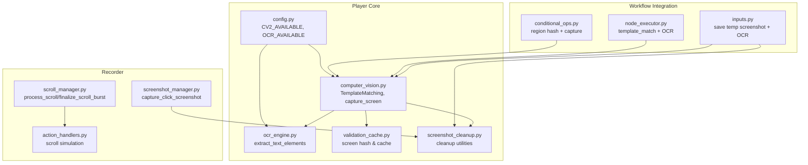
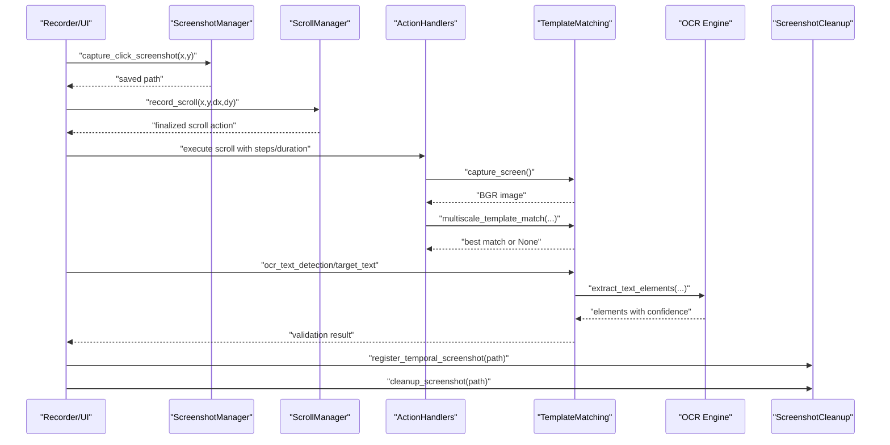
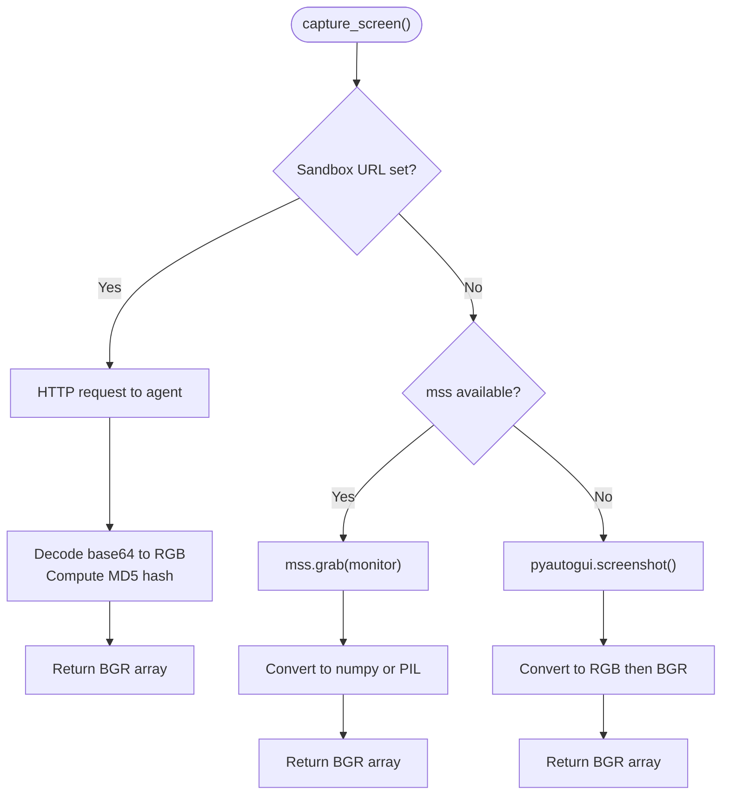
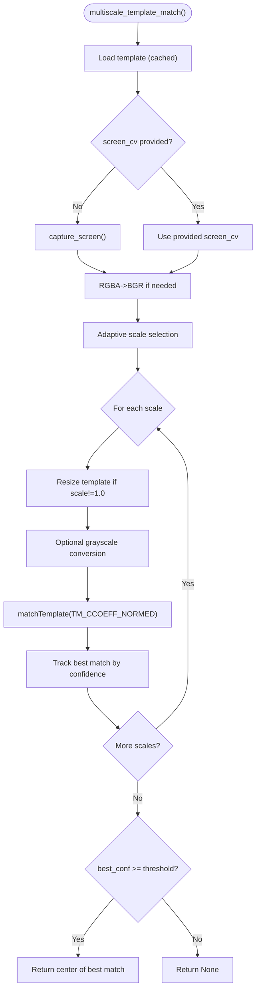
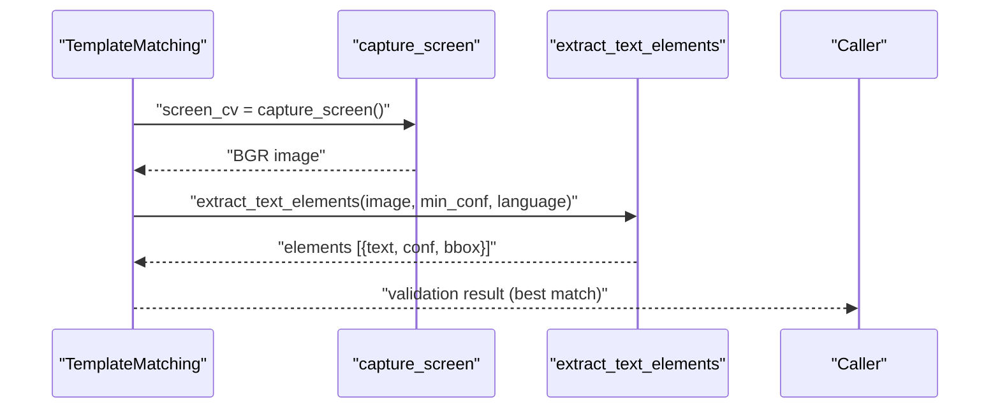
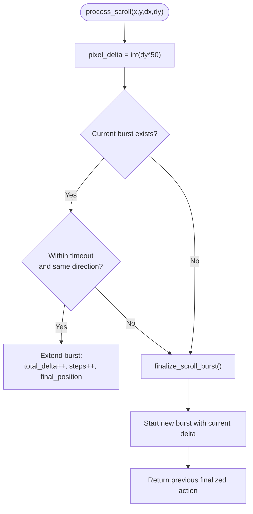
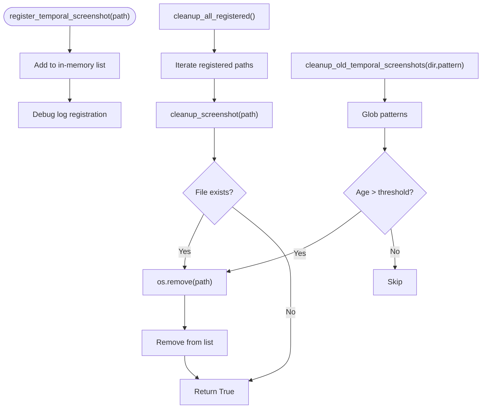
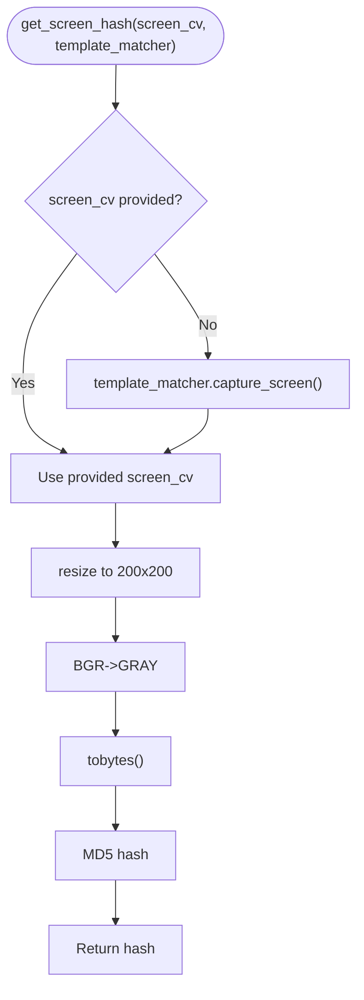
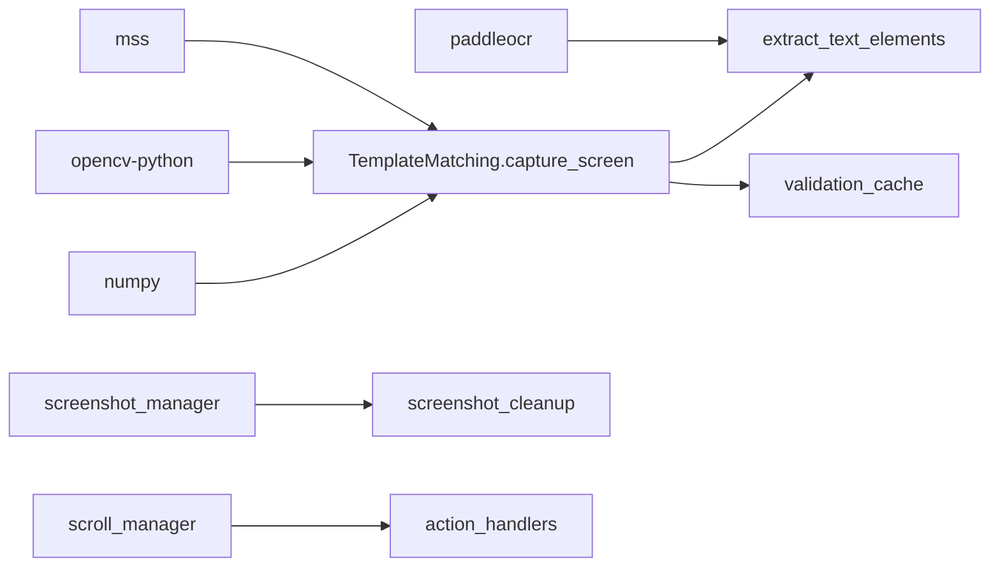

# Screenshot Integration

<cite>
**Referenced Files in This Document**
- [computer_vision.py](file://LoOper/player/computer_vision.py)
- [ocr_engine.py](file://LoOper/player/ocr_engine.py)
- [screenshot_manager.py](file://LoOper/recorder/screenshot_manager.py)
- [scroll_manager.py](file://LoOper/recorder/scroll_manager.py)
- [screenshot_cleanup.py](file://LoOper/player/screenshot_cleanup.py)
- [validation_cache.py](file://LoOper/player/multi_sequence/conditional_fallback_resources/validation_cache.py)
- [inputs.py](file://LoOper/player/multi_sequence/llm_executor_resources/inputs.py)
- [node_executor.py](file://LoOper/player/multi_sequence/conditional_fallback_resources/node_executor.py)
- [conditional_ops.py](file://LoOper/player/multi_sequence/worflow_interpreter_modules/executor_modules/conditional_ops.py)
- [action_handlers.py](file://LoOper/player/action_handlers.py)
- [config.py](file://LoOper/player/config.py)
- [.gitignore](file://LoOper/.gitignore)
</cite>

## Table of Contents
1. [Introduction](#introduction)
2. [Project Structure](#project-structure)
3. [Core Components](#core-components)
4. [Architecture Overview](#architecture-overview)
5. [Detailed Component Analysis](#detailed-component-analysis)
6. [Dependency Analysis](#dependency-analysis)
7. [Performance Considerations](#performance-considerations)
8. [Troubleshooting Guide](#troubleshooting-guide)
9. [Conclusion](#conclusion)
10. [Appendices](#appendices)

## Introduction
This document describes the screenshot integration system that powers visual capture and template-based recognition in the automation framework. It explains how screenshots are captured, processed, and validated against templates, how scroll events are coordinated with screenshot timing, and how OCR supports visual validation. It also covers template storage management, memory and performance considerations for large images, and practical guidance for extending and optimizing the screenshot pipeline.

## Project Structure
The screenshot integration spans several modules:
- Player-side computer vision and OCR: centralizes screenshot capture, template matching, and OCR extraction
- Recorder-side helpers: capture click-region screenshots and group scroll events
- Cleanup utilities: manage temporary screenshot lifecycle
- Conditional fallback and executor modules: integrate screenshot capture into validation loops and scrolling workflows
- Configuration: toggles for optional computer vision and OCR availability

**Diagram sources**
- [computer_vision.py:93-177](file://LoOper/player/computer_vision.py#L93-L177)
- [ocr_engine.py:131-240](file://LoOper/player/ocr_engine.py#L131-L240)
- [screenshot_cleanup.py:16-47](file://LoOper/player/screenshot_cleanup.py#L16-L47)
- [screenshot_manager.py:21-49](file://LoOper/recorder/screenshot_manager.py#L21-L49)
- [scroll_manager.py:13-97](file://LoOper/recorder/scroll_manager.py#L13-L97)
- [action_handlers.py:919-946](file://LoOper/player/action_handlers.py#L919-L946)
- [inputs.py:67-98](file://LoOper/player/multi_sequence/llm_executor_resources/inputs.py#L67-L98)
- [node_executor.py:900-933](file://LoOper/player/multi_sequence/conditional_fallback_resources/node_executor.py#L900-L933)
- [conditional_ops.py:456-492](file://LoOper/player/multi_sequence/worflow_interpreter_modules/executor_modules/conditional_ops.py#L456-L492)
- [config.py:11-31](file://LoOper/player/config.py#L11-L31)

**Section sources**
- [computer_vision.py:93-177](file://LoOper/player/computer_vision.py#L93-L177)
- [ocr_engine.py:131-240](file://LoOper/player/ocr_engine.py#L131-L240)
- [screenshot_manager.py:21-49](file://LoOper/recorder/screenshot_manager.py#L21-L49)
- [scroll_manager.py:13-97](file://LoOper/recorder/scroll_manager.py#L13-L97)
- [screenshot_cleanup.py:16-47](file://LoOper/player/screenshot_cleanup.py#L16-L47)
- [validation_cache.py:21-54](file://LoOper/player/multi_sequence/conditional_fallback_resources/validation_cache.py#L21-L54)
- [inputs.py:67-98](file://LoOper/player/multi_sequence/llm_executor_resources/inputs.py#L67-L98)
- [node_executor.py:900-933](file://LoOper/player/multi_sequence/conditional_fallback_resources/node_executor.py#L900-L933)
- [conditional_ops.py:456-492](file://LoOper/player/multi_sequence/worflow_interpreter_modules/executor_modules/conditional_ops.py#L456-L492)
- [action_handlers.py:919-946](file://LoOper/player/action_handlers.py#L919-L946)
- [config.py:11-31](file://LoOper/player/config.py#L11-L31)

## Core Components
- Screenshot capture and pre-processing
  - Fast capture via mss with pyautogui fallback
  - Optional sandbox agent integration for remote screenshots
  - RGB/BGR conversion and optional debug saving
- Template matching
  - Multi-scale matching with adaptive scale selection
  - Region-based search around hints
  - Grayscale optimization and best-match scoring
- OCR extraction and validation
  - PaddleOCR integration with bundled model support
  - Text element extraction with confidence and bounding boxes
  - Stop-flag-aware processing to abort on demand
- Scroll event handling and timing
  - Burst grouping with direction and duration tracking
  - Simulated scroll execution with per-step amounts and timing
- Screenshot lifecycle management
  - Registration and cleanup of temporary screenshots
  - Age-based cleanup and prefix-based cleanup
- Validation caching and screen change detection
  - Screen hash generation for cache invalidation
  - Deterministic cache keys including screen context

**Section sources**
- [computer_vision.py:93-177](file://LoOper/player/computer_vision.py#L93-L177)
- [computer_vision.py:198-331](file://LoOper/player/computer_vision.py#L198-L331)
- [computer_vision.py:333-450](file://LoOper/player/computer_vision.py#L333-L450)
- [computer_vision.py:452-606](file://LoOper/player/computer_vision.py#L452-L606)
- [ocr_engine.py:131-240](file://LoOper/player/ocr_engine.py#L131-L240)
- [scroll_manager.py:13-97](file://LoOper/recorder/scroll_manager.py#L13-L97)
- [action_handlers.py:919-946](file://LoOper/player/action_handlers.py#L919-L946)
- [screenshot_cleanup.py:16-47](file://LoOper/player/screenshot_cleanup.py#L16-L47)
- [validation_cache.py:21-54](file://LoOper/player/multi_sequence/conditional_fallback_resources/validation_cache.py#L21-L54)

## Architecture Overview
The screenshot integration orchestrates capture, preprocessing, matching, and validation across modules. It supports both template-based and OCR-based validation, with scroll events coordinated to ensure accurate timing and replay.

**Diagram sources**
- [screenshot_manager.py:21-49](file://LoOper/recorder/screenshot_manager.py#L21-L49)
- [scroll_manager.py:13-97](file://LoOper/recorder/scroll_manager.py#L13-L97)
- [action_handlers.py:919-946](file://LoOper/player/action_handlers.py#L919-L946)
- [computer_vision.py:93-177](file://LoOper/player/computer_vision.py#L93-L177)
- [computer_vision.py:452-606](file://LoOper/player/computer_vision.py#L452-L606)
- [ocr_engine.py:131-240](file://LoOper/player/ocr_engine.py#L131-L240)
- [screenshot_cleanup.py:16-47](file://LoOper/player/screenshot_cleanup.py#L16-L47)

## Detailed Component Analysis

### Screenshot Capture Mechanisms
- Fast capture path
  - Uses mss for hardware-accelerated screen capture when available
  - Falls back to pyautogui with RGB conversion to BGR for OpenCV compatibility
- Sandbox agent integration
  - Optional remote screenshot retrieval via HTTP requests with base64-encoded images
  - Caching via MD5 hash to avoid redundant captures
- Preprocessing
  - Converts RGBA to BGR for OpenCV
  - Optional debug saving to a dedicated debug directory
- Stop-flag awareness
  - Capture routines check stop flags before and after operations to abort gracefully

**Diagram sources**
- [computer_vision.py:93-177](file://LoOper/player/computer_vision.py#L93-L177)

**Section sources**
- [computer_vision.py:93-177](file://LoOper/player/computer_vision.py#L93-L177)

### Template-Based Recognition Workflow
- Template loading and caching
  - Loads templates via OpenCV and stores in-memory cache
  - Tracks attempt counts per template for adaptive scaling
- Multi-scale matching
  - Sorts scales by proximity to 1.0 to optimize speed
  - Resizes templates dynamically and performs grayscale conversion when requested
  - Searches across all scales to select the best match by confidence
- Region-based search
  - Expands a region around a hint coordinate to localize matches
  - Falls back to pyautogui when OpenCV is unavailable
- Stop-flag integration
  - Checks stop flags before capture, processing, and result evaluation

**Diagram sources**
- [computer_vision.py:198-331](file://LoOper/player/computer_vision.py#L198-L331)

**Section sources**
- [computer_vision.py:198-331](file://LoOper/player/computer_vision.py#L198-L331)

### OCR Extraction and Visual Validation
- OCR pipeline
  - Initializes PaddleOCR with bundled model support in frozen environments
  - Normalizes results into a unified structure with text, confidence, and bounding boxes
- Text detection
  - Performs OCR on full screen or provided image
  - Applies stop flags before capture, processing, and result iteration
  - Implements balanced matching logic to avoid false positives
- All-text extraction
  - Returns structured text elements filtered by minimum confidence

**Diagram sources**
- [computer_vision.py:452-606](file://LoOper/player/computer_vision.py#L452-L606)
- [ocr_engine.py:131-240](file://LoOper/player/ocr_engine.py#L131-L240)

**Section sources**
- [computer_vision.py:452-606](file://LoOper/player/computer_vision.py#L452-L606)
- [ocr_engine.py:131-240](file://LoOper/player/ocr_engine.py#L131-L240)

### Scroll Event Handling and Timing Coordination
- Scroll burst grouping
  - Aggregates scroll deltas within a short timeout and same direction
  - Computes total delta, steps, duration, and final position
- Simulation and replay
  - Splits total scroll into micro-steps with precise amounts
  - Respects stop flags mid-simulation to abort gracefully
- Integration with screenshot capture
  - Ensures scroll actions are grouped for accurate replay
  - Coordinates with validation loops to capture screenshots at appropriate moments

**Diagram sources**
- [scroll_manager.py:13-97](file://LoOper/recorder/scroll_manager.py#L13-L97)
- [action_handlers.py:919-946](file://LoOper/player/action_handlers.py#L919-L946)

**Section sources**
- [scroll_manager.py:13-97](file://LoOper/recorder/scroll_manager.py#L13-L97)
- [action_handlers.py:919-946](file://LoOper/player/action_handlers.py#L919-L946)

### Screenshot Storage Management and Lifecycle
- Registration and cleanup
  - Temporal screenshots are registered for later cleanup
  - Supports cleanup of specific files, all registered files, old files by age, and prefix-based cleanup
- Patterns and directories
  - Default directory for screenshots is under a sequences path
  - Cleanup patterns include specific prefixes for temporal and LLM vision images
- Click-region capture
  - Captures small regions around clicks for debugging and validation

**Diagram sources**
- [screenshot_cleanup.py:16-47](file://LoOper/player/screenshot_cleanup.py#L16-L47)
- [screenshot_manager.py:21-49](file://LoOper/recorder/screenshot_manager.py#L21-L49)

**Section sources**
- [screenshot_cleanup.py:16-47](file://LoOper/player/screenshot_cleanup.py#L16-L47)
- [screenshot_manager.py:21-49](file://LoOper/recorder/screenshot_manager.py#L21-L49)

### Validation Cache and Screen Change Detection
- Screen hashing
  - Generates a hash of a resized grayscale sample for efficient change detection
- Cache key composition
  - Includes resolved image path, confidence, trigger type, OCR text, and screen hash
- Cache behavior
  - Currently bypassed to force real checks; TTL and size limits are implemented for future use

**Diagram sources**
- [validation_cache.py:21-54](file://LoOper/player/multi_sequence/conditional_fallback_resources/validation_cache.py#L21-L54)

**Section sources**
- [validation_cache.py:21-54](file://LoOper/player/multi_sequence/conditional_fallback_resources/validation_cache.py#L21-L54)

### Practical Examples

- Screenshot capture triggers
  - Click-region capture for debugging and validation
  - OCR-triggered screenshot saving with cleanup
  - Conditional fallback and region-based matching with template hashes

- Image preprocessing
  - RGBA to BGR conversion for OpenCV
  - Grayscale conversion for template matching
  - Optional debug saves for evaluation images

- Template matching preparation
  - Adaptive scale selection based on attempt history
  - Region expansion around hint coordinates
  - Best-match scoring across multiple scales

- Visual validation
  - OCR-based text detection with stop-flag checks
  - Region hash capture for stateful validation loops

**Section sources**
- [screenshot_manager.py:21-49](file://LoOper/recorder/screenshot_manager.py#L21-L49)
- [inputs.py:67-98](file://LoOper/player/multi_sequence/llm_executor_resources/inputs.py#L67-L98)
- [node_executor.py:900-933](file://LoOper/player/multi_sequence/conditional_fallback_resources/node_executor.py#L900-L933)
- [conditional_ops.py:456-492](file://LoOper/player/multi_sequence/worflow_interpreter_modules/executor_modules/conditional_ops.py#L456-L492)
- [computer_vision.py:228-331](file://LoOper/player/computer_vision.py#L228-L331)
- [computer_vision.py:452-606](file://LoOper/player/computer_vision.py#L452-L606)

## Dependency Analysis
- External libraries
  - mss for fast screenshot capture
  - OpenCV and NumPy for computer vision operations
  - PaddleOCR for OCR extraction
- Internal dependencies
  - TemplateMatching depends on OCR extraction and configuration flags
  - ScrollManager integrates with ActionHandlers for simulated scroll playback
  - ScreenshotCleanup is used by OCR and other workflows to manage temporary files

**Diagram sources**
- [computer_vision.py:33-41](file://LoOper/player/computer_vision.py#L33-L41)
- [config.py:11-31](file://LoOper/player/config.py#L11-L31)
- [ocr_engine.py:30-104](file://LoOper/player/ocr_engine.py#L30-L104)
- [screenshot_manager.py:1-49](file://LoOper/recorder/screenshot_manager.py#L1-L49)
- [screenshot_cleanup.py:1-125](file://LoOper/player/screenshot_cleanup.py#L1-L125)
- [scroll_manager.py:1-97](file://LoOper/recorder/scroll_manager.py#L1-L97)
- [action_handlers.py:919-946](file://LoOper/player/action_handlers.py#L919-L946)
- [validation_cache.py:1-208](file://LoOper/player/multi_sequence/conditional_fallback_resources/validation_cache.py#L1-L208)

**Section sources**
- [computer_vision.py:33-41](file://LoOper/player/computer_vision.py#L33-L41)
- [config.py:11-31](file://LoOper/player/config.py#L11-L31)
- [ocr_engine.py:30-104](file://LoOper/player/ocr_engine.py#L30-L104)
- [screenshot_manager.py:1-49](file://LoOper/recorder/screenshot_manager.py#L1-L49)
- [screenshot_cleanup.py:1-125](file://LoOper/player/screenshot_cleanup.py#L1-L125)
- [scroll_manager.py:1-97](file://LoOper/recorder/scroll_manager.py#L1-L97)
- [action_handlers.py:919-946](file://LoOper/player/action_handlers.py#L919-L946)
- [validation_cache.py:1-208](file://LoOper/player/multi_sequence/conditional_fallback_resources/validation_cache.py#L1-L208)

## Performance Considerations
- Prefer mss for fast capture when available; fallback to pyautogui is supported
- Use grayscale matching for templates and regions to reduce computation
- Apply adaptive multi-scale matching: start with 1.0 scale and expand only when needed
- Reuse pre-captured screen images across multiple checks to avoid redundant captures
- Limit template sizes and use region-based search to constrain search space
- Avoid caching in validation loops for correctness; consider TTL-based caching for non-critical paths
- Manage memory by cleaning up temporary screenshots promptly

[No sources needed since this section provides general guidance]

## Troubleshooting Guide
- OpenCV or mss not available
  - Verify installation and availability; fallback to pyautogui will be used
- OCR not available
  - Ensure PaddleOCR is installed; bundled models are supported in frozen builds
- Screenshot artifacts or incorrect colors
  - Confirm RGBA to BGR conversion is applied before OpenCV operations
- Stuttering or missed scroll actions
  - Adjust scroll timeout and step duration; ensure stop flags are respected
- Excessive disk usage from screenshots
  - Use cleanup utilities to remove old or registered temporal screenshots

**Section sources**
- [config.py:11-31](file://LoOper/player/config.py#L11-L31)
- [computer_vision.py:33-41](file://LoOper/player/computer_vision.py#L33-L41)
- [ocr_engine.py:30-104](file://LoOper/player/ocr_engine.py#L30-L104)
- [screenshot_cleanup.py:49-94](file://LoOper/player/screenshot_cleanup.py#L49-L94)
- [scroll_manager.py:7-11](file://LoOper/recorder/scroll_manager.py#L7-L11)

## Conclusion
The screenshot integration system combines fast capture, robust template matching, and OCR-based validation to support reliable automation workflows. Scroll handling ensures accurate timing and replay, while lifecycle management keeps the working directory tidy. By leveraging adaptive strategies, grayscale optimizations, and careful resource management, the system balances accuracy and performance for large-scale automation tasks.

[No sources needed since this section summarizes without analyzing specific files]

## Appendices

### Practical Extension Guidance
- Adding new template formats
  - Ensure templates are loaded via OpenCV and resized appropriately
  - Use grayscale conversion for improved performance
- Extending OCR languages
  - Configure language normalization and model paths for PaddleOCR
  - Respect bundled model directories in frozen environments
- Integrating custom validation caches
  - Compute screen hashes for cache keys
  - Implement TTL and size limits to prevent memory growth
- Optimizing capture quality
  - Prefer mss for speed; apply region-based capture for targeted checks
  - Use stop flags to abort long-running operations

**Section sources**
- [computer_vision.py:198-331](file://LoOper/player/computer_vision.py#L198-L331)
- [ocr_engine.py:30-104](file://LoOper/player/ocr_engine.py#L30-L104)
- [validation_cache.py:21-54](file://LoOper/player/multi_sequence/conditional_fallback_resources/validation_cache.py#L21-L54)
- [screenshot_cleanup.py:49-94](file://LoOper/player/screenshot_cleanup.py#L49-L94)