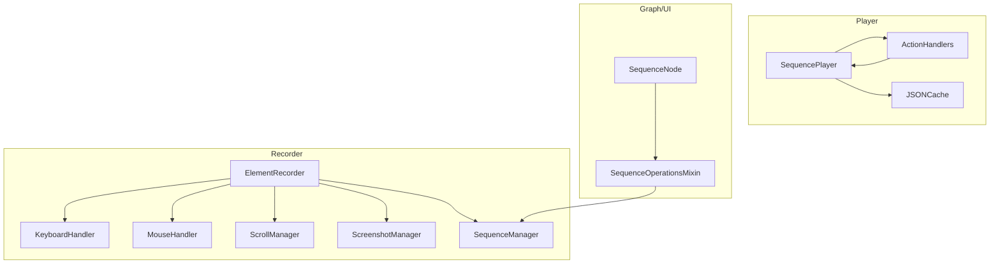
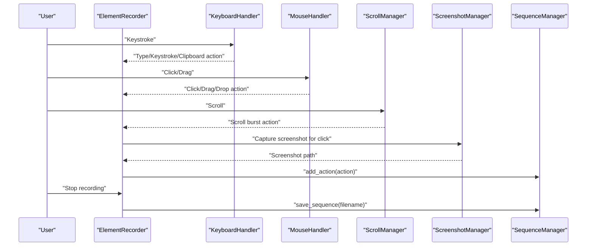
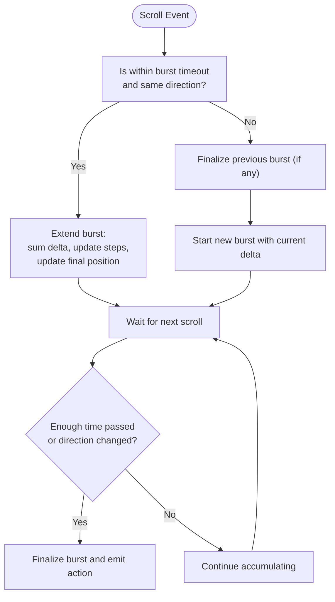
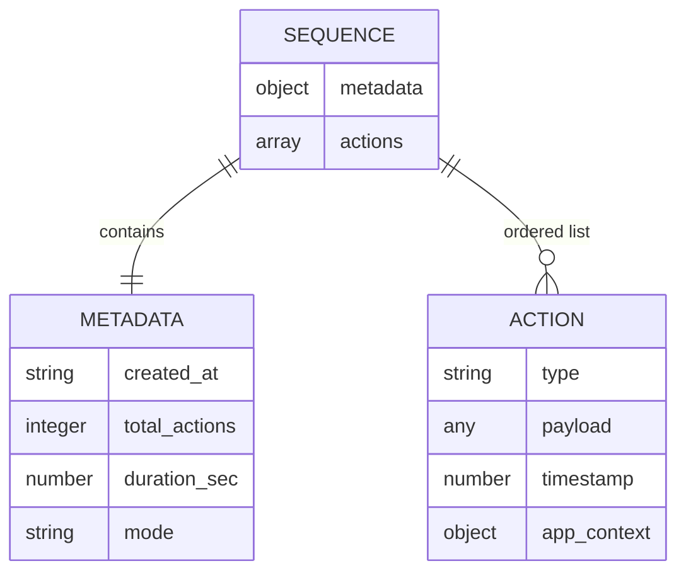
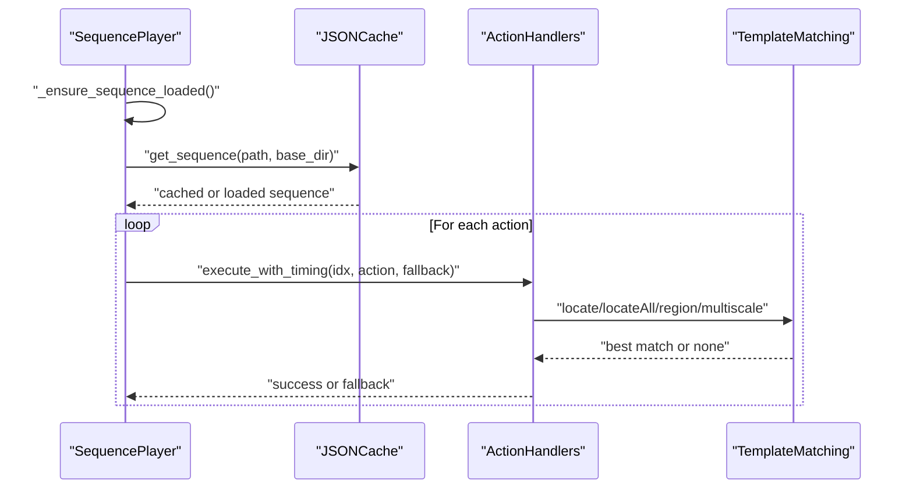
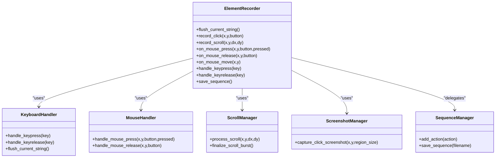
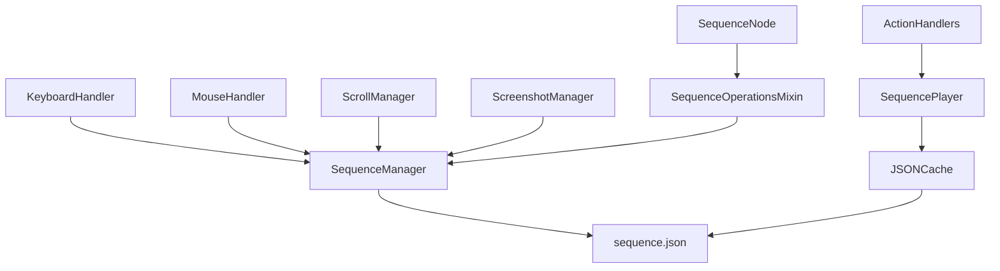

# Sequence Management

<cite>
**Referenced Files in This Document**
- [sequence_manager.py](file://LoOper/recorder/sequence_manager.py)
- [element_recorder.py](file://LoOper/recorder/element_recorder.py)
- [keyboard_handler.py](file://LoOper/recorder/keyboard_handler.py)
- [mouse_handler.py](file://LoOper/recorder/mouse_handler.py)
- [scroll_manager.py](file://LoOper/recorder/scroll_manager.py)
- [screenshot_manager.py](file://LoOper/recorder/screenshot_manager.py)
- [sequence_player.py](file://LoOper/player/sequence_player.py)
- [json_cache.py](file://LoOper/player/json_cache.py)
- [action_handlers.py](file://LoOper/player/action_handlers.py)
- [sequence_executor.py](file://LoOper/player/multi_sequence/sequence_executor.py)
- [sequence_node.py](file://LoOper/NGUI/nodes_resources/sequence_node.py)
- [sequence.py](file://LoOper/NGUI/graph_elements/node_operations_modules/sequence.py)
- [docs.html](file://website/docs.html)
</cite>

## Table of Contents
1. [Introduction](#introduction)
2. [Project Structure](#project-structure)
3. [Core Components](#core-components)
4. [Architecture Overview](#architecture-overview)
5. [Detailed Component Analysis](#detailed-component-analysis)
6. [Dependency Analysis](#dependency-analysis)
7. [Performance Considerations](#performance-considerations)
8. [Troubleshooting Guide](#troubleshooting-guide)
9. [Conclusion](#conclusion)
10. [Appendices](#appendices)

## Introduction
This document describes the sequence management system responsible for capturing, serializing, storing, validating, and playing back desktop automation sequences. It focuses on intelligent action grouping strategies that consolidate related mouse and keyboard events into logical units, the sequence serialization format and data structure organization, playback optimization techniques, element recorder coordination, validation during capture, and memory management strategies. Practical examples illustrate sequence construction, action categorization, and timing preservation, along with guidance for debugging, performance profiling, and extending sequence handling capabilities.

## Project Structure
The sequence management system spans three primary areas:
- Recorder subsystem: captures user interactions and groups related actions into a structured sequence.
- Player subsystem: loads, validates, and executes sequences with optimized caching and visual matching.
- Graph/UI subsystem: manages sequence nodes, properties, and workflow composition.

**Diagram sources**
- [element_recorder.py:11-25](file://LoOper/recorder/element_recorder.py#L11-L25)
- [keyboard_handler.py:6-28](file://LoOper/recorder/keyboard_handler.py#L6-L28)
- [mouse_handler.py:6-24](file://LoOper/recorder/mouse_handler.py#L6-L24)
- [scroll_manager.py:4-12](file://LoOper/recorder/scroll_manager.py#L4-L12)
- [screenshot_manager.py:10-19](file://LoOper/recorder/screenshot_manager.py#L10-L19)
- [sequence_manager.py:18-24](file://LoOper/recorder/sequence_manager.py#L18-L24)
- [sequence_player.py:136-158](file://LoOper/player/sequence_player.py#L136-L158)
- [action_handlers.py:26-43](file://LoOper/player/action_handlers.py#L26-L43)
- [json_cache.py:15-28](file://LoOper/player/json_cache.py#L15-L28)
- [sequence_node.py:74-118](file://LoOper/NGUI/nodes_resources/sequence_node.py#L74-L118)
- [sequence.py:41-100](file://LoOper/NGUI/graph_elements/node_operations_modules/sequence.py#L41-L100)

**Section sources**
- [element_recorder.py:11-25](file://LoOper/recorder/element_recorder.py#L11-L25)
- [sequence_manager.py:18-24](file://LoOper/recorder/sequence_manager.py#L18-L24)
- [sequence_player.py:136-158](file://LoOper/player/sequence_player.py#L136-L158)
- [json_cache.py:15-28](file://LoOper/player/json_cache.py#L15-L28)
- [sequence_node.py:74-118](file://LoOper/NGUI/nodes_resources/sequence_node.py#L74-L118)
- [sequence.py:41-100](file://LoOper/NGUI/graph_elements/node_operations_modules/sequence.py#L41-L100)

## Core Components
- ElementRecorder: Orchestrates keyboard, mouse, scroll, and screenshot capture, and delegates actions to SequenceManager for storage.
- SequenceManager: Maintains the in-memory action list, attaches app context metadata, and writes the final JSON sequence.
- SequencePlayer: Loads and executes a single sequence with caching, optimized JSON loading, and action-by-action playback.
- ActionHandlers: Executes actions (clicks, typing, keystrokes, clipboard, drag/drop, scrolling) with visual matching and fallbacks.
- JSONCache: Centralized cache for chains and sequences to avoid repeated disk I/O and enable fast lookup during playback.
- SequenceNode and SequenceOperationsMixin: Manage sequence nodes in the workflow graph, persisting only filenames to avoid path issues and enabling flexible configuration.

**Section sources**
- [element_recorder.py:11-25](file://LoOper/recorder/element_recorder.py#L11-L25)
- [sequence_manager.py:18-24](file://LoOper/recorder/sequence_manager.py#L18-L24)
- [sequence_player.py:136-158](file://LoOper/player/sequence_player.py#L136-L158)
- [action_handlers.py:26-43](file://LoOper/player/action_handlers.py#L26-L43)
- [json_cache.py:15-28](file://LoOper/player/json_cache.py#L15-L28)
- [sequence_node.py:74-118](file://LoOper/NGUI/nodes_resources/sequence_node.py#L74-L118)
- [sequence.py:41-100](file://LoOper/NGUI/graph_elements/node_operations_modules/sequence.py#L41-L100)

## Architecture Overview
The system integrates capture and playback through a unified JSON format. During capture, ElementRecorder transforms raw events into categorized actions with timestamps and contextual metadata. During playback, SequencePlayer and ActionHandlers execute actions with visual template matching and fallback sequences.

**Diagram sources**
- [element_recorder.py:11-25](file://LoOper/recorder/element_recorder.py#L11-L25)
- [keyboard_handler.py:29-158](file://LoOper/recorder/keyboard_handler.py#L29-L158)
- [mouse_handler.py:25-147](file://LoOper/recorder/mouse_handler.py#L25-L147)
- [scroll_manager.py:13-97](file://LoOper/recorder/scroll_manager.py#L13-L97)
- [screenshot_manager.py:21-49](file://LoOper/recorder/screenshot_manager.py#L21-L49)
- [sequence_manager.py:125-164](file://LoOper/recorder/sequence_manager.py#L125-L164)

## Detailed Component Analysis

### Intelligent Action Grouping Strategies
- Scroll bursts: ScrollManager aggregates multiple scroll deltas within a short time window and a consistent direction into a single scroll action with cumulative metrics.
- Text sequences: KeyboardHandler buffers printable characters and flushes them into a single type_string action, reducing noise and improving playback efficiency.
- Modifier combinations: MouseHandler detects Right-Ctrl and Right-Shift combinations to produce move_to and absolute_click actions respectively, consolidating intent into precise actions.
- Clipboard shortcuts: KeyboardHandler recognizes Ctrl+C/X/V/A/Z/Y and emits a single clipboard action per shortcut, preserving order and context.
- Double-click detection: MouseHandler distinguishes single and double clicks based on time and distance thresholds, emitting appropriate actions.

**Diagram sources**
- [scroll_manager.py:13-97](file://LoOper/recorder/scroll_manager.py#L13-L97)

**Section sources**
- [scroll_manager.py:13-97](file://LoOper/recorder/scroll_manager.py#L13-L97)
- [keyboard_handler.py:29-158](file://LoOper/recorder/keyboard_handler.py#L29-L158)
- [mouse_handler.py:25-147](file://LoOper/recorder/mouse_handler.py#L25-L147)

### Sequence Serialization Format and Data Structure Organization
- Top-level structure: metadata and actions.
- metadata: created_at, total_actions, duration_sec, mode.
- actions: ordered list of action dictionaries with type-specific fields, timestamps, and optional app_context.
- app_context: optional metadata attached to actions to ensure correct application focus during playback.

**Diagram sources**
- [sequence_manager.py:145-153](file://LoOper/recorder/sequence_manager.py#L145-L153)

**Section sources**
- [sequence_manager.py:145-153](file://LoOper/recorder/sequence_manager.py#L145-L153)

### Playback Optimization Techniques
- Caching: SequenceCache caches parsed sequences and validates freshness via file modification times. JSONCache preloads chains and referenced sequences for rapid access.
- Lazy loading: SequencePlayer supports lazy loading to defer file I/O until playback starts.
- Optimized JSON loading: _fast_json_load selects buffering and streaming strategies based on file size.
- Visual matching: ActionHandlers performs multiple search strategies with shared screenshots and dynamic cluster-aware selection to reduce retries and improve accuracy.
- Conditional app focus: SequenceExecutor ensures the correct application is in focus before playback, minimizing visual mismatches.

**Diagram sources**
- [sequence_player.py:194-200](file://LoOper/player/sequence_player.py#L194-L200)
- [json_cache.py:163-211](file://LoOper/player/json_cache.py#L163-L211)
- [action_handlers.py:133-604](file://LoOper/player/action_handlers.py#L133-L604)

**Section sources**
- [sequence_player.py:14-92](file://LoOper/player/sequence_player.py#L14-L92)
- [sequence_player.py:98-134](file://LoOper/player/sequence_player.py#L98-L134)
- [sequence_player.py:162-193](file://LoOper/player/sequence_player.py#L162-L193)
- [json_cache.py:15-28](file://LoOper/player/json_cache.py#L15-L28)
- [action_handlers.py:133-604](file://LoOper/player/action_handlers.py#L133-L604)

### Element Recorder Coordination
- KeyboardHandler: Tracks modifiers and converts Ctrl+X/C/V/A/Z/Y into clipboard actions; buffers printable characters into type_string actions.
- MouseHandler: Detects drag operations (>10px), double-clicks, and emits click/drag/double-click actions with coordinates and timestamps.
- ScrollManager: Aggregates scroll bursts and finalizes them into a single action with direction, total_delta, and positional metrics.
- ScreenshotManager: Captures small regions around click coordinates and returns stable paths for visual matching.
- SequenceManager: Adds actions to the in-memory list and attaches app_context metadata.

**Diagram sources**
- [element_recorder.py:11-25](file://LoOper/recorder/element_recorder.py#L11-L25)
- [keyboard_handler.py:6-28](file://LoOper/recorder/keyboard_handler.py#L6-L28)
- [mouse_handler.py:6-24](file://LoOper/recorder/mouse_handler.py#L6-L24)
- [scroll_manager.py:4-12](file://LoOper/recorder/scroll_manager.py#L4-L12)
- [screenshot_manager.py:10-19](file://LoOper/recorder/screenshot_manager.py#L10-L19)
- [sequence_manager.py:18-24](file://LoOper/recorder/sequence_manager.py#L18-L24)

**Section sources**
- [element_recorder.py:26-155](file://LoOper/recorder/element_recorder.py#L26-L155)
- [keyboard_handler.py:29-158](file://LoOper/recorder/keyboard_handler.py#L29-L158)
- [mouse_handler.py:25-147](file://LoOper/recorder/mouse_handler.py#L25-L147)
- [scroll_manager.py:13-97](file://LoOper/recorder/scroll_manager.py#L13-L97)
- [screenshot_manager.py:21-49](file://LoOper/recorder/screenshot_manager.py#L21-L49)
- [sequence_manager.py:125-164](file://LoOper/recorder/sequence_manager.py#L125-L164)

### Sequence Validation During Capture
- Timestamps: All actions include a timestamp to preserve ordering and timing.
- Screenshot linkage: Click actions carry a screenshot path; ActionHandlers validates existence and resolves paths across multiple locations.
- App context: SequenceManager attaches app_context to actions to ensure correct application focus during playback.
- Metadata completeness: SequenceManager writes metadata with total_actions and duration_sec for traceability.

**Section sources**
- [element_recorder.py:47-56](file://LoOper/recorder/element_recorder.py#L47-L56)
- [sequence_manager.py:111-124](file://LoOper/recorder/sequence_manager.py#L111-L124)
- [sequence_manager.py:145-153](file://LoOper/recorder/sequence_manager.py#L145-L153)
- [action_handlers.py:152-178](file://LoOper/player/action_handlers.py#L152-L178)

### Memory Management Strategies
- Action buffering: ElementRecorder accumulates actions in memory until save_sequence is invoked.
- Caching: SequenceCache and JSONCache evict stale entries and track modification times to avoid unnecessary reloads.
- Cleanup: ActionHandlers registers temporal screenshots for cleanup after matching attempts.
- Path resolution: JSONCache resolves sequence paths across multiple directories and caches results to minimize filesystem lookups.

**Section sources**
- [sequence_manager.py:174-178](file://LoOper/recorder/sequence_manager.py#L174-L178)
- [sequence_player.py:14-92](file://LoOper/player/sequence_player.py#L14-L92)
- [json_cache.py:404-448](file://LoOper/player/json_cache.py#L404-L448)
- [action_handlers.py:207-218](file://LoOper/player/action_handlers.py#L207-L218)

### Practical Examples
- Constructing a sequence: Use ElementRecorder to capture a workflow (typing, clicking, scrolling). Save via save_sequence to produce a JSON file with metadata and actions.
- Action categorization: Review the documented action types and their recorded forms to understand how clicks, keystrokes, clipboard operations, scrolls, and drag-and-drop are represented.
- Timing preservation: Rely on timestamps and scroll burst metrics to maintain temporal fidelity during playback.

**Section sources**
- [docs.html:412-1103](file://website/docs.html#L412-L1103)
- [element_recorder.py:137-155](file://LoOper/recorder/element_recorder.py#L137-L155)

## Dependency Analysis
The system exhibits clear separation of concerns:
- Recorder depends on OS input libraries and writes to SequenceManager.
- Player depends on ActionHandlers and JSONCache for execution.
- Graph/UI depends on SequenceNode and SequenceOperationsMixin to manage nodes and properties.

**Diagram sources**
- [keyboard_handler.py:29-158](file://LoOper/recorder/keyboard_handler.py#L29-L158)
- [mouse_handler.py:25-147](file://LoOper/recorder/mouse_handler.py#L25-L147)
- [scroll_manager.py:13-97](file://LoOper/recorder/scroll_manager.py#L13-L97)
- [screenshot_manager.py:21-49](file://LoOper/recorder/screenshot_manager.py#L21-L49)
- [sequence_manager.py:125-164](file://LoOper/recorder/sequence_manager.py#L125-L164)
- [sequence_player.py:136-158](file://LoOper/player/sequence_player.py#L136-L158)
- [json_cache.py:163-211](file://LoOper/player/json_cache.py#L163-L211)
- [action_handlers.py:26-43](file://LoOper/player/action_handlers.py#L26-L43)
- [sequence_node.py:74-118](file://LoOper/NGUI/nodes_resources/sequence_node.py#L74-L118)
- [sequence.py:41-100](file://LoOper/NGUI/graph_elements/node_operations_modules/sequence.py#L41-L100)

**Section sources**
- [sequence_executor.py:939-1094](file://LoOper/player/multi_sequence/sequence_executor.py#L939-L1094)
- [sequence_node.py:74-118](file://LoOper/NGUI/nodes_resources/sequence_node.py#L74-L118)
- [sequence.py:41-100](file://LoOper/NGUI/graph_elements/node_operations_modules/sequence.py#L41-L100)

## Performance Considerations
- Prefer lazy loading for large sequences to reduce startup latency.
- Use JSONCache to preload frequently used chains and sequences.
- Optimize visual matching by leveraging shared screenshots and prioritizing higher-confidence strategies first.
- Minimize repeated file I/O by relying on cached paths and modification-time checks.
- Keep action counts manageable; long sequences benefit from chunking or conditional branching.

[No sources needed since this section provides general guidance]

## Troubleshooting Guide
- Visual matching failures: Verify screenshot paths exist and are resolvable; ensure app context matches the active application; adjust retry attempts and confidence thresholds.
- Playback stops unexpectedly: Check stop_flag usage and ensure fallback callbacks are configured for actions with fallback_sequence.
- Sequence not found: Confirm sequence filename stored in node properties; ensure JSONCache path resolution finds the file; clear cache if modifications occurred.
- Performance issues: Profile JSON loading and visual matching; consider reducing retry attempts or simplifying search strategies.

**Section sources**
- [action_handlers.py:152-178](file://LoOper/player/action_handlers.py#L152-L178)
- [sequence_executor.py:939-1094](file://LoOper/player/multi_sequence/sequence_executor.py#L939-L1094)
- [json_cache.py:404-448](file://LoOper/player/json_cache.py#L404-L448)

## Conclusion
The sequence management system combines intelligent action grouping, robust serialization, and optimized playback to deliver reliable automation. By leveraging caching, visual matching, and careful metadata handling, it balances flexibility and performance. Extending the system involves adding new action types, refining grouping heuristics, and integrating additional validation and debugging hooks.

[No sources needed since this section summarizes without analyzing specific files]

## Appendices

### Action Types and Recording Behavior
- click, double_click, absolute_click, move_to
- type_string, keystroke, clipboard
- scroll
- drag_drop

**Section sources**
- [docs.html:412-1103](file://website/docs.html#L412-L1103)