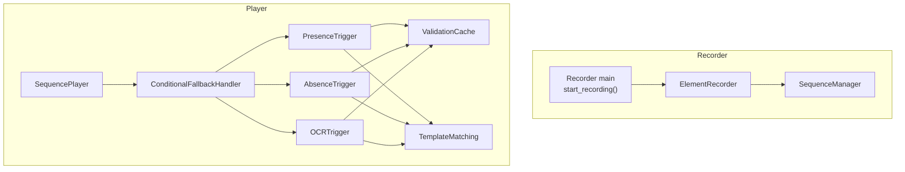
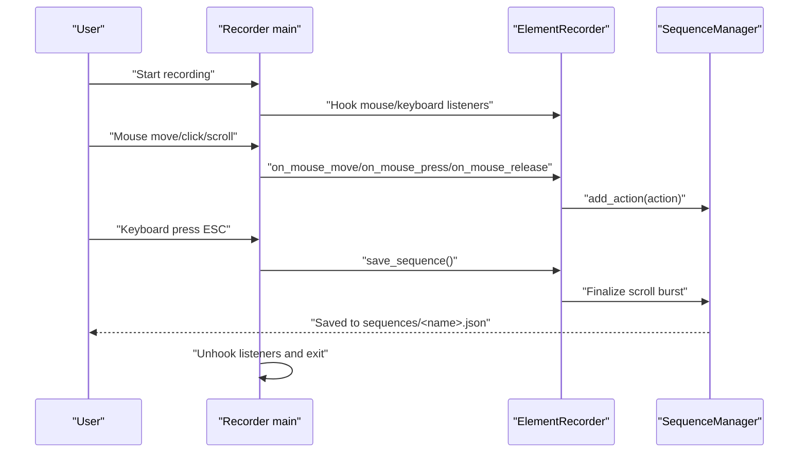
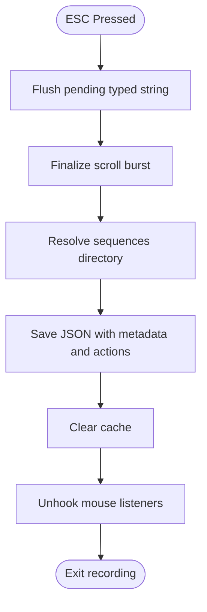
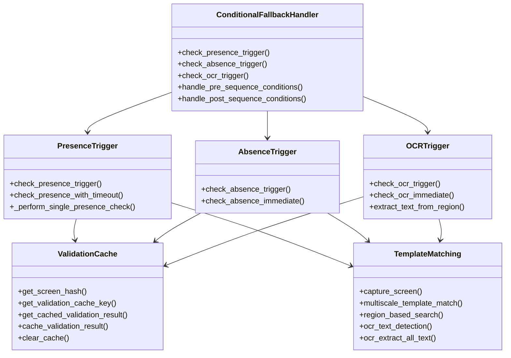
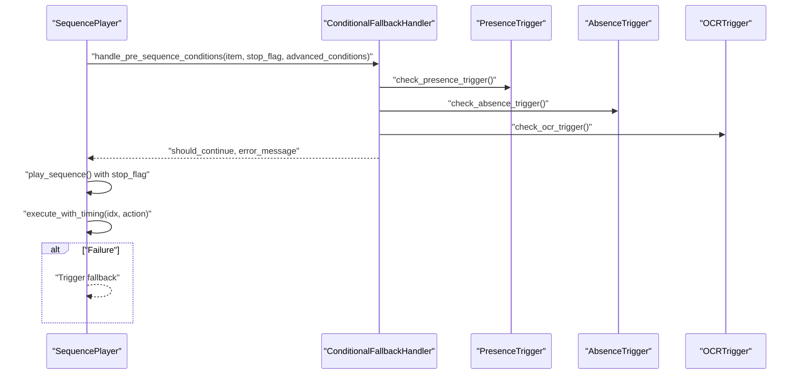
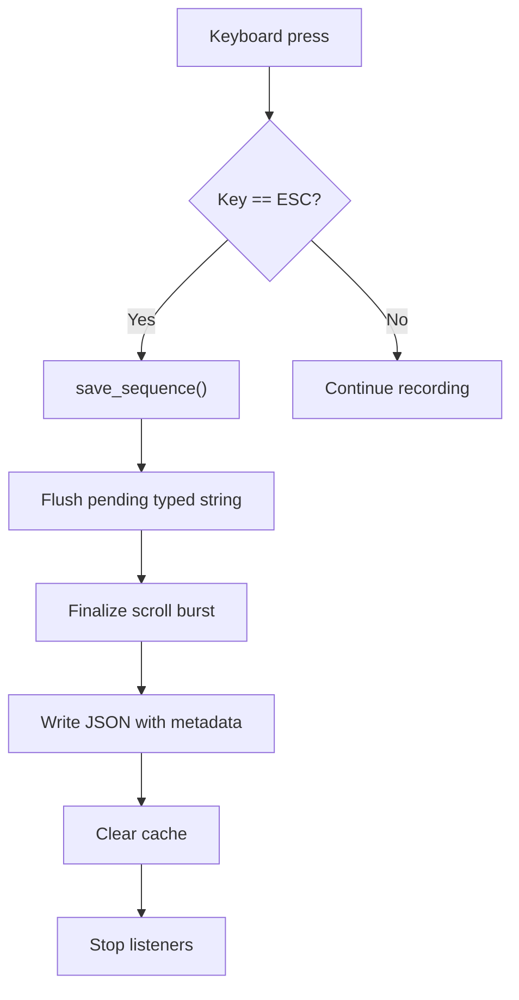
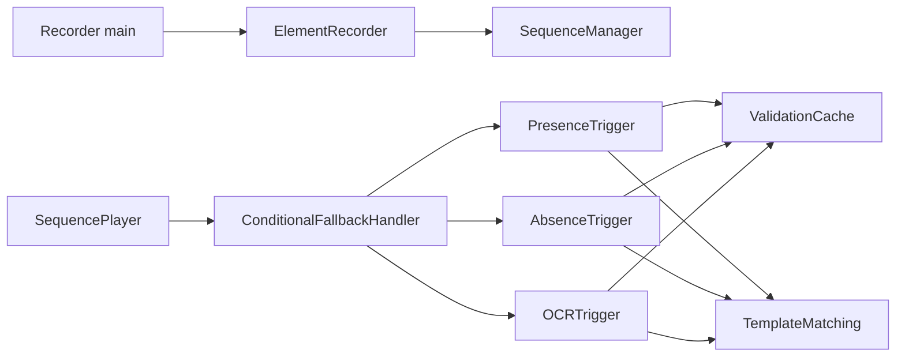

# Validation and Error Handling

<cite>
**Referenced Files in This Document**
- [main.py](file://LoOper/recorder/main.py)
- [element_recorder.py](file://LoOper/recorder/element_recorder.py)
- [sequence_manager.py](file://LoOper/recorder/sequence_manager.py)
- [conditional_fallback_handler.py](file://LoOper/player/multi_sequence/conditional_fallback_handler.py)
- [presence_trigger.py](file://LoOper/player/multi_sequence/conditional_fallback_resources/presence_trigger.py)
- [absence_trigger.py](file://LoOper/player/multi_sequence/conditional_fallback_resources/absence_trigger.py)
- [ocr_trigger.py](file://LoOper/player/multi_sequence/conditional_fallback_resources/ocr_trigger.py)
- [validation_cache.py](file://LoOper/player/multi_sequence/conditional_fallback_resources/validation_cache.py)
- [computer_vision.py](file://LoOper/player/computer_vision.py)
- [sequence_player.py](file://LoOper/player/sequence_player.py)
</cite>

## Table of Contents
1. [Introduction](#introduction)
2. [Project Structure](#project-structure)
3. [Core Components](#core-components)
4. [Architecture Overview](#architecture-overview)
5. [Detailed Component Analysis](#detailed-component-analysis)
6. [Dependency Analysis](#dependency-analysis)
7. [Performance Considerations](#performance-considerations)
8. [Troubleshooting Guide](#troubleshooting-guide)
9. [Conclusion](#conclusion)

## Introduction
This document focuses on the validation and error handling subsystems that ensure reliable automation across recording and playback. It explains real-time validation strategies for captured events, error detection during recording, and graceful degradation patterns. It also documents the ESC key cancellation system, sequence saving mechanisms, and cleanup procedures. Practical examples illustrate validation callbacks, error propagation, and recovery strategies, along with integration points in the main recording loop, exception handling patterns, and user feedback mechanisms. Guidance is provided for extending validation rules, implementing custom error handlers, and maintaining recording reliability under varying conditions.

## Project Structure
The validation and error handling spans two primary subsystems:
- Recorder: captures user interactions, groups scroll bursts, manages screenshots, and saves sequences on ESC.
- Player: executes sequences with robust fallbacks, conditional triggers, and computer vision validation.

**Diagram sources**
- [main.py:7-75](file://LoOper/recorder/main.py#L7-L75)
- [element_recorder.py:11-155](file://LoOper/recorder/element_recorder.py#L11-L155)
- [sequence_manager.py:18-178](file://LoOper/recorder/sequence_manager.py#L18-L178)
- [conditional_fallback_handler.py:20-100](file://LoOper/player/multi_sequence/conditional_fallback_handler.py#L20-L100)
- [presence_trigger.py:12-100](file://LoOper/player/multi_sequence/conditional_fallback_resources/presence_trigger.py#L12-L100)
- [absence_trigger.py:11-110](file://LoOper/player/multi_sequence/conditional_fallback_resources/absence_trigger.py#L11-L110)
- [ocr_trigger.py:11-110](file://LoOper/player/multi_sequence/conditional_fallback_resources/ocr_trigger.py#L11-L110)
- [validation_cache.py:12-55](file://LoOper/player/multi_sequence/conditional_fallback_resources/validation_cache.py#L12-L55)
- [computer_vision.py:47-178](file://LoOper/player/computer_vision.py#L47-L178)

**Section sources**
- [main.py:1-75](file://LoOper/recorder/main.py#L1-L75)
- [element_recorder.py:1-155](file://LoOper/recorder/element_recorder.py#L1-L155)
- [sequence_manager.py:1-178](file://LoOper/recorder/sequence_manager.py#L1-L178)
- [conditional_fallback_handler.py:1-208](file://LoOper/player/multi_sequence/conditional_fallback_handler.py#L1-L208)
- [presence_trigger.py:1-249](file://LoOper/player/multi_sequence/conditional_fallback_resources/presence_trigger.py#L1-L249)
- [absence_trigger.py:1-229](file://LoOper/player/multi_sequence/conditional_fallback_resources/absence_trigger.py#L1-L229)
- [ocr_trigger.py:1-266](file://LoOper/player/multi_sequence/conditional_fallback_resources/ocr_trigger.py#L1-L266)
- [validation_cache.py:1-208](file://LoOper/player/multi_sequence/conditional_fallback_resources/validation_cache.py#L1-L208)
- [computer_vision.py:1-606](file://LoOper/player/computer_vision.py#L1-L606)
- [sequence_player.py:1-252](file://LoOper/player/sequence_player.py#L1-L252)

## Core Components
- Recorder entrypoint and listeners: starts mouse and keyboard listeners, routes events to the recorder, and saves on ESC.
- ElementRecorder: orchestrates screenshot capture, scroll grouping, mouse and keyboard action creation, and integrates with SequenceManager.
- SequenceManager: attaches app context, adds actions, persists sequences to disk, and clears caches upon save.
- ConditionalFallbackHandler: aggregates presence, absence, and OCR triggers; evaluates pre/post conditions; delegates to modular components.
- PresenceTrigger: performs multiscale template matching with grayscale/color retries and optional timeout loops.
- AbsenceTrigger: checks absence with timeout and interval-based polling.
- OCRTrigger: detects text via OCR with configurable region/language and caching.
- ValidationCache: provides thread-safe caching with TTL and screen-hash-aware keys; current logic intentionally bypasses cache reads for correctness.
- TemplateMatching: computer vision engine for screen capture, multiscale matching, region search, and OCR text detection.
- SequencePlayer: loads sequences with caching, iterates actions with stop-flag support, and triggers fallbacks on failures.

**Section sources**
- [main.py:7-75](file://LoOper/recorder/main.py#L7-L75)
- [element_recorder.py:11-155](file://LoOper/recorder/element_recorder.py#L11-L155)
- [sequence_manager.py:18-178](file://LoOper/recorder/sequence_manager.py#L18-L178)
- [conditional_fallback_handler.py:20-100](file://LoOper/player/multi_sequence/conditional_fallback_handler.py#L20-L100)
- [presence_trigger.py:12-100](file://LoOper/player/multi_sequence/conditional_fallback_resources/presence_trigger.py#L12-L100)
- [absence_trigger.py:11-110](file://LoOper/player/multi_sequence/conditional_fallback_resources/absence_trigger.py#L11-L110)
- [ocr_trigger.py:11-110](file://LoOper/player/multi_sequence/conditional_fallback_resources/ocr_trigger.py#L11-L110)
- [validation_cache.py:12-55](file://LoOper/player/multi_sequence/conditional_fallback_resources/validation_cache.py#L12-L55)
- [computer_vision.py:47-178](file://LoOper/player/computer_vision.py#L47-L178)
- [sequence_player.py:136-252](file://LoOper/player/sequence_player.py#L136-L252)

## Architecture Overview
The system integrates recording and playback with robust validation and error handling:
- Recording loop captures mouse, keyboard, and scroll events, groups bursts, and records actions with screenshots where applicable.
- ESC triggers immediate save and listener shutdown.
- Playback validates pre/post conditions using computer vision and OCR, with timeouts and retries.
- Fallbacks are triggered on failures, enabling graceful degradation.

**Diagram sources**
- [main.py:7-75](file://LoOper/recorder/main.py#L7-L75)
- [element_recorder.py:11-155](file://LoOper/recorder/element_recorder.py#L11-L155)
- [sequence_manager.py:138-178](file://LoOper/recorder/sequence_manager.py#L138-L178)

## Detailed Component Analysis

### Recorder: Real-time Validation and ESC Cancellation
- Event routing: mouse move/click/scroll and keyboard press/release are routed to ElementRecorder methods.
- ESC handling: stops keyboard listener and triggers save_sequence, unhooking mouse listeners.
- Scroll grouping: ScrollManager coalesces deltas into bursts; finalize_scroll_burst is called on save.
- Screenshot capture: performed on click actions requiring visual context.
- Sequence persistence: SequenceManager writes metadata and actions to disk and clears caches.

**Diagram sources**
- [main.py:48-70](file://LoOper/recorder/main.py#L48-L70)
- [element_recorder.py:137-155](file://LoOper/recorder/element_recorder.py#L137-L155)
- [sequence_manager.py:138-178](file://LoOper/recorder/sequence_manager.py#L138-L178)

**Section sources**
- [main.py:7-75](file://LoOper/recorder/main.py#L7-L75)
- [element_recorder.py:11-155](file://LoOper/recorder/element_recorder.py#L11-L155)
- [sequence_manager.py:18-178](file://LoOper/recorder/sequence_manager.py#L18-L178)

### Validation Strategies: Presence, Absence, and OCR
- PresenceTrigger: multiscale template matching with grayscale-first, color fallback; supports timeout-based polling; bypasses cache for correctness.
- AbsenceTrigger: polls presence periodically until element disappears or timeout; supports immediate absence check.
- OCRTrigger: extracts text via OCR, matches target text with case sensitivity options, and caches results.
- ValidationCache: generates screen-hash-aware keys and maintains TTL; current logic intentionally bypasses cache reads to ensure fresh checks.
- TemplateMatching: provides screen capture, multiscale matching, region-based search, and OCR text detection.

**Diagram sources**
- [conditional_fallback_handler.py:20-100](file://LoOper/player/multi_sequence/conditional_fallback_handler.py#L20-L100)
- [presence_trigger.py:12-100](file://LoOper/player/multi_sequence/conditional_fallback_resources/presence_trigger.py#L12-L100)
- [absence_trigger.py:11-110](file://LoOper/player/multi_sequence/conditional_fallback_resources/absence_trigger.py#L11-L110)
- [ocr_trigger.py:11-110](file://LoOper/player/multi_sequence/conditional_fallback_resources/ocr_trigger.py#L11-L110)
- [validation_cache.py:12-55](file://LoOper/player/multi_sequence/conditional_fallback_resources/validation_cache.py#L12-L55)
- [computer_vision.py:47-178](file://LoOper/player/computer_vision.py#L47-L178)

**Section sources**
- [conditional_fallback_handler.py:100-185](file://LoOper/player/multi_sequence/conditional_fallback_handler.py#L100-L185)
- [presence_trigger.py:30-106](file://LoOper/player/multi_sequence/conditional_fallback_resources/presence_trigger.py#L30-L106)
- [absence_trigger.py:29-110](file://LoOper/player/multi_sequence/conditional_fallback_resources/absence_trigger.py#L29-L110)
- [ocr_trigger.py:29-110](file://LoOper/player/multi_sequence/conditional_fallback_resources/ocr_trigger.py#L29-L110)
- [validation_cache.py:94-208](file://LoOper/player/multi_sequence/conditional_fallback_resources/validation_cache.py#L94-L208)
- [computer_vision.py:92-178](file://LoOper/player/computer_vision.py#L92-L178)

### Playback Execution and Fallback Integration
- SequencePlayer loads sequences with caching and stop-flag support, iterating actions with timing and fallback invocation on failure.
- ConditionalFallbackHandler evaluates pre/post conditions using triggers and returns continuation decisions with error messages.
- TemplateMatching supports OCR-based validation and region-based matching for robustness.

**Diagram sources**
- [sequence_player.py:202-252](file://LoOper/player/sequence_player.py#L202-L252)
- [conditional_fallback_handler.py:100-185](file://LoOper/player/multi_sequence/conditional_fallback_handler.py#L100-L185)
- [presence_trigger.py:30-106](file://LoOper/player/multi_sequence/conditional_fallback_resources/presence_trigger.py#L30-L106)
- [absence_trigger.py:29-110](file://LoOper/player/multi_sequence/conditional_fallback_resources/absence_trigger.py#L29-L110)
- [ocr_trigger.py:29-110](file://LoOper/player/multi_sequence/conditional_fallback_resources/ocr_trigger.py#L29-L110)

**Section sources**
- [sequence_player.py:136-252](file://LoOper/player/sequence_player.py#L136-L252)
- [conditional_fallback_handler.py:100-185](file://LoOper/player/multi_sequence/conditional_fallback_handler.py#L100-L185)

### Error Detection During Recording and Graceful Degradation
- Keyboard handler: ESC triggers immediate save and listener shutdown.
- Scroll manager: scroll bursts are finalized before saving to avoid partial actions.
- Screenshot manager: click screenshots are captured and attached to actions when needed.
- SequenceManager: app context is attached to actions; save writes metadata and actions; cache is cleared to ensure updated chain visibility.

**Diagram sources**
- [main.py:48-70](file://LoOper/recorder/main.py#L48-L70)
- [element_recorder.py:137-155](file://LoOper/recorder/element_recorder.py#L137-L155)
- [sequence_manager.py:138-178](file://LoOper/recorder/sequence_manager.py#L138-L178)

**Section sources**
- [main.py:48-70](file://LoOper/recorder/main.py#L48-L70)
- [element_recorder.py:137-155](file://LoOper/recorder/element_recorder.py#L137-L155)
- [sequence_manager.py:138-178](file://LoOper/recorder/sequence_manager.py#L138-L178)

## Dependency Analysis
- Recorder depends on ElementRecorder, which composes ScreenshotManager, ScrollManager, KeyboardHandler, MouseHandler, and SequenceManager.
- Player components depend on TemplateMatching for computer vision and OCR, ValidationCache for caching, and ConditionalFallbackHandler for orchestration.
- SequencePlayer depends on SequenceCache for file-based caching and on base bot execution for action playback.

**Diagram sources**
- [main.py:7-75](file://LoOper/recorder/main.py#L7-L75)
- [element_recorder.py:11-21](file://LoOper/recorder/element_recorder.py#L11-L21)
- [sequence_manager.py:18-24](file://LoOper/recorder/sequence_manager.py#L18-L24)
- [sequence_player.py:136-158](file://LoOper/player/sequence_player.py#L136-L158)
- [conditional_fallback_handler.py:20-43](file://LoOper/player/multi_sequence/conditional_fallback_handler.py#L20-L43)
- [presence_trigger.py:12-29](file://LoOper/player/multi_sequence/conditional_fallback_resources/presence_trigger.py#L12-L29)
- [absence_trigger.py:11-28](file://LoOper/player/multi_sequence/conditional_fallback_resources/absence_trigger.py#L11-L28)
- [ocr_trigger.py:11-28](file://LoOper/player/multi_sequence/conditional_fallback_resources/ocr_trigger.py#L11-L28)
- [validation_cache.py:12-20](file://LoOper/player/multi_sequence/conditional_fallback_resources/validation_cache.py#L12-L20)
- [computer_vision.py:47-55](file://LoOper/player/computer_vision.py#L47-L55)

**Section sources**
- [main.py:1-75](file://LoOper/recorder/main.py#L1-L75)
- [element_recorder.py:1-155](file://LoOper/recorder/element_recorder.py#L1-L155)
- [sequence_manager.py:1-178](file://LoOper/recorder/sequence_manager.py#L1-L178)
- [sequence_player.py:1-252](file://LoOper/player/sequence_player.py#L1-L252)
- [conditional_fallback_handler.py:1-208](file://LoOper/player/multi_sequence/conditional_fallback_handler.py#L1-L208)
- [presence_trigger.py:1-249](file://LoOper/player/multi_sequence/conditional_fallback_resources/presence_trigger.py#L1-L249)
- [absence_trigger.py:1-229](file://LoOper/player/multi_sequence/conditional_fallback_resources/absence_trigger.py#L1-L229)
- [ocr_trigger.py:1-266](file://LoOper/player/multi_sequence/conditional_fallback_resources/ocr_trigger.py#L1-L266)
- [validation_cache.py:1-208](file://LoOper/player/multi_sequence/conditional_fallback_resources/validation_cache.py#L1-L208)
- [computer_vision.py:1-606](file://LoOper/player/computer_vision.py#L1-L606)

## Performance Considerations
- Template matching uses adaptive scale sets and resets to balance speed and accuracy across repeated checks.
- Multiscale matching prioritizes scales near 1.0 for faster initial checks, expanding to broader scales as needed.
- Caching is present but intentionally bypassed in current logic to ensure correctness; TTL and lock protect cache integrity.
- SequencePlayer employs a thread-safe SequenceCache with LRU-like eviction and timestamp-based freshness checks.
- Computer vision capture prefers mss for speed and falls back to pyautogui; OCR preprocessing improves detection quality.

[No sources needed since this section provides general guidance]

## Troubleshooting Guide
- ESC does not save: verify keyboard listener is active and ESC is recognized; ensure save_sequence is invoked and listeners are unhooked.
- Scroll not saved: confirm finalize_scroll_burst is called during save; check ScrollManager’s burst handling.
- Missing screenshots: ensure ScreenshotManager is initialized and capture routines are executed for click actions.
- Validation false positives/negatives:
  - PresenceTrigger: try grayscale then color matching; adjust confidence thresholds and scales.
  - AbsenceTrigger: increase timeout and check_interval; verify image existence.
  - OCRTrigger: adjust language, region, and case sensitivity; ensure OCR is available.
- Cache-related issues: ValidationCache uses TTL and locks; clearing cache resolves stale states.
- Playback failures: SequencePlayer logs exceptions and stops on error; use fallback_callback to recover.

**Section sources**
- [main.py:48-70](file://LoOper/recorder/main.py#L48-L70)
- [element_recorder.py:137-155](file://LoOper/recorder/element_recorder.py#L137-L155)
- [sequence_manager.py:138-178](file://LoOper/recorder/sequence_manager.py#L138-L178)
- [presence_trigger.py:74-106](file://LoOper/player/multi_sequence/conditional_fallback_resources/presence_trigger.py#L74-L106)
- [absence_trigger.py:59-110](file://LoOper/player/multi_sequence/conditional_fallback_resources/absence_trigger.py#L59-L110)
- [ocr_trigger.py:70-110](file://LoOper/player/multi_sequence/conditional_fallback_resources/ocr_trigger.py#L70-L110)
- [validation_cache.py:146-208](file://LoOper/player/multi_sequence/conditional_fallback_resources/validation_cache.py#L146-L208)
- [sequence_player.py:242-252](file://LoOper/player/sequence_player.py#L242-L252)

## Conclusion
The validation and error handling subsystem ensures robust automation by combining real-time event validation, computer vision-based triggers, and resilient playback with fallbacks. The ESC cancellation system provides immediate control, while scroll grouping and screenshot capture maintain fidelity. The modular ConditionalFallbackHandler, combined with Presence/Absence/OCR triggers and ValidationCache, enables graceful degradation and reliable recovery. Extending validation rules and custom error handlers is straightforward through the modular components and clear integration points.