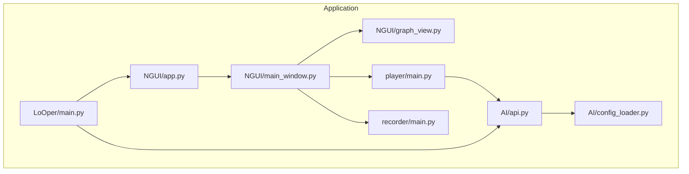
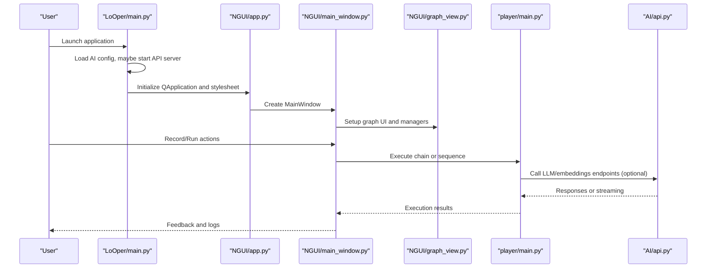
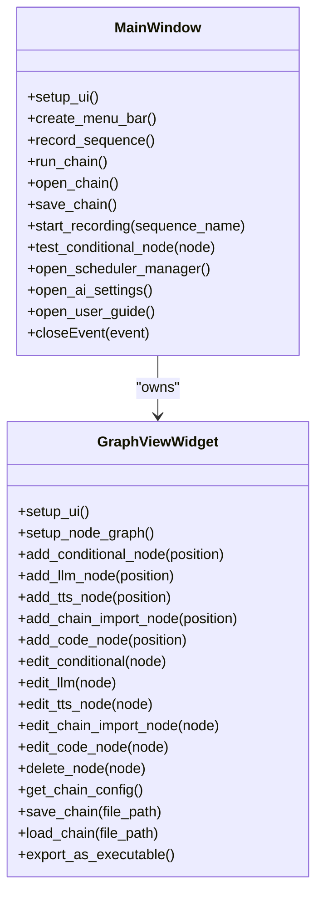
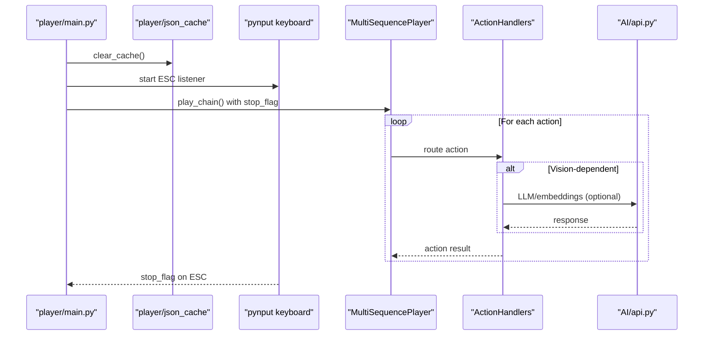
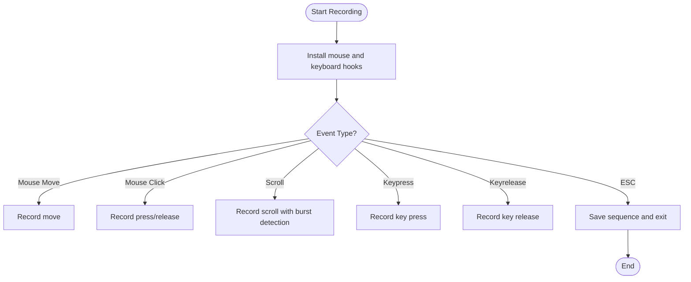
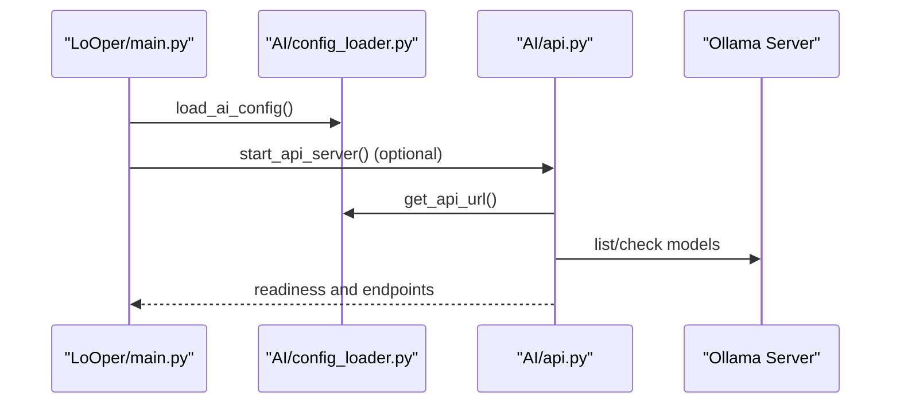
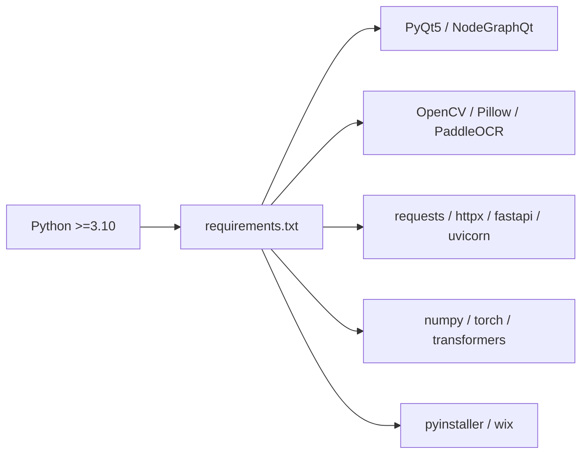

# Development Guidelines

<cite>
**Referenced Files in This Document**
- [README.md](file://README.md)
- [LoOper/README.MD](file://LoOper/README.MD)
- [requirements.txt](file://requirements.txt)
- [pyproject.toml](file://pyproject.toml)
- [LoOper/main.py](file://LoOper/main.py)
- [LoOper/AI/api.py](file://LoOper/AI/api.py)
- [LoOper/AI/config_loader.py](file://LoOper/AI/config_loader.py)
- [LoOper/NGUI/app.py](file://LoOper/NGUI/app.py)
- [LoOper/NGUI/main_window.py](file://LoOper/NGUI/main_window.py)
- [LoOper/NGUI/graph_view.py](file://LoOper/NGUI/graph_view.py)
- [LoOper/NGUI/nodes.py](file://LoOper/NGUI/nodes.py)
- [LoOper/player/main.py](file://LoOper/player/main.py)
- [LoOper/player/base_bot.py](file://LoOper/player/base_bot.py)
- [LoOper/recorder/main.py](file://LoOper/recorder/main.py)
</cite>

## Table of Contents
1. [Introduction](#introduction)
2. [Project Structure](#project-structure)
3. [Core Components](#core-components)
4. [Architecture Overview](#architecture-overview)
5. [Detailed Component Analysis](#detailed-component-analysis)
6. [Dependency Analysis](#dependency-analysis)
7. [Performance Considerations](#performance-considerations)
8. [Troubleshooting Guide](#troubleshooting-guide)
9. [Contribution and Extension Guidelines](#contribution-and-extension-guidelines)
10. [Conclusion](#conclusion)

## Introduction
This document provides comprehensive development guidelines for contributing to and extending LoOper V2. It covers environment setup, coding standards, testing procedures, GUI development with PyQt5, performance optimization, debugging strategies, and contribution workflows. It also documents extension patterns for custom nodes, plugins, and API additions, and outlines pull request and code review processes aligned with the project’s architecture and conventions.

## Project Structure
LoOper V2 is organized into cohesive modules:
- LoOper: main application package containing the GUI (NGUI), recorder, player, and AI integration.
- AI: optional local API server and model management utilities.
- Player: sequence and workflow execution engine with computer vision and fallback strategies.
- Recorder: modular input capture and sequence serialization.
- Top-level scripts and packaging: entry points, build specs, and installer generation.

**Diagram sources**
- [LoOper/main.py:1-419](file://LoOper/main.py#L1-L419)
- [LoOper/NGUI/app.py:1-153](file://Looper/NGUI/app.py#L1-L153)
- [LoOper/NGUI/main_window.py:1-770](file://Looper/NGUI/main_window.py#L1-L770)
- [LoOper/NGUI/graph_view.py:1-869](file://Looper/NGUI/graph_view.py#L1-L869)
- [LoOper/player/main.py:1-108](file://Looper/player/main.py#L1-L108)
- [LoOper/recorder/main.py:1-75](file://Looper/recorder/main.py#L1-L75)
- [LoOper/AI/api.py:1-800](file://Looper/AI/api.py#L1-L800)
- [LoOper/AI/config_loader.py:1-66](file://Looper/AI/config_loader.py#L1-L66)

**Section sources**
- [README.md:107-123](file://README.md#L107-L123)
- [LoOper/README.MD:13-47](file://LoOper/README.MD#L13-L47)

## Core Components
- NGUI (Node Graph Editor): PyQt5 + NodeGraphQt-based visual workflow builder with modular UI components, dialogs, and graph operations.
- Recorder: captures mouse, keyboard, and scroll events, groups actions intelligently, and serializes sequences with screenshots.
- Player: executes sequences and workflow chains with human-like motion, visual matching, fallbacks, and ESC cancellation.
- AI Layer: FastAPI server exposing LLM and embeddings endpoints, with Ollama integration and optional vision support.
- Packaging: PyInstaller spec and WiX MSI builder for Windows distribution.

**Section sources**
- [LoOper/README.MD:71-477](file://LoOper/README.MD#L71-L477)
- [LoOper/README.MD:478-663](file://LoOper/README.MD#L478-L663)
- [README.md:109-122](file://README.md#L109-L122)

## Architecture Overview
The application initializes the GUI, optionally starts the AI API server, preloads models, and exposes a node-based workflow editor. The player consumes either single sequences or complex workflow graphs, leveraging computer vision and AI endpoints.

**Diagram sources**
- [LoOper/main.py:355-419](file://Looper/main.py#L355-L419)
- [LoOper/NGUI/app.py:11-153](file://Looper/NGUI/app.py#L11-L153)
- [LoOper/NGUI/main_window.py:85-120](file://Looper/NGUI/main_window.py#L85-L120)
- [LoOper/NGUI/graph_view.py:43-128](file://Looper/NGUI/graph_view.py#L43-L128)
- [LoOper/player/main.py:18-107](file://Looper/player/main.py#L18-L107)
- [LoOper/AI/api.py:547-607](file://Looper/AI/api.py#L547-L607)

## Detailed Component Analysis

### GUI Development with PyQt5 (NGUI)
- Theming and DPI: High-DPI scaling and dark theme applied via stylesheet; language detection and icons integrated.
- Graph View: Modular components (UIComponents, GraphManager, NodeOperations, ViewManager, ConfigManager, ExportUtils, NodeTransforms) encapsulate UI logic and node operations.
- Menus and Toolbars: File, Settings, Environment, View, Scheduler, and Documentation menus; toolbar visibility toggled dynamically.
- Event Handling: Keyboard shortcuts (Copy/Cut/Paste/Delete), ESC abort, and drag-and-drop integration.

**Diagram sources**
- [LoOper/NGUI/main_window.py:85-770](file://Looper/NGUI/main_window.py#L85-L770)
- [LoOper/NGUI/graph_view.py:43-869](file://Looper/NGUI/graph_view.py#L43-L869)

**Section sources**
- [LoOper/NGUI/app.py:11-153](file://Looper/NGUI/app.py#L11-L153)
- [LoOper/NGUI/main_window.py:151-257](file://Looper/NGUI/main_window.py#L151-L257)
- [LoOper/NGUI/graph_view.py:129-186](file://Looper/NGUI/graph_view.py#L129-L186)

### Player Engine and Execution Flow
- CLI entry: parses file path, clears JSON cache, sets ESC abort flag, detects sequence vs. chain format, and runs playback.
- Human-like automation: random delays, curved mouse movement, click jitter, and screenshot capture after actions.
- Action routing: centralized via ActionHandlers for click, move, type, keystroke, scroll, clipboard, and drag operations.

**Diagram sources**
- [LoOper/player/main.py:18-107](file://Looper/player/main.py#L18-L107)
- [LoOper/player/base_bot.py:22-299](file://Looper/player/base_bot.py#L22-L299)
- [LoOper/AI/api.py:655-766](file://Looper/AI/api.py#L655-L766)

**Section sources**
- [LoOper/player/main.py:18-107](file://Looper/player/main.py#L18-L107)
- [LoOper/player/base_bot.py:50-283](file://Looper/player/base_bot.py#L50-L283)

### Recorder Module
- Event hooks: mouse (move/click/scroll), keyboard (press/release/ESC).
- Smart grouping: scroll bursts, typed text, and modifier combinations.
- Screenshot capture: per-click regions, organized storage, and error handling.

**Diagram sources**
- [LoOper/recorder/main.py:7-75](file://Looper/recorder/main.py#L7-L75)

**Section sources**
- [LoOper/recorder/main.py:7-75](file://Looper/recorder/main.py#L7-L75)

### AI API Server and Configuration
- FastAPI endpoints: health, models, chat/generate, embeddings, and streaming.
- Ollama integration: model listing, bootstrapping, vision model detection, and runner cleanup.
- Configuration loader: merges file and environment variables, computes API URL, and controls auto-start.

**Diagram sources**
- [LoOper/main.py:171-381](file://Looper/main.py#L171-L381)
- [LoOper/AI/config_loader.py:9-66](file://Looper/AI/config_loader.py#L9-L66)
- [LoOper/AI/api.py:581-654](file://Looper/AI/api.py#L581-L654)

**Section sources**
- [LoOper/AI/api.py:547-800](file://Looper/AI/api.py#L547-L800)
- [LoOper/AI/config_loader.py:9-66](file://Looper/AI/config_loader.py#L9-L66)

## Dependency Analysis
- Python version: 3.10+ required.
- Core dependencies include PyQt5, NodeGraphQt, PyAutoGUI, OpenCV, NumPy, Pillow, PaddleOCR, requests, and others for AI/ML.
- Optional extras for vision stacks and platform-specific constraints.

**Diagram sources**
- [requirements.txt:1-195](file://requirements.txt#L1-L195)
- [pyproject.toml:9-204](file://pyproject.toml#L9-L204)

**Section sources**
- [requirements.txt:1-195](file://requirements.txt#L1-L195)
- [pyproject.toml:1-253](file://pyproject.toml#L1-L253)

## Performance Considerations
- Visual matching: adjust confidence thresholds, constrain search regions, and balance timeouts.
- Human-like motion: reduce excessive delays; leverage perlin noise for natural curves.
- Resource cleanup: clear JSON cache before execution, clean temporal screenshots, and stop API runners.
- Vision models: ensure adequate VRAM and model caching; use streaming for large responses.

[No sources needed since this section provides general guidance]

## Troubleshooting Guide
- Recording: missing screenshots, grouped actions, ESC not captured.
- Playback: images not found, wrong clicks, timing issues.
- GUI: nodes not appearing, slow performance, theme problems.
- Logging: enable debug mode via configuration; inspect graphui_debug.log.

**Section sources**
- [LoOper/README.MD:598-625](file://Looper/README.MD#L598-L625)
- [LoOper/NGUI/main_window.py:65-84](file://Looper/NGUI/main_window.py#L65-L84)

## Contribution and Extension Guidelines

### Environment Setup
- Platform: Windows recommended.
- Python: 3.10+.
- Install dependencies: use the provided requirements or editable install via pyproject configuration.
- Optional: install Ollama and verify OCR assets via helper scripts.

**Section sources**
- [README.md:127-146](file://README.md#L127-L146)
- [requirements.txt:1-195](file://requirements.txt#L1-L195)
- [pyproject.toml:1-253](file://pyproject.toml#L1-L253)

### Coding Standards
- Python conventions: PEP 8 style; descriptive names; minimal global state; explicit imports; docstrings for public APIs.
- GUI (PyQt5): centralize UI setup in app.py and main_window.py; use stylesheets for theming; avoid heavy computations on the UI thread.
- Player: encapsulate action handlers; expose stop flags for ESC cancellation; capture screenshots for debugging.
- AI API: validate inputs, handle timeouts, and provide streaming responses; manage Ollama runners and cleanup.

**Section sources**
- [LoOper/NGUI/app.py:11-153](file://Looper/NGUI/app.py#L11-L153)
- [LoOper/NGUI/main_window.py:85-120](file://Looper/NGUI/main_window.py#L85-L120)
- [Looper/player/base_bot.py:22-299](file://Looper/player/base_bot.py#L22-L299)
- [Looper/AI/api.py:547-800](file://Looper/AI/api.py#L547-L800)

### Testing Procedures
- Unit tests: place tests under a tests/ directory following unittest conventions.
- Player CLI: validate single sequence and chain execution; confirm ESC abort behavior.
- Recorder: verify action grouping, screenshot capture, and ESC save.
- AI API: health checks, model listing, chat/generate, embeddings, and streaming endpoints.

**Section sources**
- [LoOper/player/main.py:18-107](file://Looper/player/main.py#L18-L107)
- [LoOper/recorder/main.py:7-75](file://Looper/recorder/main.py#L7-L75)
- [Looper/AI/api.py:581-800](file://Looper/AI/api.py#L581-L800)

### Pull Request and Code Review Process
- Branching: feature branches from develop; concise commit messages.
- Review checklist:
  - Code correctness and adherence to standards.
  - UI responsiveness and error handling.
  - Player stability and ESC abort behavior.
  - AI API resilience and timeout handling.
  - Documentation updates for new endpoints or workflows.
- CI: ensure builds succeed on Windows; validate installer generation if changes touch packaging.

[No sources needed since this section provides general guidance]

### Extending the Platform

#### Custom Node Development
- Define node classes in NGUI/nodes_resources and register them via NGUI/nodes.py.
- Implement property dialogs and configuration persistence.
- Integrate with NodeOperations and GraphManager for creation, editing, and validation.

**Section sources**
- [LoOper/NGUI/nodes.py:1-14](file://Looper/NGUI/nodes.py#L1-L14)
- [Looper/NGUI/graph_view.py:320-424](file://Looper/NGUI/graph_view.py#L320-L424)

#### Plugin Creation
- Extend AI endpoints: add new routes in AI/api.py with request/response models; integrate with Ollama or external services.
- Add new action handlers: extend ActionHandlers in player/action_handlers.py to support new action types.

**Section sources**
- [Looper/AI/api.py:547-800](file://Looper/AI/api.py#L547-L800)
- [Looper/player/base_bot.py:22-299](file://Looper/player/base_bot.py#L22-L299)

#### API Extension Patterns
- Health and status: use existing patterns for readiness checks and bootstrap state.
- Streaming: follow StreamingResponse patterns for long-running tasks.
- Vision models: detect multimodal capability and process images consistently.

**Section sources**
- [Looper/AI/api.py:581-654](file://Looper/AI/api.py#L581-L654)
- [Looper/AI/api.py:768-794](file://Looper/AI/api.py#L768-L794)

### GUI Development Best Practices
- Use centralized stylesheet application in app.py.
- Manage DPI and high-DPI scaling; apply dark theme consistently.
- Defer heavy operations to background threads; use signals/slots for UI updates.
- Provide user feedback via status messages and logging.

**Section sources**
- [Looper/NGUI/app.py:11-153](file://Looper/NGUI/app.py#L11-L153)
- [Looper/NGUI/main_window.py:151-257](file://Looper/NGUI/main_window.py#L151-L257)

### Performance Optimization
- Prefer region-constrained matching and tuned thresholds.
- Minimize screenshot frequency; clean up temporal screenshots.
- Use streaming for large responses; avoid blocking UI thread.

**Section sources**
- [Looper/player/base_bot.py:66-94](file://Looper/player/base_bot.py#L66-L94)
- [Looper/AI/api.py:768-794](file://Looper/AI/api.py#L768-L794)

### Debugging Strategies
- Enable debug logging; inspect graphui_debug.log.
- Use ESC abort during playback to stop execution safely.
- Validate configuration via AI/config_loader and environment variables.

**Section sources**
- [Looper/NGUI/main_window.py:65-84](file://Looper/NGUI/main_window.py#L65-L84)
- [Looper/player/main.py:44-56](file://Looper/player/main.py#L44-L56)
- [Looper/AI/config_loader.py:9-66](file://Looper/AI/config_loader.py#L9-L66)

## Conclusion
These guidelines consolidate the development workflow, coding standards, testing procedures, and extension patterns for LoOper V2. By following the established architecture and conventions—especially in NGUI, Player, and AI—you can contribute reliably while maintaining performance and usability. For packaging and distribution, adhere to the provided build and installer scripts.