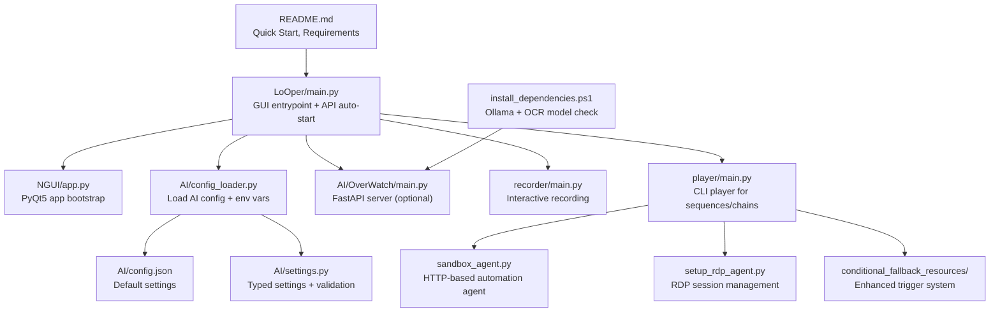
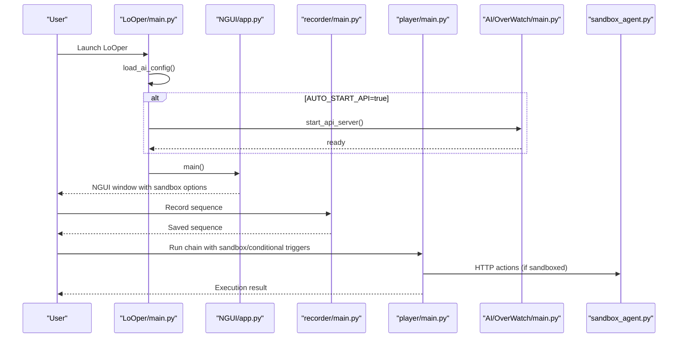
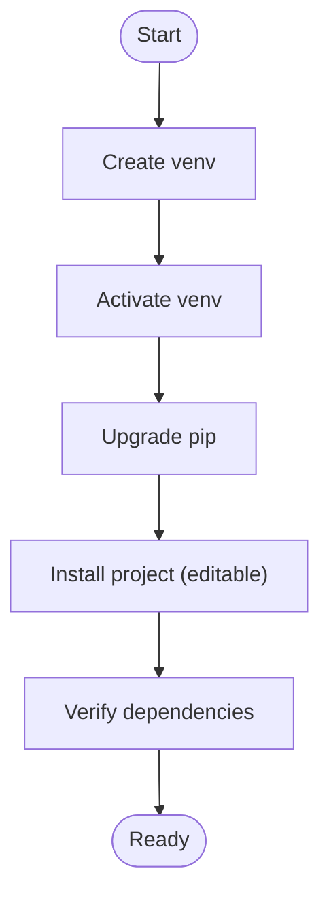
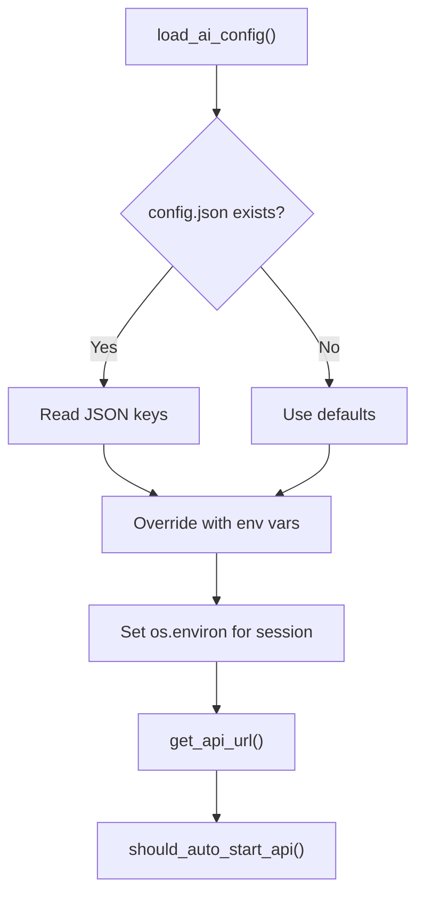
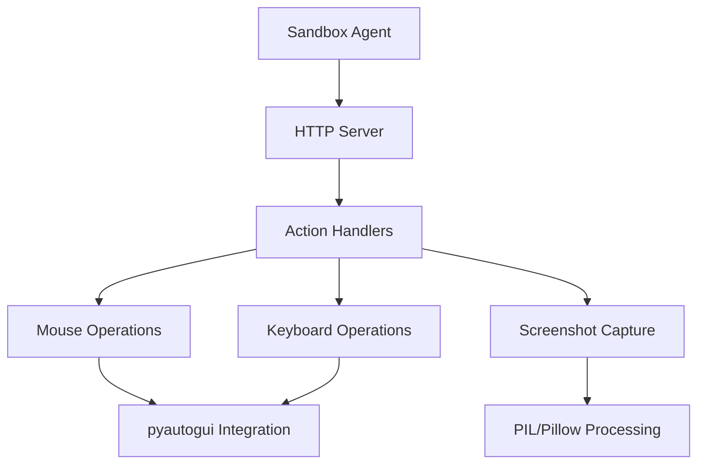
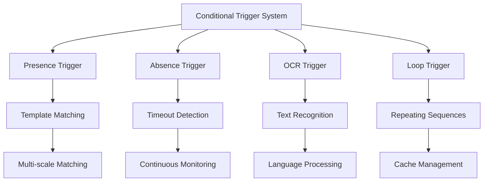
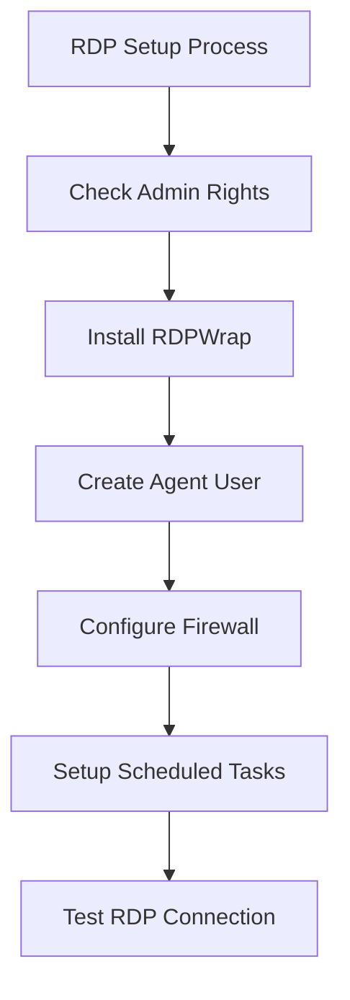
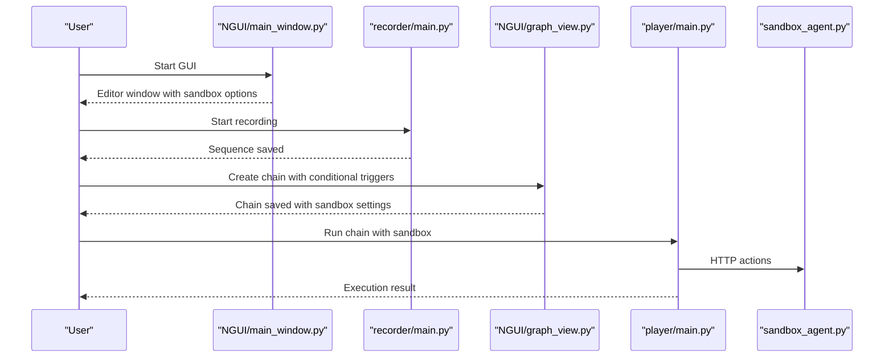
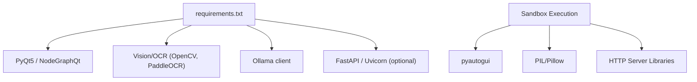

# Getting Started

<cite>
**Referenced Files in This Document**
- [README.md](file://README.md)
- [requirements.txt](file://requirements.txt)
- [LoOper/main.py](file://LoOper/main.py)
- [install_dependencies.ps1](file://install_dependencies.ps1)
- [LoOper/AI/config.json](file://LoOper/AI/config.json)
- [LoOper/AI/config_loader.py](file://LoOper/AI/config_loader.py)
- [LoOper/AI/settings.py](file://LoOper/AI/settings.py)
- [LoOper/AI/OverWatch/main.py](file://LoOper/AI/OverWatch/main.py)
- [LoOper/AI/OverWatch/launcher.py](file://LoOper/AI/OverWatch/launcher.py)
- [LoOper/recorder/main.py](file://LoOper/recorder/main.py)
- [LoOper/player/main.py](file://LoOper/player/main.py)
- [LoOper/NGUI/app.py](file://LoOper/NGUI/app.py)
- [LoOper/NGUI/main_window.py](file://LoOper/NGUI/main_window.py)
- [LoOper/NGUI/graph_view.py](file://LoOper/NGUI/graph_view.py)
- [LoOper/sandbox_agent.py](file://LoOper/sandbox_agent.py)
- [LoOper/setup_rdp_agent.py](file://LoOper/setup_rdp_agent.py)
- [LoOper/test_rdp_clicks.py](file://LoOper/test_rdp_clicks.py)
- [LoOper/player/computer_vision.py](file://LoOper/player/computer_vision.py)
- [LoOper/player/multi_sequence/conditional_fallback_resources/node_executor.py](file://LoOper/player/multi_sequence/conditional_fallback_resources/node_executor.py)
- [LoOper/player/multi_sequence/conditional_fallback_resources/presence_trigger.py](file://LoOper/player/multi_sequence/conditional_fallback_resources/presence_trigger.py)
- [LoOper/player/multi_sequence/conditional_fallback_resources/absence_trigger.py](file://LoOper/player/multi_sequence/conditional_fallback_resources/absence_trigger.py)
- [LoOper/player/multi_sequence/conditional_fallback_resources/ocr_trigger.py](file://LoOper/player/multi_sequence/conditional_fallback_resources/ocr_trigger.py)
- [LoOper/player/multi_sequence/conditional_fallback_resources/conditional_loop.py](file://LoOper/player/multi_sequence/conditional_fallback_resources/conditional_loop.py)
- [utils/rdpwrap/README.md](file://utils/rdpwrap/README.md)
</cite>

## Update Summary
**Changes Made**
- Added comprehensive documentation for new sandbox execution capabilities
- Enhanced conditional trigger functionality documentation with presence, absence, OCR, and loop triggers
- Updated installation and configuration guides to include RDP session management
- Added detailed RDP agent setup and testing procedures
- Expanded conditional trigger documentation with performance optimizations and sandbox integration

## Table of Contents
1. [Introduction](#introduction)
2. [Project Structure](#project-structure)
3. [Core Components](#core-components)
4. [Architecture Overview](#architecture-overview)
5. [Detailed Component Analysis](#detailed-component-analysis)
6. [Installation and Environment Setup](#installation-and-environment-setup)
7. [Prerequisites Verification](#prerequisites-verification)
8. [First-Time Configuration of AI Services](#first-time-configuration-of-ai-services)
9. [Sandbox Execution Capabilities](#sandbox-execution-capabilities)
10. [Enhanced Conditional Trigger Functionality](#enhanced-conditional-trigger-functionality)
11. [RDP Session Management](#rdp-session-management)
12. [Running the Application from Source](#running-the-application-from-source)
13. [Quick Start Tutorial](#quick-start-tutorial)
14. [Practical Examples](#practical-examples)
15. [Dependency Analysis](#dependency-analysis)
16. [Performance Considerations](#performance-considerations)
17. [Troubleshooting Guide](#troubleshooting-guide)
18. [Conclusion](#conclusion)
19. [Appendices](#appendices)

## Introduction
This guide helps you quickly install, configure, and run LoOper V2 from source on Windows. You will set up Python and dependencies, verify prerequisites, configure AI services, and complete a quick start tutorial to record a simple workflow, create a chain, and execute it safely. The latest version introduces powerful sandbox execution capabilities and enhanced conditional trigger functionality for robust automation scenarios.

Key highlights:
- Supported platform: Windows
- Recommended AI backend: Ollama for local LLM nodes
- Optional local API server (OverWatch) for LLM + RAG orchestration
- Visual workflow builder (NGUI) with node-based authoring
- Recorder and Player for capturing and executing automation sequences
- **NEW**: Sandbox execution capabilities for isolated automation environments
- **NEW**: Enhanced conditional trigger functionality with presence, absence, OCR, and loop triggers
- **NEW**: RDP session management for background automation

**Section sources**
- [README.md:125-147](file://README.md#L125-L147)

## Project Structure
LoOper V2 is organized into modules with enhanced sandbox and conditional trigger capabilities:
- LoOper/: main application package
  - NGUI/: visual workflow builder (node graph editor)
  - recorder/: input recording pipeline
  - player/: playback engine for sequences and workflows with sandbox support
  - AI/: AI configuration, local API server (OverWatch), and related utilities
  - **NEW**: sandbox_agent.py: HTTP-based agent for remote desktop automation
  - **NEW**: setup_rdp_agent.py: RDP session management and agent setup
- Top-level scripts and docs for installation and packaging

**Diagram sources**
- [README.md:125-147](file://README.md#L125-L147)
- [LoOper/main.py:133-135](file://LoOper/main.py#L133-L135)
- [LoOper/AI/config_loader.py:9-48](file://LoOper/AI/config_loader.py#L9-L48)
- [LoOper/AI/config.json:1-9](file://LoOper/AI/config.json#L1-L9)
- [LoOper/AI/settings.py:265-283](file://LoOper/AI/settings.py#L265-L283)
- [LoOper/AI/OverWatch/main.py:105-122](file://LoOper/AI/OverWatch/main.py#L105-L122)
- [install_dependencies.ps1:1-62](file://install_dependencies.ps1#L1-L62)
- [LoOper/recorder/main.py:1-75](file://LoOper/recorder/main.py#L1-L75)
- [LoOper/player/main.py:18-108](file://LoOper/player/main.py#L18-L108)
- [LoOper/sandbox_agent.py:1-157](file://LoOper/sandbox_agent.py#L1-L157)
- [LoOper/setup_rdp_agent.py:1-208](file://LoOper/setup_rdp_agent.py#L1-L208)

**Section sources**
- [README.md:107-123](file://README.md#L107-L123)

## Core Components
- GUI entrypoint and auto-start logic:
  - Loads AI configuration, optionally starts the local API server, preloads models, and launches the NGUI application.
- NGUI (visual workflow builder):
  - Node graph editor with menus, toolbar, and dialogs for configuring nodes including sandbox execution options.
- Recorder:
  - Interactive recording of mouse, keyboard, and scroll actions into reproducible sequences.
- Player:
  - Executes single sequences or full workflow chains with sandbox support; supports ESC cancellation.
- AI configuration and local API:
  - Reads from config.json and environment variables; exposes API endpoints for LLM and RAG.
- **NEW**: Sandbox Agent:
  - HTTP-based automation agent for remote desktop sessions with screenshot and action capabilities.
- **NEW**: Enhanced Conditional Triggers:
  - Presence, absence, OCR, and loop-based conditional triggers with performance optimizations.

**Section sources**
- [LoOper/main.py:355-373](file://LoOper/main.py#L355-L373)
- [LoOper/NGUI/app.py:11-153](file://LoOper/NGUI/app.py#L11-L153)
- [LoOper/NGUI/main_window.py:85-120](file://LoOper/NGUI/main_window.py#L85-L120)
- [LoOper/recorder/main.py:7-75](file://LoOper/recorder/main.py#L7-L75)
- [LoOper/player/main.py:18-108](file://LoOper/player/main.py#L18-L108)
- [LoOper/AI/config_loader.py:9-66](file://LoOper/AI/config_loader.py#L9-L66)
- [LoOper/AI/config.json:1-9](file://LoOper/AI/config.json#L1-L9)
- [LoOper/AI/settings.py:265-283](file://LoOper/AI/settings.py#L265-L283)
- [LoOper/sandbox_agent.py:1-157](file://LoOper/sandbox_agent.py#L1-L157)

## Architecture Overview
The application starts from the main entrypoint, which can auto-launch the local AI API server and then opens the NGUI editor. Users record sequences, build workflows with enhanced conditional triggers, and execute them either in the GUI with sandbox support or via the player CLI with advanced automation capabilities.

**Diagram sources**
- [LoOper/main.py:355-373](file://LoOper/main.py#L355-L373)
- [LoOper/AI/config_loader.py:62-66](file://LoOper/AI/config_loader.py#L62-L66)
- [LoOper/AI/OverWatch/main.py:748-767](file://LoOper/AI/OverWatch/main.py#L748-L767)
- [LoOper/NGUI/app.py:11-153](file://LoOper/NGUI/app.py#L11-L153)
- [LoOper/recorder/main.py:73-75](file://LoOper/recorder/main.py#L73-L75)
- [LoOper/player/main.py:18-108](file://LoOper/player/main.py#L18-L108)
- [LoOper/sandbox_agent.py:106-157](file://LoOper/sandbox_agent.py#L106-L157)

## Detailed Component Analysis

### Installation and Environment Setup
- Requirements:
  - Windows (primary platform)
  - Python 3.10+
  - Ollama recommended for LLM nodes
- Steps:
  1) Create and activate a virtual environment
  2) Upgrade pip
  3) Install the project in editable mode
  4) Verify dependencies from requirements.txt

**Diagram sources**
- [README.md:125-147](file://README.md#L125-L147)
- [requirements.txt:1-195](file://requirements.txt#L1-L195)

**Section sources**
- [README.md:127-140](file://README.md#L127-L140)
- [requirements.txt:1-195](file://requirements.txt#L1-L195)

### Prerequisites Verification
- Confirm Python version meets the requirement.
- Ensure Ollama is installed and reachable on the configured host/port.
- Validate OCR model assets are present (handled by the installer helper).

**Section sources**
- [README.md:127-131](file://README.md#L127-L131)
- [install_dependencies.ps1:18-45](file://install_dependencies.ps1#L18-L45)

### First-Time Configuration of AI Services
- AI configuration precedence:
  - Defaults in config_loader
  - File-based config.json
  - Environment variables override
- Key settings include API host/port, Ollama host/port, auto-start behavior, and ComoRAG flags.
- The GUI can open an AI Settings dialog to adjust configuration.

**Diagram sources**
- [LoOper/AI/config_loader.py:9-66](file://LoOper/AI/config_loader.py#L9-L66)
- [LoOper/AI/config.json:1-9](file://LoOper/AI/config.json#L1-L9)
- [LoOper/AI/settings.py:328-342](file://LoOper/AI/settings.py#L328-L342)

**Section sources**
- [LoOper/AI/config_loader.py:9-66](file://LoOper/AI/config_loader.py#L9-L66)
- [LoOper/AI/config.json:1-9](file://LoOper/AI/config.json#L1-L9)
- [LoOper/AI/settings.py:265-283](file://LoOper/AI/settings.py#L265-L283)
- [LoOper/NGUI/main_window.py:745-752](file://LoOper/NGUI/main_window.py#L745-L752)

## Sandbox Execution Capabilities

### Sandbox Agent Architecture
LoOper V2 introduces a sophisticated sandbox execution system that allows automation to run in isolated environments:

- **HTTP-based Agent**: The sandbox_agent.py provides a RESTful interface for remote desktop automation
- **Screenshot Capture**: Real-time screen capture with caching and hash validation
- **Action Execution**: Mouse clicks, keyboard input, scrolling, and drag operations
- **Network Isolation**: Runs in separate RDP sessions for complete isolation

### Sandbox Agent Features
- **Automatic Port Detection**: Falls back to port 8000 if no port specified
- **Status Reporting**: Writes agent status to shared directory for monitoring
- **Error Handling**: Comprehensive error reporting and recovery mechanisms
- **Security**: Controlled access through HTTP endpoints

**Diagram sources**
- [LoOper/sandbox_agent.py:14-104](file://LoOper/sandbox_agent.py#L14-L104)

**Section sources**
- [LoOper/sandbox_agent.py:1-157](file://LoOper/sandbox_agent.py#L1-L157)

## Enhanced Conditional Trigger Functionality

### Conditional Trigger Types
LoOper V2 provides four enhanced conditional trigger types with performance optimizations:

1. **Presence Trigger**: Detects visual elements on screen
2. **Absence Trigger**: Waits for elements to disappear
3. **OCR Trigger**: Recognizes text using optical character recognition
4. **Loop Trigger**: Creates repeating conditional loops

### Presence Trigger Optimization
The presence trigger system includes several performance enhancements:
- **Single Check Strategy**: Optimized for single-screen evaluation
- **Color/Grayscale Fallback**: Automatic fallback between color and grayscale matching
- **Cache Bypass**: Forced real-time screen checks for accuracy
- **Adaptive Scaling**: Multi-scale template matching with intelligent scale selection

### Absence Trigger Implementation
- **Timeout-based Detection**: Waits for elements to disappear within specified time limits
- **Immediate Mode**: Single-check absence detection
- **Multiple Element Support**: Handles multiple absence conditions with logical operators

### OCR Trigger Capabilities
- **Text Recognition**: Uses PaddleOCR for accurate text detection
- **Region-based Processing**: Limited OCR to specific screen regions
- **Case-sensitive Options**: Configurable text matching sensitivity
- **Language Support**: Multi-language OCR with configurable languages

### Loop Trigger Functionality
- **Multiple Loop Types**: While-present, while-absent, until-present, until-absent
- **Iteration Control**: Configurable maximum iterations and delays
- **Sequence Integration**: Executes predefined sequences within loops
- **Validation Cache**: Intelligent caching for loop condition evaluation

**Diagram sources**
- [LoOper/player/multi_sequence/conditional_fallback_resources/presence_trigger.py:30-105](file://LoOper/player/multi_sequence/conditional_fallback_resources/presence_trigger.py#L30-L105)
- [LoOper/player/multi_sequence/conditional_fallback_resources/absence_trigger.py:29-110](file://LoOper/player/multi_sequence/conditional_fallback_resources/absence_trigger.py#L29-L110)
- [LoOper/player/multi_sequence/conditional_fallback_resources/ocr_trigger.py:29-110](file://LoOper/player/multi_sequence/conditional_fallback_resources/ocr_trigger.py#L29-L110)
- [LoOper/player/multi_sequence/conditional_fallback_resources/conditional_loop.py:36-134](file://LoOper/player/multi_sequence/conditional_fallback_resources/conditional_loop.py#L36-L134)

**Section sources**
- [LoOper/player/multi_sequence/conditional_fallback_resources/node_executor.py:555-792](file://LoOper/player/multi_sequence/conditional_fallback_resources/node_executor.py#L555-L792)
- [LoOper/player/multi_sequence/conditional_fallback_resources/presence_trigger.py:30-249](file://LoOper/player/multi_sequence/conditional_fallback_resources/presence_trigger.py#L30-L249)
- [LoOper/player/multi_sequence/conditional_fallback_resources/absence_trigger.py:11-229](file://LoOper/player/multi_sequence/conditional_fallback_resources/absence_trigger.py#L11-L229)
- [LoOper/player/multi_sequence/conditional_fallback_resources/ocr_trigger.py:11-266](file://LoOper/player/multi_sequence/conditional_fallback_resources/ocr_trigger.py#L11-L266)
- [LoOper/player/multi_sequence/conditional_fallback_resources/conditional_loop.py:12-289](file://LoOper/player/multi_sequence/conditional_fallback_resources/conditional_loop.py#L12-L289)

## RDP Session Management

### RDP Agent Setup
LoOper V2 includes comprehensive RDP session management for background automation:

- **RDPWrap Integration**: Installs and configures RDPWrap for hidden session support
- **Agent User Creation**: Creates dedicated Windows account for automation
- **Firewall Configuration**: Opens necessary ports for RDP connectivity
- **Scheduled Task Management**: Automates agent startup on user login

### RDP Agent Features
- **Hidden Sessions**: Runs RDP sessions without visible windows for background automation
- **Agent Status Tracking**: Monitors agent health and status through shared files
- **Error Recovery**: Automatic restart and error reporting mechanisms
- **Security Integration**: Uses secure authentication and authorization

### Setup Process
The RDP agent setup follows a structured approach:
1. **Administrator Privileges**: Requires elevated permissions for system changes
2. **RDPWrap Installation**: Downloads and installs RDPWrap binaries
3. **Agent Account Creation**: Creates LoOperAgent user with administrative rights
4. **Firewall Configuration**: Enables RDP through Windows Firewall
5. **Session Management**: Configures automatic agent startup

**Diagram sources**
- [LoOper/setup_rdp_agent.py:166-208](file://LoOper/setup_rdp_agent.py#L166-L208)

**Section sources**
- [LoOper/setup_rdp_agent.py:1-208](file://LoOper/setup_rdp_agent.py#L1-L208)
- [LoOper/test_rdp_clicks.py:1-382](file://LoOper/test_rdp_clicks.py#L1-L382)
- [utils/rdpwrap/README.md:156-410](file://utils/rdpwrap/README.md#L156-L410)

## Running the Application from Source
- Launch the GUI:
  - From the repository root, run the main entrypoint script.
- The GUI loads AI settings, optionally starts the API server, preloads models, and displays the editor with sandbox execution options.

**Section sources**
- [README.md:142-146](file://README.md#L142-L146)
- [LoOper/main.py:355-373](file://LoOper/main.py#L355-L373)

## Quick Start Tutorial

### Basic Recording
- Use the interactive recorder to capture mouse, keyboard, and scroll actions.
- Save and exit with ESC.

### Enhanced Workflow Creation
- Open the NGUI editor, add nodes (Sequence, LLM, TTS, Conditional, etc.), connect them, and save the chain.
- **NEW**: Configure sandbox execution options for isolated automation.
- **NEW**: Set up conditional triggers with presence, absence, OCR, or loop conditions.

### Advanced Execution
- Run the chain from the GUI with sandbox support or via the player CLI with ESC cancellation.
- **NEW**: Monitor RDP session status and agent health.

**Diagram sources**
- [LoOper/recorder/main.py:7-75](file://LoOper/recorder/main.py#L7-L75)
- [LoOper/NGUI/main_window.py:487-638](file://LoOper/NGUI/main_window.py#L487-L638)
- [LoOper/NGUI/graph_view.py:548-558](file://LoOper/NGUI/graph_view.py#L548-L558)
- [LoOper/player/main.py:18-108](file://LoOper/player/main.py#L18-L108)
- [LoOper/sandbox_agent.py:106-157](file://LoOper/sandbox_agent.py#L106-L157)

**Section sources**
- [LoOper/recorder/main.py:7-75](file://LoOper/recorder/main.py#L7-L75)
- [LoOper/NGUI/main_window.py:487-638](file://LoOper/NGUI/main_window.py#L487-L638)
- [LoOper/NGUI/graph_view.py:548-558](file://LoOper/NGUI/graph_view.py#L548-L558)
- [LoOper/player/main.py:18-108](file://LoOper/player/main.py#L18-L108)

## Practical Examples

### Simple Workflow Example
1) Record a sequence (e.g., open an app and type text).
2) In NGUI, add a Sequence node referencing the recorded sequence.
3) Add an LLM node to generate text based on context.
4) Connect nodes and save the chain.
5) Run the chain from the GUI; cancel with ESC if needed.

### Enhanced Conditional Workflow Example
1) Record a sequence for opening an application.
2) Add a Presence Trigger node to detect when the application window appears.
3) Add a Sequence node to perform actions when the trigger is satisfied.
4) Add an Absence Trigger node to wait for completion.
5) Connect all nodes and configure sandbox execution.
6) Run the chain with RDP session management.

### Loop-based Automation Example
1) Create a loop trigger with while-present condition.
2) Set up a sequence to repeat (e.g., check for notifications).
3) Configure maximum iterations and delay between checks.
4) Execute the chain in sandbox mode for continuous monitoring.

**Section sources**
- [LoOper/recorder/main.py:7-75](file://LoOper/recorder/main.py#L7-L75)
- [LoOper/NGUI/main_window.py:487-638](file://LoOper/NGUI/main_window.py#L487-L638)
- [LoOper/player/main.py:18-108](file://LoOper/player/main.py#L18-L108)
- [LoOper/player/multi_sequence/conditional_fallback_resources/conditional_loop.py:182-242](file://LoOper/player/multi_sequence/conditional_fallback_resources/conditional_loop.py#L182-L242)

## Dependency Analysis
- Core runtime dependencies are listed in requirements.txt.
- The GUI uses PyQt5 and NodeGraphQt; vision/OCR uses OpenCV and PaddleOCR.
- AI stack integrates Ollama and optional local API server (FastAPI/Uvicorn).
- **NEW**: Sandbox execution requires pyautogui, PIL/Pillow, and HTTP server libraries.

**Diagram sources**
- [requirements.txt:1-195](file://requirements.txt#L1-L195)
- [LoOper/sandbox_agent.py:1-157](file://LoOper/sandbox_agent.py#L1-L157)

**Section sources**
- [requirements.txt:1-195](file://requirements.txt#L1-L195)

## Performance Considerations
- Prefer Python 3.10+ for compatibility with pinned dependencies.
- Keep GPU drivers updated if using CUDA-backed models.
- Reduce model context length and token limits for faster responses when experimenting.
- Use ESC to cancel long-running executions during testing.
- **NEW**: Sandbox execution may impact performance due to HTTP communication overhead.
- **NEW**: Conditional triggers with OCR require additional processing time for text recognition.

## Troubleshooting Guide

### Common Issues and Resolutions
- Port conflicts for the local API server:
  - Change API_PORT in environment variables or config.json.
- Ollama not detected:
  - Ensure Ollama is installed and reachable on the configured host/port.
- Dependency installation failures:
  - Reinstall from requirements.txt; verify network connectivity.
- OCR model verification:
  - Use the installer helper script to validate OCR assets.
- **NEW**: Sandbox agent connection failures:
  - Verify agent is running and accessible on configured port.
  - Check firewall settings for HTTP traffic.
- **NEW**: RDP session setup issues:
  - Ensure administrator privileges for setup script.
  - Verify RDPWrap installation and configuration.
- **NEW**: Conditional trigger performance issues:
  - Adjust timeout values and check intervals.
  - Consider presence/absence triggers instead of OCR for better performance.

**Section sources**
- [LoOper/AI/config_loader.py:50-60](file://LoOper/AI/config_loader.py#L50-L60)
- [LoOper/AI/config.json:2-8](file://LoOper/AI/config.json#L2-L8)
- [install_dependencies.ps1:18-61](file://install_dependencies.ps1#L18-L61)
- [LoOper/sandbox_agent.py:122-157](file://LoOper/sandbox_agent.py#L122-L157)
- [LoOper/setup_rdp_agent.py:171-182](file://LoOper/setup_rdp_agent.py#L171-L182)

## Conclusion
You now have the essentials to install LoOper V2, configure AI services, and run your first recording and workflow with enhanced sandbox execution and conditional trigger capabilities. Use the GUI for authoring with sandbox options and the player CLI for scripted runs with advanced automation features, and rely on ESC for safe cancellation.

## Appendices

### Appendix A: Requirements Checklist
- Windows OS
- Python 3.10+
- Ollama installed and running
- Virtual environment with editable install
- Optional: local API server (OverWatch) for advanced AI features
- **NEW**: RDP session support for background automation
- **NEW**: Sandbox execution capabilities for isolated environments

**Section sources**
- [README.md:127-140](file://README.md#L127-L140)
- [install_dependencies.ps1:18-45](file://install_dependencies.ps1#L18-L45)

### Appendix B: AI Configuration Reference
- Environment variables override config.json:
  - AUTO_START_API, API_PORT, TAILSCALE_SERVER_IP, OLLAMA_HOST, OLLAMA_PORT, USE_COMORAG, OVERWATCH_API_URL
- API URL resolution:
  - Constructed from host/port with sensible defaults

**Section sources**
- [README.md:148-158](file://README.md#L148-L158)
- [LoOper/AI/config_loader.py:50-66](file://LoOper/AI/config_loader.py#L50-L66)
- [LoOper/AI/settings.py:328-342](file://LoOper/AI/settings.py#L328-L342)

### Appendix C: Sandbox Configuration Reference
- **NEW**: Sandbox agent port configuration via environment variable LOOPER_AGENT_PORT
- **NEW**: HTTP endpoint structure for agent actions (click, type, hotkey, screenshot, scroll)
- **NEW**: Shared directory status reporting for agent monitoring
- **NEW**: Agent URL propagation through global context for conditional triggers

**Section sources**
- [LoOper/sandbox_agent.py:122-157](file://LoOper/sandbox_agent.py#L122-L157)
- [LoOper/player/computer_vision.py:17-28](file://LoOper/player/computer_vision.py#L17-L28)

### Appendix D: Conditional Trigger Configuration
- **NEW**: Presence trigger with multi-scale template matching and color/grayscale fallback
- **NEW**: Absence trigger with timeout-based detection and immediate mode
- **NEW**: OCR trigger with language support and region-based processing
- **NEW**: Loop trigger with multiple loop types and iteration control
- **NEW**: Conditional loop validation with comprehensive error handling

**Section sources**
- [LoOper/player/multi_sequence/conditional_fallback_resources/presence_trigger.py:153-210](file://LoOper/player/multi_sequence/conditional_fallback_resources/presence_trigger.py#L153-L210)
- [LoOper/player/multi_sequence/conditional_fallback_resources/absence_trigger.py:29-110](file://LoOper/player/multi_sequence/conditional_fallback_resources/absence_trigger.py#L29-L110)
- [LoOper/player/multi_sequence/conditional_fallback_resources/ocr_trigger.py:29-110](file://LoOper/player/multi_sequence/conditional_fallback_resources/ocr_trigger.py#L29-L110)
- [LoOper/player/multi_sequence/conditional_fallback_resources/conditional_loop.py:244-289](file://LoOper/player/multi_sequence/conditional_fallback_resources/conditional_loop.py#L244-L289)