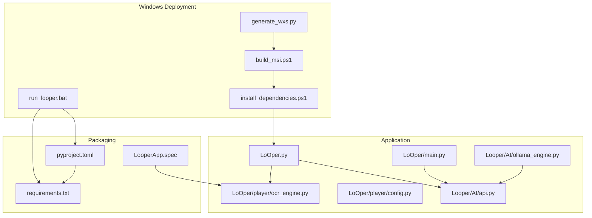
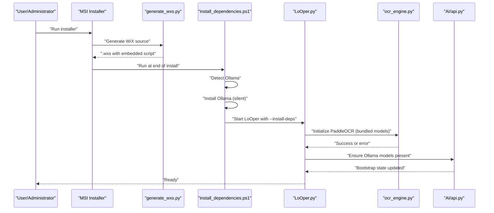
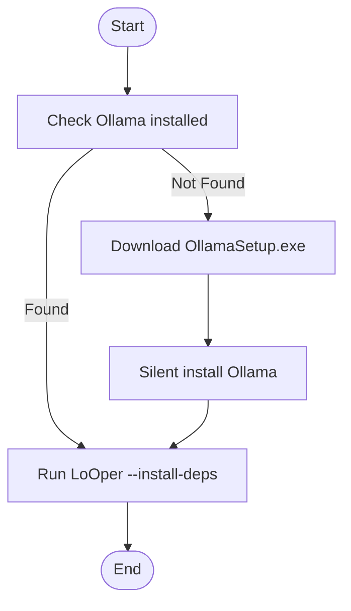
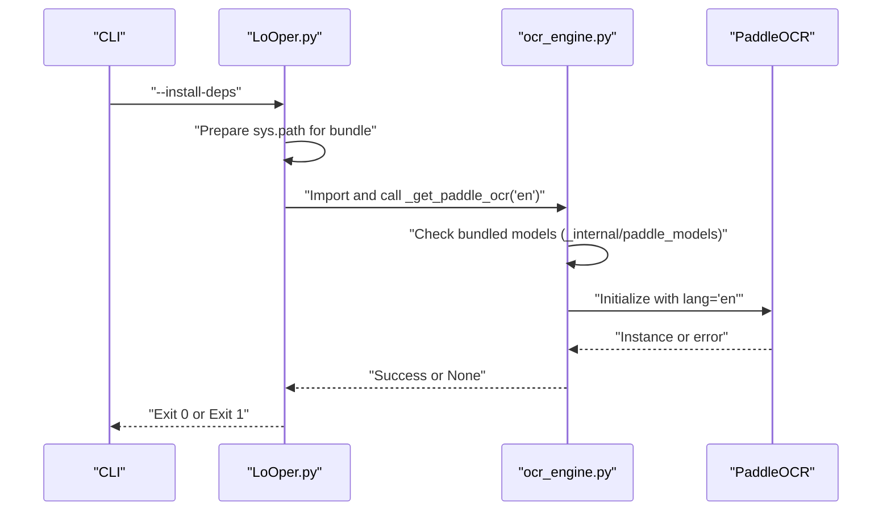
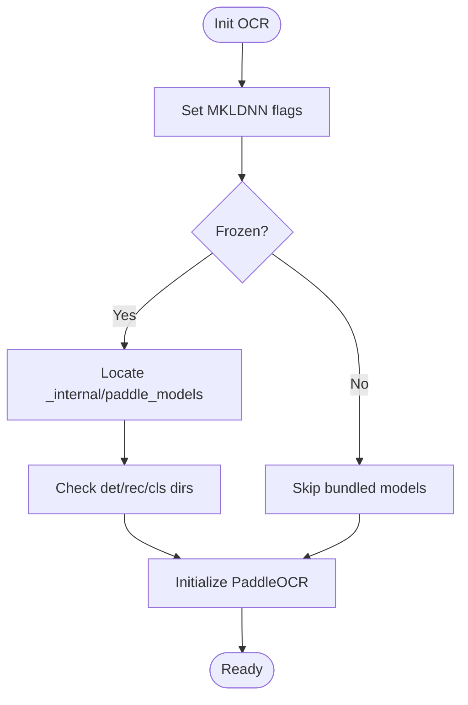
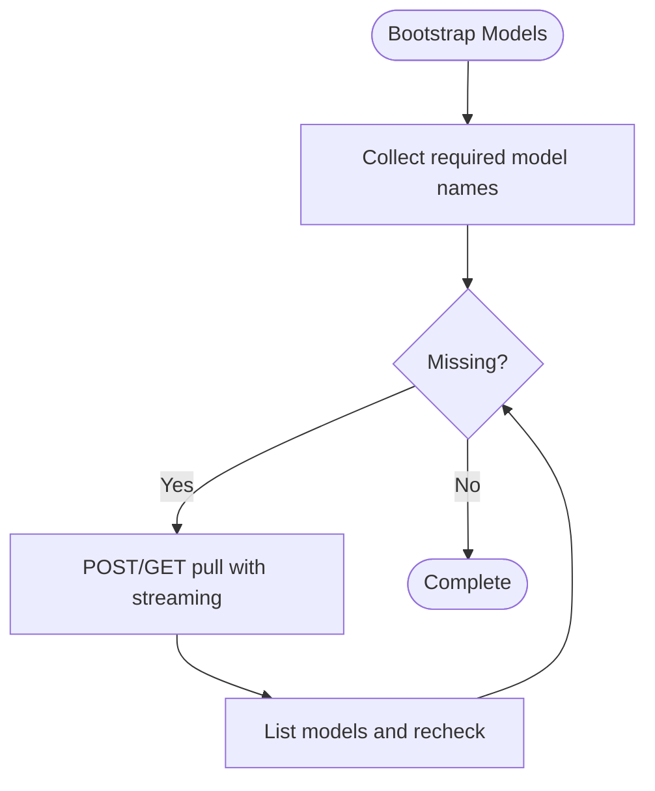
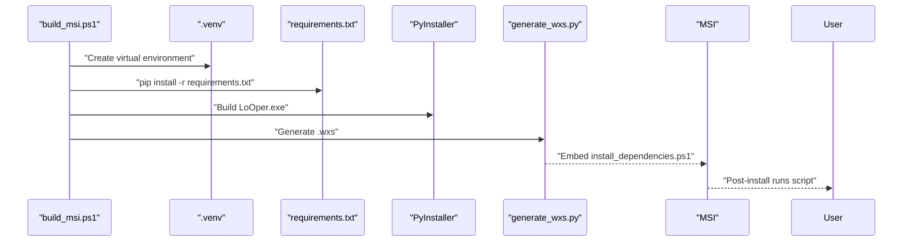
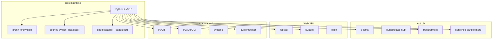

# Dependency Management

<cite>
**Referenced Files in This Document**
- [install_dependencies.ps1](file://install_dependencies.ps1)
- [requirements.txt](file://requirements.txt)
- [pyproject.toml](file://pyproject.toml)
- [run_looper.bat](file://run_looper.bat)
- [build_msi.ps1](file://build_msi.ps1)
- [generate_wxs.py](file://generate_wxs.py)
- [LoOper.py](file://LoOper.py)
- [LoOper\main.py](file://LoOper/main.py)
- [LoOper\player\config.py](file://LoOper/player/config.py)
- [LoOper\player\ocr_engine.py](file://LoOper/player/ocr_engine.py)
- [LoOper\AI\api.py](file://LoOper/AI/api.py)
- [LoOper\AI\ollama_engine.py](file://LoOper/AI/ollama_engine.py)
- [LoOper\player\multi_sequence\worflow_interpreter_modules\executor_modules\code_ops.py](file://LoOper/player/multi_sequence/worflow_interpreter_modules/executor_modules/code_ops.py)
- [LoOperApp.spec](file://LooperApp.spec)
</cite>

## Table of Contents
1. [Introduction](#introduction)
2. [Project Structure](#project-structure)
3. [Core Components](#core-components)
4. [Architecture Overview](#architecture-overview)
5. [Detailed Component Analysis](#detailed-component-analysis)
6. [Dependency Analysis](#dependency-analysis)
7. [Performance Considerations](#performance-considerations)
8. [Troubleshooting Guide](#troubleshooting-guide)
9. [Conclusion](#conclusion)
10. [Appendices](#appendices)

## Introduction
This document explains how the project manages dependencies for Windows deployment. It covers:
- Automatic detection and installation of Ollama and PaddleOCR models via PowerShell and Python entry points
- The requirements.txt specification for GUI frameworks, automation libraries, computer vision, and AI integrations
- The pyproject.toml configuration for modern Python packaging and dependency resolution
- Concrete workflows for validating dependencies, downloading models, and preparing the environment
- The relationship between development and production dependencies, optional extras, and platform-specific conditions
- Error handling strategies for missing dependencies, version conflicts, and installation failures

## Project Structure
The dependency management pipeline spans PowerShell scripts, Python entry points, packaging metadata, and installer generation:
- install_dependencies.ps1 orchestrates Ollama and PaddleOCR model verification/installation
- LoOper.py exposes a command-line flag to trigger dependency checks
- LoOper\player\ocr_engine.py initializes PaddleOCR and bundles model assets
- Looper\AI\api.py pulls and validates Ollama models
- pyproject.toml defines core and optional dependencies with environment markers
- requirements.txt enumerates pinned versions for reproducible installs
- run_looper.bat sets up a virtual environment and installs the project in development mode
- build_msi.ps1 and generate_wxs.py integrate dependency checks into the MSI installer

**Diagram sources**
- [install_dependencies.ps1:1-62](file://install_dependencies.ps1#L1-L62)
- [generate_wxs.py:181-202](file://generate_wxs.py#L181-L202)
- [build_msi.ps1:16-53](file://build_msi.ps1#L16-L53)
- [run_looper.bat:14-23](file://run_looper.bat#L14-L23)
- [LoOper.py:586-651](file://LoOper.py#L586-L651)
- [LoOper/main.py:171-353](file://Looper/main.py#L171-L353)
- [Looper/player/ocr_engine.py:30-103](file://Looper/player/ocr_engine.py#L30-L103)
- [Looper/player/config.py:11-31](file://Looper/player/config.py#L11-L31)
- [Looper/AI/api.py:95-207](file://Looper/AI/api.py#L95-L207)
- [Looper/AI/ollama_engine.py:65-90](file://Looper/AI/ollama_engine.py#L65-L90)
- [pyproject.toml:10-204](file://pyproject.toml#L10-L204)
- [requirements.txt:1-195](file://requirements.txt#L1-L195)
- [LooperApp.spec:362-393](file://LooperApp.spec#L362-L393)

**Section sources**
- [install_dependencies.ps1:1-62](file://install_dependencies.ps1#L1-L62)
- [LoOper.py:586-651](file://Looper.py#L586-L651)
- [Looper/player/ocr_engine.py:30-103](file://Looper/player/ocr_engine.py#L30-L103)
- [Looper/AI/api.py:95-207](file://Looper/AI/api.py#L95-L207)
- [pyproject.toml:10-204](file://pyproject.toml#L10-L204)
- [requirements.txt:1-195](file://requirements.txt#L1-L195)
- [run_looper.bat:14-23](file://run_looper.bat#L14-L23)
- [build_msi.ps1:16-53](file://build_msi.ps1#L16-L53)
- [generate_wxs.py:181-202](file://generate_wxs.py#L181-L202)
- [LooperApp.spec:362-393](file://LooperApp.spec#L362-L393)

## Core Components
- PowerShell dependency installer: Detects Ollama, downloads and installs it silently if missing, then triggers the application’s model verification routine
- Application entry point for dependency checks: Provides a flag to initialize OCR and validate model presence
- OCR engine: Initializes PaddleOCR with bundled model directories and handles environment flags to avoid MKL/DNN conflicts
- Ollama model bootstrapper: Lists existing models, detects missing ones, pulls them, and updates state for monitoring
- Packaging metadata: pyproject.toml defines core dependencies and optional extras; requirements.txt pins versions for reproducibility
- Installer integration: MSI generation embeds the dependency script and runs it post-installation

**Section sources**
- [install_dependencies.ps1:18-45](file://install_dependencies.ps1#L18-L45)
- [Looper.py:586-651](file://Looper.py#L586-L651)
- [Looper/player/ocr_engine.py:30-103](file://Looper/player/ocr_engine.py#L30-L103)
- [Looper/AI/api.py:95-207](file://Looper/AI/api.py#L95-L207)
- [pyproject.toml:10-204](file://pyproject.toml#L10-L204)
- [requirements.txt:1-195](file://requirements.txt#L1-L195)
- [generate_wxs.py:181-202](file://generate_wxs.py#L181-L202)

## Architecture Overview
The dependency management architecture integrates pre-flight checks, model provisioning, and installer automation.

**Diagram sources**
- [generate_wxs.py:181-202](file://generate_wxs.py#L181-L202)
- [install_dependencies.ps1:25-61](file://install_dependencies.ps1#L25-L61)
- [Looper.py:586-651](file://Looper.py#L586-L651)
- [Looper/player/ocr_engine.py:30-103](file://Looper/player/ocr_engine.py#L30-L103)
- [Looper/AI/api.py:95-207](file://Looper/AI/api.py#L95-L207)

## Detailed Component Analysis

### PowerShell Dependency Installer
- Detects Ollama presence via command and local path
- Downloads OllamaSetup.exe using curl or web request, runs silent install, cleans up
- Invokes LoOper.exe with a flag to verify and install PaddleOCR models
- Uses Windows notifications to inform the user of progress

**Diagram sources**
- [install_dependencies.ps1:18-61](file://install_dependencies.ps1#L18-L61)

**Section sources**
- [install_dependencies.ps1:18-61](file://install_dependencies.ps1#L18-L61)

### Application Dependency Verification Workflow
- LoOper.py recognizes a special flag to enter dependency verification mode
- Imports OCR engine using multiple strategies to handle frozen/bundled environments
- Attempts to initialize PaddleOCR with bundled model directories and logs outcomes
- Falls back to direct initialization if package imports fail
- Reports success or exits with error

**Diagram sources**
- [Looper.py:586-651](file://Looper.py#L586-L651)
- [Looper/player/ocr_engine.py:30-103](file://Looper/player/ocr_engine.py#L30-L103)

**Section sources**
- [Looper.py:586-651](file://Looper.py#L586-L651)
- [Looper/player/ocr_engine.py:30-103](file://Looper/player/ocr_engine.py#L30-L103)

### PaddleOCR Model Bundling and Initialization
- OCR engine disables MKL/DNN to prevent OneDNN initialization errors
- Detects bundled models under a dedicated internal directory when frozen
- Supports detection of detection, recognition, and classification models
- Initializes PaddleOCR with language-specific settings and environment flags

**Diagram sources**
- [Looper/player/ocr_engine.py:30-103](file://Looper/player/ocr_engine.py#L30-L103)

**Section sources**
- [Looper/player/ocr_engine.py:30-103](file://Looper/player/ocr_engine.py#L30-L103)
- [LooperApp.spec:362-393](file://LooperApp.spec#L362-L393)

### Ollama Model Bootstrapping
- Lists existing models and determines missing ones based on configured hard-coded lists
- Pulls models via Ollama API with streaming progress
- Updates bootstrap state for monitoring and error reporting

**Diagram sources**
- [Looper/AI/api.py:95-207](file://Looper/AI/api.py#L95-L207)

**Section sources**
- [Looper/AI/api.py:95-207](file://Looper/AI/api.py#L95-L207)
- [Looper/AI/ollama_engine.py:65-90](file://Looper/AI/ollama_engine.py#L65-L90)

### Installer Integration and Environment Setup
- MSI generation embeds the dependency script and schedules it post-install
- The script runs with hidden window style and bypasses execution policy
- The installer also provisions RDPWrap and updates service configuration

**Diagram sources**
- [build_msi.ps1:16-53](file://build_msi.ps1#L16-L53)
- [generate_wxs.py:181-202](file://generate_wxs.py#L181-L202)

**Section sources**
- [build_msi.ps1:16-53](file://build_msi.ps1#L16-L53)
- [generate_wxs.py:181-202](file://generate_wxs.py#L181-L202)

### Development vs Production Dependencies
- requirements.txt pins exact versions for deterministic installs
- pyproject.toml defines core dependencies and optional extras for different feature sets
- Optional extras include overwatch and vision stacks with Python version and platform markers
- Platform-specific markers target Windows and lower Python versions for certain packages

**Section sources**
- [requirements.txt:1-195](file://requirements.txt#L1-L195)
- [pyproject.toml:10-204](file://pyproject.toml#L10-L204)

## Dependency Analysis
This section maps the core dependencies and their roles across the system.

**Diagram sources**
- [pyproject.toml:10-204](file://pyproject.toml#L10-L204)
- [requirements.txt:1-195](file://requirements.txt#L1-L195)

**Section sources**
- [pyproject.toml:10-204](file://pyproject.toml#L10-L204)
- [requirements.txt:1-195](file://requirements.txt#L1-L195)

## Performance Considerations
- Model downloads: Streaming pull progress reduces perceived latency; consider caching and offline availability for large models
- OCR initialization: Disabling MKL/DNN avoids initialization overhead and conflicts; ensure bundled models are included in the distribution
- Pip installations: Batch install followed by per-package retries minimizes total time and isolates failures
- Installer runtime: Silent Ollama install and hidden PowerShell windows reduce UI overhead during deployment

[No sources needed since this section provides general guidance]

## Troubleshooting Guide
Common issues and remedies:
- Missing Python: Ensure Python 3.10+ is installed and on PATH; pyproject.toml enforces this requirement
- Missing system libraries: Install Microsoft Visual C++ Redistributable; the spec adds DLLs to multiple candidate locations
- Network connectivity: The installer attempts to download RDPWrap and Ollama; configure proxies if required
- Version conflicts: Use requirements.txt for pinned versions in development; rely on pyproject.toml extras for optional stacks
- OCR failures: Verify bundled model directories exist; check MKL/DNN flags; confirm PaddleOCR availability
- Ollama not running: Confirm service accessibility; the bootstrapper raises explicit errors when unreachable

**Section sources**
- [pyproject.toml:9](file://pyproject.toml#L9)
- [Looper/player/config.py:12-31](file://Looper/player/config.py#L12-L31)
- [Looper/player/ocr_engine.py:30-103](file://Looper/player/ocr_engine.py#L30-L103)
- [Looper/AI/api.py:95-207](file://Looper/AI/api.py#L95-L207)
- [build_msi.ps1:29-37](file://build_msi.ps1#L29-L37)
- [LooperApp.spec:381-393](file://LooperApp.spec#L381-L393)

## Conclusion
The project’s dependency management combines PowerShell-driven pre-flight checks, robust Python entry points for model provisioning, and installer-integrated automation. The pyproject.toml and requirements.txt together define a clear separation between core and optional dependencies, with platform-specific markers and environment safeguards. This design supports both developer-friendly local setups and reliable production deployments.

[No sources needed since this section summarizes without analyzing specific files]

## Appendices

### Appendix A: Command-Line Flags and Entry Points
- LoOper.py recognizes a flag to run dependency verification and model initialization
- Looper/main.py starts the API server and coordinates model loading

**Section sources**
- [Looper.py:586-651](file://Looper.py#L586-L651)
- [Looper/main.py:171-353](file://Looper/main.py#L171-L353)

### Appendix B: Environment Setup Script
- run_looper.bat creates a virtual environment, upgrades pip, and installs the project
- It also provisions RDPWrap and configures Windows services for remote desktop automation

**Section sources**
- [run_looper.bat:14-87](file://run_looper.bat#L14-L87)

### Appendix C: Optional Extras and Platform Conditions
- pyproject.toml defines optional groups for overwatch and vision stacks
- Platform markers target Windows and lower Python versions for certain packages

**Section sources**
- [pyproject.toml:206-248](file://pyproject.toml#L206-L248)