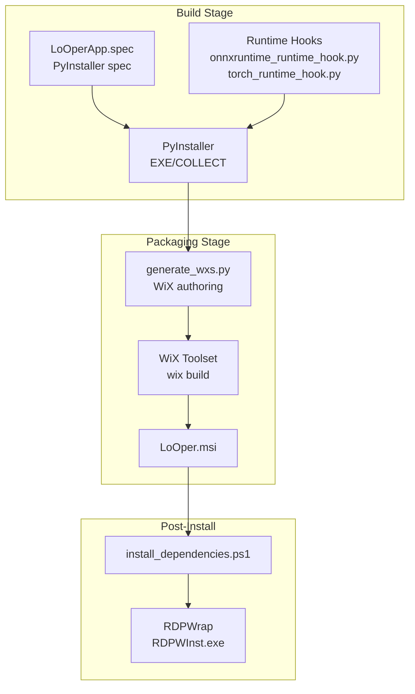
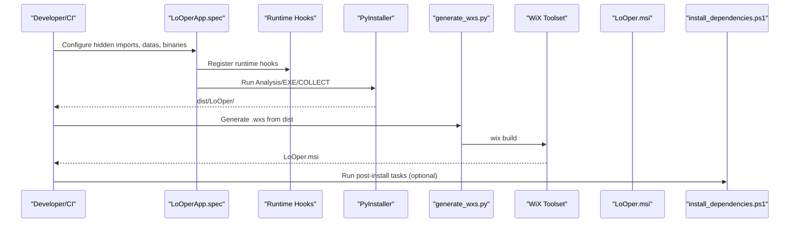
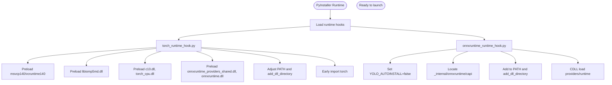
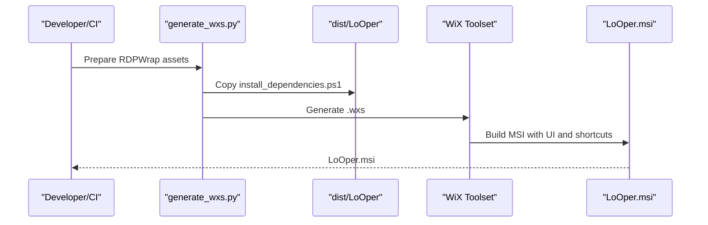
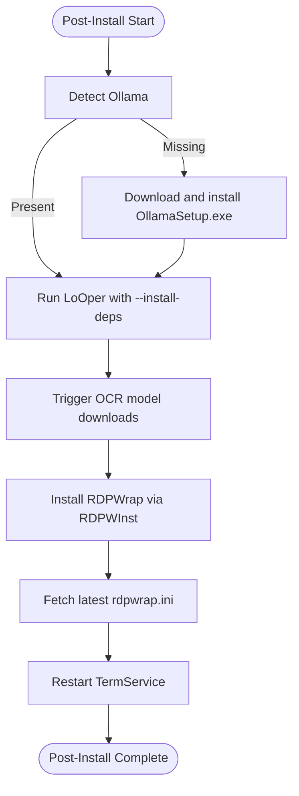
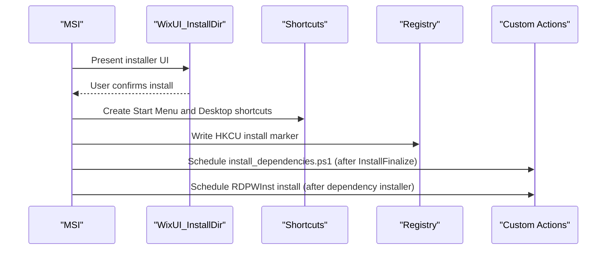
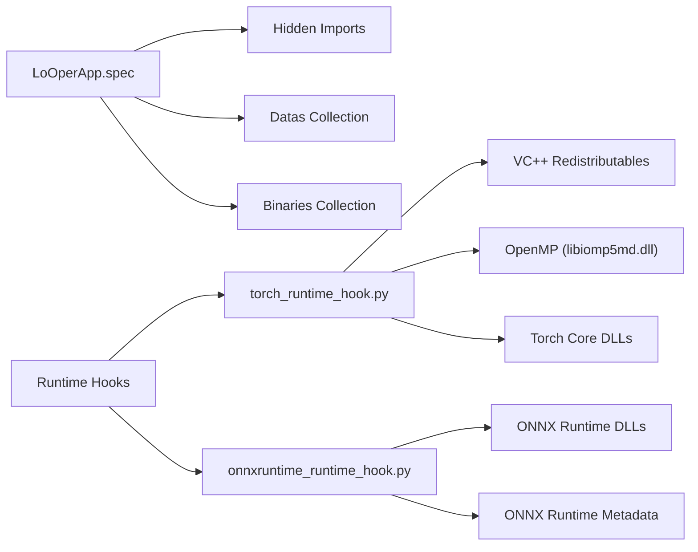

# Packaging and Distribution

<cite>
**Referenced Files in This Document**
- [LoOperApp.spec](file://LoOperApp.spec)
- [build_msi.ps1](file://build_msi.ps1)
- [generate_wxs.py](file://generate_wxs.py)
- [install_dependencies.ps1](file://install_dependencies.ps1)
- [hook-onnxruntime.py](file://hook-onnxruntime.py)
- [onnxruntime_runtime_hook.py](file://onnxruntime_runtime_hook.py)
- [torch_runtime_hook.py](file://torch_runtime_hook.py)
- [pyproject.toml](file://pyproject.toml)
- [requirements.txt](file://requirements.txt)
- [run_looper.bat](file://run_looper.bat)
- [LoOper.wxs](file://LoOper.wxs)
- [utils\rdpwrap\res\RDPWInst.wxs](file://utils/rdpwrap/res/RDPWInst.wxs)
- [utils\rdpwrap\bin\install.bat](file://utils/rdpwrap/bin/install.bat)
- [utils\rdpwrap\bin\uninstall.bat](file://utils/rdpwrap/bin/uninstall.bat)
</cite>

## Table of Contents
1. [Introduction](#introduction)
2. [Project Structure](#project-structure)
3. [Core Components](#core-components)
4. [Architecture Overview](#architecture-overview)
5. [Detailed Component Analysis](#detailed-component-analysis)
6. [Dependency Analysis](#dependency-analysis)
7. [Performance Considerations](#performance-considerations)
8. [Troubleshooting Guide](#troubleshooting-guide)
9. [Conclusion](#conclusion)
10. [Appendices](#appendices)

## Introduction
This document explains the packaging and distribution pipeline for Windows, focusing on how the project builds a cross-platform executable with PyInstaller, packages it into an MSI using WiX Toolset, and automates post-installation setup via PowerShell. It covers the build specification configuration, runtime hooks for specialized libraries, and bundle optimization strategies. It also documents the Windows installer workflow, including shortcuts, registry entries, and dependency bootstrapping, and how these packaging decisions affect deployment and distribution.

## Project Structure
The packaging pipeline spans three primary stages:
- Build specification and bundling: PyInstaller collects application code, data, and binary dependencies into a single executable.
- MSI authoring and build: WiX Toolset transforms the built bundle into an installer with UI, shortcuts, and post-install automation.
- Post-install automation: PowerShell scripts install optional dependencies and configure the environment.

**Diagram sources**
- [LoOperApp.spec:463-509](file://LoOperApp.spec#L463-L509)
- [onnxruntime_runtime_hook.py:1-34](file://onnxruntime_runtime_hook.py#L1-L34)
- [torch_runtime_hook.py:1-118](file://torch_runtime_hook.py#L1-L118)
- [generate_wxs.py:44-224](file://generate_wxs.py#L44-L224)
- [build_msi.ps1:86-99](file://build_msi.ps1#L86-L99)
- [install_dependencies.ps1:1-62](file://install_dependencies.ps1#L1-L62)

**Section sources**
- [LoOperApp.spec:1-510](file://LoOperApp.spec#L1-L510)
- [build_msi.ps1:1-102](file://build_msi.ps1#L1-L102)
- [generate_wxs.py:1-224](file://generate_wxs.py#L1-L224)
- [install_dependencies.ps1:1-62](file://install_dependencies.ps1#L1-L62)

## Core Components
- PyInstaller spec and runtime hooks
  - The spec defines module paths, hidden imports, data and binary collections, and runtime hooks for specialized libraries.
  - Runtime hooks prepare the environment for ONNX Runtime and PyTorch, preloading DLLs and adjusting the DLL search path.
- WiX authoring and MSI build
  - A Python script generates the WiX source file, embeds the built bundle, creates shortcuts, and schedules post-install actions.
  - The PowerShell build script orchestrates virtual environment setup, dependency installation, PyInstaller build, WiX detection, and MSI generation.
- Post-install automation
  - A PowerShell script detects and installs optional dependencies (e.g., Ollama), triggers model downloads, and configures RDP-related components.

**Section sources**
- [LoOperApp.spec:27-87](file://LoOperApp.spec#L27-L87)
- [LoOperApp.spec:420-423](file://LoOperApp.spec#L420-L423)
- [onnxruntime_runtime_hook.py:1-34](file://onnxruntime_runtime_hook.py#L1-L34)
- [torch_runtime_hook.py:1-118](file://torch_runtime_hook.py#L1-L118)
- [generate_wxs.py:44-224](file://generate_wxs.py#L44-L224)
- [build_msi.ps1:1-102](file://build_msi.ps1#L1-L102)
- [install_dependencies.ps1:1-62](file://install_dependencies.ps1#L1-L62)

## Architecture Overview
The packaging architecture integrates build-time bundling, packaging-time authoring, and install-time automation.

**Diagram sources**
- [LoOperApp.spec:463-509](file://LoOperApp.spec#L463-L509)
- [onnxruntime_runtime_hook.py:1-34](file://onnxruntime_runtime_hook.py#L1-L34)
- [torch_runtime_hook.py:1-118](file://torch_runtime_hook.py#L1-L118)
- [generate_wxs.py:44-224](file://generate_wxs.py#L44-L224)
- [build_msi.ps1:86-99](file://build_msi.ps1#L86-L99)
- [install_dependencies.ps1:1-62](file://install_dependencies.ps1#L1-L62)

## Detailed Component Analysis

### PyInstaller Build Specification and Runtime Hooks
- Build specification configuration
  - Module paths and hidden imports include Qt, NodeGraphQt, OCR libraries, machine learning frameworks, and UI toolkits.
  - Data and binary collections ensure third-party DLLs and package resources are included.
  - Special handling for ONNX Runtime and PaddleOCR/Paddle patches to resolve import conflicts and packaging issues.
  - Runtime hooks are registered to preload critical DLLs and adjust the search path before the application starts.
- Runtime hooks
  - ONNX Runtime hook ensures license metadata and C-API binaries are bundled and the runtime can locate them.
  - Torch runtime hook preloads VC++ redistributables, OpenMP, and core Torch/ONNX Runtime DLLs, and adjusts PATH and DLL directory search lists to prevent loader failures.

**Diagram sources**
- [LoOperApp.spec:420-423](file://LoOperApp.spec#L420-L423)
- [onnxruntime_runtime_hook.py:1-34](file://onnxruntime_runtime_hook.py#L1-L34)
- [torch_runtime_hook.py:1-118](file://torch_runtime_hook.py#L1-L118)

**Section sources**
- [LoOperApp.spec:27-87](file://LoOperApp.spec#L27-L87)
- [LoOperApp.spec:121-327](file://LoOperApp.spec#L121-L327)
- [LoOperApp.spec:420-423](file://LoOperApp.spec#L420-L423)
- [hook-onnxruntime.py:1-39](file://hook-onnxruntime.py#L1-L39)
- [onnxruntime_runtime_hook.py:1-34](file://onnxruntime_runtime_hook.py#L1-L34)
- [torch_runtime_hook.py:1-118](file://torch_runtime_hook.py#L1-L118)

### WiX Authoring and MSI Generation
- WiX authoring
  - The Python script prepares RDPWrap assets, copies the post-install script into the bundle, and generates a WiX source file that embeds the entire dist folder.
  - It creates shortcuts on the Start Menu and Desktop, sets UI images and icons, and defines a persistent upgrade code.
- MSI build workflow
  - The PowerShell script checks for WiX Toolset, generates the WiX source, and builds the MSI with UI extensions.
  - It schedules two custom actions: running the post-install script after installation and installing/updating RDPWrap.

**Diagram sources**
- [generate_wxs.py:44-224](file://generate_wxs.py#L44-L224)
- [build_msi.ps1:86-99](file://build_msi.ps1#L86-L99)
- [LoOper.wxs:1-200](file://LoOper.wxs#L1-L200)

**Section sources**
- [generate_wxs.py:44-224](file://generate_wxs.py#L44-L224)
- [build_msi.ps1:1-102](file://build_msi.ps1#L1-L102)
- [LoOper.wxs:1-200](file://LoOper.wxs#L1-L200)

### Post-Installation Setup and Dependency Bootstrapping
- Dependency detection and installation
  - The PowerShell script checks for Ollama and installs it silently if missing.
  - It triggers the application with a flag to download OCR models and other bundled assets.
- RDP configuration
  - The installer includes RDPWrap binaries and runs the RDPWInst installer to enable Remote Desktop sharing features.
  - It optionally updates the shared rdpwrap.ini and restarts the service.

**Diagram sources**
- [install_dependencies.ps1:18-61](file://install_dependencies.ps1#L18-L61)
- [generate_wxs.py:11-42](file://generate_wxs.py#L11-L42)
- [utils\rdpwrap\bin\install.bat:1-15](file://utils/rdpwrap/bin/install.bat#L1-L15)

**Section sources**
- [install_dependencies.ps1:1-62](file://install_dependencies.ps1#L1-L62)
- [generate_wxs.py:11-42](file://generate_wxs.py#L11-L42)
- [utils\rdpwrap\bin\install.bat:1-15](file://utils/rdpwrap/bin/install.bat#L1-L15)
- [utils\rdpwrap\bin\uninstall.bat:1-11](file://utils/rdpwrap/bin/uninstall.bat#L1-L11)

### Windows Installer Workflow
- Shortcuts and UI
  - The WiX source creates shortcuts on the Start Menu and Desktop pointing to the main executable.
  - UI images and icons are embedded and referenced for branding.
- Registry entries and cleanup
  - A component writes a registry value under the current user to mark installation and enables cleanup on uninstall.
- Dependency bootstrapping
  - Custom actions schedule the post-install script and RDPWrap installation immediately after the main install finishes.

**Diagram sources**
- [LoOper.wxs:15-118](file://Looper.wxs#L15-L118)
- [LoOper.wxs:174-180](file://Looper.wxs#L174-L180)
- [generate_wxs.py:181-203](file://generate_wxs.py#L181-L203)

**Section sources**
- [LoOper.wxs:1-200](file://Looper.wxs#L1-L200)
- [generate_wxs.py:181-203](file://generate_wxs.py#L181-L203)

## Dependency Analysis
- Build-time dependencies
  - The spec declares hidden imports for Qt, machine learning libraries, and OCR toolchains.
  - Binary and data collections ensure ONNX Runtime, Torch, OpenCV, and Paddle assets are bundled.
- Runtime dependencies
  - VC++ redistributables and OpenMP libraries are preloaded by the Torch runtime hook to avoid loader errors.
  - ONNX Runtime metadata and binaries are collected and placed under the onnxruntime namespace.
- Optional dependencies
  - Ollama and PaddleOCR models are detected and installed post-installation.

**Diagram sources**
- [LoOperApp.spec:27-87](file://LoOperApp.spec#L27-L87)
- [LoOperApp.spec:121-327](file://LoOperApp.spec#L121-L327)
- [onnxruntime_runtime_hook.py:1-34](file://onnxruntime_runtime_hook.py#L1-L34)
- [torch_runtime_hook.py:1-118](file://torch_runtime_hook.py#L1-L118)

**Section sources**
- [LoOperApp.spec:27-87](file://LoOperApp.spec#L27-L87)
- [LoOperApp.spec:121-327](file://LoOperApp.spec#L121-L327)
- [onnxruntime_runtime_hook.py:1-34](file://onnxruntime_runtime_hook.py#L1-L34)
- [torch_runtime_hook.py:1-118](file://torch_runtime_hook.py#L1-L118)

## Performance Considerations
- Bundle size and startup time
  - Minimizing unnecessary hidden imports and data reduces bundle size and speeds up startup.
  - Prefer collecting only required ONNX Runtime and Torch binaries to avoid bloating the installer.
- DLL loading order
  - Preloading VC++ redistributables and OpenMP before Torch/PyQt avoids loader errors and reduces cold-start failures.
- MSI embedding
  - Embedding files in the MSI increases install size but simplifies distribution; consider CAB embedding trade-offs.

[No sources needed since this section provides general guidance]

## Troubleshooting Guide
- PyInstaller build fails or missing DLLs at runtime
  - Verify hidden imports and binary collections for Torch, ONNX Runtime, and OpenCV.
  - Ensure runtime hooks are registered and preloading steps are executed.
- Loader errors (WinError 1114 or 127)
  - Confirm VC++ redistributables and OpenMP are present and loaded before Torch imports.
  - Check that Torch runtime hook adjusts PATH and DLL directory search lists.
- WiX Toolset not found
  - Install WiX Toolset globally or ensure the build script can detect it; otherwise, generate the .wxs file and build manually.
- Post-install dependencies not installed
  - Confirm the post-install script runs and has permissions; verify Ollama download URLs and network connectivity.
- RDPWrap not functioning
  - Ensure RDPWInst ran successfully and the service was restarted; confirm the shared rdpwrap.ini was updated.

**Section sources**
- [LoOperApp.spec:420-423](file://LoOperApp.spec#L420-L423)
- [torch_runtime_hook.py:75-118](file://torch_runtime_hook.py#L75-L118)
- [build_msi.ps1:55-77](file://build_msi.ps1#L55-L77)
- [install_dependencies.ps1:18-61](file://install_dependencies.ps1#L18-L61)
- [utils\rdpwrap\bin\install.bat:1-15](file://utils/rdpwrap/bin/install.bat#L1-L15)

## Conclusion
The packaging and distribution pipeline leverages PyInstaller for robust cross-platform bundling, WiX Toolset for a polished Windows installer, and PowerShell scripts for seamless post-install automation. The runtime hooks and build specification address complex dependency chains, particularly around Torch and ONNX Runtime, while the MSI workflow ensures shortcuts, UI branding, and environment configuration. Together, these components deliver a reliable, user-friendly installer suitable for both end users and enterprise deployment.

[No sources needed since this section summarizes without analyzing specific files]

## Appendices

### Appendix A: Build and Distribution Commands
- Build the Windows installer:
  - Run the PowerShell build script to orchestrate virtual environment setup, dependency installation, PyInstaller build, WiX detection, and MSI generation.
- Manual steps (if needed):
  - Generate the WiX source file from the built bundle.
  - Build the MSI using WiX Toolset with UI extensions.

**Section sources**
- [build_msi.ps1:1-102](file://build_msi.ps1#L1-L102)
- [generate_wxs.py:44-224](file://generate_wxs.py#L44-L224)

### Appendix B: RDPWrap Integration Details
- RDPWrap is bundled and installed automatically during MSI installation.
- The installer runs RDPWInst to install and update the wrapper, fetches the latest rdpwrap.ini, and restarts the Remote Desktop service.

**Section sources**
- [generate_wxs.py:11-42](file://generate_wxs.py#L11-L42)
- [utils\rdpwrap\res\RDPWInst.wxs:1-50](file://utils/rdpwrap/res/RDPWInst.wxs#L1-L50)
- [utils\rdpwrap\bin\install.bat:1-15](file://utils/rdpwrap/bin/install.bat#L1-L15)
- [utils\rdpwrap\bin\uninstall.bat:1-11](file://utils/rdpwrap/bin/uninstall.bat#L1-L11)