# PyInstaller Configuration

<cite>
**Referenced Files in This Document**
- [LoOperApp.spec](file://LoOperApp.spec)
- [hook-onnxruntime.py](file://hook-onnxruntime.py)
- [onnxruntime_runtime_hook.py](file://onnxruntime_runtime_hook.py)
- [torch_runtime_hook.py](file://torch_runtime_hook.py)
- [requirements.txt](file://requirements.txt)
- [LoOper/main.py](file://LoOper/main.py)
- [LoOper/player/computer_vision.py](file://Looper/player/computer_vision.py)
- [Looper/player/ocr_engine.py](file://Looper/player/ocr_engine.py)
- [Looper/player/Computer_vision/model_vision.py](file://Looper/player/Computer_vision/model_vision.py)
- [Looper/player/Computer_vision/layoutlmv3_layer.py](file://Looper/player/Computer_vision/layoutlmv3_layer.py)
</cite>

## Table of Contents
1. [Introduction](#introduction)
2. [Project Structure](#project-structure)
3. [Core Components](#core-components)
4. [Architecture Overview](#architecture-overview)
5. [Detailed Component Analysis](#detailed-component-analysis)
6. [Dependency Analysis](#dependency-analysis)
7. [Performance Considerations](#performance-considerations)
8. [Troubleshooting Guide](#troubleshooting-guide)
9. [Conclusion](#conclusion)

## Introduction
This document explains the PyInstaller configuration used to build cross-platform executables for the LoOperV2 project. It focuses on the complete build specification, hidden imports, data and binary collection strategies, and runtime hooks for AI/ML frameworks such as ONNX Runtime and PyTorch. It also covers how the build integrates with OCR assets and computer vision models, and how the runtime hooks resolve DLL dependencies and library path issues. The guidance is designed for developers who need to customize the build process while understanding the trade-offs and pitfalls of bundling complex dependencies.

## Project Structure
The build system centers on a single PyInstaller spec file that orchestrates:
- Hidden imports for PyQt5, NodeGraphQt, AI libraries, and computer vision frameworks
- Data collection for AI models, OCR assets, and application resources
- Binary collection and filtering for ONNX Runtime and PyTorch
- Runtime hooks for DLL resolution and pre-loading

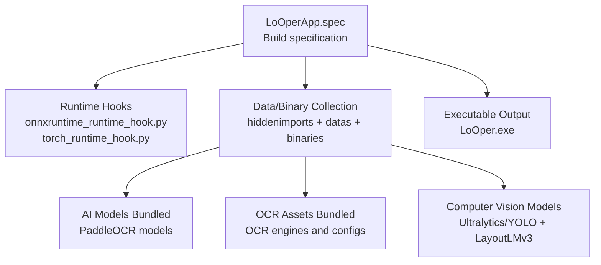

**Diagram sources**
- [LoOperApp.spec:463-510](file://LoOperApp.spec#L463-L510)
- [onnxruntime_runtime_hook.py:1-34](file://onnxruntime_runtime_hook.py#L1-L34)
- [torch_runtime_hook.py:1-118](file://torch_runtime_hook.py#L1-L118)

**Section sources**
- [LoOperApp.spec:27-87](file://LoOperApp.spec#L27-L87)
- [LoOperApp.spec:89-131](file://LoOperApp.spec#L89-L131)
- [LoOperApp.spec:463-510](file://LoOperApp.spec#L463-L510)

## Core Components
- Build specification (spec): Defines hidden imports, data/binary collections, and runtime hooks.
- ONNX Runtime hook: Declares hidden imports and collects license/data files plus binaries.
- ONNX Runtime runtime hook: Prepares the DLL search path and pre-loads providers.
- Torch runtime hook: Manages DLL search paths, pre-loads critical libraries, and resolves conflicts with PyQt and other runtimes.
- Requirements: Lists all dependencies including PyTorch, ONNX Runtime, Ultralytics, PaddleOCR, and OpenCV.

Key responsibilities:
- Ensure all dynamic imports are discoverable at analysis time via hidden imports.
- Bundle AI/OCR models and resources into the final executable.
- Resolve DLL conflicts and missing dependencies at runtime using hooks.

**Section sources**
- [LoOperApp.spec:27-87](file://LooperApp.spec#L27-L87)
- [LoOperApp.spec:121-131](file://LooperApp.spec#L121-L131)
- [hook-onnxruntime.py:4-39](file://hook-onnxruntime.py#L4-L39)
- [onnxruntime_runtime_hook.py:7-34](file://onnxruntime_runtime_hook.py#L7-L34)
- [torch_runtime_hook.py:5-118](file://torch_runtime_hook.py#L5-L118)
- [requirements.txt:89-127](file://requirements.txt#L89-L127)

## Architecture Overview
The build pipeline integrates three major phases:
1) Analysis-time discovery: hidden imports and collected data/binary assets
2) Bundle-time assembly: datas/binaries normalization and exclusion rules
3) Runtime-time resolution: DLL search path setup and pre-loading

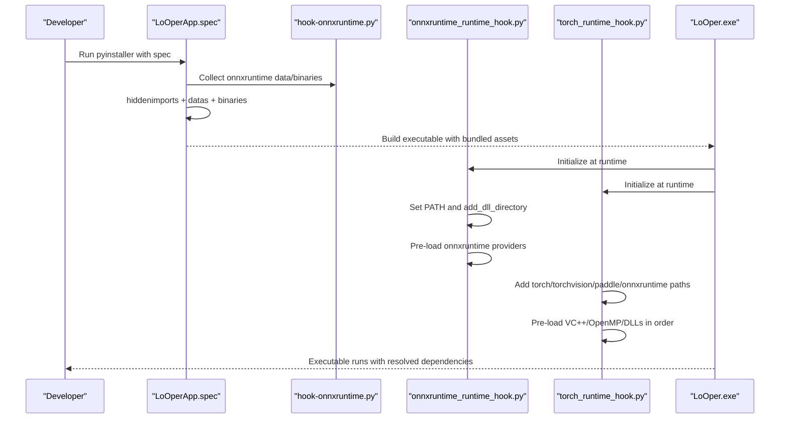

**Diagram sources**
- [LoOperApp.spec:420-423](file://LooperApp.spec#L420-L423)
- [hook-onnxruntime.py:22-37](file://hook-onnxruntime.py#L22-L37)
- [onnxruntime_runtime_hook.py:21-34](file://onnxruntime_runtime_hook.py#L21-L34)
- [torch_runtime_hook.py:13-74](file://torch_runtime_hook.py#L13-L74)

## Detailed Component Analysis

### LoOperApp.spec: Build Specification and Hidden Imports
- Hidden imports: Explicitly declare PyQt5, NodeGraphQt, AI/ML libraries, and system-level packages to avoid missing imports at analysis time.
- Data collection: Adds application resources, schedules, icons, and the entire Computer_vision directory to ensure all assets are included.
- Binary collection: Uses PyInstaller’s collection utilities for complex packages and manually adds ONNX Runtime binaries and VC redistributables.
- Runtime hooks: Registers onnxruntime_runtime_hook.py and torch_runtime_hook.py to resolve DLL paths at runtime.
- Exclusions: Excludes onnx, onnx.reference, paddleocr, and paddle from automatic inclusion to avoid duplication and conflicts.

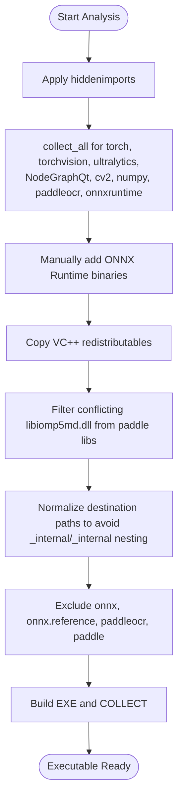

**Diagram sources**
- [LoOperApp.spec:121-131](file://LooperApp.spec#L121-L131)
- [LooperApp.spec:137-200](file://LooperApp.spec#L137-L200)
- [LooperApp.spec:381-417](file://LooperApp.spec#L381-L417)
- [LooperApp.spec:440-461](file://LooperApp.spec#L440-L461)
- [LooperApp.spec:472](file://LooperApp.spec#L472)

**Section sources**
- [LooperApp.spec:27-87](file://LooperApp.spec#L27-L87)
- [LooperApp.spec:89-131](file://LooperApp.spec#L89-L131)
- [LooperApp.spec:137-200](file://LooperApp.spec#L137-L200)
- [LooperApp.spec:381-417](file://LooperApp.spec#L381-L417)
- [LooperApp.spec:420-477](file://LooperApp.spec#L420-L477)
- [LooperApp.spec:472](file://LooperApp.spec#L472)

### ONNX Runtime Hook: hook-onnxruntime.py
- Hidden imports: Ensures onnxruntime C-API modules are recognized at analysis time.
- Data files: Includes licenses and notices; copies metadata.
- Binaries: Scans the onnxruntime package directory for .dll/.pyd files and bundles them under onnxruntime/capi.

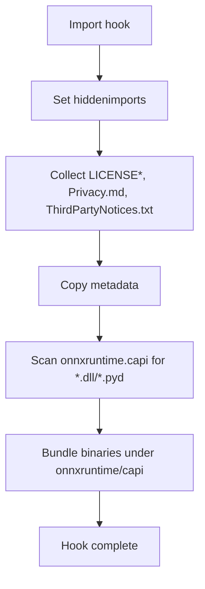

**Diagram sources**
- [hook-onnxruntime.py:4-39](file://hook-onnxruntime.py#L4-L39)

**Section sources**
- [hook-onnxruntime.py:4-39](file://hook-onnxruntime.py#L4-L39)

### ONNX Runtime Runtime Hook: onnxruntime_runtime_hook.py
- Environment: Sets YOLO_AUTOINSTALL=false to avoid auto-downloads in frozen environments.
- Path setup: Locates the internal onnxruntime/capi directory and adds it to the DLL search path.
- Pre-loading: Attempts to load provider and core DLLs to prime the loader.

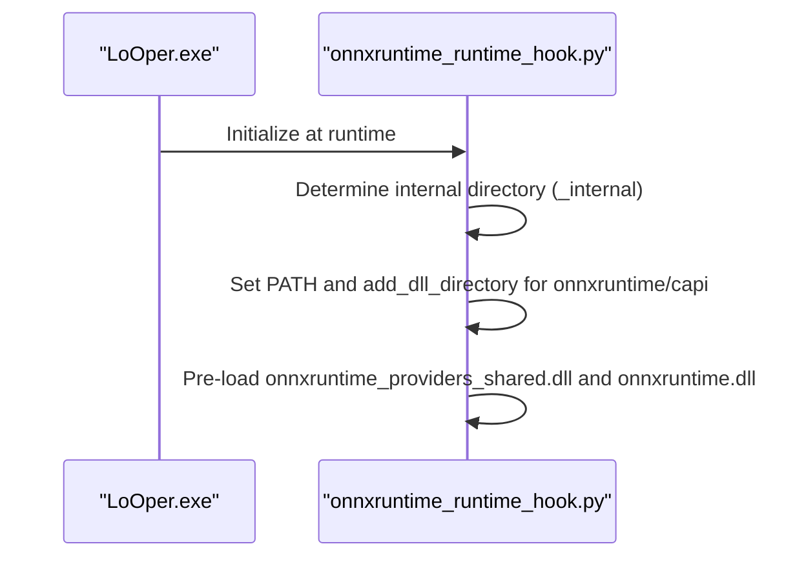

**Diagram sources**
- [onnxruntime_runtime_hook.py:7-34](file://onnxruntime_runtime_hook.py#L7-L34)

**Section sources**
- [onnxruntime_runtime_hook.py:7-34](file://onnxruntime_runtime_hook.py#L7-L34)

### Torch Runtime Hook: torch_runtime_hook.py
- Environment: Sets KMP_DUPLICATE_LIB_OK to avoid OpenMP runtime conflicts.
- Path discovery: Builds a list of candidate base directories for DLLs (executable root, _internal, torch/lib, torchvision, paddle libs, onnxruntime).
- Path configuration: Adds discovered paths to Windows DLL search and PATH.
- Pre-loading: Loads VC++ redistributables, OpenMP, core Torch libraries, and ONNX Runtime providers in a specific order to prevent WinError 1114.

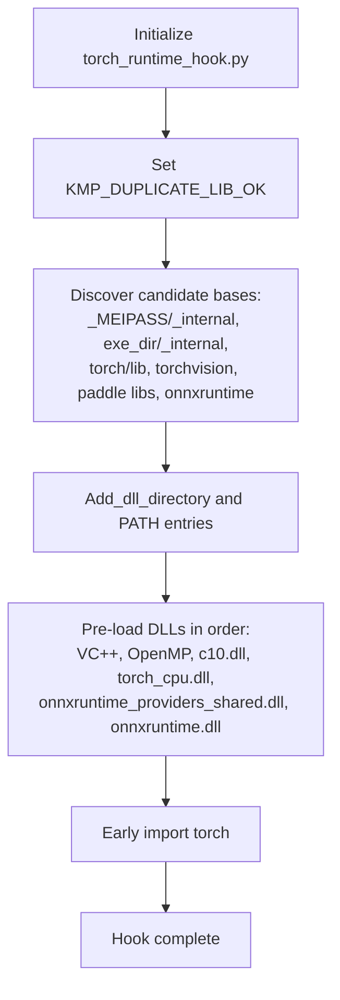

**Diagram sources**
- [torch_runtime_hook.py:5-118](file://torch_runtime_hook.py#L5-L118)

**Section sources**
- [torch_runtime_hook.py:5-118](file://torch_runtime_hook.py#L5-L118)

### Data Collection Strategies: AI Models, OCR Assets, and Resources
- PaddleOCR models: Bundles detection, recognition, and classification models from the user’s local .paddleocr directory into the bundle under _internal/paddle_models.
- Application resources: Copies icons, PNG assets, and schedules into both root and _internal locations to ensure availability in frozen builds.
- Computer vision assets: Includes the entire Computer_vision directory to preserve Python modules and resources.

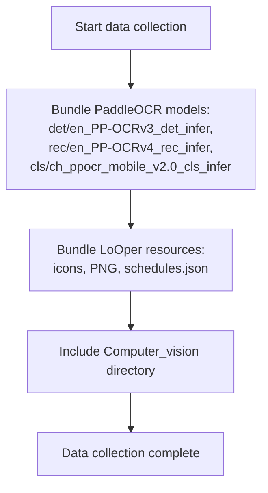

**Diagram sources**
- [LooperApp.spec:361-379](file://LooperApp.spec#L361-L379)
- [LooperApp.spec:341-356](file://LooperApp.spec#L341-L356)
- [LooperApp.spec:357-359](file://LooperApp.spec#L357-L359)

**Section sources**
- [LooperApp.spec:341-356](file://LooperApp.spec#L341-L356)
- [LooperApp.spec:361-379](file://LooperApp.spec#L361-L379)
- [LooperApp.spec:357-359](file://LooperApp.spec#L357-L359)

### Runtime Hooks Implementation: ONNX Runtime and PyTorch Integration
- ONNX Runtime: The hook ensures providers and core DLLs are discoverable and pre-loaded, preventing runtime failures when providers are dynamically loaded.
- PyTorch: The hook sets up the DLL search path and pre-loads critical libraries in a deterministic order to avoid conflicts with PyQt and other runtimes.

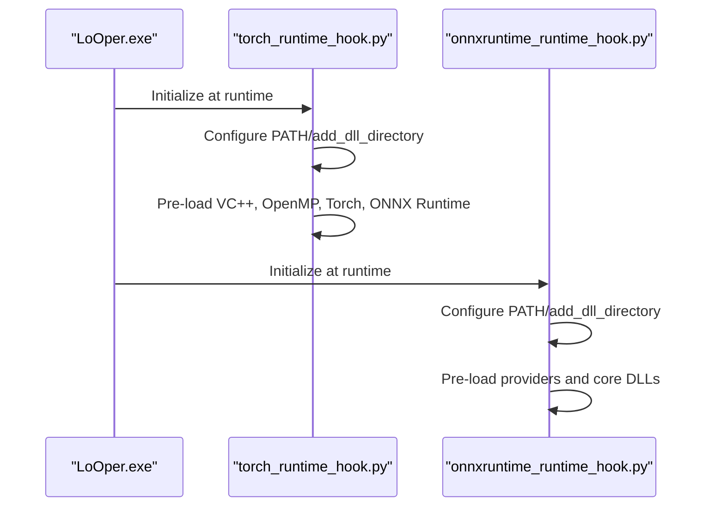

**Diagram sources**
- [torch_runtime_hook.py:13-118](file://torch_runtime_hook.py#L13-L118)
- [onnxruntime_runtime_hook.py:21-34](file://onnxruntime_runtime_hook.py#L21-L34)

**Section sources**
- [torch_runtime_hook.py:13-118](file://torch_runtime_hook.py#L13-L118)
- [onnxruntime_runtime_hook.py:21-34](file://onnxruntime_runtime_hook.py#L21-L34)

### Binary Collection, Dependency Filtering, and Bundle Optimization
- Binary collection: Uses collect_all for complex packages and manual addition for ONNX Runtime binaries and VC redistributables.
- Dependency filtering: Removes libiomp5md.dll from paddle libs to avoid conflicts with Torch’s version.
- Destination normalization: Strips duplicated "_internal" prefixes to prevent nested paths in the final bundle.
- Exclusions: Excludes onnx, onnx.reference, paddleocr, and paddle from automatic inclusion to reduce duplication and potential conflicts.

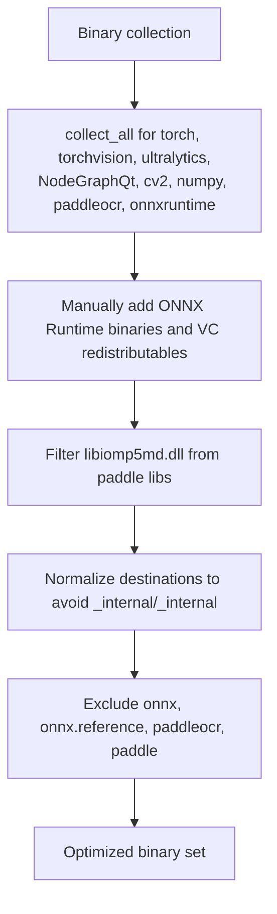

**Diagram sources**
- [LooperApp.spec:121-131](file://LooperApp.spec#L121-L131)
- [LooperApp.spec:137-200](file://LooperApp.spec#L137-L200)
- [LooperApp.spec:440-461](file://LooperApp.spec#L440-L461)
- [LooperApp.spec:472](file://LooperApp.spec#L472)

**Section sources**
- [LooperApp.spec:121-131](file://LooperApp.spec#L121-L131)
- [LooperApp.spec:137-200](file://LooperApp.spec#L137-L200)
- [LooperApp.spec:440-461](file://LooperApp.spec#L440-L461)
- [LooperApp.spec:472](file://LooperApp.spec#L472)

### Integration with Application Architecture and Runtime Performance
- Entry point: The main entry imports torch early to avoid DLL initialization conflicts with PyQt on Windows.
- API server: Starts an embedded FastAPI/Uvicorn server for AI services, with frozen-mode path handling and logging.
- OCR engine: Detects OCR availability and uses bundled PaddleOCR models when running from a frozen bundle.
- Computer vision: Initializes ONNX Runtime and Torch DLL paths at module import time and pre-loads providers.

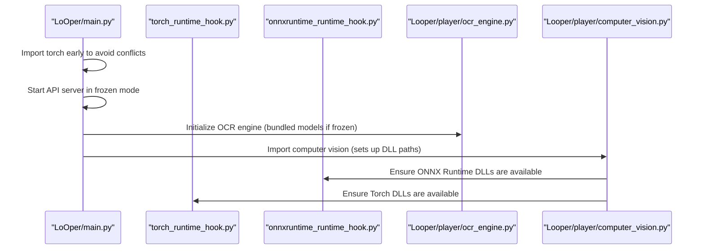

**Diagram sources**
- [Looper/main.py:106-110](file://Looper/main.py#L106-L110)
- [Looper/main.py:171-353](file://Looper/main.py#L171-L353)
- [Looper/player/ocr_engine.py:58-91](file://Looper/player/ocr_engine.py#L58-L91)
- [Looper/player/computer_vision.py:8-63](file://Looper/player/computer_vision.py#L8-L63)

**Section sources**
- [Looper/main.py:106-110](file://Looper/main.py#L106-L110)
- [Looper/main.py:171-353](file://Looper/main.py#L171-L353)
- [Looper/player/ocr_engine.py:58-91](file://Looper/player/ocr_engine.py#L58-L91)
- [Looper/player/computer_vision.py:8-63](file://Looper/player/computer_vision.py#L8-L63)

## Dependency Analysis
The build depends on:
- PyInstaller 6+ with dedicated contents directory handling
- ONNX Runtime and PyTorch for AI/ML inference
- Ultralytics for YOLO-based computer vision
- PaddleOCR for OCR tasks
- OpenCV for image processing

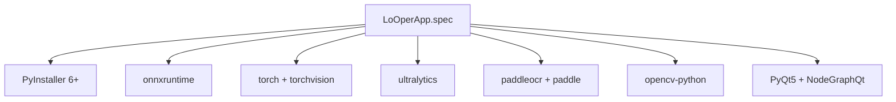

**Diagram sources**
- [requirements.txt:89-127](file://requirements.txt#L89-L127)
- [requirements.txt:171-172](file://requirements.txt#L171-L172)
- [requirements.txt:182](file://requirements.txt#L182)
- [requirements.txt:88](file://requirements.txt#L88)
- [requirements.txt:99](file://requirements.txt#L99)

**Section sources**
- [requirements.txt:89-127](file://requirements.txt#L89-L127)
- [requirements.txt:171-172](file://requirements.txt#L171-L172)
- [requirements.txt:182](file://requirements.txt#L182)
- [requirements.txt:88](file://requirements.txt#L88)
- [requirements.txt:99](file://requirements.txt#L99)

## Performance Considerations
- Pre-loading critical DLLs reduces runtime initialization overhead and avoids loader conflicts.
- Bundling models and assets minimizes startup latency by avoiding network downloads.
- Normalizing destinations avoids redundant nested paths and keeps the bundle compact.
- Excluding unnecessary packages reduces bundle size and potential import conflicts.

## Troubleshooting Guide
Common issues and resolutions:
- Missing dependencies at runtime:
  - Ensure all dynamic imports are covered by hiddenimports in the spec.
  - Verify that collect_all is applied to complex packages and that binaries are explicitly added for ONNX Runtime.
- DLL conflicts (e.g., WinError 1114):
  - Use the Torch runtime hook to pre-load VC++ redistributables, OpenMP, and core Torch/ONNX Runtime DLLs in a deterministic order.
  - Filter conflicting libiomp5md.dll from paddle libs to avoid version mismatches.
- Missing ONNX Runtime providers:
  - Confirm onnxruntime_runtime_hook registers and pre-loads providers and core DLLs.
- OCR model not found in frozen builds:
  - Ensure PaddleOCR models are bundled into _internal/paddle_models and that the OCR engine detects them at runtime.

**Section sources**
- [LooperApp.spec:440-461](file://LooperApp.spec#L440-L461)
- [torch_runtime_hook.py:75-118](file://torch_runtime_hook.py#L75-L118)
- [onnxruntime_runtime_hook.py:21-34](file://onnxruntime_runtime_hook.py#L21-L34)
- [Looper/player/ocr_engine.py:58-91](file://Looper/player/ocr_engine.py#L58-L91)

## Conclusion
The LoOperV2 PyInstaller configuration is designed to reliably package complex AI/ML dependencies across platforms. By combining hidden imports, targeted data and binary collection, and robust runtime hooks, the build ensures that ONNX Runtime and PyTorch DLLs are discoverable and pre-loaded, while OCR and computer vision assets are available in frozen environments. Developers can customize the spec to adjust bundle size and asset inclusion, guided by the strategies outlined here.