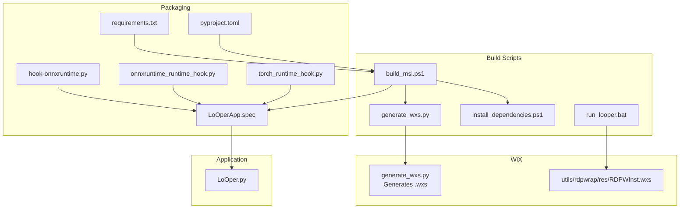
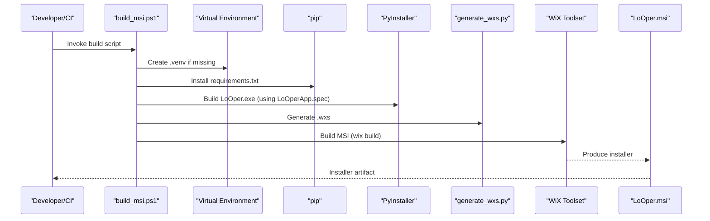
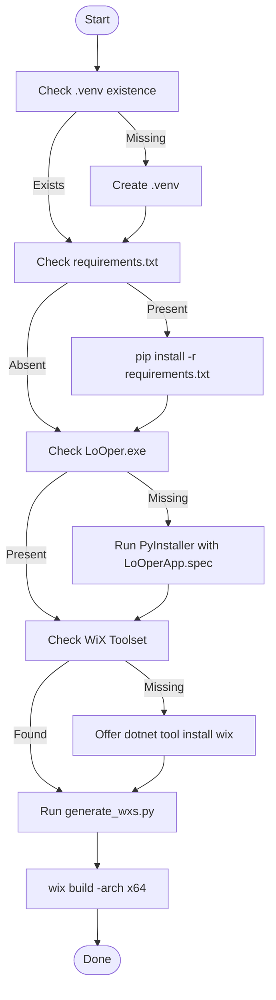
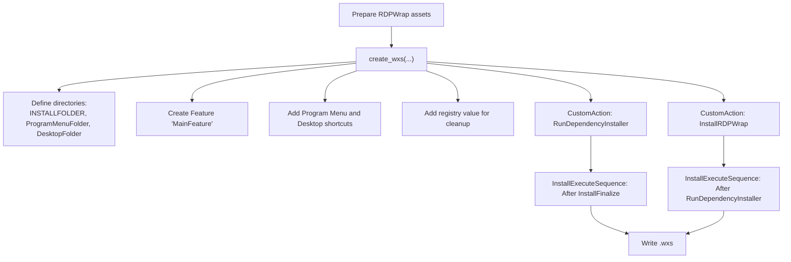
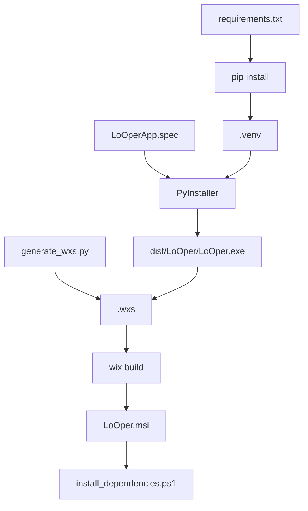

# Windows Installer Generation

<cite>
**Referenced Files in This Document**
- [build_msi.ps1](file://build_msi.ps1)
- [generate_wxs.py](file://generate_wxs.py)
- [install_dependencies.ps1](file://install_dependencies.ps1)
- [LoOperApp.spec](file://LoOperApp.spec)
- [requirements.txt](file://requirements.txt)
- [run_looper.bat](file://run_looper.bat)
- [hook-onnxruntime.py](file://hook-onnxruntime.py)
- [onnxruntime_runtime_hook.py](file://onnxruntime_runtime_hook.py)
- [torch_runtime_hook.py](file://torch_runtime_hook.py)
- [LoOper.py](file://LoOper.py)
- [pyproject.toml](file://pyproject.toml)
- [utils/rdpwrap/res/RDPWInst.wxs](file://utils/rdpwrap/res/RDPWInst.wxs)
</cite>

## Table of Contents
1. [Introduction](#introduction)
2. [Project Structure](#project-structure)
3. [Core Components](#core-components)
4. [Architecture Overview](#architecture-overview)
5. [Detailed Component Analysis](#detailed-component-analysis)
6. [Dependency Analysis](#dependency-analysis)
7. [Performance Considerations](#performance-considerations)
8. [Troubleshooting Guide](#troubleshooting-guide)
9. [Conclusion](#conclusion)
10. [Appendices](#appendices)

## Introduction
This document explains the complete Windows installer generation pipeline for LoOper, from a PyInstaller-built executable to a signed MSI package using WiX Toolset v4+. It covers:
- The PowerShell-driven build pipeline that orchestrates virtual environments, dependency installation, executable bundling, WiX source generation, and MSI compilation.
- The WiX source generation logic that creates a feature-based MSI with shortcuts, registry entries, and post-install custom actions.
- The post-install automation that installs Ollama and verifies OCR model assets.
- WiX configuration specifics, including product identity, UI customization, directory layout, and RDP wrapper integration.
- Installer customization options, shortcut creation, and system requirements validation.
- How the installer packaging integrates with the application architecture and impacts deployment and user experience.
- Common issues such as installer signing, compatibility requirements, and troubleshooting installation problems.

## Project Structure
The Windows installer artifacts and scripts are organized as follows:
- PowerShell build and automation:
  - build_msi.ps1: Orchestrates environment setup, PyInstaller build, WiX detection, .wxs generation, and MSI build.
  - install_dependencies.ps1: Post-install script to install Ollama and verify OCR models.
  - run_looper.bat: Developer-focused script to bootstrap RDP wrapper and agent user setup.
- WiX tooling:
  - generate_wxs.py: Generates the WiX source (Wix 4) with product definition, features, files, shortcuts, and custom actions.
  - utils/rdpwrap/res/RDPWInst.wxs: WiX source for the RDP Wrapper installer (legacy reference).
- Packaging and runtime hooks:
  - LoOperApp.spec: PyInstaller spec that bundles the application and its dependencies.
  - hook-onnxruntime.py, onnxruntime_runtime_hook.py, torch_runtime_hook.py: Hooks to ensure proper DLL resolution and runtime initialization.
  - requirements.txt: Python dependencies used by the build and runtime.
  - pyproject.toml: Project metadata and dependency declarations.
- Application entry point:
  - LoOper.py: Launcher that manages elevation, splash screen, and post-install dependency verification.

**Diagram sources**
- [build_msi.ps1:1-102](file://build_msi.ps1#L1-L102)
- [generate_wxs.py:44-224](file://generate_wxs.py#L44-L224)
- [install_dependencies.ps1:1-62](file://install_dependencies.ps1#L1-L62)
- [run_looper.bat:1-88](file://run_looper.bat#L1-L88)
- [LoOperApp.spec:1-510](file://LoOperApp.spec#L1-L510)
- [hook-onnxruntime.py:1-39](file://hook-onnxruntime.py#L1-L39)
- [onnxruntime_runtime_hook.py:1-34](file://onnxruntime_runtime_hook.py#L1-L34)
- [torch_runtime_hook.py:1-118](file://torch_runtime_hook.py#L1-L118)
- [requirements.txt:1-195](file://requirements.txt#L1-L195)
- [pyproject.toml:1-253](file://pyproject.toml#L1-L253)
- [utils/rdpwrap/res/RDPWInst.wxs:1-50](file://utils/rdpwrap/res/RDPWInst.wxs#L1-L50)
- [LoOper.py:1-654](file://LoOper.py#L1-L654)

**Section sources**
- [build_msi.ps1:1-102](file://build_msi.ps1#L1-L102)
- [generate_wxs.py:44-224](file://generate_wxs.py#L44-L224)
- [install_dependencies.ps1:1-62](file://install_dependencies.ps1#L1-L62)
- [run_looper.bat:1-88](file://run_looper.bat#L1-L88)
- [LoOperApp.spec:1-510](file://LoOperApp.spec#L1-L510)
- [hook-onnxruntime.py:1-39](file://hook-onnxruntime.py#L1-L39)
- [onnxruntime_runtime_hook.py:1-34](file://onnxruntime_runtime_hook.py#L1-L34)
- [torch_runtime_hook.py:1-118](file://torch_runtime_hook.py#L1-L118)
- [requirements.txt:1-195](file://requirements.txt#L1-L195)
- [pyproject.toml:1-253](file://pyproject.toml#L1-L253)
- [utils/rdpwrap/res/RDPWInst.wxs:1-50](file://utils/rdpwrap/res/RDPWInst.wxs#L1-L50)
- [LoOper.py:1-654](file://LoOper.py#L1-L654)

## Core Components
- PowerShell MSI Builder (build_msi.ps1)
  - Creates a virtual environment if missing, installs Python dependencies, runs PyInstaller to produce the executable, checks for WiX Toolset, generates .wxs, and builds the MSI.
- WiX Source Generator (generate_wxs.py)
  - Produces a Wix 4 .wxs with product identity, media embedding, UI variables, directory structure, feature groups, file components, shortcuts, and custom actions.
- Post-Install Automation (install_dependencies.ps1)
  - Detects and installs Ollama if missing, and triggers OCR model verification via the application.
- PyInstaller Spec (LoOperApp.spec)
  - Defines hidden imports, data files, binaries, runtime hooks, and packaging behavior for bundling the application.
- Runtime Hooks (hook-onnxruntime.py, onnxruntime_runtime_hook.py, torch_runtime_hook.py)
  - Ensure proper DLL resolution and initialization order for ONNX Runtime and Torch to avoid WinError 1114 and similar loader conflicts.
- RDP Wrapper Integration (generate_wxs.py + run_looper.bat + RDPWInst.wxs)
  - Downloads and embeds RDP Wrapper, adds a custom action to install and update RDPWInst, and supports legacy RDPWInst.wxs for reference.

**Section sources**
- [build_msi.ps1:14-102](file://build_msi.ps1#L14-L102)
- [generate_wxs.py:44-224](file://generate_wxs.py#L44-L224)
- [install_dependencies.ps1:18-62](file://install_dependencies.ps1#L18-L62)
- [LoOperApp.spec:27-510](file://LoOperApp.spec#L27-L510)
- [hook-onnxruntime.py:1-39](file://hook-onnxruntime.py#L1-L39)
- [onnxruntime_runtime_hook.py:1-34](file://onnxruntime_runtime_hook.py#L1-L34)
- [torch_runtime_hook.py:1-118](file://torch_runtime_hook.py#L1-L118)
- [utils/rdpwrap/res/RDPWInst.wxs:1-50](file://utils/rdpwrap/res/RDPWInst.wxs#L1-L50)

## Architecture Overview
The installer generation pipeline ties together build automation, packaging, and WiX compilation to deliver a user-friendly MSI with embedded post-install tasks.

**Diagram sources**
- [build_msi.ps1:16-53](file://build_msi.ps1#L16-L53)
- [build_msi.ps1:78-99](file://build_msi.ps1#L78-L99)
- [generate_wxs.py:210-224](file://generate_wxs.py#L210-L224)
- [LoOperApp.spec:481-510](file://LoOperApp.spec#L481-L510)

## Detailed Component Analysis

### PowerShell MSI Builder (build_msi.ps1)
Responsibilities:
- Environment management: Creates a virtual environment and installs dependencies from requirements.txt.
- Executable bundling: Runs PyInstaller using LoOperApp.spec to produce the dist/LoOper directory containing LoOper.exe.
- WiX Toolset detection: Checks for wix command; offers guided installation via dotnet tool if missing.
- WiX source generation: Invokes generate_wxs.py to create the .wxs file.
- MSI compilation: Builds the MSI using WiX Toolset v4 with UI extension and outputs LoOper.msi.

Key behaviors:
- Uses a persistent UpgradeCode for upgrades.
- Accepts WiX EULA and adds WixToolset.UI.wixext extension.
- Compiles for x64 architecture.

**Diagram sources**
- [build_msi.ps1:16-99](file://build_msi.ps1#L16-L99)

**Section sources**
- [build_msi.ps1:16-99](file://build_msi.ps1#L16-L99)

### WiX Source Generator (generate_wxs.py)
Responsibilities:
- Prepares RDP wrapper assets by downloading and extracting RDPWrap-v1.6.2, copying binaries into the dist directory, and embedding them into the installer.
- Generates a Wix 4 .wxs with:
  - Product identity (Name, Manufacturer, Version, UpgradeCode).
  - MajorUpgrade policy and MediaTemplate for embedded CAB.
  - UI variables for banner/dialog images and license RTF.
  - Standard directory structure under LocalAppDataFolder with INSTALLFOLDER.
  - Program Menu and Desktop shortcut creation for the main executable.
  - Feature group aggregating all components.
  - Registry value for cleanup and uninstall behavior.
  - Custom actions:
    - RunDependencyInstaller: Executes install_dependencies.ps1 after installation.
    - InstallRDPWrap: Runs RDPWInst.exe to install/update and refresh rdpwrap.ini, then restarts Terminal Services.

Runtime integration:
- Copies install_dependencies.ps1 into the dist directory so it is included in the MSI.
- Adds a property to display Ollama status on the installer UI.

**Diagram sources**
- [generate_wxs.py:11-42](file://generate_wxs.py#L11-L42)
- [generate_wxs.py:44-209](file://generate_wxs.py#L44-L209)

**Section sources**
- [generate_wxs.py:11-42](file://generate_wxs.py#L11-L42)
- [generate_wxs.py:44-209](file://generate_wxs.py#L44-L209)

### Post-Install Automation (install_dependencies.ps1)
Responsibilities:
- Detects Ollama presence via command availability or local app path.
- If missing, downloads OllamaSetup.exe and installs silently.
- Invokes LoOper.exe with --install-deps to trigger OCR model verification and initialization.

User experience:
- Uses Windows notification balloons to inform the user about ongoing setup steps.

**Section sources**
- [install_dependencies.ps1:18-62](file://install_dependencies.ps1#L18-L62)

### PyInstaller Spec (LoOperApp.spec)
Responsibilities:
- Defines hidden imports for PyQt5, NodeGraphQt, PyAutoGUI, OpenCV, Torch, Ultralytics, and others.
- Collects data files and binaries, including ONNX Runtime DLLs and redistributables.
- Applies runtime hooks for ONNX Runtime and Torch to resolve DLLs and initialize early.
- Normalizes destinations to avoid nested _internal/_internal paths.
- Produces a console=False executable with icon and excludes certain packages.

Integration with installer:
- Ensures all runtime dependencies are bundled so the MSI can run without pre-installed system components.

**Section sources**
- [LoOperApp.spec:27-510](file://LoOperApp.spec#L27-L510)

### Runtime Hooks (ONNX Runtime and Torch)
Responsibilities:
- hook-onnxruntime.py: Collects onnxruntime data files and binaries for packaging.
- onnxruntime_runtime_hook.py: Adds onnxruntime/capi to DLL search path and loads critical DLLs early.
- torch_runtime_hook.py: Adds multiple potential DLL search paths, pre-loads VC++ redistributables and Torch libraries, and sets environment flags to prevent loader conflicts.

Impact on installer:
- These hooks ensure the bundled executable runs reliably on target systems, reducing post-install failures.

**Section sources**
- [hook-onnxruntime.py:1-39](file://hook-onnxruntime.py#L1-L39)
- [onnxruntime_runtime_hook.py:1-34](file://onnxruntime_runtime_hook.py#L1-L34)
- [torch_runtime_hook.py:1-118](file://torch_runtime_hook.py#L1-L118)

### RDP Wrapper Integration
Two complementary mechanisms are present:
- In generate_wxs.py: Downloads RDPWrap-v1.6.2, embeds RDPWInst.exe, and adds a custom action to install/update RDPWInst and fetch a community rdpwrap.ini, followed by restarting Terminal Services.
- In run_looper.bat: Provides a developer-focused bootstrap to download RDPWInst.exe, install/update, fetch rdpwrap.ini, and configure agent user permissions and firewall rules.

Legacy WiX reference:
- utils/rdpwrap/res/RDPWInst.wxs defines a WiX 2.x product for RDP Wrapper, useful for understanding the original RDPWInst packaging.

**Section sources**
- [generate_wxs.py:11-42](file://generate_wxs.py#L11-L42)
- [generate_wxs.py:191-203](file://generate_wxs.py#L191-L203)
- [run_looper.bat:25-57](file://run_looper.bat#L25-L57)
- [utils/rdpwrap/res/RDPWInst.wxs:1-50](file://utils/rdpwrap/res/RDPWInst.wxs#L1-L50)

## Dependency Analysis
The installer pipeline depends on:
- Python virtual environment and pip to install dependencies from requirements.txt.
- PyInstaller to produce the executable according to LoOperApp.spec.
- WiX Toolset v4+ for compiling the MSI.
- Embedded PowerShell scripts for post-install tasks.
- Runtime hooks to ensure DLL resolution and initialization.

**Diagram sources**
- [requirements.txt:1-195](file://requirements.txt#L1-L195)
- [LoOperApp.spec:481-510](file://LoOperApp.spec#L481-L510)
- [generate_wxs.py:210-224](file://generate_wxs.py#L210-L224)
- [build_msi.ps1:87-99](file://build_msi.ps1#L87-L99)

**Section sources**
- [requirements.txt:1-195](file://requirements.txt#L1-L195)
- [LoOperApp.spec:481-510](file://LoOperApp.spec#L481-L510)
- [generate_wxs.py:210-224](file://generate_wxs.py#L210-L224)
- [build_msi.ps1:87-99](file://build_msi.ps1#L87-L99)

## Performance Considerations
- MSI size: Embedding files via MediaTemplate increases MSI size but simplifies distribution. Consider whether embedding all files is optimal for your deployment scenario.
- Post-install tasks: Running PowerShell-based installers and model downloads can take time; ensure adequate user feedback and network connectivity.
- DLL resolution: Runtime hooks reduce startup-time failures by pre-loading critical DLLs; keep these hooks aligned with bundled binaries.

## Troubleshooting Guide
Common issues and resolutions:
- WiX Toolset not found
  - Cause: wix command missing or WiX Toolset v4+ not installed.
  - Resolution: The build script offers to install via dotnet tool; alternatively, install WiX manually and ensure it is on PATH.
  - Reference: [build_msi.ps1:55-76](file://build_msi.ps1#L55-L76)
- PyInstaller build failure
  - Cause: Missing dependencies or incorrect spec configuration.
  - Resolution: Verify requirements.txt and LoOperApp.spec; ensure .venv is created and dependencies are installed before invoking PyInstaller.
  - Reference: [build_msi.ps1:39-53](file://build_msi.ps1#L39-L53), [LoOperApp.spec:27-510](file://LoOperApp.spec#L27-L510)
- Installer does not install Ollama or OCR models
  - Cause: Network issues or blocked downloads.
  - Resolution: Manually install OllamaSetup.exe and run LoOper.exe with --install-deps; verify network connectivity and proxy settings.
  - Reference: [install_dependencies.ps1:25-62](file://install_dependencies.ps1#L25-L62)
- RDP wrapper installation fails
  - Cause: Missing RDPWInst.exe or insufficient privileges.
  - Resolution: Ensure RDPWInst.exe is present in the installer; run the installer with administrative privileges; restart Terminal Services if needed.
  - Reference: [generate_wxs.py:191-203](file://generate_wxs.py#L191-L203), [run_looper.bat:43-57](file://run_looper.bat#L43-L57)
- Installer signing
  - Requirement: To distribute widely, sign the MSI with a trusted certificate to avoid security warnings.
  - Reference: [build_msi.ps1:87-99](file://build_msi.ps1#L87-L99)
- Compatibility requirements
  - Ensure target systems meet Python 3.10+ and Windows OS requirements; verify that the bundled VC++ redistributables match the target environment.
  - References: [pyproject.toml:9](file://pyproject.toml#L9), [torch_runtime_hook.py:95-108](file://torch_runtime_hook.py#L95-L108)

**Section sources**
- [build_msi.ps1:55-76](file://build_msi.ps1#L55-L76)
- [build_msi.ps1:39-53](file://build_msi.ps1#L39-L53)
- [install_dependencies.ps1:25-62](file://install_dependencies.ps1#L25-L62)
- [generate_wxs.py:191-203](file://generate_wxs.py#L191-L203)
- [run_looper.bat:43-57](file://run_looper.bat#L43-L57)
- [pyproject.toml:9](file://pyproject.toml#L9)
- [torch_runtime_hook.py:95-108](file://torch_runtime_hook.py#L95-L108)

## Conclusion
The Windows installer generation pipeline leverages PowerShell automation, WiX Toolset v4+, and PyInstaller to produce a robust MSI with embedded post-install tasks. The WiX source generator encapsulates product identity, UI customization, directory layout, shortcuts, and RDP wrapper integration. Runtime hooks ensure reliable DLL resolution and initialization. By following the documented workflow and troubleshooting guidance, DevOps teams can consistently build, sign, and deploy distributable installers that provide a smooth user experience.

## Appendices

### WiX Configuration Highlights
- Product definition: Includes Name, Manufacturer, Version, UpgradeCode, and MajorUpgrade.
- UI customization: Banner, dialog background, license RTF, and wizard icon variables.
- Directory structure: INSTALLFOLDER under LocalAppDataFolder; Program Menu and Desktop shortcut directories.
- Feature groups: Single feature aggregates all components.
- Shortcuts: Program Menu and Desktop shortcuts for the main executable.
- Registry entries: Cleanup component writes HKCU registry value for uninstall behavior.
- Custom actions: RunDependencyInstaller and InstallRDPWrap executed in InstallExecuteSequence.

**Section sources**
- [generate_wxs.py:55-209](file://generate_wxs.py#L55-L209)

### Installer Customization Options
- Customize product name, version, and manufacturer in the WiX generator.
- Modify UI images and license file paths.
- Adjust shortcut creation and desktop presence.
- Control RDP wrapper integration and post-install behavior.

**Section sources**
- [generate_wxs.py:84-96](file://generate_wxs.py#L84-L96)
- [generate_wxs.py:150-164](file://generate_wxs.py#L150-L164)
- [generate_wxs.py:174-179](file://generate_wxs.py#L174-L179)
- [generate_wxs.py:181-203](file://generate_wxs.py#L181-L203)

### System Requirements Validation
- Python 3.10+ for building and running.
- WiX Toolset v4+ for MSI compilation.
- Administrative privileges for installing Ollama and RDP wrapper.
- Network connectivity for downloading OllamaSetup.exe and rdpwrap.ini.

**Section sources**
- [pyproject.toml:9](file://pyproject.toml#L9)
- [build_msi.ps1:55-76](file://build_msi.ps1#L55-L76)
- [install_dependencies.ps1:25-45](file://install_dependencies.ps1#L25-L45)
- [run_looper.bat:48-57](file://run_looper.bat#L48-L57)