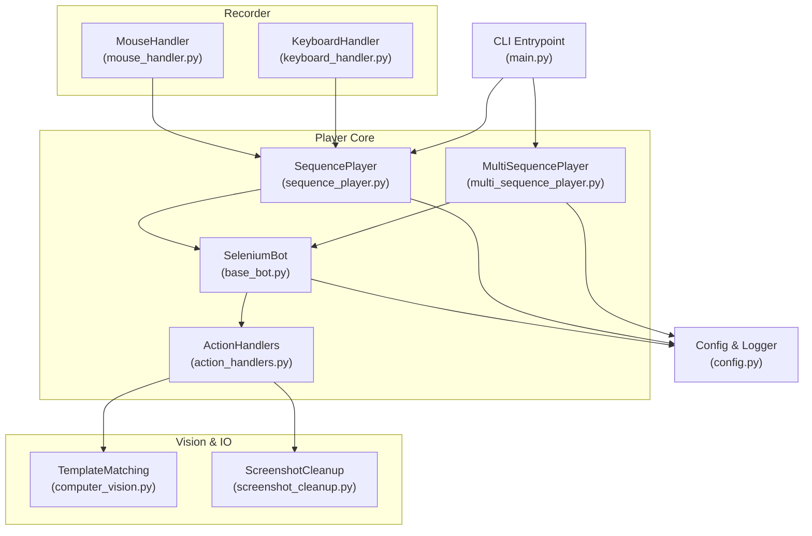
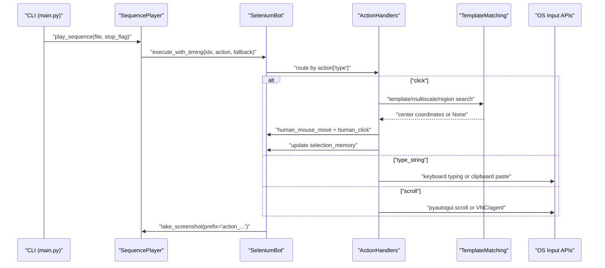
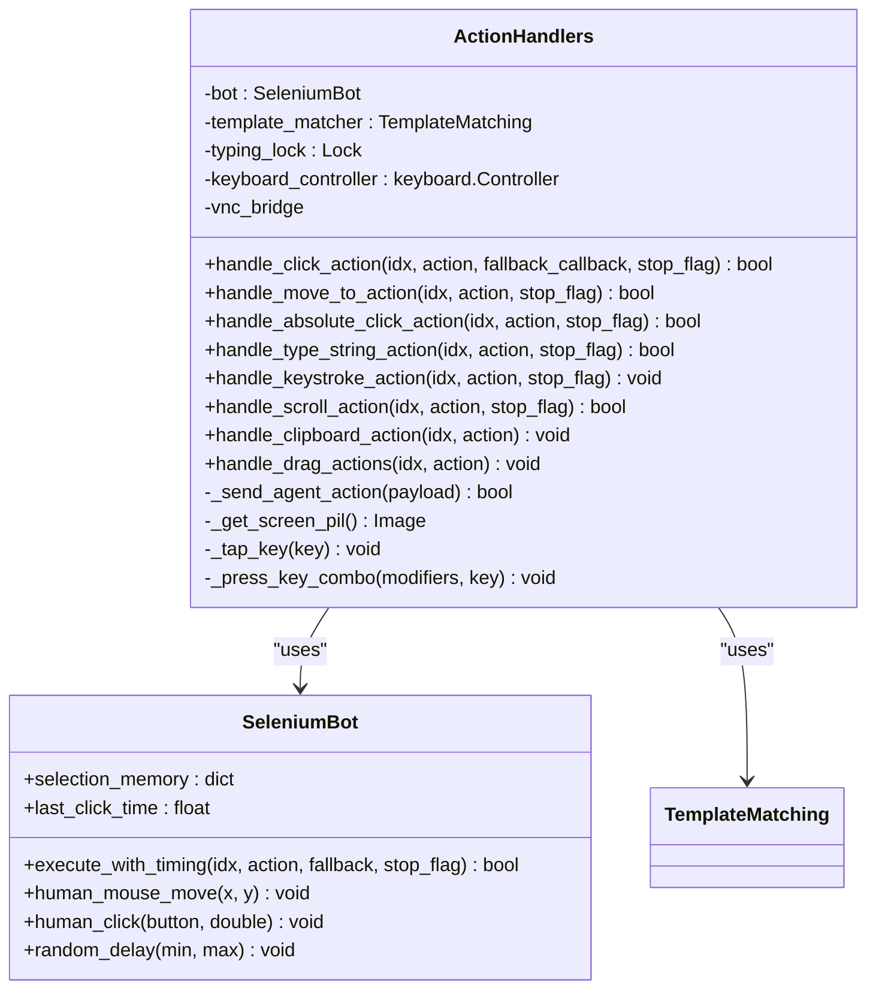
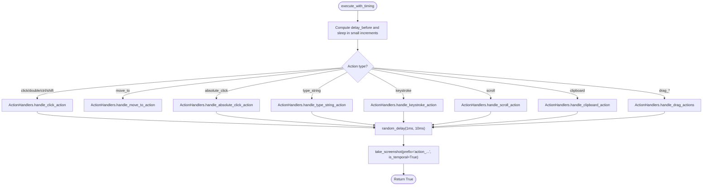
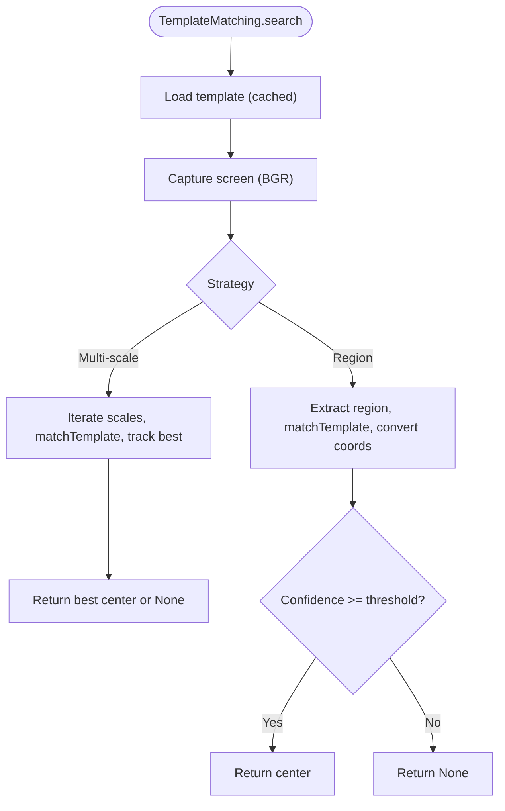
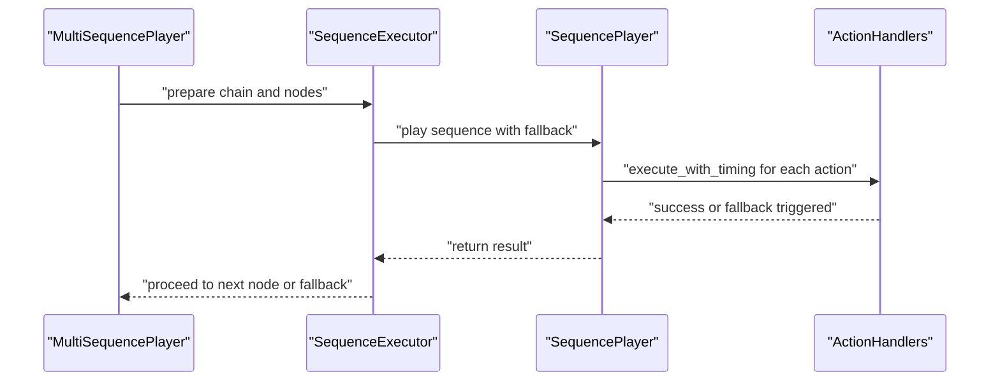
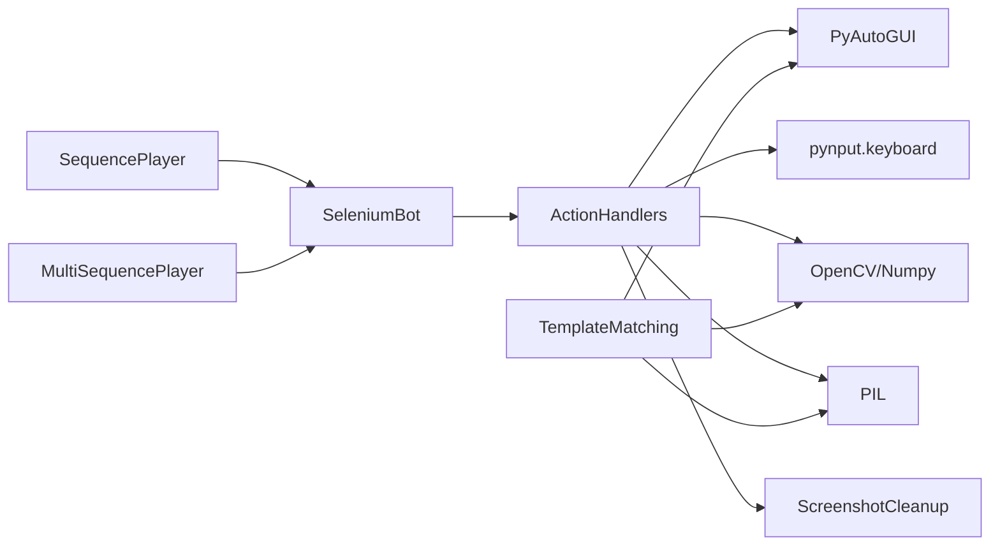

# Action Handlers

<cite>
**Referenced Files in This Document**
- [action_handlers.py](file://LoOper/player/action_handlers.py)
- [base_bot.py](file://LoOper/player/base_bot.py)
- [sequence_player.py](file://LoOper/player/sequence_player.py)
- [multi_sequence_player.py](file://LoOper/player/multi_sequence_player.py)
- [computer_vision.py](file://LoOper/player/computer_vision.py)
- [screenshot_cleanup.py](file://LoOper/player/screenshot_cleanup.py)
- [mouse_handler.py](file://LoOper/recorder/mouse_handler.py)
- [keyboard_handler.py](file://LoOper/recorder/keyboard_handler.py)
- [main.py](file://LoOper/player/main.py)
- [config.py](file://LoOper/player/config.py)
</cite>

## Table of Contents
1. [Introduction](#introduction)
2. [Project Structure](#project-structure)
3. [Core Components](#core-components)
4. [Architecture Overview](#architecture-overview)
5. [Detailed Component Analysis](#detailed-component-analysis)
6. [Dependency Analysis](#dependency-analysis)
7. [Performance Considerations](#performance-considerations)
8. [Troubleshooting Guide](#troubleshooting-guide)
9. [Conclusion](#conclusion)
10. [Appendices](#appendices)

## Introduction
This document explains the action handlers system responsible for desktop automation control and input simulation. It covers mouse and keyboard control, text input handling, application context management, base bot functionality, selection memory preservation, and timing synchronization across action types. It also documents how actions are processed, validated, and executed with proper error handling, and how the system integrates with PyAutoGUI, pynput, and other automation libraries. Practical examples illustrate the flow of a click action, including fallback sequences, and guidance is provided for extending the system with custom action handlers and optimizing performance.

## Project Structure
The action handlers system is centered in the player package and integrates with recording utilities and playback orchestration. Key modules include:
- Action handlers: centralized logic for executing actions (mouse, keyboard, typing, scrolling, clipboard, drag-and-drop)
- Base bot: core automation primitives (human-like mouse movement, clicks, random delays)
- Sequence and multi-sequence players: orchestrate playback, manage fallbacks, and preserve selection memory
- Computer vision: template matching, region-based search, OCR, and sandbox agent integration
- Screenshot cleanup: manage temporal screenshots for debugging and verification
- Recorder utilities: mouse and keyboard event handlers used during recording

**Diagram sources**
- [action_handlers.py:1-1058](file://LoOper/player/action_handlers.py#L1-L1058)
- [base_bot.py:1-299](file://LoOper/player/base_bot.py#L1-L299)
- [sequence_player.py:1-252](file://LoOper/player/sequence_player.py#L1-L252)
- [multi_sequence_player.py:1-532](file://LoOper/player/multi_sequence_player.py#L1-L532)
- [computer_vision.py:1-606](file://LoOper/player/computer_vision.py#L1-L606)
- [screenshot_cleanup.py:1-125](file://LoOper/player/screenshot_cleanup.py#L1-L125)
- [mouse_handler.py:1-167](file://LoOper/recorder/mouse_handler.py#L1-L167)
- [keyboard_handler.py:1-197](file://LoOper/recorder/keyboard_handler.py#L1-L197)
- [main.py:1-108](file://LoOper/player/main.py#L1-L108)
- [config.py:1-46](file://LoOper/player/config.py#L1-L46)

**Section sources**
- [action_handlers.py:1-1058](file://LoOper/player/action_handlers.py#L1-L1058)
- [base_bot.py:1-299](file://LoOper/player/base_bot.py#L1-L299)
- [sequence_player.py:1-252](file://LoOper/player/sequence_player.py#L1-L252)
- [multi_sequence_player.py:1-532](file://LoOper/player/multi_sequence_player.py#L1-L532)
- [computer_vision.py:1-606](file://LoOper/player/computer_vision.py#L1-L606)
- [screenshot_cleanup.py:1-125](file://LoOper/player/screenshot_cleanup.py#L1-L125)
- [mouse_handler.py:1-167](file://LoOper/recorder/mouse_handler.py#L1-L167)
- [keyboard_handler.py:1-197](file://LoOper/recorder/keyboard_handler.py#L1-L197)
- [main.py:1-108](file://LoOper/player/main.py#L1-L108)
- [config.py:1-46](file://LoOper/player/config.py#L1-L46)

## Core Components
- ActionHandlers: central dispatcher for actions (click, move_to, absolute_click, type_string, keystroke, scroll, clipboard, drag actions). Implements robust visual matching, retry logic, and fallback sequences. Integrates with sandbox agents and VNC bridges.
- SeleniumBot: provides human-like motion, random delays, and action execution orchestration. Manages selection memory for deterministic element selection across repeated matches.
- SequencePlayer: loads and plays back a single sequence, supports caching and fallback callbacks.
- MultiSequencePlayer: orchestrates chains of sequences with conditional fallbacks, workflow graphs, and application context management.
- TemplateMatching: computer vision utilities for multi-scale template matching, region-based search, OCR, and sandbox agent integration.
- ScreenshotCleanup: manages temporal screenshots for debugging and cleanup.
- Recorder utilities: MouseHandler and KeyboardHandler capture user input and produce action dictionaries compatible with the playback system.

**Section sources**
- [action_handlers.py:26-1058](file://LoOper/player/action_handlers.py#L26-L1058)
- [base_bot.py:22-299](file://LoOper/player/base_bot.py#L22-L299)
- [sequence_player.py:136-252](file://LoOper/player/sequence_player.py#L136-L252)
- [multi_sequence_player.py:32-532](file://LoOper/player/multi_sequence_player.py#L32-L532)
- [computer_vision.py:47-606](file://LoOper/player/computer_vision.py#L47-L606)
- [screenshot_cleanup.py:6-125](file://LoOper/player/screenshot_cleanup.py#L6-L125)
- [mouse_handler.py:6-167](file://LoOper/recorder/mouse_handler.py#L6-L167)
- [keyboard_handler.py:6-197](file://LoOper/recorder/keyboard_handler.py#L6-L197)

## Architecture Overview
The system separates concerns across layers:
- Recording layer produces action dictionaries with fields like type, coordinates, text, and optional screenshot paths.
- Playback layer validates actions, applies timing, routes to specialized handlers, and captures screenshots for verification.
- Vision layer performs template matching and region searches to locate UI elements reliably.
- Context and memory layers preserve selection state and application context across actions and sequences.

**Diagram sources**
- [main.py:18-108](file://LoOper/player/main.py#L18-L108)
- [sequence_player.py:202-252](file://LoOper/player/sequence_player.py#L202-L252)
- [base_bot.py:207-284](file://LoOper/player/base_bot.py#L207-L284)
- [action_handlers.py:133-604](file://LoOper/player/action_handlers.py#L133-L604)
- [computer_vision.py:198-450](file://LoOper/player/computer_vision.py#L198-L450)

## Detailed Component Analysis

### ActionHandlers: Central Dispatcher and Execution Engine
ActionHandlers encapsulates all action execution logic and integrates with computer vision, sandbox agents, and VNC bridges. It maintains a typing lock to serialize keyboard input and preserves selection state for deterministic element selection.

Key capabilities:
- Click actions with visual template matching, multi-strategy search, retry loops, and fallback sequences
- Human-like mouse movement and clicking
- Text input handling with optimized batching, Unicode-safe clipboard fallback, and post-type delays
- Keystroke handling for special keys and delays
- Scroll simulation with step-wise execution and timing fidelity
- Clipboard operations (copy/paste/cut/select_all/undo/redo)
- Drag-and-drop operations (start, end, drop)
- Agent/VNC bridge integration for remote environments

**Diagram sources**
- [action_handlers.py:26-1058](file://LoOper/player/action_handlers.py#L26-L1058)
- [base_bot.py:22-299](file://LoOper/player/base_bot.py#L22-L299)

**Section sources**
- [action_handlers.py:26-1058](file://LoOper/player/action_handlers.py#L26-L1058)

### Base Bot: Timing, Motion, and Selection Memory
SeleniumBot provides:
- Human-like mouse movement using quadratic Bézier curves with Perlin noise for natural motion
- Random delays with Gaussian distribution to mimic human behavior
- Action execution orchestration with pre-action delays, post-click delays, and screenshot capture
- Selection memory to preserve state across repeated matches (instance counts, last coordinates, visited indices, cluster radius)

**Diagram sources**
- [base_bot.py:207-284](file://LoOper/player/base_bot.py#L207-L284)
- [action_handlers.py:133-1058](file://LoOper/player/action_handlers.py#L133-L1058)

**Section sources**
- [base_bot.py:22-299](file://LoOper/player/base_bot.py#L22-L299)

### Computer Vision: Template Matching and Region Search
TemplateMatching provides:
- Multi-scale template matching with adaptive scale selection and confidence thresholds
- Region-based search around hinted coordinates with expandable regions
- OCR text detection and extraction with configurable confidence
- Sandbox agent integration for remote screenshot capture and template matching
- Fast screenshot capture using mss when available

**Diagram sources**
- [computer_vision.py:198-450](file://LoOper/player/computer_vision.py#L198-L450)

**Section sources**
- [computer_vision.py:47-606](file://LoOper/player/computer_vision.py#L47-L606)

### Sequence and Multi-Sequence Players: Orchestration and Fallbacks
SequencePlayer:
- Loads and validates JSON sequences with caching and optimized JSON loading
- Executes actions with stop flags and fallback callbacks
- Preserves application context and selection memory across actions

MultiSequencePlayer:
- Supports legacy linear chains and new workflow-based chains
- Manages conditional fallbacks, workflow navigation, and LLM/TTS/code nodes
- Integrates sandbox contexts and propagates selection memory across components

**Diagram sources**
- [multi_sequence_player.py:32-532](file://LoOper/player/multi_sequence_player.py#L32-L532)
- [sequence_player.py:136-252](file://LoOper/player/sequence_player.py#L136-L252)
- [action_handlers.py:133-1058](file://LoOper/player/action_handlers.py#L133-L1058)

**Section sources**
- [sequence_player.py:136-252](file://LoOper/player/sequence_player.py#L136-L252)
- [multi_sequence_player.py:32-532](file://LoOper/player/multi_sequence_player.py#L32-L532)

### Recorder Utilities: Input Simulation for Recording
MouseHandler and KeyboardHandler translate pynput events into action dictionaries compatible with the playback system:
- MouseHandler detects clicks, double-clicks, and drags, producing click, double_click, drag_start/end/drop actions
- KeyboardHandler tracks modifiers, detects Ctrl+C/V/X/A/Z/Y, and buffers typed text into type_string actions

These recorded actions are consumed by SequencePlayer/MultiSequencePlayer during playback.

**Section sources**
- [mouse_handler.py:6-167](file://LoOper/recorder/mouse_handler.py#L6-L167)
- [keyboard_handler.py:6-197](file://LoOper/recorder/keyboard_handler.py#L6-L197)

## Dependency Analysis
The action handlers system relies on:
- PyAutoGUI for screenshotting and input simulation
- pynput for keyboard controller and event recording
- OpenCV/Numpy for computer vision operations
- PIL for image manipulation and sandbox screenshots
- Threading locks for safe keyboard input serialization
- Config module for feature availability flags and logging

**Diagram sources**
- [action_handlers.py:10-23](file://LoOper/player/action_handlers.py#L10-L23)
- [base_bot.py:7-17](file://LoOper/player/base_bot.py#L7-L17)
- [computer_vision.py:42-44](file://LoOper/player/computer_vision.py#L42-L44)
- [screenshot_cleanup.py:1-125](file://LoOper/player/screenshot_cleanup.py#L1-L125)

**Section sources**
- [action_handlers.py:10-23](file://LoOper/player/action_handlers.py#L10-L23)
- [base_bot.py:7-17](file://LoOper/player/base_bot.py#L7-L17)
- [computer_vision.py:42-44](file://LoOper/player/computer_vision.py#L42-L44)
- [screenshot_cleanup.py:1-125](file://LoOper/player/screenshot_cleanup.py#L1-L125)
- [config.py:11-31](file://LoOper/player/config.py#L11-L31)

## Performance Considerations
- Human-like motion: Bézier curves with Perlin noise reduce robotic appearance; tune noise amplitude and frequency for speed vs. realism.
- Typing optimization: Batched character writes, configurable keystroke delays, and clipboard fallback for large Unicode text improve throughput.
- Visual matching: Multi-scale template matching with adaptive scales reduces false positives and improves robustness; region-based search narrows search space.
- Retry and delay strategies: Small random delays before actions and retries with incremental backoff balance reliability and responsiveness.
- Screenshot management: Temporal screenshots are registered for cleanup to avoid disk clutter; use is_temporal flag for action screenshots.
- Parallelism: Typing lock prevents race conditions; consider isolating heavy operations (OCR, multi-scale matching) to minimize contention.

[No sources needed since this section provides general guidance]

## Troubleshooting Guide
Common issues and resolutions:
- Visual match failures:
  - Increase retry attempts and adjust confidence thresholds.
  - Use region-based search with hints to narrow scope.
  - Enable fallback sequences to recover from repeated failures.
- Input timing precision:
  - Use post_type_delay and keystroke_delay to synchronize input with application responses.
  - Apply delay_after_click to wait for UI updates after preceding clicks.
- Application context switching:
  - Use app_context markers in sequences to track foreground application state.
  - For sandboxed environments, ensure sandbox_agent_url is set and propagated to handlers and vision utilities.
- Cross-platform compatibility:
  - Verify OpenCV availability; fallbacks exist when CV2 is not installed.
  - Test keyboard shortcuts across platforms; use explicit key names via pynput mapping.
- Clipboard and Unicode:
  - For non-ASCII or large text, rely on clipboard paste to avoid typing latency.
  - Monitor paste settle times to allow applications to process input.

**Section sources**
- [action_handlers.py:133-604](file://LoOper/player/action_handlers.py#L133-L604)
- [base_bot.py:207-284](file://LoOper/player/base_bot.py#L207-L284)
- [computer_vision.py:198-450](file://LoOper/player/computer_vision.py#L198-L450)
- [multi_sequence_player.py:252-358](file://LoOper/player/multi_sequence_player.py#L252-L358)

## Conclusion
The action handlers system provides a robust, extensible framework for desktop automation. It combines human-like motion, precise timing, and resilient visual matching with flexible fallback mechanisms. By leveraging computer vision, sandbox integrations, and selection memory, it achieves reliable playback across diverse applications and environments. Extensibility is supported through modular handlers and standardized action dictionaries, enabling custom actions and integration with advanced orchestration systems.

[No sources needed since this section summarizes without analyzing specific files]

## Appendices

### Practical Examples

- Executing a click action with fallback:
  - The handler captures a single screenshot, tries multiple matching strategies, selects the best candidate considering selection memory, performs human-like movement and clicking, updates selection memory, and triggers a fallback sequence if all attempts fail.
  - See [action_handlers.py:133-604](file://LoOper/player/action_handlers.py#L133-L604) and [sequence_player.py:202-252](file://LoOper/player/sequence_player.py#L202-L252).

- Typing text with optimized batching:
  - The handler chooses between character-by-character or batched typing, filters non-printable characters, optionally uses clipboard paste for Unicode/text length thresholds, and applies post-type delays.
  - See [action_handlers.py:674-825](file://LoOper/player/action_handlers.py#L674-L825).

- Scroll simulation with step-wise execution:
  - The handler divides total scroll into steps, applies per-step amounts with timing fidelity, and respects stop flags mid-scroll.
  - See [action_handlers.py:895-968](file://LoOper/player/action_handlers.py#L895-L968).

- Application context management:
  - Sequences can include app_context markers; MultiSequencePlayer tracks and propagates context across nodes and sequences.
  - See [sequence_player.py:234-237](file://LoOper/player/sequence_player.py#L234-L237) and [multi_sequence_player.py:252-288](file://LoOper/player/multi_sequence_player.py#L252-L288).

### Extending the System with Custom Actions
To add a new action type:
- Define a handler method in ActionHandlers with a unique action type and integrate with existing primitives (human_mouse_move, human_click, keyboard_controller).
- Update SeleniumBot.execute_with_timing to route the new action type to your handler.
- Ensure proper error handling, stop flag checks, and screenshot capture semantics.
- If the action requires visual matching, leverage TemplateMatching or extend it accordingly.

**Section sources**
- [action_handlers.py:26-1058](file://LoOper/player/action_handlers.py#L26-L1058)
- [base_bot.py:207-284](file://LoOper/player/base_bot.py#L207-L284)