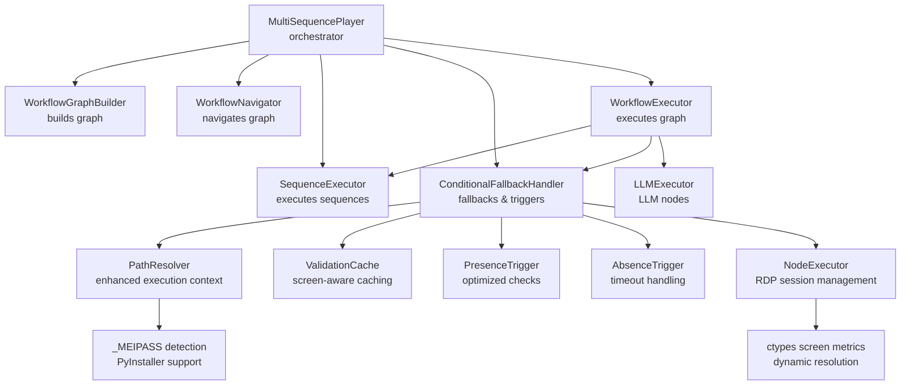
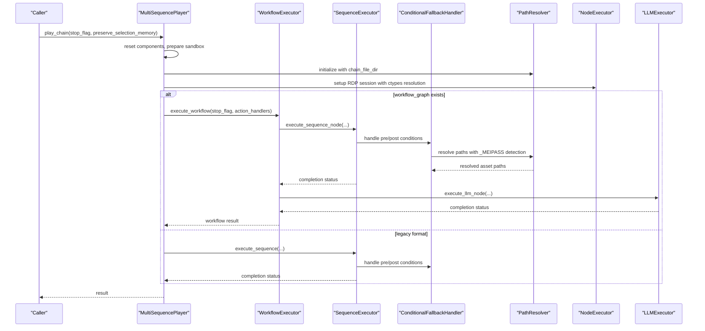
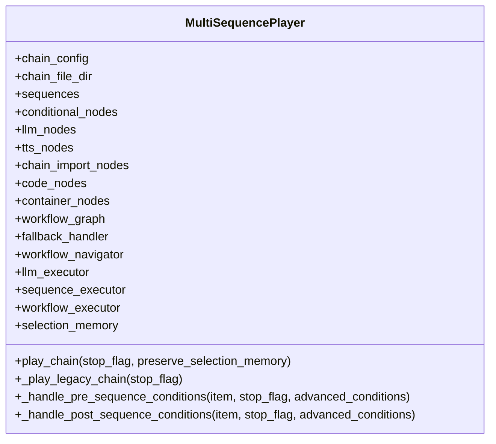
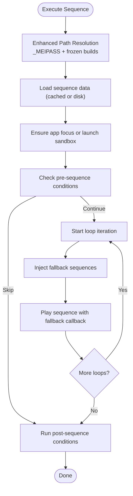
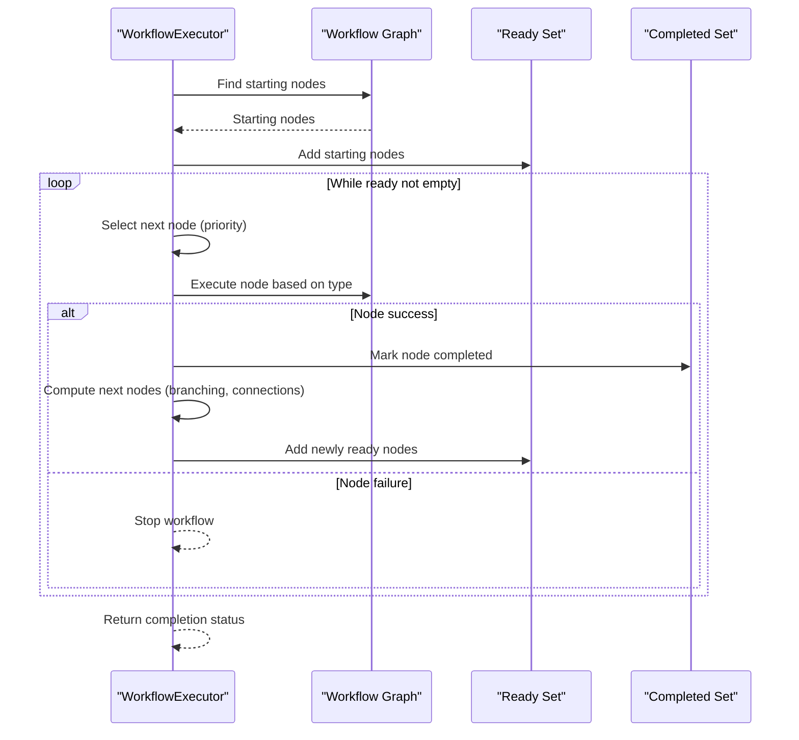
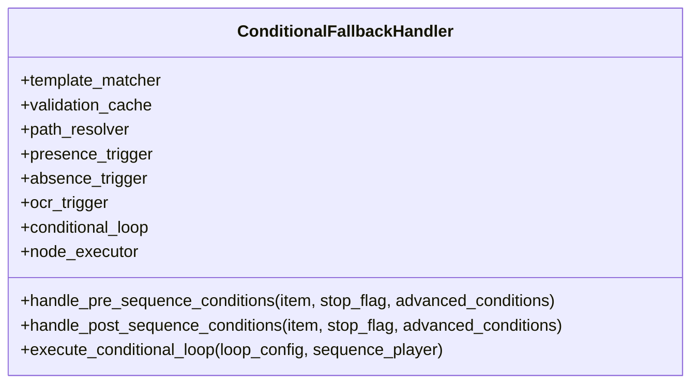
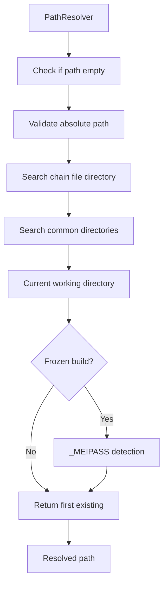
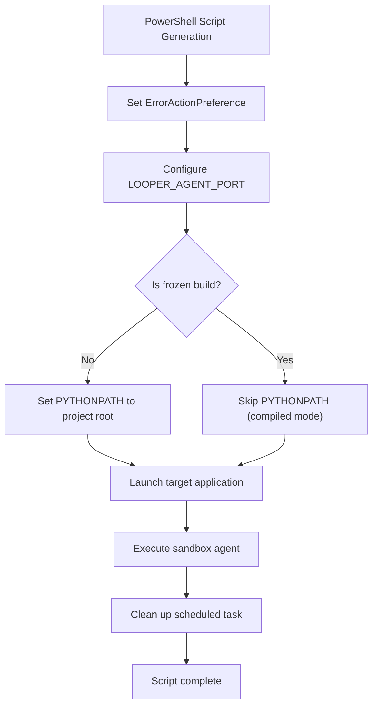
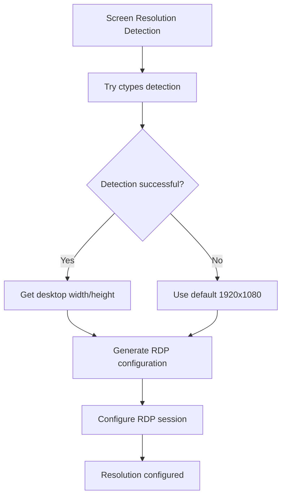
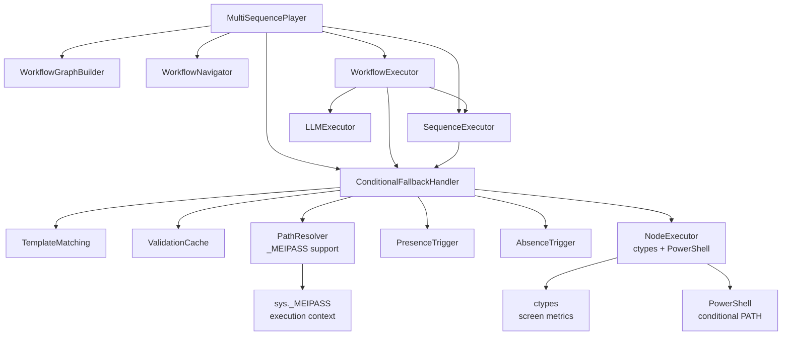

# Multi-Sequence Player

<cite>
**Referenced Files in This Document**
- [multi_sequence_player.py](file://LoOper/player/multi_sequence_player.py)
- [sequence_executor.py](file://LoOper/player/multi_sequence/sequence_executor.py)
- [workflow_graph.py](file://LoOper/player/multi_sequence/workflow_graph.py)
- [conditional_fallback_handler.py](file://LoOper/player/multi_sequence/conditional_fallback_handler.py)
- [llm_executor.py](file://LoOper/player/multi_sequence/llm_executor.py)
- [core.py](file://LoOper/player/multi_sequence/worflow_interpreter_modules/executor_modules/core.py)
- [path_resolver.py](file://LoOper/player/multi_sequence/conditional_fallback_resources/path_resolver.py)
- [validation_cache.py](file://LoOper/player/multi_sequence/conditional_fallback_resources/validation_cache.py)
- [presence_trigger.py](file://LoOper/player/multi_sequence/conditional_fallback_resources/presence_trigger.py)
- [absence_trigger.py](file://LoOper/player/multi_sequence/conditional_fallback_resources/absence_trigger.py)
- [node_executor.py](file://LoOper/player/multi_sequence/conditional_fallback_resources/node_executor.py)
</cite>

## Update Summary
**Changes Made**
- Enhanced PathResolver with robust execution context detection for PyInstaller's _MEIPASS mechanism
- Improved PowerShell script generation with conditional PYTHONPATH setting based on frozen/unfrozen execution state
- Added dynamic screen resolution detection using ctypes for RDP session configuration
- Strengthened path resolution logic for different execution contexts including frozen builds
- Enhanced fallback mechanism with improved resource deployment and sandbox agent handling

## Table of Contents
1. [Introduction](#introduction)
2. [Project Structure](#project-structure)
3. [Core Components](#core-components)
4. [Architecture Overview](#architecture-overview)
5. [Detailed Component Analysis](#detailed-component-analysis)
6. [Enhanced Path Resolution System](#enhanced-path-resolution-system)
7. [PowerShell Script Generation Improvements](#powershell-script-generation-improvements)
8. [Dynamic Screen Resolution Detection](#dynamic-screen-resolution-detection)
9. [Dependency Analysis](#dependency-analysis)
10. [Performance Considerations](#performance-considerations)
11. [Troubleshooting Guide](#troubleshooting-guide)
12. [Conclusion](#conclusion)

## Introduction
This document explains the multi-sequence player component responsible for orchestrating complex automation workflows that combine multiple sequences, conditional logic, and fallback mechanisms. It covers workflow graph execution, dependency resolution, conditional branching, memory sharing across executions, fallback handling, and integration with AI services and computer vision systems. The system now features enhanced path resolution for different execution contexts including PyInstaller's _MEIPASS mechanism and improved PowerShell script generation with conditional PYTHONPATH settings and dynamic screen resolution detection using ctypes.

## Project Structure
The multi-sequence player is implemented under the player module with a modular design featuring enhanced conditional fallback resources:
- MultiSequencePlayer: orchestrator that initializes and coordinates all subsystems
- SequenceExecutor: executes individual sequences and manages app focus/sandbox sessions
- WorkflowExecutor: executes workflow graphs with dependency-aware scheduling
- ConditionalFallbackHandler: encapsulates computer vision triggers, loops, and fallback orchestration with enhanced path resolution
- LLMExecutor: modularized LLM node execution
- WorkflowGraphBuilder and Navigator: construct and navigate the workflow graph
- Enhanced PathResolver: robust path resolution supporting PyInstaller contexts
- Dynamic Screen Resolution Detection: ctypes-based resolution detection for RDP sessions

**Diagram sources**
- [multi_sequence_player.py:32-135](file://LoOper/player/multi_sequence_player.py#L32-L135)
- [workflow_graph.py:1-10](file://LoOper/player/multi_sequence/workflow_graph.py#L1-L10)
- [conditional_fallback_handler.py:20-43](file://LoOper/player/multi_sequence/conditional_fallback_handler.py#L20-L43)
- [core.py:14-38](file://LoOper/player/multi_sequence/worflow_interpreter_modules/executor_modules/core.py#L14-L38)
- [path_resolver.py:10-21](file://LoOper/player/multi_sequence/conditional_fallback_resources/path_resolver.py#L10-L21)
- [node_executor.py:254-279](file://LoOper/player/multi_sequence/conditional_fallback_resources/node_executor.py#L254-L279)

**Section sources**
- [multi_sequence_player.py:1-120](file://LoOper/player/multi_sequence_player.py#L1-L120)
- [workflow_graph.py:1-10](file://LoOper/player/multi_sequence/workflow_graph.py#L1-L10)

## Core Components
- MultiSequencePlayer: central coordinator that loads chains, preloads assets, sets up sandbox contexts, and delegates to modular executors. It also shares selection memory across components to ensure deterministic candidate selection across sequences and fallbacks.
- SequenceExecutor: executes a single sequence node, resolves paths with enhanced context awareness, manages app focus and sandbox sessions, injects fallback sequences, and coordinates with the fallback handler for pre/post conditions.
- WorkflowExecutor: schedules and executes nodes in a workflow graph respecting dependencies, supports conditional branching, LLM-specific chaining rules, and maintains a ready-set for dependency-driven execution.
- ConditionalFallbackHandler: provides presence/absence/OCR triggers, conditional loops, and fallback orchestration with enhanced path resolution capabilities. It caches validation results with screen-aware keys and resolves paths for assets across different execution contexts.
- LLMExecutor: modularized executor for LLM nodes, integrated into the workflow execution pipeline.

**Section sources**
- [multi_sequence_player.py:32-135](file://LoOper/player/multi_sequence_player.py#L32-L135)
- [sequence_executor.py:17-25](file://LoOper/player/multi_sequence/sequence_executor.py#L17-L25)
- [core.py:14-38](file://LoOper/player/multi_sequence/worflow_interpreter_modules/executor_modules/core.py#L14-L38)
- [conditional_fallback_handler.py:20-43](file://LoOper/player/multi_sequence/conditional_fallback_handler.py#L20-L43)
- [llm_executor.py:1-12](file://LoOper/player/multi_sequence/llm_executor.py#L1-L12)

## Architecture Overview
The multi-sequence player implements a layered architecture with enhanced execution context awareness:
- Orchestration layer: MultiSequencePlayer initializes components and coordinates execution
- Execution layer: WorkflowExecutor drives graph execution; SequenceExecutor handles sequence execution; ConditionalFallbackHandler manages triggers and fallbacks with robust path resolution
- Integration layer: LLMExecutor integrates AI services; computer vision triggers enable conditional logic; sandbox management enables remote automation with dynamic screen resolution detection

**Diagram sources**
- [multi_sequence_player.py:192-358](file://LoOper/player/multi_sequence_player.py#L192-L358)
- [core.py:51-316](file://LoOper/player/multi_sequence/worflow_interpreter_modules/executor_modules/core.py#L51-L316)
- [sequence_executor.py:901-1274](file://LoOper/player/multi_sequence/sequence_executor.py#L901-L1274)
- [conditional_fallback_handler.py:100-184](file://LoOper/player/multi_sequence/conditional_fallback_handler.py#L100-L184)
- [path_resolver.py:22-90](file://LoOper/player/multi_sequence/conditional_fallback_resources/path_resolver.py#L22-L90)
- [node_executor.py:398-424](file://LoOper/player/multi_sequence/conditional_fallback_resources/node_executor.py#L398-424)

## Detailed Component Analysis

### MultiSequencePlayer
Responsibilities:
- Loads chain configuration in legacy or new dict format
- Preloads chains/sequences for performance
- Builds workflow graph from sequences and conditional nodes
- Initializes modular components with enhanced path resolution: ConditionalFallbackHandler, WorkflowNavigator, LLMExecutor, SequenceExecutor, WorkflowExecutor
- Shares selection memory across components to maintain deterministic behavior
- Manages sandbox lifecycle for remote automation with dynamic screen resolution
- Supports ComoRAG engine readiness and memory clearing

Key behaviors:
- Preloading: Uses JSON cache to preload chains and sequences to reduce IO overhead
- Memory sharing: Propagates selection_memory to fallback_handler, sequence_executor, and workflow_executor
- Sandbox management: Begins/ends sandbox sessions and propagates agent URLs to action handlers
- Conditional LLM handling: Detects and waits for ComoRAG readiness before clearing memory

**Diagram sources**
- [multi_sequence_player.py:32-135](file://LoOper/player/multi_sequence_player.py#L32-L135)

**Section sources**
- [multi_sequence_player.py:39-135](file://LoOper/player/multi_sequence_player.py#L39-L135)
- [multi_sequence_player.py:192-358](file://LoOper/player/multi_sequence_player.py#L192-L358)

### SequenceExecutor
Responsibilities:
- Execute a single sequence node with loop support and delays
- Resolve sequence file paths with enhanced execution context awareness
- Manage app focus and sandbox sessions for both local and remote targets
- Inject fallback sequences into actions and coordinate fallback execution
- Share selection memory with SequencePlayer instances

Key behaviors:
- Enhanced Path Resolution: Searches multiple directories including PyInstaller _MEIPASS context and supports frozen builds
- App focus: Ensures target application is in foreground or launches sandbox agent
- Fallback injection: Adds chain-level and action-specific fallback sequences
- Conditional pre/post: Delegates to ConditionalFallbackHandler for presence/absence/OCR checks

**Diagram sources**
- [sequence_executor.py:937-1274](file://LoOper/player/multi_sequence/sequence_executor.py#L937-L1274)

**Section sources**
- [sequence_executor.py:17-25](file://LoOper/player/multi_sequence/sequence_executor.py#L17-L25)
- [sequence_executor.py:937-1274](file://LoOper/player/multi_sequence/sequence_executor.py#L937-L1274)

### WorkflowExecutor
Responsibilities:
- Execute workflow graphs with dependency-aware scheduling
- Evaluate conditional nodes and manage branching
- Respect LLM-specific chaining rules and typing synchronization
- Maintain ready-set of nodes whose dependencies are satisfied
- Record node summaries and last executed node metadata

Key behaviors:
- Dependency resolution: Finds starting nodes and iteratively selects ready nodes
- Conditional branching: Stores chosen branch in node data and marks unchosen branches as skipped
- LLM chaining: Delays non-LLM outputs until LLM concatenation completes
- Typing synchronization: Defers execution while LLM is "typing"

**Diagram sources**
- [core.py:51-316](file://LoOper/player/multi_sequence/worflow_interpreter_modules/executor_modules/core.py#L51-L316)

**Section sources**
- [core.py:14-38](file://LoOper/player/multi_sequence/worflow_interpreter_modules/executor_modules/core.py#L14-L38)
- [core.py:51-316](file://LoOper/player/multi_sequence/worflow_interpreter_modules/executor_modules/core.py#L51-L316)

### ConditionalFallbackHandler
Responsibilities:
- Provide modular components for triggers (presence, absence, OCR), conditional loops, and node execution
- Cache validation results keyed by screen hash and trigger configuration
- Resolve asset paths relative to chain file directory with enhanced execution context support
- Handle pre/post-sequence conditions with wait semantics

Key behaviors:
- Enhanced Trigger Evaluation: Supports timeout-based presence checks and polling-based absence/OCR checks with improved path resolution
- Conditional Loops: Execute loops before/after sequences with configurable conditions
- Backward Compatibility: Delegates legacy methods to new modular components
- Execution Context Awareness: Handles both regular and PyInstaller execution environments

**Diagram sources**
- [conditional_fallback_handler.py:20-43](file://LoOper/player/multi_sequence/conditional_fallback_handler.py#L20-L43)

**Section sources**
- [conditional_fallback_handler.py:20-43](file://LoOper/player/multi_sequence/conditional_fallback_handler.py#L20-L43)
- [conditional_fallback_handler.py:100-184](file://LoOper/player/multi_sequence/conditional_fallback_handler.py#L100-L184)

### LLMExecutor Integration
Responsibilities:
- Modularized LLM node execution integrated into WorkflowExecutor
- Provides variable storage and retrieval for LLM outputs
- Coordinates with WorkflowExecutor for typing synchronization and chaining

Integration points:
- Variables: LLMExecutor exposes get/set variable APIs consumed by WorkflowExecutor
- Chaining: LLM nodes can influence downstream execution order and prioritization

**Section sources**
- [llm_executor.py:1-12](file://LoOper/player/multi_sequence/llm_executor.py#L1-L12)
- [core.py:99-116](file://LoOper/player/multi_sequence/worflow_interpreter_modules/executor_modules/core.py#L99-L116)

## Enhanced Path Resolution System
The PathResolver component has been significantly enhanced to support robust path resolution across different execution contexts:

### Key Enhancements
- **PyInstaller _MEIPASS Detection**: Automatically detects frozen builds and resolves paths accordingly
- **Enhanced Directory Search**: Comprehensive search across multiple directories including sequences, code, and LoOper-specific paths
- **Execution Context Awareness**: Differentiates between regular and frozen execution environments
- **JSON Variant Support**: Automatic addition of .json extensions for sequence files

### Path Resolution Logic
The enhanced path resolution follows a comprehensive search strategy:
1. Original path validation
2. Absolute path existence check
3. Chain file directory resolution
4. Common subdirectory searches
5. Current working directory fallbacks
6. PyInstaller _MEIPASS context detection

**Diagram sources**
- [path_resolver.py:22-90](file://LoOper/player/multi_sequence/conditional_fallback_resources/path_resolver.py#L22-L90)

**Section sources**
- [path_resolver.py:10-198](file://LoOper/player/multi_sequence/conditional_fallback_resources/path_resolver.py#L10-L198)

## PowerShell Script Generation Improvements
The NodeExecutor component now features enhanced PowerShell script generation with conditional PYTHONPATH settings:

### Key Improvements
- **Conditional PYTHONPATH Setting**: Only sets PYTHONPATH in source mode; compiled mode interpreter already knows module paths
- **Enhanced Error Handling**: Improved error reporting and logging for PowerShell script execution
- **Dynamic Environment Configuration**: Configures environment variables based on execution context
- **Robust Task Management**: Creates and manages scheduled tasks for RDP agent sessions

### PowerShell Script Generation Logic
The enhanced script generation follows these steps:
1. Set ErrorActionPreference to Stop
2. Configure LOOPER_AGENT_PORT environment variable
3. Conditionally set PYTHONPATH for source mode execution
4. Launch target application if specified
5. Execute sandbox agent with proper logging

**Diagram sources**
- [node_executor.py:316-336](file://LoOper/player/multi_sequence/conditional_fallback_resources/node_executor.py#L316-L336)

**Section sources**
- [node_executor.py:254-487](file://LoOper/player/multi_sequence/conditional_fallback_resources/node_executor.py#L254-L487)

## Dynamic Screen Resolution Detection
The NodeExecutor now incorporates dynamic screen resolution detection using ctypes for improved RDP session configuration:

### Implementation Details
- **ctypes Integration**: Uses Windows API functions to detect screen resolution
- **Fallback Mechanisms**: Provides default resolution values when ctypes fails
- **RDP Configuration**: Dynamically generates RDP files with appropriate screen dimensions
- **Session Optimization**: Configures RDP sessions based on detected screen metrics

### Screen Resolution Detection Process
The dynamic detection process includes:
1. Attempt ctypes-based resolution detection
2. Fallback to default values (1920x1080)
3. Generate RDP configuration with detected or fallback resolution
4. Configure session parameters based on detected metrics

**Diagram sources**
- [node_executor.py:398-406](file://LoOper/player/multi_sequence/conditional_fallback_resources/node_executor.py#L398-L406)

**Section sources**
- [node_executor.py:398-424](file://LoOper/player/multi_sequence/conditional_fallback_resources/node_executor.py#L398-L424)

## Dependency Analysis
The multi-sequence player exhibits strong modularity with clear separation of concerns and enhanced execution context awareness:
- MultiSequencePlayer depends on WorkflowGraphBuilder, WorkflowNavigator, WorkflowExecutor, SequenceExecutor, and ConditionalFallbackHandler
- WorkflowExecutor depends on SequenceExecutor, ConditionalFallbackHandler, and LLMExecutor
- SequenceExecutor depends on ConditionalFallbackHandler and uses JSON cache for performance
- ConditionalFallbackHandler depends on TemplateMatching, ValidationCache, PathResolver, and trigger modules
- Enhanced PathResolver supports PyInstaller execution contexts and dynamic path resolution
- NodeExecutor incorporates ctypes for screen resolution detection and PowerShell script generation

**Diagram sources**
- [multi_sequence_player.py:14-21](file://LoOper/player/multi_sequence_player.py#L14-L21)
- [workflow_graph.py](file://LoOper/player/multi_sequence/workflow_graph.py#L7)
- [conditional_fallback_handler.py:9-17](file://LoOper/player/multi_sequence/conditional_fallback_handler.py#L9-L17)
- [core.py:5-12](file://LoOper/player/multi_sequence/worflow_interpreter_modules/executor_modules/core.py#L5-L12)
- [path_resolver.py:260-266](file://LoOper/player/multi_sequence/conditional_fallback_resources/path_resolver.py#L260-L266)
- [node_executor.py:321](file://LoOper/player/multi_sequence/conditional_fallback_resources/node_executor.py#L321)
- [node_executor.py:400-406](file://LoOper/player/multi_sequence/conditional_fallback_resources/node_executor.py#L400-L406)

**Section sources**
- [multi_sequence_player.py:14-21](file://LoOper/player/multi_sequence_player.py#L14-L21)
- [workflow_graph.py](file://LoOper/player/multi_sequence/workflow_graph.py#L7)
- [conditional_fallback_handler.py:9-17](file://LoOper/player/multi_sequence/conditional_fallback_handler.py#L9-L17)
- [core.py:5-12](file://LoOper/player/multi_sequence/worflow_interpreter_modules/executor_modules/core.py#L5-L12)

## Performance Considerations
- Preloading: Chain and sequence preloading reduces repeated IO; verify cache stats to confirm effectiveness
- Caching: JSON cache and validation cache minimize redundant loads and repeated template matches
- Enhanced Path Resolution: Efficient multi-path search with PyInstaller support avoids unnecessary filesystem scans
- Conditional Polling: Reduced polling intervals (e.g., 0.02s) improve responsiveness without excessive CPU usage
- Memory Sharing: Selection memory propagation prevents repeated visual searches and improves determinism
- Sandboxing: Reuse of sandbox agent URLs avoids repeated session setup costs
- Dynamic Resolution: ctypes-based screen detection minimizes configuration overhead for RDP sessions

Recommendations:
- Monitor cache hit rates and adjust preload strategies for frequently reused chains
- Use extra_delay judiciously to balance throughput and stability
- Prefer presence/absence triggers with timeouts to avoid indefinite polling
- Keep LLM outputs synchronized to prevent premature downstream execution
- Leverage enhanced path resolution for improved reliability in frozen builds

## Troubleshooting Guide
Common issues and strategies:
- Circular dependencies: WorkflowExecutor detects stalls when no nodes are ready; review node connections and conditional branches
- Execution timeouts: Use presence/absence/OCR wait conditions with explicit timeouts; configure appropriate polling intervals
- Memory leaks: Ensure sandbox sessions are ended; verify agent URLs are cleared and sessions closed
- Visual matching failures: Inject fallback sequences per action; verify image paths and thresholds; leverage validation cache
- LLM synchronization: WorkflowExecutor defers execution while LLM is "typing"; ensure LLM nodes complete before downstream nodes
- Path resolution failures: Enhanced PathResolver now supports PyInstaller _MEIPASS detection; verify execution context detection
- PowerShell script errors: Conditional PYTHONPATH setting prevents module import issues in compiled mode; check script generation logs
- Screen resolution issues: ctypes-based detection provides fallback values; verify RDP session configuration

Recovery strategies:
- Graceful stop: All major components honor stop_flag; use it to terminate long-running operations
- Fallback execution: SequenceExecutor invokes fallback sequences with shared selection memory to maintain continuity
- Sandbox lifecycle: Begin/end sandbox sessions around chain execution; avoid nested sessions unless explicitly managed
- Enhanced debugging: Use detailed logging from PathResolver and NodeExecutor for execution context issues
- Context switching: Verify _MEIPASS detection and fallback mechanisms for different execution environments

**Section sources**
- [core.py:117-131](file://LoOper/player/multi_sequence/worflow_interpreter_modules/executor_modules/core.py#L117-L131)
- [sequence_executor.py:1203-1221](file://LoOper/player/multi_sequence/sequence_executor.py#L1203-L1221)
- [conditional_fallback_handler.py:116-137](file://LoOper/player/multi_sequence/conditional_fallback_handler.py#L116-L137)
- [path_resolver.py:260-266](file://LoOper/player/multi_sequence/conditional_fallback_resources/path_resolver.py#L260-L266)
- [node_executor.py:321](file://LoOper/player/multi_sequence/conditional_fallback_resources/node_executor.py#L321)

## Conclusion
The multi-sequence player provides a robust framework for orchestrating complex automation workflows with enhanced execution context awareness. Its modular design separates concerns across orchestration, execution, conditional logic, and fallback handling while incorporating significant improvements in path resolution for PyInstaller environments, PowerShell script generation with conditional PYTHONPATH settings, and dynamic screen resolution detection using ctypes. These enhancements ensure reliable and efficient execution of multi-sequence chains across different deployment scenarios, from development environments to production deployments with frozen executables. The system's ability to adapt to various execution contexts while maintaining strong error recovery and performance characteristics makes it suitable for sophisticated AI-assisted automation tasks.