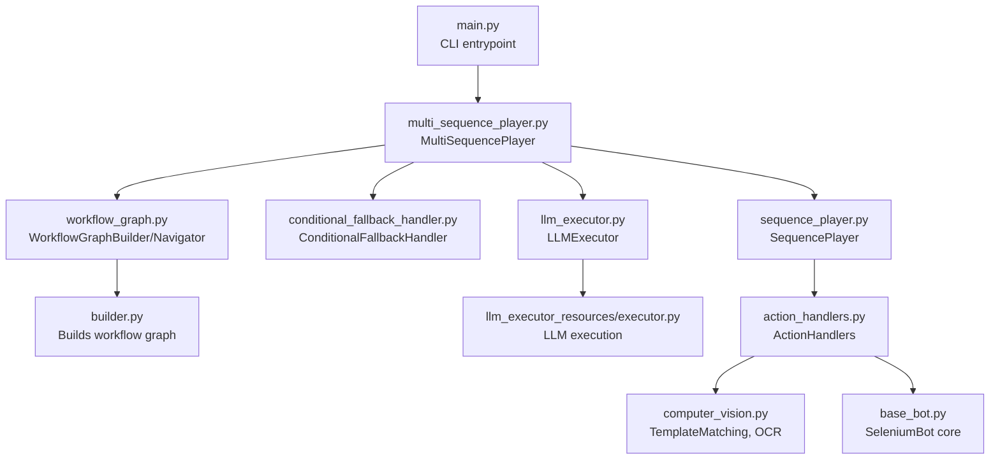
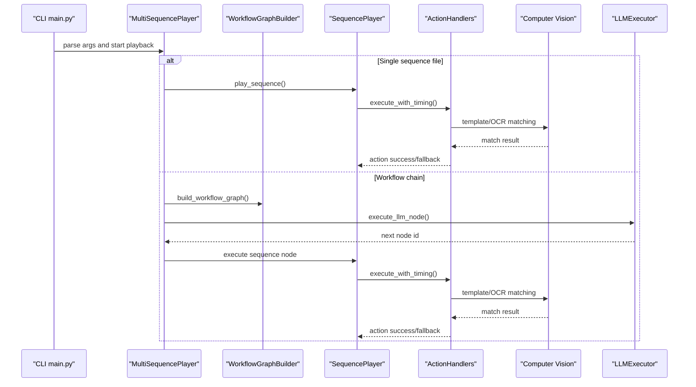
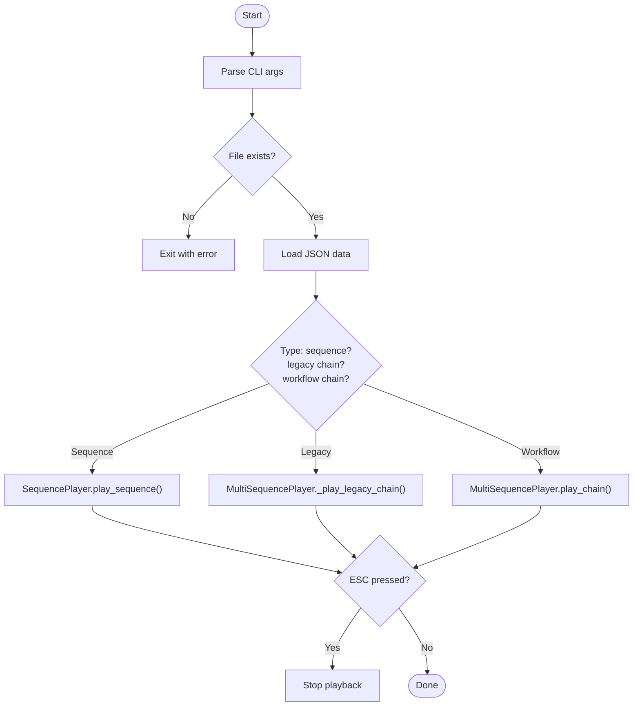
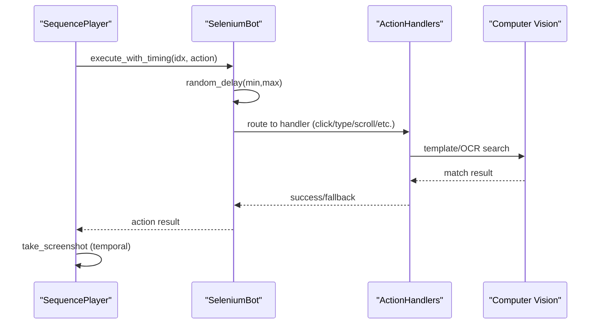
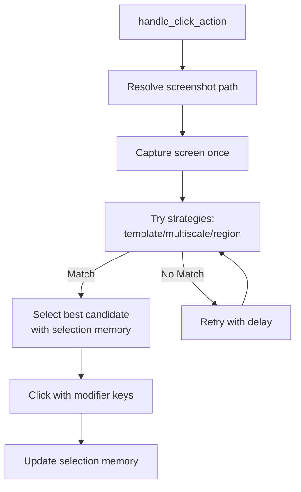
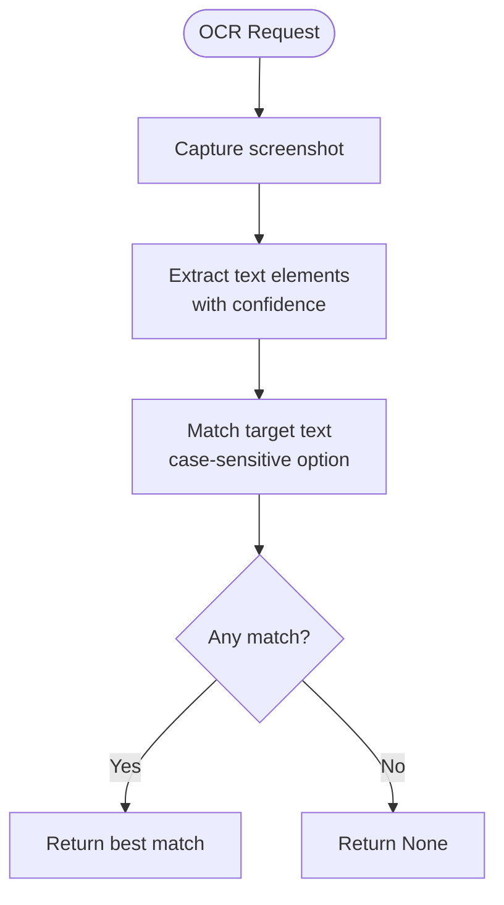
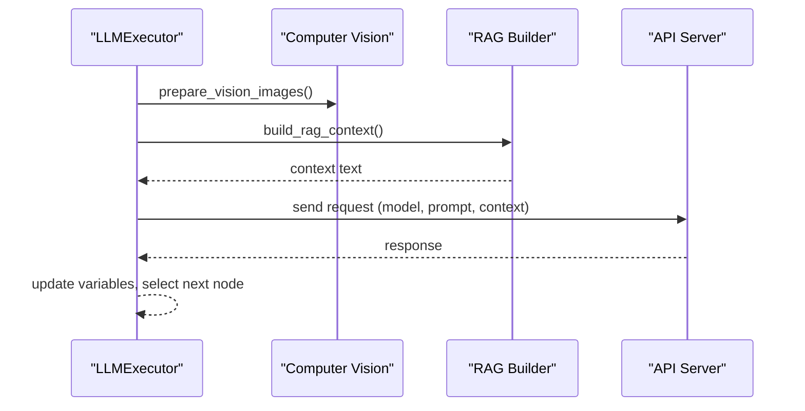
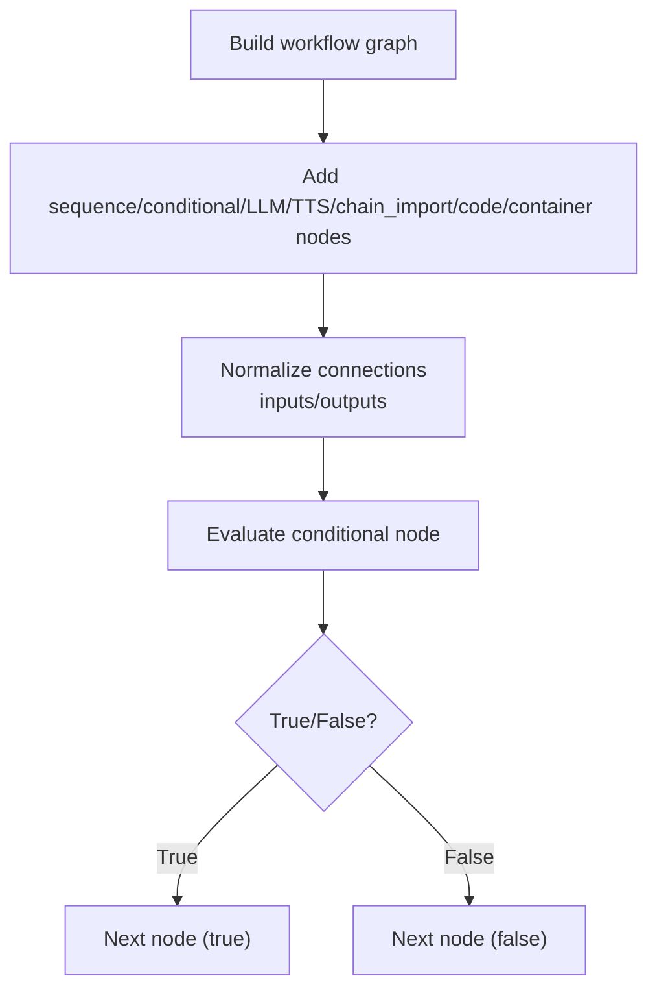
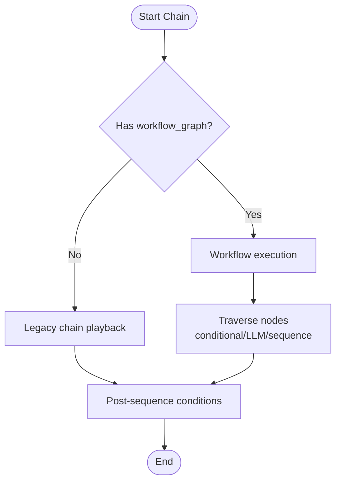
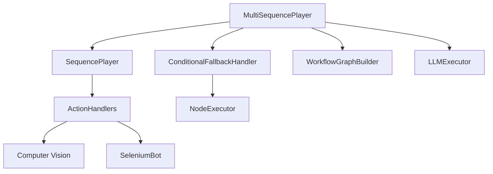

# Playback Engine

<cite>
**Referenced Files in This Document**
- [main.py](file://LoOper/player/main.py)
- [multi_sequence_player.py](file://LoOper/player/multi_sequence_player.py)
- [sequence_player.py](file://LoOper/player/sequence_player.py)
- [action_handlers.py](file://LoOper/player/action_handlers.py)
- [base_bot.py](file://LoOper/player/base_bot.py)
- [computer_vision.py](file://LoOper/player/computer_vision.py)
- [conditional_fallback_handler.py](file://LoOper/player/conditional_fallback_handler.py)
- [workflow_graph.py](file://LoOper/player/multi_sequence/workflow_graph.py)
- [builder.py](file://LoOper/player/multi_sequence/worflow_interpreter_modules/builder.py)
- [common.py](file://LoOper/player/multi_sequence/worflow_interpreter_modules/common.py)
- [llm_executor.py](file://LoOper/player/multi_sequence/llm_executor.py)
- [executor.py](file://LoOper/player/multi_sequence/llm_executor_resources/executor.py)
- [node_executor.py](file://LoOper/player/multi_sequence/conditional_fallback_resources/node_executor.py)
</cite>

## Table of Contents
1. [Introduction](#introduction)
2. [Project Structure](#project-structure)
3. [Core Components](#core-components)
4. [Architecture Overview](#architecture-overview)
5. [Detailed Component Analysis](#detailed-component-analysis)
6. [Dependency Analysis](#dependency-analysis)
7. [Performance Considerations](#performance-considerations)
8. [Troubleshooting Guide](#troubleshooting-guide)
9. [Conclusion](#conclusion)

## Introduction
This document explains the playback engine that executes recorded automation sequences and complex workflow chains. It covers action execution, timing synchronization, error handling with fallback strategies, dual-mode execution (simple sequences and workflow graphs with conditional logic), and the integration with computer vision and AI services. It also provides practical guidance for timing precision, error recovery, and performance optimization, balancing accessibility for beginners with technical depth for advanced users.

## Project Structure
The playback engine is organized around a main entry point, a sequence player for single sequences, and a multi-sequence player that orchestrates complex chains. The system integrates computer vision for UI interaction and AI services for decision-making and text understanding.

**Diagram sources**
- [main.py:18-108](file://LoOper/player/main.py#L18-L108)
- [multi_sequence_player.py:32-135](file://LoOper/player/multi_sequence_player.py#L32-L135)
- [sequence_player.py:136-252](file://LoOper/player/sequence_player.py#L136-L252)
- [action_handlers.py:26-800](file://LoOper/player/action_handlers.py#L26-L800)
- [base_bot.py:22-299](file://LoOper/player/base_bot.py#L22-L299)
- [computer_vision.py:47-606](file://LoOper/player/computer_vision.py#L47-L606)
- [conditional_fallback_handler.py:20-208](file://LoOper/player/conditional_fallback_handler.py#L20-L208)
- [workflow_graph.py:1-10](file://LoOper/player/multi_sequence/workflow_graph.py#L1-L10)
- [builder.py:3-489](file://LoOper/player/multi_sequence/worflow_interpreter_modules/builder.py#L3-L489)
- [llm_executor.py:1-12](file://LoOper/player/multi_sequence/llm_executor.py#L1-L12)
- [executor.py:22-800](file://LoOper/player/multi_sequence/llm_executor_resources/executor.py#L22-L800)

**Section sources**
- [main.py:18-108](file://LoOper/player/main.py#L18-L108)
- [multi_sequence_player.py:32-135](file://LoOper/player/multi_sequence_player.py#L32-L135)
- [sequence_player.py:136-252](file://LoOper/player/sequence_player.py#L136-L252)
- [action_handlers.py:26-800](file://LoOper/player/action_handlers.py#L26-L800)
- [base_bot.py:22-299](file://LoOper/player/base_bot.py#L22-L299)
- [computer_vision.py:47-606](file://LoOper/player/computer_vision.py#L47-L606)
- [conditional_fallback_handler.py:20-208](file://LoOper/player/conditional_fallback_handler.py#L20-L208)
- [workflow_graph.py:1-10](file://LoOper/player/multi_sequence/workflow_graph.py#L1-L10)
- [builder.py:3-489](file://LoOper/player/multi_sequence/worflow_interpreter_modules/builder.py#L3-L489)
- [llm_executor.py:1-12](file://LoOper/player/multi_sequence/llm_executor.py#L1-L12)
- [executor.py:22-800](file://LoOper/player/multi_sequence/llm_executor_resources/executor.py#L22-L800)

## Core Components
- Main entrypoint: parses CLI arguments, sets up ESC cancellation, and dispatches to single or chained playback.
- SequencePlayer: loads and executes a single recorded sequence with optimized JSON loading, caching, and action timing.
- MultiSequencePlayer: orchestrates complex chains, supports conditional fallbacks, LLM/TTS/code/container nodes, and sandboxed execution.
- ActionHandlers: performs mouse/keyboard/text actions, integrates with computer vision, and supports agent/VNC bridges.
- Computer vision: template matching, region-based search, OCR, and adaptive multi-scale strategies.
- LLMExecutor: integrates with AI services for decision-making, vision prompts, RAG, and tool selection.
- ConditionalFallbackHandler and NodeExecutor: evaluate triggers (presence/absence/OCR/code), manage loops, and branch execution.

**Section sources**
- [main.py:18-108](file://LoOper/player/main.py#L18-L108)
- [sequence_player.py:136-252](file://LoOper/player/sequence_player.py#L136-L252)
- [multi_sequence_player.py:32-135](file://LoOper/player/multi_sequence_player.py#L32-L135)
- [action_handlers.py:26-800](file://LoOper/player/action_handlers.py#L26-L800)
- [computer_vision.py:47-606](file://LoOper/player/computer_vision.py#L47-L606)
- [llm_executor.py:1-12](file://LoOper/player/multi_sequence/llm_executor.py#L1-L12)
- [executor.py:22-800](file://LoOper/player/multi_sequence/llm_executor_resources/executor.py#L22-L800)
- [conditional_fallback_handler.py:20-208](file://LoOper/player/conditional_fallback_handler.py#L20-L208)
- [node_executor.py:506-792](file://LoOper/player/multi_sequence/conditional_fallback_resources/node_executor.py#L506-L792)

## Architecture Overview
The playback engine supports two execution modes:
- Simple sequences: linear playback of recorded actions with fallbacks injected into actions.
- Workflow graphs: conditional branching, loops, LLM decisions, and specialized nodes (TTS, code, containers).

**Diagram sources**
- [main.py:58-101](file://LoOper/player/main.py#L58-L101)
- [multi_sequence_player.py:192-358](file://LoOper/player/multi_sequence_player.py#L192-L358)
- [builder.py:15-489](file://LoOper/player/multi_sequence/worflow_interpreter_modules/builder.py#L15-L489)
- [sequence_player.py:202-252](file://LoOper/player/sequence_player.py#L202-L252)
- [action_handlers.py:133-604](file://LoOper/player/action_handlers.py#L133-L604)
- [executor.py:126-800](file://LoOper/player/multi_sequence/llm_executor_resources/executor.py#L126-L800)

## Detailed Component Analysis

### Main Entry Point and ESC Cancellation
- Parses the input file and determines whether it is a single sequence, legacy chain, or new workflow chain.
- Starts a keyboard listener to detect ESC and set a stop flag for interruption.
- Clears JSON cache before execution and logs progress.

**Diagram sources**
- [main.py:18-108](file://LoOper/player/main.py#L18-L108)

**Section sources**
- [main.py:18-108](file://LoOper/player/main.py#L18-L108)

### Sequence Execution and Timing
- SequencePlayer loads JSON with optimized buffered I/O and caches parsed sequences.
- execute_with_timing applies pre-action delays, routes to handlers, and captures screenshots after actions.
- BaseBot provides human-like delays, mouse movement with noise, and click mechanics.

**Diagram sources**
- [sequence_player.py:202-252](file://LoOper/player/sequence_player.py#L202-L252)
- [base_bot.py:207-284](file://LoOper/player/base_bot.py#L207-L284)
- [action_handlers.py:133-604](file://LoOper/player/action_handlers.py#L133-L604)
- [computer_vision.py:198-450](file://LoOper/player/computer_vision.py#L198-L450)

**Section sources**
- [sequence_player.py:136-252](file://LoOper/player/sequence_player.py#L136-L252)
- [base_bot.py:207-284](file://LoOper/player/base_bot.py#L207-L284)
- [action_handlers.py:133-604](file://LoOper/player/action_handlers.py#L133-L604)
- [computer_vision.py:198-450](file://LoOper/player/computer_vision.py#L198-L450)

### Action Handler System (Mouse, Keyboard, Text Input)
- Click actions: robust template matching with multi-strategy search, retry/backoff, and selection memory to avoid random clicks.
- Type actions: supports clipboard/paste for Unicode and long texts, character-by-character mode, and keystroke delays.
- Keystrokes, scrolling, clipboard, drag-and-drop, and move-to actions are supported.
- Agent/VNC bridge support for remote environments.

**Diagram sources**
- [action_handlers.py:133-604](file://LoOper/player/action_handlers.py#L133-L604)
- [base_bot.py:119-161](file://LoOper/player/base_bot.py#L119-L161)

**Section sources**
- [action_handlers.py:133-604](file://LoOper/player/action_handlers.py#L133-L604)
- [base_bot.py:119-161](file://LoOper/player/base_bot.py#L119-L161)

### Computer Vision and OCR
- TemplateMatching: multi-scale matching, region-based search, and adaptive strategies to reduce false positives.
- OCR: extracts text elements with configurable confidence and case sensitivity; supports stop-flag checks.
- Sandbox agent integration for remote screenshots and agent control.

**Diagram sources**
- [computer_vision.py:452-550](file://LoOper/player/computer_vision.py#L452-L550)

**Section sources**
- [computer_vision.py:47-606](file://LoOper/player/computer_vision.py#L47-L606)

### LLM Integration and Decision Making
- LLMExecutor builds prompts, injects context/RAG, prepares vision inputs, and selects tools intelligently.
- Supports direct RAG, embedding models, and integration with external API servers (including ComoRAG).
- Provides structured logging and resets state between runs.

**Diagram sources**
- [executor.py:126-800](file://LoOper/player/multi_sequence/llm_executor_resources/executor.py#L126-L800)
- [llm_executor.py:1-12](file://LoOper/player/multi_sequence/llm_executor.py#L1-L12)

**Section sources**
- [executor.py:126-800](file://LoOper/player/multi_sequence/llm_executor_resources/executor.py#L126-L800)
- [llm_executor.py:1-12](file://LoOper/player/multi_sequence/llm_executor.py#L1-L12)

### Conditional Fallbacks and Workflow Graphs
- ConditionalFallbackHandler delegates to modular components: presence/absence/OCR triggers, loops, and node execution.
- NodeExecutor evaluates conditions (including code-based conditions) and branches accordingly.
- WorkflowGraphBuilder constructs a graph from sequences and conditional nodes, normalizing connections and enriching LLM tool descriptions.

**Diagram sources**
- [builder.py:15-489](file://LoOper/player/multi_sequence/worflow_interpreter_modules/builder.py#L15-L489)
- [conditional_fallback_handler.py:72-98](file://LoOper/player/conditional_fallback_handler.py#L72-L98)
- [node_executor.py:529-553](file://LoOper/player/multi_sequence/conditional_fallback_resources/node_executor.py#L529-L553)

**Section sources**
- [conditional_fallback_handler.py:20-208](file://LoOper/player/conditional_fallback_handler.py#L20-L208)
- [node_executor.py:506-792](file://LoOper/player/multi_sequence/conditional_fallback_resources/node_executor.py#L506-L792)
- [builder.py:15-489](file://LoOper/player/multi_sequence/worflow_interpreter_modules/builder.py#L15-L489)

### Dual-Mode Execution: Sequences vs. Workflows
- Legacy mode: linear chain playback with pre/post-condition checks and fallback injection.
- Workflow mode: graph traversal with conditional branching, loops, and LLM-driven decisions.

**Diagram sources**
- [multi_sequence_player.py:192-358](file://LoOper/player/multi_sequence_player.py#L192-L358)

**Section sources**
- [multi_sequence_player.py:192-358](file://LoOper/player/multi_sequence_player.py#L192-L358)

## Dependency Analysis
The engine exhibits strong modularity:
- MultiSequencePlayer depends on SequencePlayer, ConditionalFallbackHandler, WorkflowGraphBuilder, LLMExecutor, and SequenceExecutor.
- SequencePlayer depends on ActionHandlers and BaseBot.
- ActionHandlers depends on Computer Vision and BaseBot.
- LLMExecutor depends on AI services and vision utilities.
- ConditionalFallbackHandler depends on modular triggers and NodeExecutor.

**Diagram sources**
- [multi_sequence_player.py:32-135](file://LoOper/player/multi_sequence_player.py#L32-L135)
- [sequence_player.py:136-252](file://LoOper/player/sequence_player.py#L136-L252)
- [action_handlers.py:26-800](file://LoOper/player/action_handlers.py#L26-L800)
- [base_bot.py:22-299](file://LoOper/player/base_bot.py#L22-L299)
- [conditional_fallback_handler.py:20-208](file://LoOper/player/conditional_fallback_handler.py#L20-L208)
- [node_executor.py:506-792](file://LoOper/player/multi_sequence/conditional_fallback_resources/node_executor.py#L506-L792)
- [workflow_graph.py:1-10](file://LoOper/player/multi_sequence/workflow_graph.py#L1-L10)

**Section sources**
- [multi_sequence_player.py:32-135](file://LoOper/player/multi_sequence_player.py#L32-L135)
- [sequence_player.py:136-252](file://LoOper/player/sequence_player.py#L136-L252)
- [action_handlers.py:26-800](file://LoOper/player/action_handlers.py#L26-L800)
- [base_bot.py:22-299](file://LoOper/player/base_bot.py#L22-L299)
- [conditional_fallback_handler.py:20-208](file://LoOper/player/conditional_fallback_handler.py#L20-L208)
- [node_executor.py:506-792](file://LoOper/player/multi_sequence/conditional_fallback_resources/node_executor.py#L506-L792)
- [workflow_graph.py:1-10](file://LoOper/player/multi_sequence/workflow_graph.py#L1-L10)

## Performance Considerations
- Sequence caching: SequencePlayer caches parsed JSON and evicts with LRU to reduce I/O.
- Optimized JSON loading: Uses buffered reads and streaming for large files.
- Human-like delays: Randomized delays and mouse curves reduce robotic behavior and improve reliability.
- Computer vision optimization: Single screenshot capture reused across strategies; adaptive multi-scale matching reduces redundant work.
- LLM efficiency: Pre-stops competing models, reuses embedding clients, and limits RAG chunks.
- Interruptibility: Delays and waits are broken into small increments to honor stop flags.

[No sources needed since this section provides general guidance]

## Troubleshooting Guide
Common issues and remedies:
- Timing precision
  - Use minimal sleep increments during delays and retries to respect stop flags.
  - Adjust pre-action delays and post-click delays for stability.
  - Section sources
    - [base_bot.py:207-284](file://LoOper/player/base_bot.py#L207-L284)
    - [sequence_player.py:202-252](file://LoOper/player/sequence_player.py#L202-L252)

- Error recovery and fallbacks
  - Visual matching failures trigger fallback sequences; ensure fallbacks are configured and share selection memory.
  - Conditional fallbacks evaluate presence/absence/OCR/code conditions and branch accordingly.
  - Section sources
    - [action_handlers.py:593-604](file://LoOper/player/action_handlers.py#L593-L604)
    - [conditional_fallback_handler.py:100-185](file://LoOper/player/conditional_fallback_handler.py#L100-L185)
    - [node_executor.py:529-553](file://LoOper/player/multi_sequence/conditional_fallback_resources/node_executor.py#L529-L553)

- ESC-key cancellation
  - Keyboard listener sets a stop flag; all loops and waits check this flag to terminate safely.
  - Section sources
    - [main.py:37-53](file://LoOper/player/main.py#L37-L53)
    - [main.py:88-101](file://LoOper/player/main.py#L88-L101)

- Computer vision reliability
  - Increase confidence thresholds or adjust region expansion factors for unstable UIs.
  - Use OCR with appropriate language and confidence settings.
  - Section sources
    - [computer_vision.py:200-332](file://LoOper/player/computer_vision.py#L200-L332)
    - [computer_vision.py:452-550](file://LoOper/player/computer_vision.py#L452-L550)

- LLM and RAG performance
  - Reduce chunk size and overlap for faster RAG; tune top-K and embedding model.
  - Ensure API connectivity and fallback to local models when needed.
  - Section sources
    - [executor.py:619-693](file://LoOper/player/multi_sequence/llm_executor_resources/executor.py#L619-L693)

- Application context and sandboxing
  - Configure app_context with exe/process_name/title/pid; sandboxed sessions launch RDP agents automatically.
  - Section sources
    - [sequence_player.py:39-121](file://LoOper/player/multi_sequence/sequence_executor.py#L39-L121)
    - [node_executor.py:24-504](file://LoOper/player/multi_sequence/conditional_fallback_resources/node_executor.py#L24-L504)

## Conclusion
The playback engine combines robust action execution, precise timing, and resilient fallback strategies with powerful workflow orchestration. Its modular design enables simple sequences and complex conditional graphs, while tight integration with computer vision and AI services supports intelligent UI interaction and decision-making. By following the guidance here, users can achieve reliable automation with predictable behavior and safe termination.