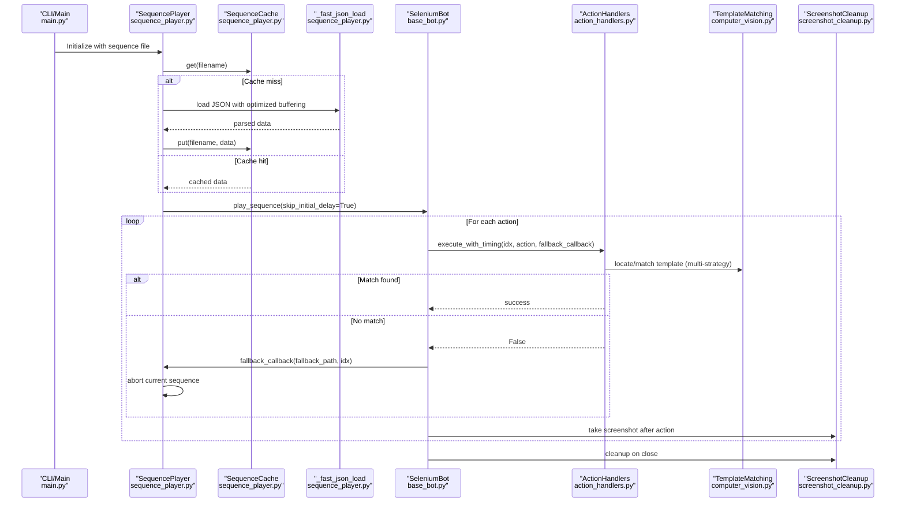
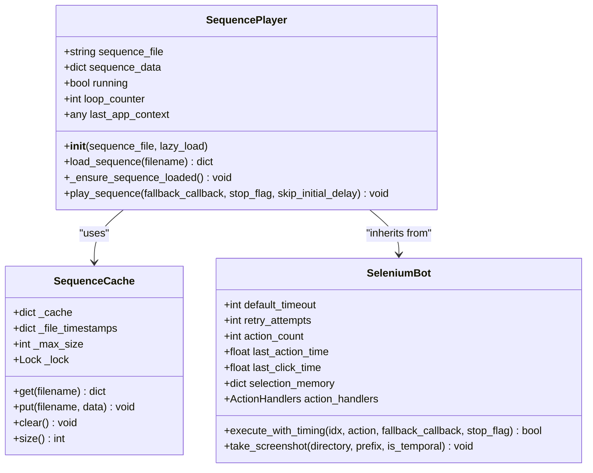
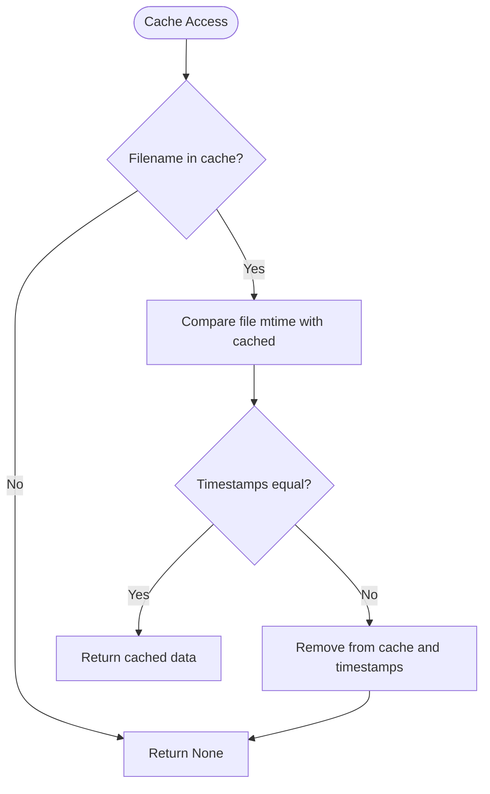
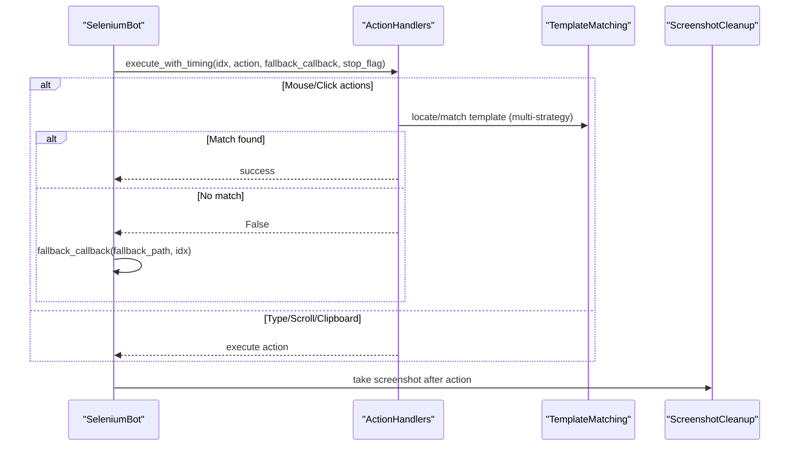
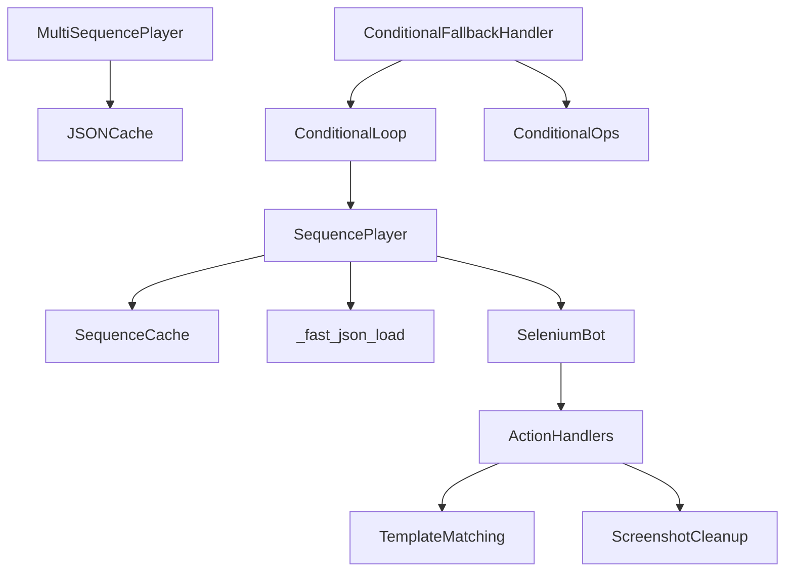

# Sequence Player

<cite>
**Referenced Files in This Document**
- [sequence_player.py](file://LoOper/player/sequence_player.py)
- [base_bot.py](file://LoOper/player/base_bot.py)
- [action_handlers.py](file://LoOper/player/action_handlers.py)
- [computer_vision.py](file://LoOper/player/computer_vision.py)
- [json_cache.py](file://LoOper/player/json_cache.py)
- [screenshot_cleanup.py](file://LoOper/player/screenshot_cleanup.py)
- [main.py](file://LoOper/player/main.py)
- [multi_sequence_player.py](file://LoOper/player/multi_sequence_player.py)
- [config.py](file://LoOper/player/config.py)
- [conditional.py](file://LoOper/NGUI/graph_elements/node_operations_modules/conditional.py)
- [conditional_loop.py](file://LoOper/player/multi_sequence/conditional_fallback_resources/conditional_loop.py)
- [conditional_ops.py](file://LoOper/player/multi_sequence/worflow_interpreter_modules/executor_modules/conditional_ops.py)
- [conditional_fallback_handler.py](file://LoOper/player/multi_sequence/conditional_fallback_handler.py)
- [test_rdp_clicks.py](file://LoOper/test_rdp_clicks.py)
</cite>

## Update Summary
**Changes Made**
- Updated performance considerations to reflect removal of artificial delays in layout matching
- Added documentation for maximum speed operation capabilities
- Updated conditional node configuration to reflect delay_between_attempts removal
- Enhanced troubleshooting guide with new performance-related considerations
- Updated practical examples to demonstrate maximum speed execution

## Table of Contents
1. [Introduction](#introduction)
2. [Project Structure](#project-structure)
3. [Core Components](#core-components)
4. [Architecture Overview](#architecture-overview)
5. [Detailed Component Analysis](#detailed-component-analysis)
6. [Dependency Analysis](#dependency-analysis)
7. [Performance Considerations](#performance-considerations)
8. [Troubleshooting Guide](#troubleshooting-guide)
9. [Conclusion](#conclusion)
10. [Appendices](#appendices)

## Introduction
This document explains the single sequence playback execution system centered around the SequencePlayer class. It covers the thread-safe caching system (SequenceCache), optimized JSON loading (_fast_json_load), lazy loading, sequence validation, and the action execution pipeline. It also documents the fallback callback system, integration with base bot classes, and timing synchronization. The system now operates at maximum speed by removing artificial delays in layout matching, allowing performance to be optimized based on host PC capabilities. Practical examples demonstrate configuration, timing adjustments, and integration with computer vision fallback mechanisms.

## Project Structure
The sequence player lives under the player module and integrates with base bot functionality, action handlers, and computer vision utilities. The main entry point determines whether to run a single sequence or a multi-sequence chain. The system now supports maximum speed operation by eliminating artificial delays in visual matching operations.

```mermaid
graph TB
subgraph "Player Module"
SP["SequencePlayer<br/>sequence_player.py"]
SB["SeleniumBot<br/>base_bot.py"]
AH["ActionHandlers<br/>action_handlers.py"]
CV["TemplateMatching<br/>computer_vision.py"]
JC["JSONCache<br/>json_cache.py"]
SC["ScreenshotCleanup<br/>screenshot_cleanup.py"]
MP["MultiSequencePlayer<br/>multi_sequence_player.py"]
CFG["Config<br/>config.py"]
MAIN["Entry Point<br/>main.py"]
CL["ConditionalLoop<br/>conditional_loop.py"]
CFH["ConditionalFallbackHandler<br/>conditional_fallback_handler.py"]
CO["ConditionalOps<br/>conditional_ops.py"]
END
MAIN --> SP
MAIN --> MP
SP --> SB
SP --> JC
SP --> SC
SB --> AH
AH --> CV
AH --> SC
MP --> CFH
CFH --> CL
CFH --> CO
```

**Diagram sources**
- [sequence_player.py:136-252](file://LoOper/player/sequence_player.py#L136-L252)
- [base_bot.py:22-299](file://LoOper/player/base_bot.py#L22-L299)
- [action_handlers.py:26-1058](file://LoOper/player/action_handlers.py#L26-L1058)
- [computer_vision.py:47-606](file://LoOper/player/computer_vision.py#L47-L606)
- [json_cache.py:15-584](file://LoOper/player/json_cache.py#L15-L584)
- [screenshot_cleanup.py:6-125](file://LoOper/player/screenshot_cleanup.py#L6-L125)
- [multi_sequence_player.py:32-532](file://LoOper/player/multi_sequence_player.py#L32-L532)
- [config.py:1-46](file://LoOper/player/config.py#L1-L46)
- [main.py:18-108](file://LoOper/player/main.py#L18-L108)
- [conditional_loop.py:36-134](file://LoOper/player/multi_sequence/conditional_fallback_resources/conditional_loop.py#L36-L134)
- [conditional_fallback_handler.py:20-108](file://LoOper/player/multi_sequence/conditional_fallback_handler.py#L20-L108)
- [conditional_ops.py:770-872](file://LoOper/player/multi_sequence/worflow_interpreter_modules/executor_modules/conditional_ops.py#L770-L872)

**Section sources**
- [main.py:18-108](file://LoOper/player/main.py#L18-L108)
- [sequence_player.py:136-252](file://LoOper/player/sequence_player.py#L136-L252)
- [base_bot.py:22-299](file://LoOper/player/base_bot.py#L22-L299)
- [action_handlers.py:26-1058](file://LoOper/player/action_handlers.py#L26-L1058)
- [computer_vision.py:47-606](file://LoOper/player/computer_vision.py#L47-L606)
- [json_cache.py:15-584](file://LoOper/player/json_cache.py#L15-L584)
- [screenshot_cleanup.py:6-125](file://LoOper/player/screenshot_cleanup.py#L6-L125)
- [multi_sequence_player.py:32-532](file://LoOper/player/multi_sequence_player.py#L32-L532)
- [config.py:1-46](file://LoOper/player/config.py#L1-L46)

## Core Components
- SequencePlayer: Single sequence playback controller that loads, validates, and executes actions with fallback support. Now operates at maximum speed by removing artificial delays.
- SequenceCache: Thread-safe cache for sequence data with file timestamp-based invalidation.
- _fast_json_load: Optimized JSON loader with buffer sizing and streaming fallback.
- SeleniumBot: Base bot providing timing, human-like motion, and action execution orchestration with reduced delays for faster execution.
- ActionHandlers: Dispatches actions to specialized handlers, including visual template matching with fallback.
- TemplateMatching: Computer vision utilities for multi-strategy template matching and region search with maximum speed operation.
- JSONCache: Centralized cache for chains and sequences used by multi-sequence workflows.
- ScreenshotCleanup: Temporal screenshot lifecycle management.
- ConditionalLoop: Handles conditional loop execution with optimized layout matching that runs at maximum speed.

**Section sources**
- [sequence_player.py:14-134](file://LoOper/player/sequence_player.py#L14-L134)
- [sequence_player.py:136-252](file://LoOper/player/sequence_player.py#L136-L252)
- [base_bot.py:22-299](file://LoOper/player/base_bot.py#L22-L299)
- [action_handlers.py:26-1058](file://LoOper/player/action_handlers.py#L26-L1058)
- [computer_vision.py:47-606](file://LoOper/player/computer_vision.py#L47-L606)
- [json_cache.py:15-584](file://LoOper/player/json_cache.py#L15-L584)
- [screenshot_cleanup.py:6-125](file://LoOper/player/screenshot_cleanup.py#L6-L125)
- [conditional_loop.py:12-134](file://LoOper/player/multi_sequence/conditional_fallback_resources/conditional_loop.py#L12-L134)

## Architecture Overview
The sequence player orchestrates a single JSON sequence of actions. It uses a thread-safe cache to avoid repeated file I/O, validates the sequence structure, and executes actions through the base bot's timing and action handler system. Visual actions leverage computer vision with multiple matching strategies and a fallback callback mechanism. The system now operates at maximum speed by eliminating artificial delays in layout matching operations.



**Diagram sources**
- [main.py:58-87](file://LoOper/player/main.py#L58-L87)
- [sequence_player.py:162-252](file://LoOper/player/sequence_player.py#L162-L252)
- [sequence_player.py:98-134](file://LoOper/player/sequence_player.py#L98-L134)
- [base_bot.py:207-283](file://LoOper/player/base_bot.py#L207-L283)
- [action_handlers.py:133-604](file://LoOper/player/action_handlers.py#L133-L604)
- [computer_vision.py:47-606](file://LoOper/player/computer_vision.py#L47-L606)
- [screenshot_cleanup.py:6-125](file://LoOper/player/screenshot_cleanup.py#L6-L125)

## Detailed Component Analysis

### SequencePlayer
Responsibilities:
- Lazy loading support via constructor parameter.
- Thread-safe sequence loading with caching and validation.
- Action iteration with stop-flag support and timing synchronization.
- Fallback callback integration for visual matching failures.
- Maximum speed operation through skip_initial_delay parameter.

Key behaviors:
- Lazy loading: If lazy_load is True, sequence_data remains None until play_sequence or load_sequence is invoked.
- Validation: Ensures the loaded JSON contains an "actions" key.
- Timing: Uses base bot's execute_with_timing to enforce delays and human-like motion with reduced delays for faster execution.
- Fallback: On action failure, triggers fallback_callback and aborts current sequence.
- Maximum speed: When skip_initial_delay=True, reduces initial delay from 2 seconds to 0.5 seconds for faster execution.



**Diagram sources**
- [sequence_player.py:14-95](file://LoOper/player/sequence_player.py#L14-L95)
- [sequence_player.py:136-252](file://LoOper/player/sequence_player.py#L136-L252)
- [base_bot.py:22-299](file://LoOper/player/base_bot.py#L22-L299)

**Section sources**
- [sequence_player.py:136-252](file://LoOper/player/sequence_player.py#L136-L252)
- [sequence_player.py:14-95](file://LoOper/player/sequence_player.py#L14-L95)
- [base_bot.py:22-299](file://LoOper/player/base_bot.py#L22-L299)

### SequenceCache
Responsibilities:
- Thread-safe storage of sequence data with file timestamp tracking.
- LRU-style eviction when capacity is exceeded.
- Automatic invalidation when files change.

Behavior highlights:
- get: Returns cached data only if timestamps match; otherwise evicts and returns None.
- put: Caches data and stores file modification time; falls back gracefully if timestamp cannot be obtained.
- clear/size: Utility methods for cache management.



**Diagram sources**
- [sequence_player.py:24-91](file://LoOper/player/sequence_player.py#L24-L91)

**Section sources**
- [sequence_player.py:24-91](file://LoOper/player/sequence_player.py#L24-L91)

### _fast_json_load
Optimization strategies:
- Determines file size and selects buffer size accordingly.
- Uses buffered reads for small files and streaming JSON parsing for large files.
- Provides fallback to standard json.load if optimized path fails.

Benefits:
- Reduces I/O overhead and improves throughput for large sequences.
- Ensures robustness against malformed or inaccessible files.

**Section sources**
- [sequence_player.py:98-134](file://LoOper/player/sequence_player.py#L98-L134)

### Action Execution Pipeline
The pipeline routes actions to specialized handlers and captures screenshots for verification. The system now operates at maximum speed by reducing delays and eliminating artificial wait times in visual matching operations.



**Diagram sources**
- [base_bot.py:207-283](file://LoOper/player/base_bot.py#L207-L283)
- [action_handlers.py:133-604](file://LoOper/player/action_handlers.py#L133-L604)
- [computer_vision.py:47-606](file://LoOper/player/computer_vision.py#L47-L606)
- [screenshot_cleanup.py:6-125](file://LoOper/player/screenshot_cleanup.py#L6-L125)

**Section sources**
- [base_bot.py:207-283](file://LoOper/player/base_bot.py#L207-L283)
- [action_handlers.py:133-604](file://LoOper/player/action_handlers.py#L133-L604)
- [computer_vision.py:47-606](file://LoOper/player/computer_vision.py#L47-L606)
- [screenshot_cleanup.py:6-125](file://LoOper/player/screenshot_cleanup.py#L6-L125)

### Relationship with Base Bot Classes and Timing Synchronization
- SeleniumBot provides:
  - Human-like delays and mouse movement with noise and perlin-based curves.
  - Reduced delay ranges for faster execution (0.001-0.01 seconds for action delays).
  - Retry mechanism with exponential backoff.
  - Selection memory to maintain deterministic behavior across repeated elements.
  - execute_with_timing orchestrates delays, routing to handlers, and optional fallback invocation.
- SequencePlayer inherits from SeleniumBot, leveraging these capabilities for precise timing and robust action execution.
- **Updated**: Base bot now uses reduced delay ranges (0.001-0.01 seconds) instead of 0.01-0.05 seconds for faster execution.

**Section sources**
- [base_bot.py:22-299](file://LoOper/player/base_bot.py#L22-L299)
- [sequence_player.py:136-252](file://LoOper/player/sequence_player.py#L136-L252)

### Integration with Computer Vision Fallback Mechanisms
- ActionHandlers uses TemplateMatching for multi-strategy matching:
  - High-confidence grayscale/color template matching.
  - Multi-scale matching across predefined scales.
  - Region-based search with expanding regions and hints.
- On failure, triggers fallback callback with a fallback sequence path, allowing alternate flows.
- **Updated**: Conditional operations now run at maximum speed without artificial delays, improving layout matching performance.

**Section sources**
- [action_handlers.py:133-604](file://LoOper/player/action_handlers.py#L133-L604)
- [computer_vision.py:47-606](file://LoOper/player/computer_vision.py#L47-L606)

### Conditional Loop Operations
- ConditionalLoop handles loop execution with optimized layout matching that runs at maximum speed.
- Eliminates artificial delays between attempts, allowing continuous layout matching based on host PC capabilities.
- Supports various loop types (while_present, while_absent, until_present, until_absent) with immediate condition evaluation.

**Section sources**
- [conditional_loop.py:36-134](file://LoOper/player/multi_sequence/conditional_fallback_resources/conditional_loop.py#L36-L134)
- [conditional_fallback_handler.py:20-108](file://LoOper/player/multi_sequence/conditional_fallback_handler.py#L20-L108)
- [conditional_ops.py:770-872](file://LoOper/player/multi_sequence/worflow_interpreter_modules/executor_modules/conditional_ops.py#L770-L872)

## Dependency Analysis
- SequencePlayer depends on:
  - SequenceCache for thread-safe caching.
  - _fast_json_load for optimized JSON loading.
  - SeleniumBot for timing and action orchestration.
  - ActionHandlers for dispatching actions.
  - TemplateMatching for visual matching.
  - ScreenshotCleanup for lifecycle management.
- MultiSequencePlayer complements single-sequence playback by orchestrating chains and integrating JSONCache for preloading.
- **Updated**: Conditional operations depend on TemplateMatching for maximum speed layout matching without artificial delays.



**Diagram sources**
- [sequence_player.py:14-134](file://LoOper/player/sequence_player.py#L14-L134)
- [sequence_player.py:136-252](file://LoOper/player/sequence_player.py#L136-L252)
- [base_bot.py:22-299](file://LoOper/player/base_bot.py#L22-L299)
- [action_handlers.py:26-1058](file://LoOper/player/action_handlers.py#L26-L1058)
- [computer_vision.py:47-606](file://LoOper/player/computer_vision.py#L47-L606)
- [screenshot_cleanup.py:6-125](file://LoOper/player/screenshot_cleanup.py#L6-L125)
- [multi_sequence_player.py:32-532](file://LoOper/player/multi_sequence_player.py#L32-L532)
- [json_cache.py:15-584](file://LoOper/player/json_cache.py#L15-L584)
- [conditional_loop.py:12-134](file://LoOper/player/multi_sequence/conditional_fallback_resources/conditional_loop.py#L12-L134)
- [conditional_fallback_handler.py:20-108](file://LoOper/player/multi_sequence/conditional_fallback_handler.py#L20-L108)
- [conditional_ops.py:770-872](file://LoOper/player/multi_sequence/worflow_interpreter_modules/executor_modules/conditional_ops.py#L770-L872)

**Section sources**
- [sequence_player.py:14-134](file://LoOper/player/sequence_player.py#L14-L134)
- [sequence_player.py:136-252](file://LoOper/player/sequence_player.py#L136-L252)
- [base_bot.py:22-299](file://LoOper/player/base_bot.py#L22-L299)
- [action_handlers.py:26-1058](file://LoOper/player/action_handlers.py#L26-L1058)
- [computer_vision.py:47-606](file://LoOper/player/computer_vision.py#L47-L606)
- [screenshot_cleanup.py:6-125](file://LoOper/player/screenshot_cleanup.py#L6-L125)
- [multi_sequence_player.py:32-532](file://LoOper/player/multi_sequence_player.py#L32-L532)
- [json_cache.py:15-584](file://LoOper/player/json_cache.py#L15-L584)

## Performance Considerations
- Thread-safety: SequenceCache uses a Lock to guard access to cache and timestamps.
- LRU eviction: When cache is full and a new entry is inserted, the oldest entry is evicted.
- File timestamping: Ensures cache invalidation when files change; gracefully handles missing timestamps.
- Optimized JSON loading: Selects buffer sizes and streaming vs. bulk reads based on file size.
- **Updated**: Human-like motion: Minimizes delays and uses efficient mouse movement curves to reduce total runtime. Base bot now uses reduced delay ranges (0.001-0.01 seconds) for faster execution.
- **Updated**: Maximum speed operation: Layout matching now runs at maximum speed without artificial delays, allowing system to operate based on host PC capabilities.
- **Updated**: Conditional operations: delay_between_attempts parameter has been removed, enabling continuous layout matching for improved performance.
- Screenshot capture: Temporal screenshots are registered and cleaned up to avoid disk growth.

**Section sources**
- [sequence_player.py:202-252](file://LoOper/player/sequence_player.py#L202-L252)
- [base_bot.py:226-270](file://LoOper/player/base_bot.py#L226-L270)
- [conditional.py:59-61](file://LoOper/NGUI/graph_elements/node_operations_modules/conditional.py#L59-L61)
- [conditional.py:168-170](file://LoOper/NGUI/graph_elements/node_operations_modules/conditional.py#L168-L170)
- [conditional_loop.py:102-103](file://LoOper/player/multi_sequence/conditional_fallback_resources/conditional_loop.py#L102-L103)

## Troubleshooting Guide
Common issues and resolutions:
- File loading failures:
  - Symptom: JSON decode errors or missing actions key.
  - Resolution: Verify JSON validity and presence of "actions" key; ensure file paths are correct.
- Cache invalidation:
  - Symptom: Out-of-date sequence data.
  - Resolution: Use SequenceCache.clear() or rely on timestamp-based invalidation; for multi-chain scenarios, use JSONCache invalidate_* helpers.
- Performance bottlenecks:
  - Symptom: Slow playback on large sequences.
  - Resolution: Enable lazy loading; use _fast_json_load; minimize fallback retries; reduce retry delays.
  - **Updated**: For maximum speed operation, consider using skip_initial_delay=True to reduce initial delays from 2 seconds to 0.5 seconds.
  - **Updated**: Layout matching performance issues: Ensure delay_between_attempts is not configured in conditional nodes, as it's no longer used.
- Visual matching failures:
  - Symptom: Actions fail to find targets.
  - Resolution: Adjust confidence thresholds, enable multi-scale matching, or configure fallback sequences.
  - **Updated**: With maximum speed operation, consider increasing confidence thresholds or adjusting timeout values to account for faster execution.

**Section sources**
- [sequence_player.py:162-193](file://LoOper/player/sequence_player.py#L162-L193)
- [sequence_player.py:24-91](file://LoOper/player/sequence_player.py#L24-L91)
- [json_cache.py:404-584](file://LoOper/player/json_cache.py#L404-L584)
- [action_handlers.py:133-604](file://LoOper/player/action_handlers.py#L133-L604)

## Conclusion
The SequencePlayer provides a robust, thread-safe, and optimized pathway for single sequence playback. Its integration with caching, computer vision fallbacks, and base bot timing ensures reliable automation with human-like behavior. The recent performance optimizations eliminate artificial delays in layout matching, allowing the system to operate at maximum speed based on host PC capabilities. Proper configuration of fallbacks, timing, and cache invalidation yields predictable performance and resilience.

## Appendices

### Practical Examples

- Example: Loading and playing a single sequence at maximum speed
  - Initialize SequencePlayer with a sequence file path.
  - Optionally enable lazy loading to defer loading until play_sequence is called.
  - Call play_sequence with skip_initial_delay=True for maximum speed execution.
  - Use skip_initial_delay=False to maintain the reduced 0.5 second initial delay.

- Example: Caching strategies
  - Use SequenceCache.get/put to manually manage cache entries.
  - For multi-chain workflows, use JSONCache preload_chain/get_sequence to pre-warm caches.

- Example: Timing adjustments
  - Adjust delay_before in actions to fine-tune inter-action timing.
  - Use execute_with_timing's internal delays and human-like motion to balance speed and reliability.
  - **Updated**: Base bot now uses reduced delay ranges (0.001-0.01 seconds) for faster execution.

- Example: Integration with computer vision fallback
  - Configure fallback_sequence in actions to switch to an alternate sequence when visual matching fails.
  - Use TemplateMatching strategies to improve matching confidence and reduce fallback triggers.
  - **Updated**: Conditional operations now run at maximum speed without artificial delays for improved performance.

- Example: Maximum speed operation configuration
  - Use skip_initial_delay=True in SequencePlayer.play_sequence() for fastest execution.
  - Ensure conditional nodes are configured without delay_between_attempts parameter.
  - Monitor system performance and adjust confidence thresholds as needed for maximum speed operation.

**Section sources**
- [sequence_player.py:140-161](file://LoOper/player/sequence_player.py#L140-L161)
- [sequence_player.py:202-252](file://LoOper/player/sequence_player.py#L202-L252)
- [json_cache.py:29-161](file://LoOper/player/json_cache.py#L29-L161)
- [base_bot.py:207-283](file://LoOper/player/base_bot.py#L207-L283)
- [action_handlers.py:593-604](file://LoOper/player/action_handlers.py#L593-L604)
- [conditional.py:59-61](file://LoOper/NGUI/graph_elements/node_operations_modules/conditional.py#L59-L61)
- [conditional.py:168-170](file://LoOper/NGUI/graph_elements/node_operations_modules/conditional.py#L168-L170)