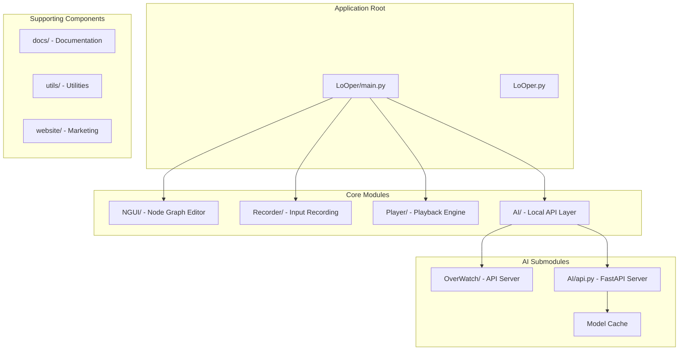
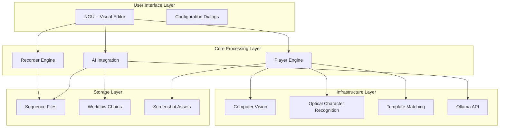
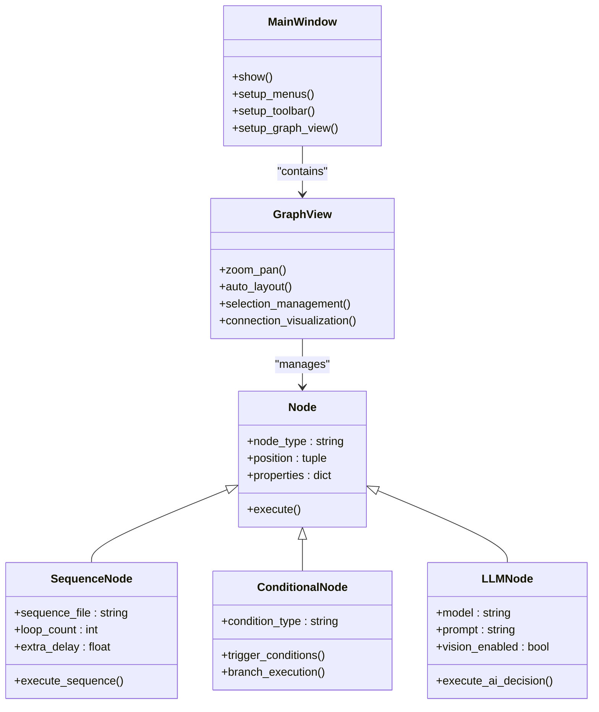
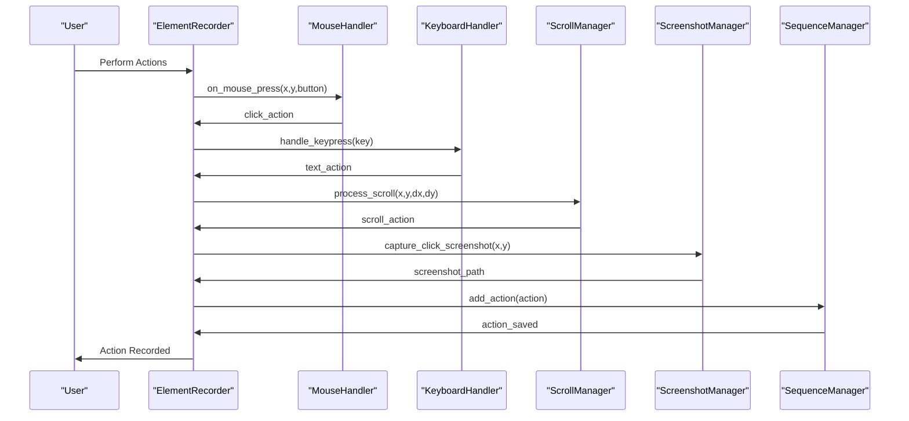
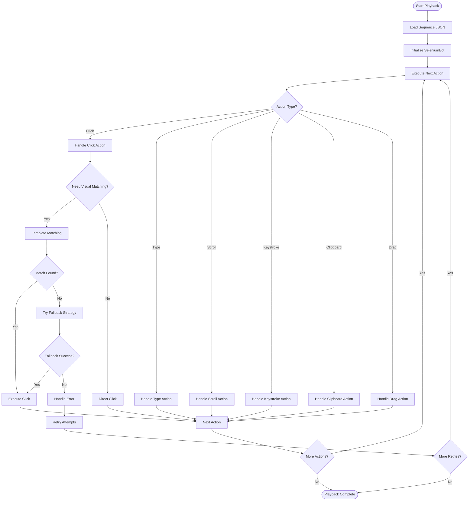
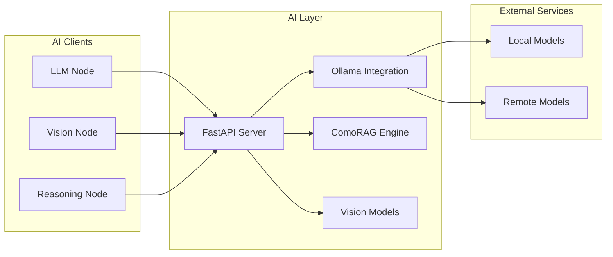
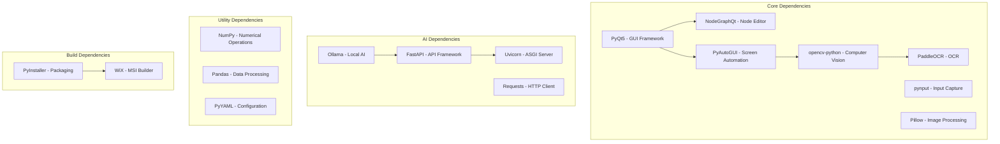

# Project Overview

<cite>
**Referenced Files in This Document**
- [README.md](file://README.md)
- [LoOper/README.MD](file://LoOper/README.MD)
- [docs/USER_GUIDE.md](file://docs/USER_GUIDE.md)
- [LoOper/main.py](file://LoOper/main.py)
- [LoOper/AI/README.md](file://LoOper/AI/README.md)
- [LoOper/AI/OverWatch/README.md](file://LoOper/AI/OverWatch/README.md)
- [LoOper/AI/config.json](file://LoOper/AI/config.json)
- [LoOper/NGUI/app.py](file://LoOper/NGUI/app.py)
- [LoOper/player/README.md](file://LoOper/player/README.md)
- [LoOper/player/base_bot.py](file://LoOper/player/base_bot.py)
- [LoOper/recorder/README.md](file://LoOper/recorder/README.md)
- [LoOper/recorder/element_recorder.py](file://LoOper/recorder/element_recorder.py)
- [requirements.txt](file://requirements.txt)
</cite>

## Table of Contents
1. [Introduction](#introduction)
2. [Project Structure](#project-structure)
3. [Core Components](#core-components)
4. [Architecture Overview](#architecture-overview)
5. [Detailed Component Analysis](#detailed-component-analysis)
6. [Dependency Analysis](#dependency-analysis)
7. [Performance Considerations](#performance-considerations)
8. [Troubleshooting Guide](#troubleshooting-guide)
9. [Conclusion](#conclusion)

## Introduction
LoOper V2 is an advanced desktop-native automation platform designed to enable users to record, build, and execute reliable workflows that can see the screen, reason with local AI, and act through mouse/keyboard control. The platform combines a visual node-graph editor with a modular recorder/player engine and optional AI layer to deliver a complete desktop automation solution.

The platform's core purpose is to transform desktop automation from simple macro recording to intelligent, visual, AI-powered workflow orchestration. It achieves this through three primary pillars:
- Visual workflow composition using a node-graph editor
- Reliable playback powered by computer vision and OCR
- Intelligent automation through local AI integration

Key value propositions include:
- **Visual Workflow Composition**: Build complex automation sequences using drag-and-drop node-based logic
- **Computer Vision Integration**: Reliable visual element detection using template matching and OCR
- **Local AI Processing**: Run AI models locally via Ollama for privacy and performance
- **Modular Architecture**: Separate recorder, player, and AI components for maintainability and extensibility
- **Cross-Platform Compatibility**: Built with Windows as the primary platform while maintaining cross-platform potential

## Project Structure
The LoOper V2 project follows a modular architecture with clear separation of concerns:

**Diagram sources**
- [LoOper/main.py:1-419](file://LoOper/main.py#L1-L419)
- [README.md:107-123](file://README.md#L107-L123)

The project is organized into several key directories:
- **LoOper/**: Main application package containing all core functionality
- **docs/**: User documentation and guides
- **utils/**: Utility scripts and tools
- **website/**: Marketing and informational materials

**Section sources**
- [README.md:107-123](file://README.md#L107-L123)
- [LoOper/README.MD:13-47](file://LoOper/README.MD#L13-L47)

## Core Components
LoOper V2 consists of four primary components that work together to provide comprehensive desktop automation capabilities:

### Visual Node Graph Editor (NGUI)
The NGUI component provides a PyQt5-based visual interface for creating and managing automation workflows. It enables users to compose complex automation sequences using a node-based approach where each node represents a specific action or decision point.

Key features include:
- **Node-based Workflow Design**: Visual representation of automation logic using interconnected nodes
- **Context-menu Editing**: Node configuration through dialogs to maintain clean visual interface
- **Node Transformations**: Ability to convert between different node types (Sequence, Conditional, LLM)
- **Dark Theme UI**: Professional dark interface with color-coded ports for different node types

### Recorder Module
The recorder captures user interactions with sophisticated precision and intelligence. It transforms raw user actions into structured sequences that can be replayed reliably.

Core recording capabilities:
- **Action Capture**: Records clicks, keyboard input, scrolling, and drag operations
- **Smart Grouping**: Groups related actions (scroll bursts, text sequences, modifier combinations)
- **Visual Template Capture**: Automatic screenshot capture for visual matching during playback
- **JSON Serialization**: Structured sequence storage with metadata and action timing

### Player Engine
The player executes recorded sequences with advanced computer vision and AI capabilities. It provides robust execution with fallback mechanisms and human-like automation patterns.

Key execution features:
- **Template Matching**: Multi-scale image matching with OpenCV for reliable visual element detection
- **Intelligent Fallbacks**: Progressive search strategies when primary actions fail
- **Human-like Automation**: Natural mouse movements, variable timing, and realistic action patterns
- **Chain Execution**: Multi-sequence workflow execution with looping and conditional branching

### AI Integration Layer
The AI layer provides optional local AI processing capabilities through Ollama integration and the OverWatch API server. This enables AI-powered decision making and intelligent automation workflows.

AI capabilities include:
- **Local Model Support**: Run AI models locally via Ollama for privacy and performance
- **Vision Models**: AI models that can analyze screenshots and visual content
- **ComoRAG Integration**: Cognitive-inspired memory-organized RAG for advanced reasoning
- **API Server**: FastAPI-based server for model management and reasoning

**Section sources**
- [LoOper/README.MD:71-47](file://LoOper/README.MD#L71-L47)
- [README.md:24-32](file://README.md#L24-L32)

## Architecture Overview
LoOper V2 employs a layered architecture that separates concerns while maintaining tight integration between components:

**Diagram sources**
- [LoOper/README.MD:13-47](file://LoOper/README.MD#L13-L47)
- [LoOper/player/README.md:1-76](file://LoOper/player/README.md#L1-L76)
- [LoOper/recorder/README.md:1-86](file://LoOper/recorder/README.md#L1-L86)

The architecture follows these design principles:
- **Separation of Concerns**: Each component has a specific responsibility
- **Modular Design**: Components can be developed, tested, and deployed independently
- **Layered Abstraction**: Lower layers provide infrastructure while higher layers provide user-facing functionality
- **Extensibility**: New node types and AI capabilities can be added without disrupting existing functionality

## Detailed Component Analysis

### Visual Node Graph Editor (NGUI)
The NGUI component serves as the primary interface for workflow composition, providing a visual environment for creating complex automation sequences.

**Diagram sources**
- [LoOper/NGUI/app.py:11-153](file://LoOper/NGUI/app.py#L11-L153)

The editor provides a dark-themed interface with color-coded nodes representing different automation capabilities. Users can create, connect, and configure nodes to build complex automation workflows.

**Section sources**
- [LoOper/README.MD:71-130](file://LoOper/README.MD#L71-L130)
- [LoOper/NGUI/app.py:43-149](file://LoOper/NGUI/app.py#L43-L149)

### Recorder System
The recorder module captures user interactions with sophisticated precision and intelligence, transforming raw actions into structured sequences.

**Diagram sources**
- [LoOper/recorder/element_recorder.py:11-155](file://LoOper/recorder/element_recorder.py#L11-L155)

The recorder provides smart action grouping and automatic screenshot capture for visual matching during playback.

**Section sources**
- [LoOper/recorder/README.md:1-86](file://LoOper/recorder/README.md#L1-86)
- [LoOper/recorder/element_recorder.py:32-104](file://LoOper/recorder/element_recorder.py#L32-L104)

### Player Engine
The player engine executes recorded sequences with advanced computer vision and AI capabilities, providing robust execution with fallback mechanisms.

**Diagram sources**
- [LoOper/player/base_bot.py:22-299](file://LoOper/player/base_bot.py#L22-L299)

The player incorporates human-like automation patterns and provides comprehensive error handling with fallback strategies.

**Section sources**
- [LoOper/player/README.md:1-76](file://LoOper/player/README.md#L1-L76)
- [LoOper/player/base_bot.py:95-283](file://LoOper/player/base_bot.py#L95-L283)

### AI Integration Layer
The AI layer provides optional local AI processing capabilities through Ollama integration and the OverWatch API server.

**Diagram sources**
- [LoOper/AI/README.md:1-401](file://LoOper/AI/README.md#L1-L401)
- [LoOper/AI/OverWatch/README.md:15-36](file://LoOper/AI/OverWatch/README.md#L15-L36)

The AI layer supports both local model execution and cloud-based inference, with optional vision capabilities for screen analysis.

**Section sources**
- [LoOper/AI/README.md:1-401](file://LoOper/AI/README.md#L1-L401)
- [LoOper/AI/OverWatch/README.md:15-36](file://LoOper/AI/OverWatch/README.md#L15-L36)

## Dependency Analysis
LoOper V2 relies on a carefully selected set of dependencies that balance functionality with performance and maintainability.

**Diagram sources**
- [requirements.txt:1-195](file://requirements.txt#L1-L195)

The dependency structure reflects the platform's modular design, with clear separation between UI components, automation libraries, and AI processing capabilities.

**Section sources**
- [requirements.txt:1-195](file://requirements.txt#L1-L195)

## Performance Considerations
LoOper V2 is designed with performance and reliability as primary concerns. The platform employs several optimization strategies:

### Computer Vision Optimization
- **Multi-scale Template Matching**: Handles UI element scaling variations
- **Region-based Search**: Limits search areas to improve performance
- **Confidence Thresholds**: Balances accuracy with speed
- **Fallback Strategies**: Progressive search approaches when initial attempts fail

### Human-like Automation Patterns
- **Natural Mouse Movement**: Curved paths and variable timing
- **Random Delays**: Gaussian distribution for realistic timing
- **Selection Memory**: Prevents repeated clicking on multiple matches
- **Exponential Backoff**: Retry mechanisms with increasing delays

### Memory Management
- **Temporal Screenshot Cleanup**: Automatic cleanup of intermediate screenshots
- **Model Caching**: Efficient model loading and reuse
- **Resource Pooling**: Shared resources across multiple executions

## Troubleshooting Guide
Common issues and their solutions:

### Recording Issues
- **No Screenshots Generated**: Ensure Pillow is properly installed and configured
- **Missing Actions**: Check for rapid actions that might be grouped by the recording system
- **ESC Key Not Working**: Verify no other applications are intercepting the ESC key

### Playback Issues
- **Images Not Found**: Verify screenshot paths and image quality meets matching requirements
- **Wrong Clicks**: Adjust match threshold or use region constraints for better accuracy
- **Timing Problems**: Increase delays between actions to accommodate slower systems

### GUI Issues
- **Nodes Not Appearing**: Check NodeGraphQt installation and version compatibility
- **Slow Performance**: Reduce graph complexity or restart the application to clear memory
- **Theme Problems**: Verify PyQt5 installation and theme configuration

### AI Integration Issues
- **Ollama Not Responding**: Check Ollama service status and network connectivity
- **Model Loading Failures**: Verify sufficient disk space and memory for model downloads
- **API Server Startup**: Check port availability and firewall settings

**Section sources**
- [LoOper/README.MD:598-625](file://LoOper/README.MD#L598-L625)
- [docs/USER_GUIDE.md:716-726](file://docs/USER_GUIDE.md#L716-L726)

## Conclusion
LoOper V2 represents a comprehensive desktop automation platform that successfully combines visual workflow composition with intelligent automation capabilities. The platform's modular architecture, computer vision integration, and local AI processing capabilities make it a powerful tool for both novice and advanced users.

The platform's key strengths include its intuitive visual editor, robust playback engine with fallback mechanisms, and flexible AI integration layer. These components work together to provide a complete solution for desktop automation tasks ranging from simple macro recording to complex AI-powered workflows.

Future development opportunities include expanding the node library, enhancing AI capabilities, and improving cross-platform compatibility. The modular design ensures that new features can be added without disrupting existing functionality, making LoOper V2 a scalable solution for evolving automation needs.