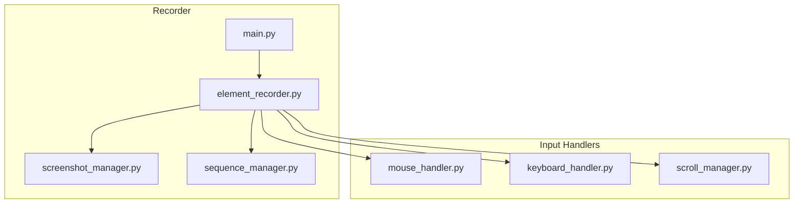
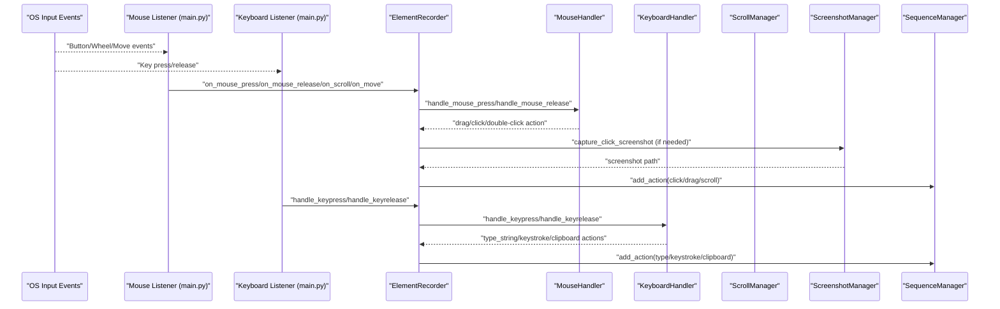
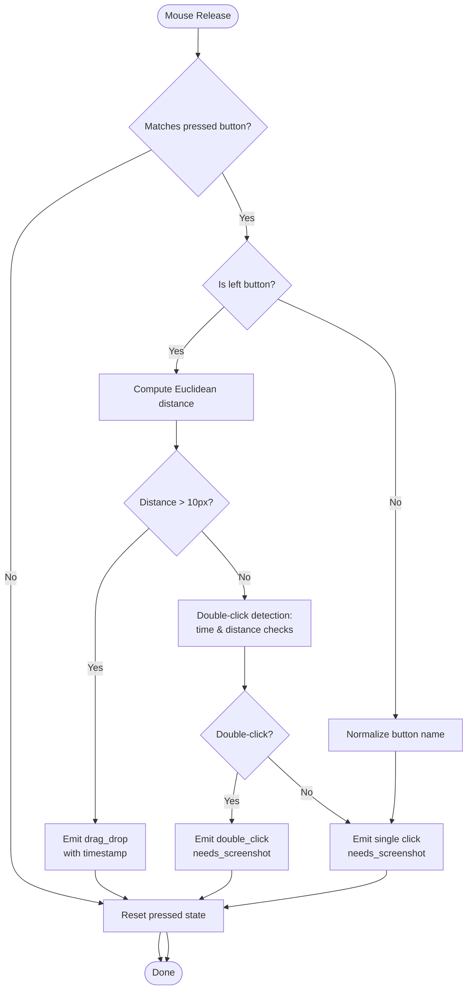
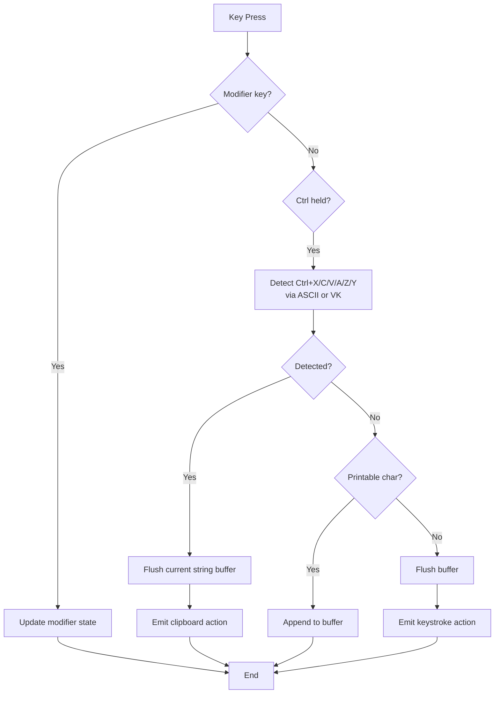
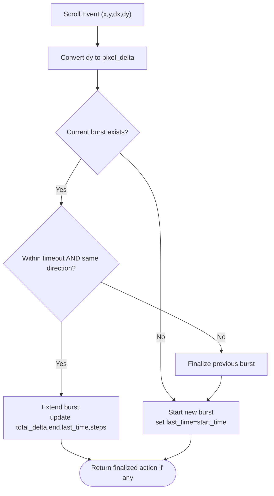
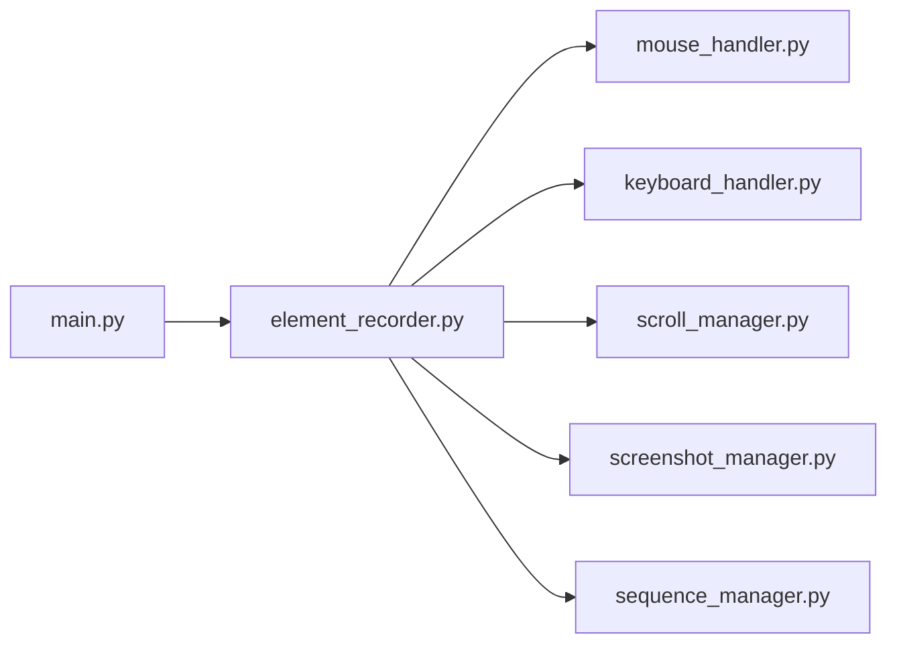

# Input Capture

<cite>
**Referenced Files in This Document**
- [mouse_handler.py](file://LoOper/recorder/mouse_handler.py)
- [keyboard_handler.py](file://LoOper/recorder/keyboard_handler.py)
- [scroll_manager.py](file://LoOper/recorder/scroll_manager.py)
- [sequence_manager.py](file://LoOper/recorder/sequence_manager.py)
- [element_recorder.py](file://LoOper/recorder/element_recorder.py)
- [main.py](file://LoOper/recorder/main.py)
- [screenshot_manager.py](file://LoOper/recorder/screenshot_manager.py)
</cite>

## Table of Contents
1. [Introduction](#introduction)
2. [Project Structure](#project-structure)
3. [Core Components](#core-components)
4. [Architecture Overview](#architecture-overview)
5. [Detailed Component Analysis](#detailed-component-analysis)
6. [Dependency Analysis](#dependency-analysis)
7. [Performance Considerations](#performance-considerations)
8. [Troubleshooting Guide](#troubleshooting-guide)
9. [Conclusion](#conclusion)

## Introduction
This document explains the input capture subsystem responsible for mouse, keyboard, and scroll event handling. It covers event detection, timing precision, and data collection mechanisms. It documents how the mouse handler detects clicks and drags, tracks button state, and integrates with screenshot capture; how the keyboard handler captures key presses, handles modifiers, and records text input; and how the scroll manager groups scroll bursts into meaningful actions. It also describes how raw events are transformed into structured actions and stored via the sequence manager, along with configuration options, performance considerations, and common issues.

## Project Structure
The input capture subsystem is organized into modular components under the recorder package:
- Event entry points and listeners: [main.py](file://LoOper/recorder/main.py)
- Central coordinator: [element_recorder.py](file://LoOper/recorder/element_recorder.py)
- Mouse handling: [mouse_handler.py](file://LoOper/recorder/mouse_handler.py)
- Keyboard handling: [keyboard_handler.py](file://LoOper/recorder/keyboard_handler.py)
- Scroll handling: [scroll_manager.py](file://LoOper/recorder/scroll_manager.py)
- Screenshot capture: [screenshot_manager.py](file://LoOper/recorder/screenshot_manager.py)
- Action storage and metadata: [sequence_manager.py](file://LoOper/recorder/sequence_manager.py)

**Diagram sources**
- [main.py](file://LoOper/recorder/main.py)
- [element_recorder.py](file://LoOper/recorder/element_recorder.py)
- [mouse_handler.py](file://LoOper/recorder/mouse_handler.py)
- [keyboard_handler.py](file://LoOper/recorder/keyboard_handler.py)
- [scroll_manager.py](file://LoOper/recorder/scroll_manager.py)
- [screenshot_manager.py](file://LoOper/recorder/screenshot_manager.py)
- [sequence_manager.py](file://LoOper/recorder/sequence_manager.py)

**Section sources**
- [main.py](file://LoOper/recorder/main.py)
- [element_recorder.py](file://LoOper/recorder/element_recorder.py)

## Core Components
- Mouse Handler: Detects press/release, tracks drag vs. click, computes distances, and emits click/drag/double-click actions with timestamps and optional screenshots.
- Keyboard Handler: Tracks modifier keys, captures printable characters into typed strings, recognizes clipboard shortcuts (Ctrl+C/V/X/A/Z/Y), and emits keystrokes and clipboard actions.
- Scroll Manager: Groups scroll events into bursts, determines direction and total delta, and finalizes actions with start/end positions and duration.
- Element Recorder: Orchestrates handlers, manages screenshot capture for clicks, attaches app context, and forwards actions to the sequence manager.
- Sequence Manager: Stores actions with metadata (timestamps, counts, duration), writes JSON sequences, and invalidates caches upon save.
- Screenshot Manager: Captures small regions around click coordinates for visual context.

**Section sources**
- [mouse_handler.py](file://LoOper/recorder/mouse_handler.py)
- [keyboard_handler.py](file://LoOper/recorder/keyboard_handler.py)
- [scroll_manager.py](file://LoOper/recorder/scroll_manager.py)
- [element_recorder.py](file://LoOper/recorder/element_recorder.py)
- [sequence_manager.py](file://LoOper/recorder/sequence_manager.py)
- [screenshot_manager.py](file://LoOper/recorder/screenshot_manager.py)

## Architecture Overview
The recorder starts listeners for mouse and keyboard events. Mouse events are handled by a unified hook that dispatches to the Element Recorder. The recorder delegates to specialized handlers, which produce action dictionaries enriched with timestamps and optional screenshots. Actions are attached with application context and queued for persistence.

**Diagram sources**
- [main.py](file://LoOper/recorder/main.py)
- [element_recorder.py](file://LoOper/recorder/element_recorder.py)
- [mouse_handler.py](file://LoOper/recorder/mouse_handler.py)
- [keyboard_handler.py](file://LoOper/recorder/keyboard_handler.py)
- [scroll_manager.py](file://LoOper/recorder/scroll_manager.py)
- [screenshot_manager.py](file://LoOper/recorder/screenshot_manager.py)
- [sequence_manager.py](file://LoOper/recorder/sequence_manager.py)

## Detailed Component Analysis

### Mouse Handler
Responsibilities:
- Track button press state and drag initiation for the left button.
- Compute Euclidean distance to distinguish drag (>10 px) from click.
- Detect double-click using time and spatial thresholds.
- Emit click, double-click, or drag-drop actions with timestamps and optional screenshot flags.

Key behaviors:
- Press: initializes drag origin for left button and sets pressed state.
- Release: resolves drag vs. click; if drag distance exceeds threshold, emits drag-drop; otherwise delegates to double-click detection.
- Double-click detection: compares elapsed time against threshold and spatial distance; if satisfied, emits double-click with screenshot flag.
- Non-left buttons: treated as simple clicks; button name normalized for action payload.

Timestamps:
- Uses precise per-action timestamps for click/drag/double-click.

Screenshots:
- Click actions carry a flag indicating screenshot capture is needed; the recorder replaces the flag with a screenshot path.

Configuration options:
- Double-click time threshold and spatial threshold are defined as class constants.
- Drag distance threshold is defined as a class constant.

**Diagram sources**
- [mouse_handler.py](file://LoOper/recorder/mouse_handler.py)

**Section sources**
- [mouse_handler.py](file://LoOper/recorder/mouse_handler.py)

### Keyboard Handler
Responsibilities:
- Track modifier keys (Ctrl_L, Ctrl_R, Shift_L, Shift_R, Alt_L, Alt_R).
- Buffer printable characters into typed strings.
- Recognize clipboard shortcuts (Ctrl+C, Ctrl+V, Ctrl+X, Ctrl+A, Ctrl+Z, Ctrl+Y) using ASCII control codes and virtual key codes.
- Emit keystroke actions for control keys and clipboard actions; flush buffered typed strings on boundaries.

Key behaviors:
- Modifier press/release toggles internal state.
- Ctrl+X/C/V/A/Z/Y detection prioritizes ASCII control characters for reliability, with fallback to VK codes.
- Printable characters appended to current string buffer; control characters flush the buffer and emit keystroke action.
- Non-printable keys flush buffer and emit keystroke action.

Timestamps:
- Per-action timestamps are attached to keystroke, clipboard, and typed-string actions.

**Diagram sources**
- [keyboard_handler.py](file://LoOper/recorder/keyboard_handler.py)

**Section sources**
- [keyboard_handler.py](file://LoOper/recorder/keyboard_handler.py)

### Scroll Manager
Responsibilities:
- Group scroll events into bursts separated by timeout.
- Maintain cumulative scroll position and compute direction from sign of total delta.
- Finalize bursts into scroll actions with start/end coordinates, total delta, steps, duration, and timestamps.

Key behaviors:
- Converts wheel deltas to pixel deltas using a fixed conversion factor.
- Continues current burst if subsequent scroll occurs within timeout and maintains same direction; otherwise finalizes previous burst and starts a new one.
- Direction determined by sign of total delta; final position computed cumulatively.

Timestamps:
- Uses per-burst start time for action timestamp.

**Diagram sources**
- [scroll_manager.py](file://LoOper/recorder/scroll_manager.py)

**Section sources**
- [scroll_manager.py](file://LoOper/recorder/scroll_manager.py)

### Element Recorder and Integration
Responsibilities:
- Coordinate all input handlers and persist actions.
- Capture screenshots for click actions and attach app context.
- Transform click actions based on modifier keys (e.g., absolute click, ctrl-click, shift-click).
- Aggregate typed strings and flush buffers before saving.
- Finalize scroll bursts during save.

Integration points:
- Receives mouse press/release callbacks and delegates to MouseHandler; transforms resulting actions and optionally captures screenshots.
- Receives keyboard callbacks and delegates to KeyboardHandler; forwards actions to SequenceManager.
- Receives scroll callbacks and delegates to ScrollManager; adds finalized actions to SequenceManager.
- Attaches app context to actions via SequenceManager.

**Section sources**
- [element_recorder.py](file://LoOper/recorder/element_recorder.py)

### Sequence Manager
Responsibilities:
- Store actions with metadata (created_at, total_actions, duration_sec, mode).
- Attach active application context to each action.
- Persist sequences to JSON and clear caches after save.

**Section sources**
- [sequence_manager.py](file://LoOper/recorder/sequence_manager.py)

### Screenshot Manager
Responsibilities:
- Capture small screenshot regions around click coordinates.
- Save screenshots to a dedicated directory with unique filenames.

**Section sources**
- [screenshot_manager.py](file://LoOper/recorder/screenshot_manager.py)

## Dependency Analysis
The recorder components are loosely coupled via the Element Recorder, which acts as a central orchestrator. The main entry point wires OS-level listeners to the recorder.

**Diagram sources**
- [main.py](file://LoOper/recorder/main.py)
- [element_recorder.py](file://LoOper/recorder/element_recorder.py)
- [mouse_handler.py](file://LoOper/recorder/mouse_handler.py)
- [keyboard_handler.py](file://LoOper/recorder/keyboard_handler.py)
- [scroll_manager.py](file://LoOper/recorder/scroll_manager.py)
- [screenshot_manager.py](file://LoOper/recorder/screenshot_manager.py)
- [sequence_manager.py](file://LoOper/recorder/sequence_manager.py)

**Section sources**
- [main.py](file://LoOper/recorder/main.py)
- [element_recorder.py](file://LoOper/recorder/element_recorder.py)

## Performance Considerations
- Event frequency and polling: The recorder relies on OS-level hooks provided by the mouse and keyboard libraries. There are no explicit polling loops in the recorder; performance depends on the underlying libraries’ event delivery cadence.
- Timestamp precision: Per-action timestamps are taken at event emission time, minimizing drift. Scroll bursts are finalized on timeout or direction change, avoiding continuous updates.
- Filtering: Scroll filtering is disabled by default (no epsilon threshold); all scroll events are captured. This ensures fidelity at the cost of potential noise in very high-frequency scrolling.
- Memory footprint: Buffered typed strings are flushed on control boundaries or on save; this keeps memory usage bounded.
- I/O overhead: Screenshot capture is performed only for click actions requiring visual context. JSON serialization occurs once on save.

[No sources needed since this section provides general guidance]

## Troubleshooting Guide
Common issues and resolutions:
- Event timing accuracy:
  - Ensure OS-level hooks are active and not blocked by anti-virus or accessibility overlays. The main entry point starts listeners and stops them on ESC.
  - Verify that timestamps are taken per action; drift is minimized by capturing time at emission.
- Hardware compatibility:
  - Mouse wheel deltas may vary by device; the scroll manager converts deltas using a fixed factor. If observed deltas seem off, adjust the conversion factor in the scroll manager.
  - Some mice report move events inconsistently; the main entry point falls back to querying current position when needed.
- High-frequency input capture:
  - If experiencing missed events, confirm that the mouse hook is capturing all events (including move and wheel) and that the keyboard listener is running continuously until ESC.
  - Reduce unnecessary processing in callbacks; the current implementation is lightweight and primarily constructs action dictionaries.
- Double-click detection:
  - Adjust double-click time and distance thresholds in the mouse handler if detection is too sensitive or not sensitive enough for your workflow.
- Clipboard shortcuts:
  - Ctrl+C/V/X/A/Z/Y detection uses ASCII control codes first for reliability; ensure the environment supports ASCII control characters for the detected shortcut.

**Section sources**
- [main.py](file://LoOper/recorder/main.py)
- [scroll_manager.py](file://LoOper/recorder/scroll_manager.py)
- [mouse_handler.py](file://LoOper/recorder/mouse_handler.py)
- [keyboard_handler.py](file://LoOper/recorder/keyboard_handler.py)

## Conclusion
The input capture subsystem provides robust, modular handling of mouse, keyboard, and scroll events. It distinguishes between clicks and drags, captures typed text efficiently, and groups scroll events into meaningful actions. The Element Recorder integrates handlers, attaches app context, and persists actions with metadata. While the current implementation focuses on correctness and simplicity, it offers clear extension points for sensitivity tuning, filtering, and performance optimization tailored to specific environments.