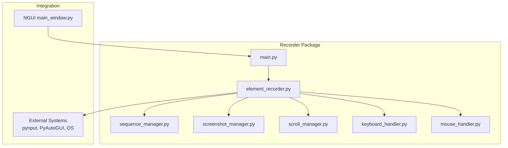
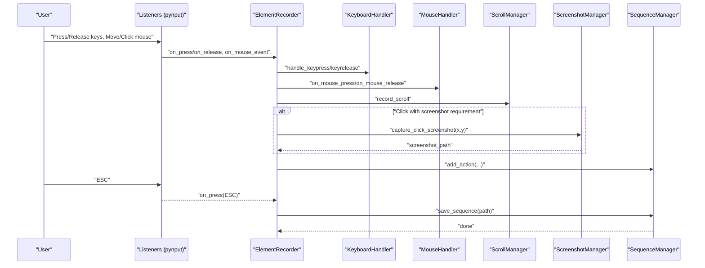
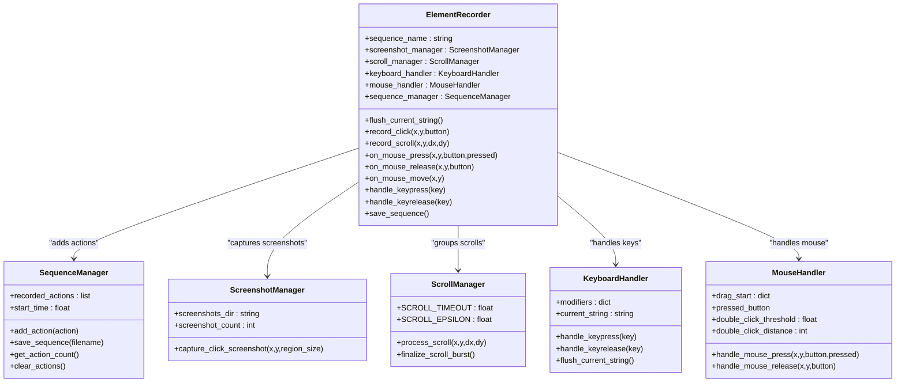
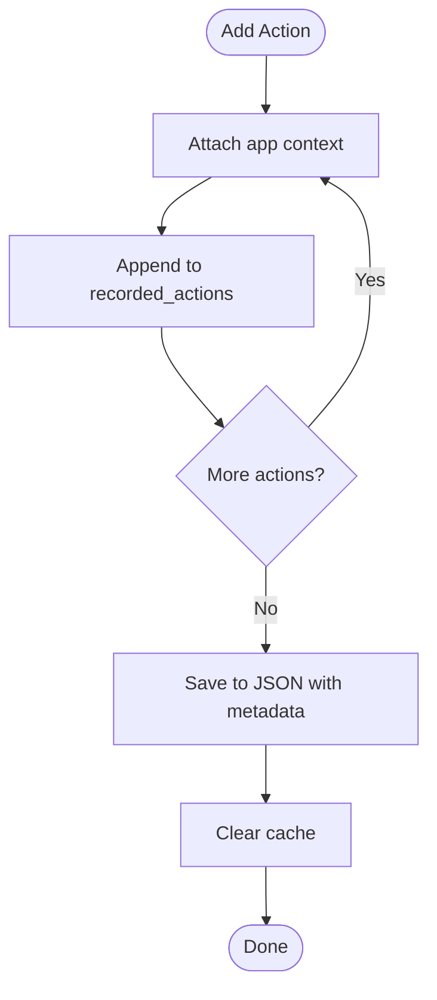
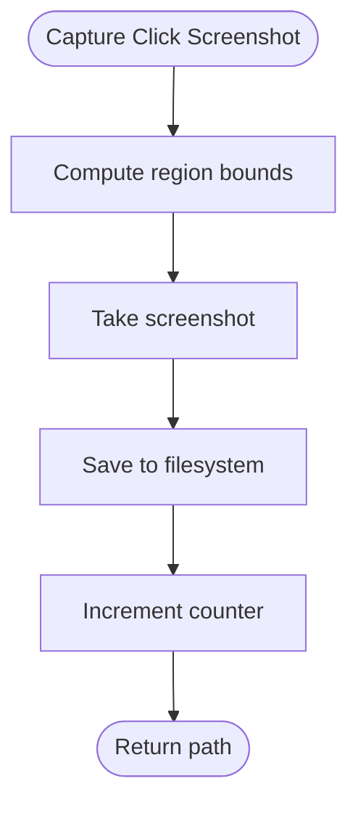
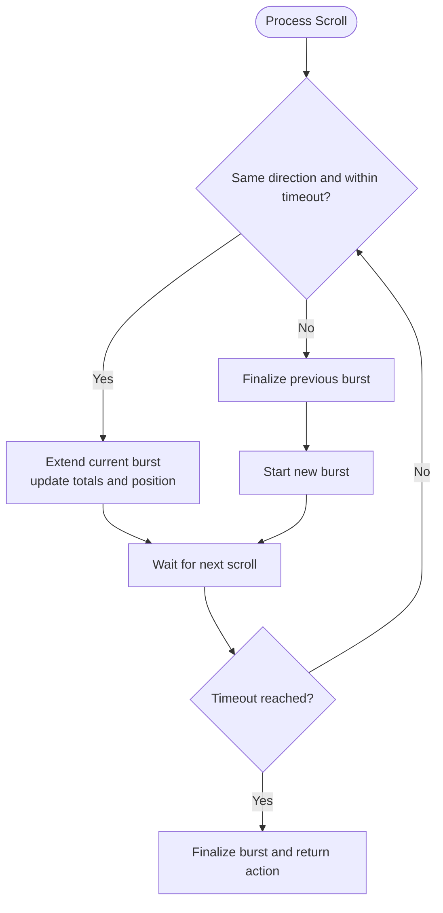
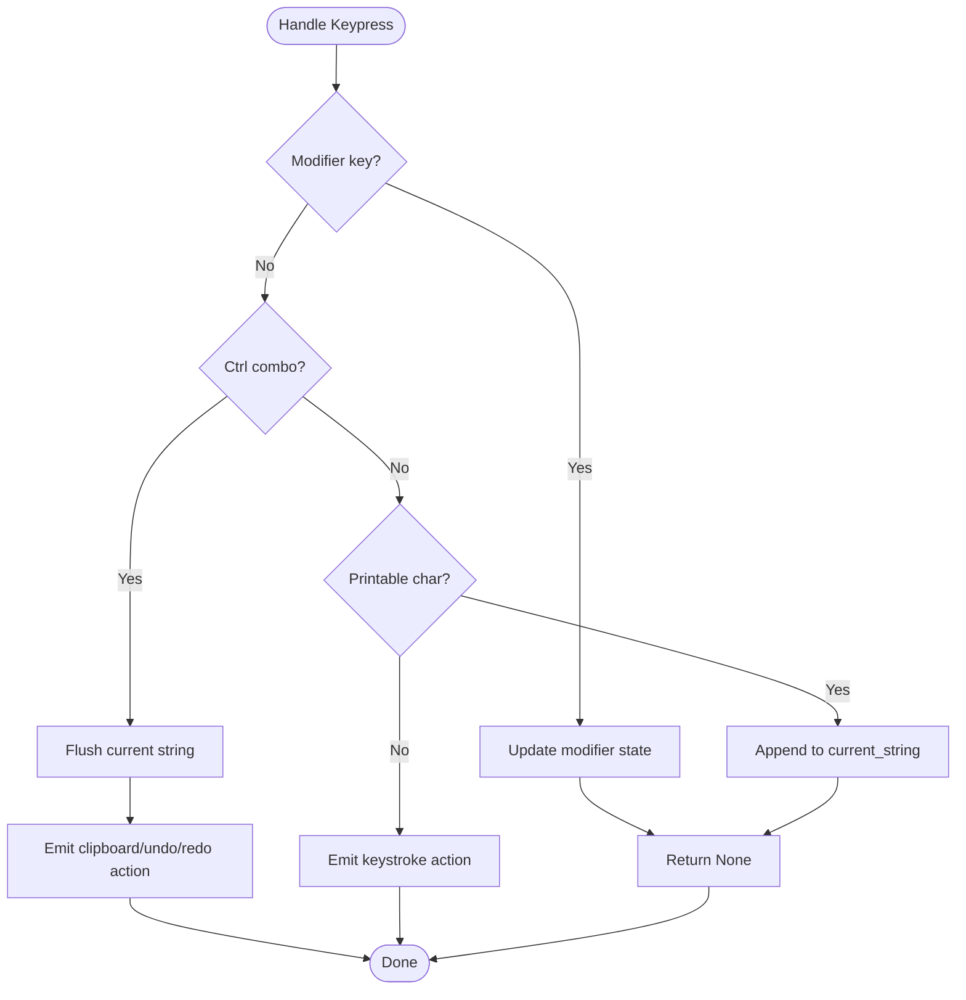
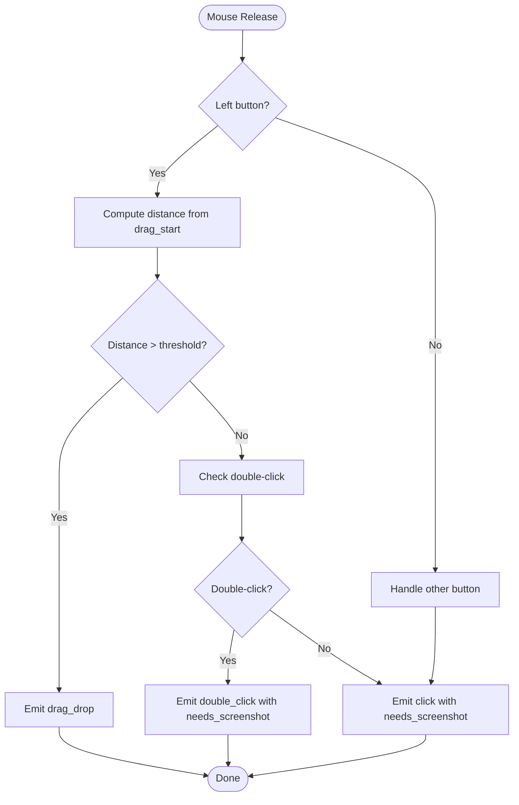
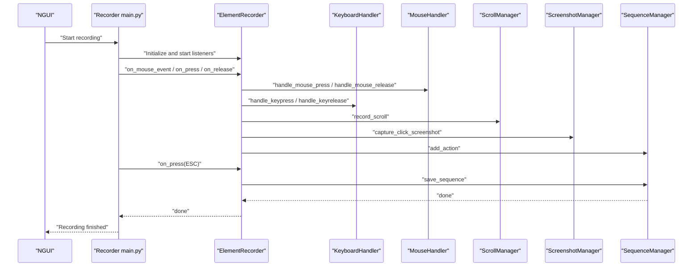
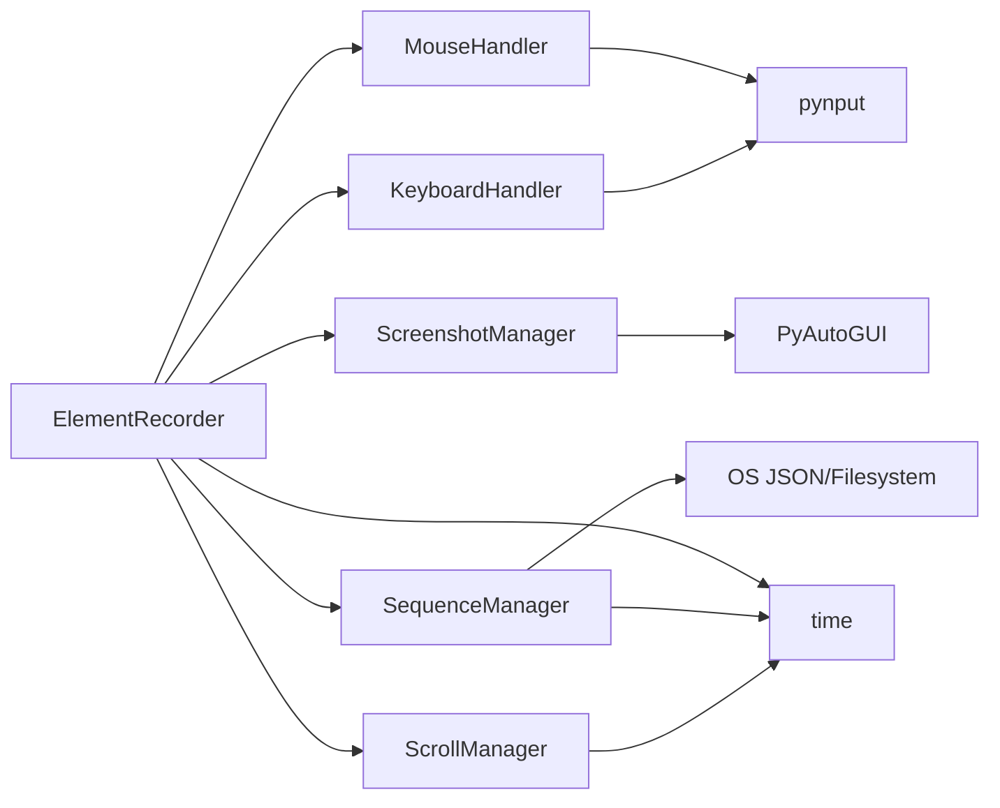

# Recording Engine

<cite>
**Referenced Files in This Document**
- [README.md](file://LoOper/README.MD)
- [main.py](file://LoOper/main.py)
- [main.py](file://LoOper/recorder/main.py)
- [element_recorder.py](file://LoOper/recorder/element_recorder.py)
- [sequence_manager.py](file://LoOper/recorder/sequence_manager.py)
- [screenshot_manager.py](file://LoOper/recorder/screenshot_manager.py)
- [scroll_manager.py](file://LoOper/recorder/scroll_manager.py)
- [keyboard_handler.py](file://LoOper/recorder/keyboard_handler.py)
- [mouse_handler.py](file://LoOper/recorder/mouse_handler.py)
- [README.md](file://LoOper/recorder/README.md)
- [main_window.py](file://LoOper/NGUI/main_window.py)
</cite>

## Table of Contents
1. [Introduction](#introduction)
2. [Project Structure](#project-structure)
3. [Core Components](#core-components)
4. [Architecture Overview](#architecture-overview)
5. [Detailed Component Analysis](#detailed-component-analysis)
6. [Dependency Analysis](#dependency-analysis)
7. [Performance Considerations](#performance-considerations)
8. [Troubleshooting Guide](#troubleshooting-guide)
9. [Conclusion](#conclusion)
10. [Appendices](#appendices)

## Introduction
This document explains the recording engine that orchestrates the entire desktop recording system. It focuses on the central coordination of input handlers, sequence management, and screenshot capture. It covers the recording lifecycle, state management, initialization and shutdown procedures, error handling strategies, configuration options, and how the engine integrates with external systems. The goal is to make the recording engine understandable for beginners while providing deep technical insights for developers extending the functionality.

## Project Structure
The recording engine resides under the recorder package and is designed as a modular system. The main entry point wires listeners and delegates to the ElementRecorder, which coordinates specialized handlers and managers.

**Diagram sources**
- [main.py:1-75](file://LoOper/recorder/main.py#L1-L75)
- [element_recorder.py:1-155](file://LoOper/recorder/element_recorder.py#L1-L155)
- [sequence_manager.py:1-178](file://LoOper/recorder/sequence_manager.py#L1-L178)
- [screenshot_manager.py:1-49](file://LoOper/recorder/screenshot_manager.py#L1-L49)
- [scroll_manager.py:1-97](file://LoOper/recorder/scroll_manager.py#L1-L97)
- [keyboard_handler.py:1-197](file://LoOper/recorder/keyboard_handler.py#L1-L197)
- [mouse_handler.py:1-167](file://LoOper/recorder/mouse_handler.py#L1-L167)
- [main_window.py:597-638](file://LoOper/NGUI/main_window.py#L597-L638)

**Section sources**
- [README.md:147-222](file://LoOper/README.MD#L147-L222)
- [README.md:1-86](file://LoOper/recorder/README.md#L1-L86)

## Core Components
- ElementRecorder: Central coordinator that initializes and orchestrates all recording components, aggregates actions, and triggers saves.
- SequenceManager: Stores actions, attaches application context, and serializes sequences to JSON.
- ScreenshotManager: Captures click-region screenshots and manages storage.
- ScrollManager: Groups rapid scroll events into cohesive scroll actions.
- KeyboardHandler: Tracks modifiers, recognizes special key combinations (e.g., Ctrl+C/V/X/A), and buffers typed text.
- MouseHandler: Distinguishes clicks from drags, detects double-clicks, and emits appropriate actions.
- main.py: Starts listeners, routes events to ElementRecorder, and handles termination on ESC.

These components collaborate to transform raw input events into a structured, replayable sequence with optional visual templates.

**Section sources**
- [element_recorder.py:11-25](file://LoOper/recorder/element_recorder.py#L11-L25)
- [sequence_manager.py:18-24](file://LoOper/recorder/sequence_manager.py#L18-L24)
- [screenshot_manager.py:10-20](file://LoOper/recorder/screenshot_manager.py#L10-L20)
- [scroll_manager.py:4-12](file://LoOper/recorder/scroll_manager.py#L4-L12)
- [keyboard_handler.py:6-19](file://LoOper/recorder/keyboard_handler.py#L6-L19)
- [mouse_handler.py:6-17](file://LoOper/recorder/mouse_handler.py#L6-L17)
- [main.py:7-71](file://LoOper/recorder/main.py#L7-L71)

## Architecture Overview
The recording engine follows a listener-driven pipeline:
- Listeners capture mouse and keyboard events.
- ElementRecorder translates events into actions.
- ScrollManager groups scroll bursts; MouseHandler distinguishes clicks/drags; KeyboardHandler buffers text and recognizes shortcuts.
- ScreenshotManager captures click-related visuals.
- SequenceManager stores actions and metadata, then persists to disk.

**Diagram sources**
- [main.py:14-70](file://LoOper/recorder/main.py#L14-L70)
- [element_recorder.py:76-155](file://LoOper/recorder/element_recorder.py#L76-L155)
- [keyboard_handler.py:29-158](file://LoOper/recorder/keyboard_handler.py#L29-L158)
- [mouse_handler.py:25-167](file://LoOper/recorder/mouse_handler.py#L25-L167)
- [scroll_manager.py:13-97](file://LoOper/recorder/scroll_manager.py#L13-L97)
- [screenshot_manager.py:21-49](file://LoOper/recorder/screenshot_manager.py#L21-L49)
- [sequence_manager.py:138-163](file://LoOper/recorder/sequence_manager.py#L138-L163)

## Detailed Component Analysis

### ElementRecorder: Central Coordinator
Responsibilities:
- Initializes and holds references to all managers and handlers.
- Translates low-level events into high-level actions.
- Coordinates screenshot capture for click actions.
- Finalizes scroll bursts and flushes pending text before saving.

Key behaviors:
- On mouse release, determines action type (click, absolute click, ctrl_click, shift_click) based on modifier keys and flags.
- On keypress, flushes buffered text and forwards keystrokes/shortcuts to SequenceManager.
- On ESC, flushes pending strings, finalizes scroll bursts, and saves the sequence.

**Diagram sources**
- [element_recorder.py:11-25](file://LoOper/recorder/element_recorder.py#L11-L25)
- [sequence_manager.py:18-24](file://LoOper/recorder/sequence_manager.py#L18-L24)
- [screenshot_manager.py:10-20](file://LoOper/recorder/screenshot_manager.py#L10-L20)
- [scroll_manager.py:4-12](file://LoOper/recorder/scroll_manager.py#L4-L12)
- [keyboard_handler.py:6-19](file://LoOper/recorder/keyboard_handler.py#L6-L19)
- [mouse_handler.py:6-17](file://LoOper/recorder/mouse_handler.py#L6-L17)

**Section sources**
- [element_recorder.py:11-25](file://LoOper/recorder/element_recorder.py#L11-L25)
- [element_recorder.py:76-155](file://LoOper/recorder/element_recorder.py#L76-L155)

### SequenceManager: Action Storage and Persistence
Responsibilities:
- Stores actions with application context attached.
- Generates metadata (timestamps, duration, mode).
- Serializes to JSON and clears caches upon save.

Behavior highlights:
- Attaches active application context (title, PID, rect) to each action.
- Clears caches after saving to ensure downstream consumers see updated sequences.

**Diagram sources**
- [sequence_manager.py:125-163](file://LoOper/recorder/sequence_manager.py#L125-L163)

**Section sources**
- [sequence_manager.py:18-24](file://LoOper/recorder/sequence_manager.py#L18-L24)
- [sequence_manager.py:125-163](file://LoOper/recorder/sequence_manager.py#L125-L163)

### ScreenshotManager: Visual Templates for Clicks
Responsibilities:
- Captures a small region around click coordinates.
- Names and stores screenshots in a dedicated directory.
- Provides error handling for screenshot operations.

**Diagram sources**
- [screenshot_manager.py:21-49](file://LoOper/recorder/screenshot_manager.py#L21-L49)

**Section sources**
- [screenshot_manager.py:10-20](file://LoOper/recorder/screenshot_manager.py#L10-L20)
- [screenshot_manager.py:21-49](file://LoOper/recorder/screenshot_manager.py#L21-L49)

### ScrollManager: Scroll Burst Grouping
Responsibilities:
- Detects bursts of scroll events within a timeout.
- Aggregates deltas into a single scroll action with direction and cumulative position.
- Finalizes bursts and returns them for sequencing.

**Diagram sources**
- [scroll_manager.py:13-64](file://LoOper/recorder/scroll_manager.py#L13-L64)
- [scroll_manager.py:66-97](file://LoOper/recorder/scroll_manager.py#L66-L97)

**Section sources**
- [scroll_manager.py:4-12](file://LoOper/recorder/scroll_manager.py#L4-L12)
- [scroll_manager.py:13-97](file://LoOper/recorder/scroll_manager.py#L13-L97)

### KeyboardHandler: Modifiers, Shortcuts, and Text Buffering
Responsibilities:
- Tracks modifier keys (Ctrl, Shift, Alt).
- Recognizes special shortcuts (Ctrl+C, Ctrl+V, Ctrl+X, Ctrl+A, Ctrl+Z, Ctrl+Y).
- Buffers typed characters into a single type_string action.
- Emits keystroke actions for control keys and non-printable characters.

**Diagram sources**
- [keyboard_handler.py:29-158](file://LoOper/recorder/keyboard_handler.py#L29-L158)

**Section sources**
- [keyboard_handler.py:6-19](file://LoOper/recorder/keyboard_handler.py#L6-L19)
- [keyboard_handler.py:29-158](file://LoOper/recorder/keyboard_handler.py#L29-L158)

### MouseHandler: Clicks, Drags, and Double-Click Detection
Responsibilities:
- Tracks drag initiation and distance to distinguish drags from clicks.
- Emits drag_drop or click actions depending on distance.
- Detects double-clicks within configurable time and distance thresholds.
- Supports left, right, and middle buttons.

**Diagram sources**
- [mouse_handler.py:44-167](file://LoOper/recorder/mouse_handler.py#L44-L167)

**Section sources**
- [mouse_handler.py:6-17](file://LoOper/recorder/mouse_handler.py#L6-L17)
- [mouse_handler.py:44-167](file://LoOper/recorder/mouse_handler.py#L44-L167)

### Recording Lifecycle and Event Pipeline
End-to-end flow:
- Start listeners and route events to ElementRecorder.
- Translate events into actions; capture screenshots for click actions.
- Group scrolls into bursts; finalize on timeout or new burst.
- Save sequence on ESC: flush text, finalize scroll, persist JSON, clear caches.

**Diagram sources**
- [main.py:7-71](file://LoOper/recorder/main.py#L7-L71)
- [element_recorder.py:76-155](file://LoOper/recorder/element_recorder.py#L76-L155)
- [sequence_manager.py:138-163](file://LoOper/recorder/sequence_manager.py#L138-L163)

**Section sources**
- [main.py:7-71](file://LoOper/recorder/main.py#L7-L71)
- [element_recorder.py:137-155](file://LoOper/recorder/element_recorder.py#L137-L155)

## Dependency Analysis
- Internal dependencies:
  - ElementRecorder depends on all managers and handlers.
  - SequenceManager depends on JSON and time; optionally on player’s cache invalidation.
  - ScreenshotManager depends on PyAutoGUI and filesystem.
  - ScrollManager depends on time.
  - KeyboardHandler depends on pynput and time.
  - MouseHandler depends on pynput and time.
- External integrations:
  - pynput for cross-platform input capture.
  - PyAutoGUI for screenshot capture.
  - OS-level hooks for mouse and keyboard listeners.
  - Optional Windows libraries for application context retrieval.

**Diagram sources**
- [element_recorder.py:14-21](file://LoOper/recorder/element_recorder.py#L14-L21)
- [sequence_manager.py:1-16](file://LoOper/recorder/sequence_manager.py#L1-L16)
- [screenshot_manager.py:1-8](file://LoOper/recorder/screenshot_manager.py#L1-L8)
- [scroll_manager.py:1-2](file://LoOper/recorder/scroll_manager.py#L1-L2)
- [keyboard_handler.py:1-4](file://LoOper/recorder/keyboard_handler.py#L1-L4)
- [mouse_handler.py:1-4](file://LoOper/recorder/mouse_handler.py#L1-L4)

**Section sources**
- [element_recorder.py:14-21](file://LoOper/recorder/element_recorder.py#L14-L21)
- [sequence_manager.py:1-16](file://LoOper/recorder/sequence_manager.py#L1-L16)
- [screenshot_manager.py:1-8](file://LoOper/recorder/screenshot_manager.py#L1-L8)
- [scroll_manager.py:1-2](file://LoOper/recorder/scroll_manager.py#L1-L2)
- [keyboard_handler.py:1-4](file://LoOper/recorder/keyboard_handler.py#L1-L4)
- [mouse_handler.py:1-4](file://LoOper/recorder/mouse_handler.py#L1-L4)

## Performance Considerations
- Scroll grouping reduces action count and improves replay accuracy by consolidating rapid scroll events.
- Screenshot capture is triggered only for click actions, minimizing IO overhead.
- Text buffering avoids emitting many tiny keystroke actions, reducing sequence size and improving playback performance.
- Application context attachment is opportunistic and does not block action recording; failures are handled gracefully.
- Cache invalidation after save ensures immediate visibility of updated sequences in downstream consumers.

[No sources needed since this section provides general guidance]

## Troubleshooting Guide
Common issues and resolutions:
- No screenshots captured:
  - Ensure image libraries are installed and functional.
  - Verify the screenshot directory exists and is writable.
- ESC does not stop recording:
  - Confirm no other application is intercepting the ESC key.
  - Check that the keyboard listener is active and not blocked by exceptions.
- Missing actions or grouped actions:
  - Rapid scroll events are intentionally grouped; adjust timeout if needed.
  - Very short drags (< threshold) are treated as clicks; increase drag threshold if necessary.
- Incorrect click screenshots:
  - Validate screenshot region computation and permissions.
  - Re-run with corrected permissions or environment.

**Section sources**
- [screenshot_manager.py:21-49](file://LoOper/recorder/screenshot_manager.py#L21-L49)
- [scroll_manager.py:13-64](file://LoOper/recorder/scroll_manager.py#L13-L64)
- [mouse_handler.py:62-78](file://LoOper/recorder/mouse_handler.py#L62-L78)
- [README.md:598-625](file://LoOper/README.MD#L598-L625)

## Conclusion
The recording engine is a modular, event-driven system that transforms raw user interactions into a structured, replayable sequence. ElementRecorder acts as the central coordinator, orchestrating keyboard, mouse, scroll, screenshot, and sequence management. Its design emphasizes clarity, extensibility, and robustness, with careful attention to error handling and performance. Developers can extend the engine by adding new handlers or managers while maintaining loose coupling and clear responsibilities.

[No sources needed since this section summarizes without analyzing specific files]

## Appendices

### Initialization and Shutdown Procedures
- Initialization:
  - ElementRecorder constructs and holds instances of all managers and handlers.
  - Listeners are started in main.py; callbacks route events to ElementRecorder.
- Shutdown:
  - On ESC, ElementRecorder flushes buffered text, finalizes scroll bursts, and saves the sequence to disk.
  - SequenceManager persists metadata and actions; cache invalidation is triggered post-save.

**Section sources**
- [element_recorder.py:14-25](file://LoOper/recorder/element_recorder.py#L14-L25)
- [main.py:65-71](file://LoOper/recorder/main.py#L65-L71)
- [element_recorder.py:137-155](file://LoOper/recorder/element_recorder.py#L137-L155)
- [sequence_manager.py:138-163](file://LoOper/recorder/sequence_manager.py#L138-L163)

### Configuration Options
- ScreenshotManager:
  - Screenshots directory and region size for click screenshots.
- ScrollManager:
  - Scroll timeout and epsilon thresholds for burst grouping.
- KeyboardHandler:
  - Modifier key mappings and special shortcut recognition.
- MouseHandler:
  - Drag distance threshold for distinguishing drags from clicks.
- SequenceManager:
  - Output filename and metadata format.

**Section sources**
- [README.md:78-86](file://LoOper/recorder/README.md#L78-L86)
- [screenshot_manager.py:13-19](file://LoOper/recorder/screenshot_manager.py#L13-L19)
- [scroll_manager.py:7-11](file://LoOper/recorder/scroll_manager.py#L7-L11)
- [mouse_handler.py:15-16](file://LoOper/recorder/mouse_handler.py#L15-L16)
- [sequence_manager.py:138-153](file://LoOper/recorder/sequence_manager.py#L138-L153)

### External System Integrations
- pynput: Cross-platform input capture for keyboard and mouse.
- PyAutoGUI: Screenshot capture for visual template matching.
- OS-level hooks: Mouse and keyboard listeners.
- Optional Windows libraries: Active window and process context retrieval.

**Section sources**
- [keyboard_handler.py:1-4](file://LoOper/recorder/keyboard_handler.py#L1-L4)
- [mouse_handler.py:1-4](file://LoOper/recorder/mouse_handler.py#L1-L4)
- [screenshot_manager.py:1-8](file://LoOper/recorder/screenshot_manager.py#L1-L8)
- [sequence_manager.py:25-109](file://LoOper/recorder/sequence_manager.py#L25-L109)

### Thread Safety and Concurrent Operations
- Recording runs in a dedicated thread from the GUI to avoid blocking the UI.
- Window restoration and error reporting are performed on the main thread using Qt mechanisms.
- Listeners operate in their own threads; the GUI ensures thread-safe updates.

**Section sources**
- [main_window.py:597-638](file://LoOper/NGUI/main_window.py#L597-L638)