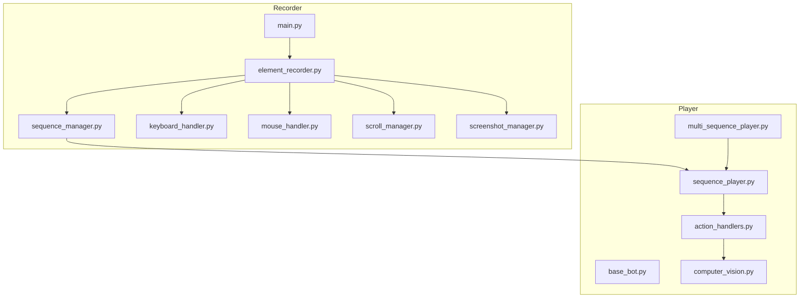
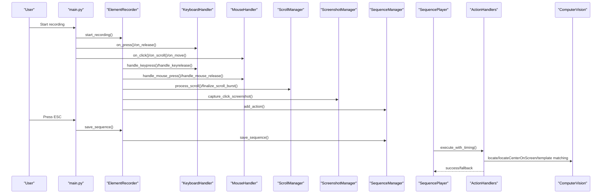
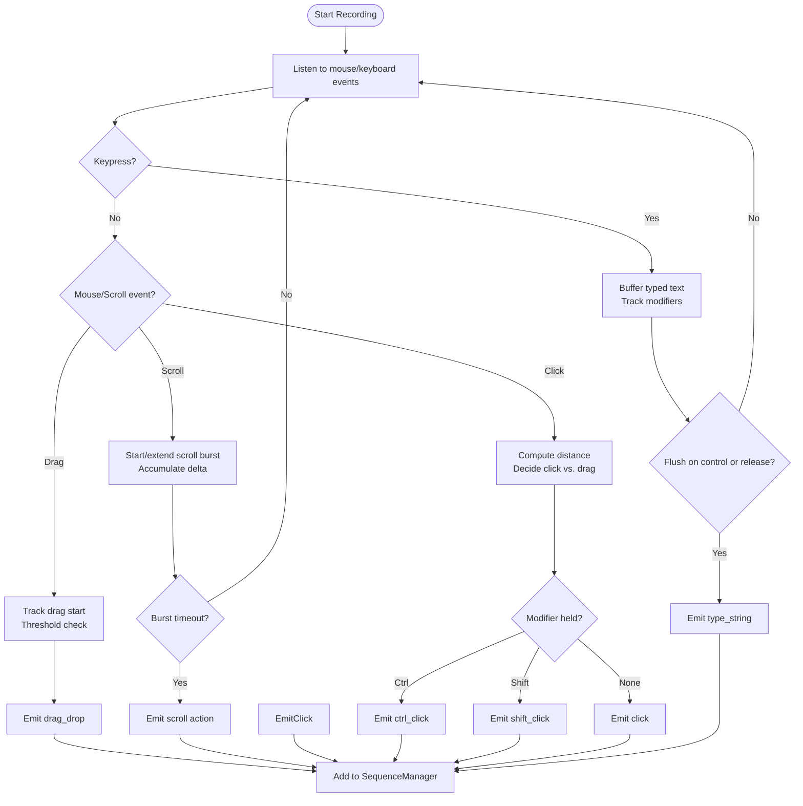
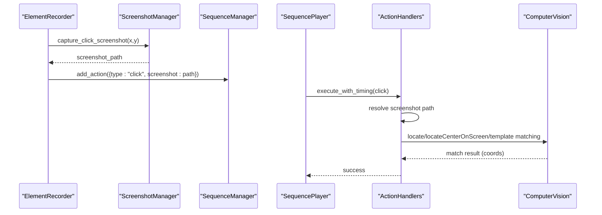
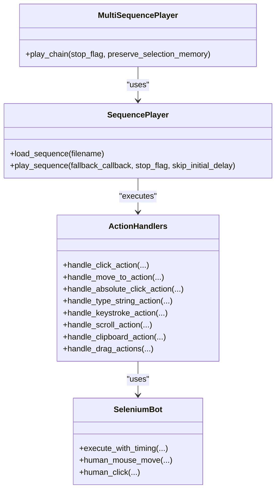
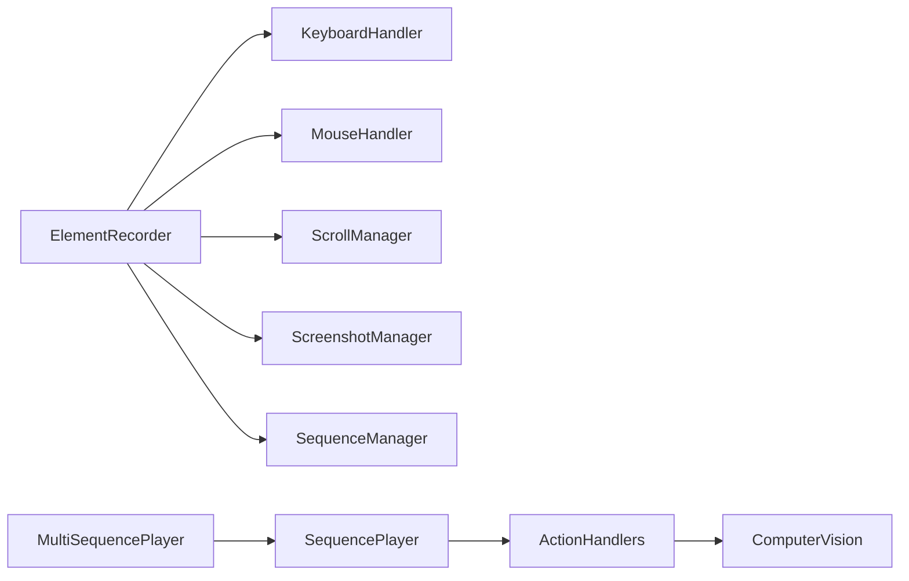

# Recording System

<cite>
**Referenced Files in This Document**
- [main.py](file://LoOper/recorder/main.py)
- [element_recorder.py](file://LoOper/recorder/element_recorder.py)
- [sequence_manager.py](file://LoOper/recorder/sequence_manager.py)
- [screenshot_manager.py](file://LoOper/recorder/screenshot_manager.py)
- [scroll_manager.py](file://LoOper/recorder/scroll_manager.py)
- [keyboard_handler.py](file://LoOper/recorder/keyboard_handler.py)
- [mouse_handler.py](file://LoOper/recorder/mouse_handler.py)
- [README.md](file://LoOper/recorder/README.md)
- [sequence_player.py](file://LoOper/player/sequence_player.py)
- [multi_sequence_player.py](file://LoOper/player/multi_sequence_player.py)
- [base_bot.py](file://LoOper/player/base_bot.py)
- [action_handlers.py](file://LoOper/player/action_handlers.py)
- [computer_vision.py](file://LoOper/player/computer_vision.py)
- [README.md](file://README.md)
</cite>

## Table of Contents
1. [Introduction](#introduction)
2. [Project Structure](#project-structure)
3. [Core Components](#core-components)
4. [Architecture Overview](#architecture-overview)
5. [Detailed Component Analysis](#detailed-component-analysis)
6. [Dependency Analysis](#dependency-analysis)
7. [Performance Considerations](#performance-considerations)
8. [Troubleshooting Guide](#troubleshooting-guide)
9. [Conclusion](#conclusion)

## Introduction
This document explains the recording system responsible for capturing user input (mouse, keyboard, scroll) and generating sequences suitable for playback. It covers:
- How input capture works (event handling, grouping, and metadata)
- Smart grouping strategies (scroll bursts, typed text, modifier-aware clicks)
- Integration with screenshots for template-based playback
- Sequence serialization format and action types
- Relationship with the playback engine and execution flow
- Common issues and performance tips

The goal is to help both beginners and experienced developers understand how recordings are made and how they are executed reliably.

## Project Structure
The recording system is modularized under LoOper/recorder and integrates with the playback engine under LoOper/player.

**Diagram sources**
- [main.py:1-75](file://LoOper/recorder/main.py#L1-L75)
- [element_recorder.py:1-155](file://LoOper/recorder/element_recorder.py#L1-L155)
- [sequence_manager.py:1-178](file://LoOper/recorder/sequence_manager.py#L1-L178)
- [keyboard_handler.py:1-197](file://LoOper/recorder/keyboard_handler.py#L1-L197)
- [mouse_handler.py:1-167](file://LoOper/recorder/mouse_handler.py#L1-L167)
- [scroll_manager.py:1-97](file://LoOper/recorder/scroll_manager.py#L1-L97)
- [screenshot_manager.py:1-49](file://LoOper/recorder/screenshot_manager.py#L1-L49)
- [sequence_player.py:1-252](file://LoOper/player/sequence_player.py#L1-L252)
- [multi_sequence_player.py:1-532](file://LoOper/player/multi_sequence_player.py#L1-L532)
- [base_bot.py:1-299](file://LoOper/player/base_bot.py#L1-L299)
- [action_handlers.py:1-800](file://LoOper/player/action_handlers.py#L1-L800)
- [computer_vision.py:1-606](file://LoOper/player/computer_vision.py#L1-L606)

**Section sources**
- [README.md:1-86](file://LoOper/recorder/README.md#L1-L86)
- [README.md:61-78](file://README.md#L61-L78)

## Core Components
- ElementRecorder: Orchestrates all recording modules and exposes high-level APIs for recording actions.
- SequenceManager: Collects actions, attaches app context, and serializes to JSON with metadata.
- KeyboardHandler: Tracks modifiers, detects special combos (Ctrl+C/V/X/A/Z/Y), and buffers typed text.
- MouseHandler: Distinguishes clicks vs. drags, supports double-click detection, and generates click-related actions.
- ScrollManager: Groups rapid scroll events into a single scroll action with cumulative position tracking.
- ScreenshotManager: Captures small regions around clicks for template-based playback.

**Section sources**
- [element_recorder.py:11-25](file://LoOper/recorder/element_recorder.py#L11-L25)
- [sequence_manager.py:18-178](file://LoOper/recorder/sequence_manager.py#L18-L178)
- [keyboard_handler.py:6-197](file://LoOper/recorder/keyboard_handler.py#L6-L197)
- [mouse_handler.py:6-167](file://LoOper/recorder/mouse_handler.py#L6-L167)
- [scroll_manager.py:4-97](file://LoOper/recorder/scroll_manager.py#L4-L97)
- [screenshot_manager.py:10-49](file://LoOper/recorder/screenshot_manager.py#L10-L49)

## Architecture Overview
End-to-end flow from input capture to sequence execution:

**Diagram sources**
- [main.py:7-71](file://LoOper/recorder/main.py#L7-L71)
- [element_recorder.py:76-155](file://LoOper/recorder/element_recorder.py#L76-L155)
- [keyboard_handler.py:29-158](file://LoOper/recorder/keyboard_handler.py#L29-L158)
- [mouse_handler.py:25-88](file://LoOper/recorder/mouse_handler.py#L25-L88)
- [scroll_manager.py:13-97](file://LoOper/recorder/scroll_manager.py#L13-L97)
- [screenshot_manager.py:21-49](file://LoOper/recorder/screenshot_manager.py#L21-L49)
- [sequence_manager.py:138-163](file://LoOper/recorder/sequence_manager.py#L138-L163)
- [sequence_player.py:202-251](file://LoOper/player/sequence_player.py#L202-L251)
- [action_handlers.py:133-604](file://LoOper/player/action_handlers.py#L133-L604)
- [computer_vision.py:199-450](file://LoOper/player/computer_vision.py#L199-L450)

## Detailed Component Analysis

### Input Capture and Event Handling
- Mouse:
  - Button press/release tracked to detect drag vs. click.
  - Drag threshold determines whether to emit a drag action or two separate click actions.
  - Double-click detection uses time and spatial thresholds.
  - Right Ctrl + move can capture a terminal move target for a move_to action.
- Keyboard:
  - Modifiers tracked centrally (Ctrl_L, Ctrl_R, Shift_L, Shift_R, Alt_L, Alt_R).
  - Special combos recognized: Ctrl+C (copy), Ctrl+V (paste), Ctrl+X (cut), Ctrl+A (select all), Ctrl+Z (undo), Ctrl+Y (redo).
  - Printable characters buffered into a typed string; control keys emitted as keystroke actions.
- Scroll:
  - Burst tracking with a timeout window; same-direction deltas accumulate into a single scroll action.
  - Cumulative scroll position maintained for precise positioning.

**Section sources**
- [mouse_handler.py:25-167](file://LoOper/recorder/mouse_handler.py#L25-L167)
- [keyboard_handler.py:29-197](file://LoOper/recorder/keyboard_handler.py#L29-L197)
- [scroll_manager.py:13-97](file://LoOper/recorder/scroll_manager.py#L13-L97)

### Smart Grouping Strategies
- Scroll bursts:
  - Consecutive scrolls within a short timeout and same direction are merged into one scroll action with total delta and final position.
- Typed text:
  - Consecutive printable characters are accumulated into a single type_string action, minimizing action count and improving playback reliability.
- Modifier-aware clicks:
  - Clicks are contextualized by active modifiers (e.g., Ctrl+Click, Shift+Click) to produce specialized actions for playback.

**Diagram sources**
- [mouse_handler.py:25-167](file://LoOper/recorder/mouse_handler.py#L25-L167)
- [keyboard_handler.py:29-197](file://LoOper/recorder/keyboard_handler.py#L29-L197)
- [scroll_manager.py:13-97](file://LoOper/recorder/scroll_manager.py#L13-L97)
- [element_recorder.py:26-103](file://LoOper/recorder/element_recorder.py#L26-L103)

**Section sources**
- [mouse_handler.py:57-88](file://LoOper/recorder/mouse_handler.py#L57-L88)
- [keyboard_handler.py:104-158](file://LoOper/recorder/keyboard_handler.py#L104-L158)
- [scroll_manager.py:34-64](file://LoOper/recorder/scroll_manager.py#L34-L64)

### Text Input Capture and Clipboard Shortcuts
- Printable characters are appended to a buffer until a control key or release occurs.
- On control key detection, the buffered text is flushed as a type_string action.
- Special Ctrl+ combos are detected and emitted as clipboard actions with timestamps.
- Modifier flags are updated on key press/release to inform click action types.

**Section sources**
- [keyboard_handler.py:180-197](file://LoOper/recorder/keyboard_handler.py#L180-L197)
- [keyboard_handler.py:69-128](file://LoOper/recorder/keyboard_handler.py#L69-L128)
- [keyboard_handler.py:160-179](file://LoOper/recorder/keyboard_handler.py#L160-L179)

### Screenshots and Template-Based Playback
- For click actions (including double-click and modifier-aware clicks), a small screenshot region is captured around the click coordinates.
- The screenshot path is attached to the action for template-based matching during playback.
- During playback, the system resolves screenshot paths, captures a live screen, and uses multiple strategies (template matching, multi-scale, region-based) to locate the target reliably.

**Diagram sources**
- [element_recorder.py:43-55](file://LoOper/recorder/element_recorder.py#L43-L55)
- [screenshot_manager.py:21-49](file://LoOper/recorder/screenshot_manager.py#L21-L49)
- [sequence_manager.py:125-137](file://LoOper/recorder/sequence_manager.py#L125-L137)
- [sequence_player.py:202-251](file://LoOper/player/sequence_player.py#L202-L251)
- [action_handlers.py:133-604](file://LoOper/player/action_handlers.py#L133-L604)
- [computer_vision.py:199-450](file://LoOper/player/computer_vision.py#L199-L450)

**Section sources**
- [element_recorder.py:43-55](file://LoOper/recorder/element_recorder.py#L43-L55)
- [screenshot_manager.py:21-49](file://LoOper/recorder/screenshot_manager.py#L21-L49)
- [action_handlers.py:133-604](file://LoOper/player/action_handlers.py#L133-L604)

### Sequence Serialization Format and Metadata
- Output JSON includes:
  - metadata: created_at, total_actions, duration_sec, mode
  - actions: ordered list of action objects
- Each action includes:
  - type: click, double_click, ctrl_click, shift_click, absolute_click, move_to, type_string, keystroke, scroll, clipboard, drag_drop
  - timestamps and coordinates
  - screenshot path for click actions
  - app_context (title, process_name, exe, pid, rect) attached to actions when available

**Section sources**
- [sequence_manager.py:145-163](file://LoOper/recorder/sequence_manager.py#L145-L163)
- [sequence_manager.py:111-124](file://LoOper/recorder/sequence_manager.py#L111-L124)

### Playback Engine Integration
- Single sequence playback:
  - SequencePlayer loads JSON, validates structure, and iterates actions.
  - Uses ActionHandlers to execute actions with human-like delays and retries.
  - Supports fallback sequences for click actions when visual matching fails.
- Multi-sequence chains:
  - MultiSequencePlayer orchestrates multiple sequences, conditional fallbacks, and workflow execution.
  - Integrates with computer vision and OCR for robust targeting.

**Diagram sources**
- [sequence_player.py:136-251](file://LoOper/player/sequence_player.py#L136-L251)
- [multi_sequence_player.py:32-135](file://LoOper/player/multi_sequence_player.py#L32-L135)
- [action_handlers.py:26-800](file://LoOper/player/action_handlers.py#L26-L800)
- [base_bot.py:22-299](file://LoOper/player/base_bot.py#L22-L299)

**Section sources**
- [sequence_player.py:202-251](file://LoOper/player/sequence_player.py#L202-L251)
- [multi_sequence_player.py:192-325](file://LoOper/player/multi_sequence_player.py#L192-L325)
- [action_handlers.py:133-604](file://LoOper/player/action_handlers.py#L133-L604)

## Dependency Analysis
- Recorder depends on:
  - pynput for keyboard/mouse events
  - pyautogui for screenshot capture and basic UI control
  - internal managers for logic separation
- Playback depends on:
  - pyautogui for UI control
  - OpenCV (optional) for template matching and multi-scale strategies
  - Computer vision utilities for robust target localization

**Diagram sources**
- [element_recorder.py:14-21](file://LoOper/recorder/element_recorder.py#L14-L21)
- [sequence_player.py:136-149](file://LoOper/player/sequence_player.py#L136-L149)
- [action_handlers.py:26-42](file://LoOper/player/action_handlers.py#L26-L42)
- [computer_vision.py:47-450](file://LoOper/player/computer_vision.py#L47-L450)
- [multi_sequence_player.py:32-110](file://LoOper/player/multi_sequence_player.py#L32-L110)

**Section sources**
- [element_recorder.py:14-21](file://LoOper/recorder/element_recorder.py#L14-L21)
- [sequence_player.py:136-149](file://LoOper/player/sequence_player.py#L136-L149)
- [action_handlers.py:26-42](file://LoOper/player/action_handlers.py#L26-L42)

## Performance Considerations
- Scroll burst timeout and direction filtering reduce noise and improve replay accuracy.
- Typed text buffering minimizes action count and reduces playback overhead.
- Screenshot capture is scoped to small regions to limit I/O and memory usage.
- Playback caches sequence data and uses incremental file timestamp checks to avoid unnecessary reloads.
- Human-like delays and retries balance robustness with speed; adjust delays for your environment.

[No sources needed since this section provides general guidance]

## Troubleshooting Guide
Common issues and resolutions:
- Visual matching fails for clicks:
  - Ensure the recorded screenshot exists and is resolvable at playback time.
  - Verify the target is visible and not obscured; adjust confidence thresholds or use fallback sequences.
- Modifier keys not detected:
  - Confirm modifier flags are tracked correctly; some environments may require specific key names.
- Scroll action not grouping:
  - Check burst timeout and direction; ensure rapid successive scrolls occur within the timeout window.
- Typing too slow or too fast:
  - Adjust keystroke_delay and batch_size in type_string actions.
- ESC-to-stop not working:
  - Ensure stop_flag is passed through the execution pipeline; verify the stop flag function returns True when needed.

**Section sources**
- [action_handlers.py:133-604](file://LoOper/player/action_handlers.py#L133-L604)
- [keyboard_handler.py:29-158](file://LoOper/recorder/keyboard_handler.py#L29-L158)
- [scroll_manager.py:34-64](file://LoOper/recorder/scroll_manager.py#L34-L64)
- [sequence_player.py:202-251](file://LoOper/player/sequence_player.py#L202-L251)

## Conclusion
The recording system provides a modular, robust pipeline for capturing mouse, keyboard, and scroll interactions, grouping related actions intelligently, and attaching screenshots for reliable template-based playback. Its integration with the playback engine enables repeatable automation with fallbacks, retries, and human-like behavior. By understanding the event handling, grouping strategies, and serialization format, developers can extend and optimize the system for diverse automation scenarios.