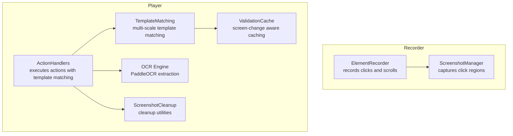
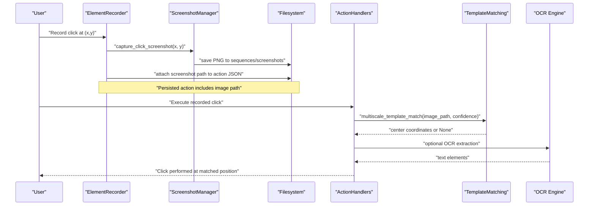
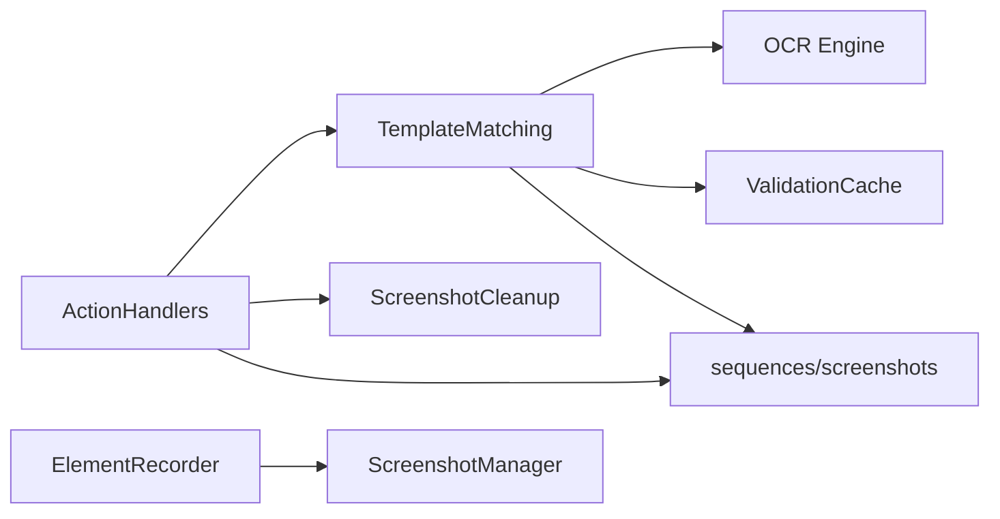

# Screenshot Integration

<cite>
**Referenced Files in This Document**
- [screenshot_manager.py](file://LoOper/recorder/screenshot_manager.py)
- [element_recorder.py](file://LoOper/recorder/element_recorder.py)
- [computer_vision.py](file://LoOper/player/computer_vision.py)
- [action_handlers.py](file://LoOper/player/action_handlers.py)
- [screenshot_cleanup.py](file://LoOper/player/screenshot_cleanup.py)
- [config.py](file://LoOper/player/config.py)
- [ocr_engine.py](file://LoOper/player/ocr_engine.py)
- [validation_cache.py](file://LoOper/player/multi_sequence/conditional_fallback_resources/validation_cache.py)
- [node_executor.py](file://LoOper/player/multi_sequence/conditional_fallback_resources/node_executor.py)
- [base_bot.py](file://LoOper/player/base_bot.py)
</cite>

## Table of Contents
1. [Introduction](#introduction)
2. [Project Structure](#project-structure)
3. [Core Components](#core-components)
4. [Architecture Overview](#architecture-overview)
5. [Detailed Component Analysis](#detailed-component-analysis)
6. [Dependency Analysis](#dependency-analysis)
7. [Performance Considerations](#performance-considerations)
8. [Troubleshooting Guide](#troubleshooting-guide)
9. [Conclusion](#conclusion)

## Introduction
This document describes the screenshot integration subsystem responsible for capturing UI imagery during recording, persisting images efficiently, and enabling template-based recognition during playback. It explains capture timing, image storage and cleanup, template matching workflows, OCR-based verification, and how the system coordinates with the recording pipeline to ensure reliable playback. It also documents configuration options, performance characteristics, and common operational issues.

## Project Structure
The screenshot integration spans two primary subsystems:
- Recorder: captures click regions and persists PNG images alongside recorded actions.
- Player: performs template matching, region-based search, and OCR-based verification using screenshots and screen captures.

**Diagram sources**
- [element_recorder.py:11-104](file://LoOper/recorder/element_recorder.py#L11-L104)
- [screenshot_manager.py:10-49](file://LoOper/recorder/screenshot_manager.py#L10-L49)
- [action_handlers.py:26-42](file://LoOper/player/action_handlers.py#L26-L42)
- [computer_vision.py:47-606](file://LoOper/player/computer_vision.py#L47-L606)
- [ocr_engine.py:131-367](file://LoOper/player/ocr_engine.py#L131-L367)
- [screenshot_cleanup.py:6-125](file://LoOper/player/screenshot_cleanup.py#L6-L125)
- [validation_cache.py:12-208](file://LoOper/player/multi_sequence/conditional_fallback_resources/validation_cache.py#L12-L208)

**Section sources**
- [element_recorder.py:11-155](file://LoOper/recorder/element_recorder.py#L11-L155)
- [screenshot_manager.py:10-49](file://LoOper/recorder/screenshot_manager.py#L10-L49)
- [action_handlers.py:26-42](file://LoOper/player/action_handlers.py#L26-L42)
- [computer_vision.py:47-606](file://LoOper/player/computer_vision.py#L47-L606)
- [ocr_engine.py:131-367](file://LoOper/player/ocr_engine.py#L131-L367)
- [screenshot_cleanup.py:6-125](file://LoOper/player/screenshot_cleanup.py#L6-L125)
- [validation_cache.py:12-208](file://LoOper/player/multi_sequence/conditional_fallback_resources/validation_cache.py#L12-L208)

## Core Components
- ScreenshotManager: Captures a square region around a click coordinate and saves a PNG file with a timestamped filename. It creates the screenshots directory if missing.
- ElementRecorder: Orchestrates recording, triggering ScreenshotManager to capture click regions and attaching the image path to the recorded action.
- TemplateMatching: Provides multi-scale template matching, region-based search, and OCR-based text detection. It selects the fastest available capture method (mss, pyautogui, or sandbox agent).
- ActionHandlers: Executes click actions by locating the expected UI element via template matching and optional OCR verification, registering and cleaning up temporary screenshots.
- ScreenshotCleanup: Centralized cleanup for temporal screenshots using registration, age-based pruning, and pattern-based deletion.
- ValidationCache: Caches validation results keyed by screen state to reduce repeated template matches; integrates screen hashing for change detection.
- OCR Engine: Extracts text elements from images using PaddleOCR with language normalization and model bundling support.

**Section sources**
- [screenshot_manager.py:10-49](file://LoOper/recorder/screenshot_manager.py#L10-L49)
- [element_recorder.py:32-56](file://LoOper/recorder/element_recorder.py#L32-L56)
- [computer_vision.py:47-606](file://LoOper/player/computer_vision.py#L47-L606)
- [action_handlers.py:133-200](file://LoOper/player/action_handlers.py#L133-L200)
- [screenshot_cleanup.py:6-125](file://LoOper/player/screenshot_cleanup.py#L6-L125)
- [validation_cache.py:12-208](file://LoOper/player/multi_sequence/conditional_fallback_resources/validation_cache.py#L12-L208)
- [ocr_engine.py:131-367](file://LoOper/player/ocr_engine.py#L131-L367)

## Architecture Overview
The screenshot integration coordinates capture and recognition across recording and playback:

**Diagram sources**
- [element_recorder.py:32-56](file://LoOper/recorder/element_recorder.py#L32-L56)
- [screenshot_manager.py:21-49](file://LoOper/recorder/screenshot_manager.py#L21-L49)
- [action_handlers.py:133-200](file://LoOper/player/action_handlers.py#L133-L200)
- [computer_vision.py:198-331](file://LoOper/player/computer_vision.py#L198-L331)
- [ocr_engine.py:131-367](file://LoOper/player/ocr_engine.py#L131-L367)

## Detailed Component Analysis

### ScreenshotManager
Responsibilities:
- Capture a square region around a click coordinate.
- Save the image to a timestamped PNG filename.
- Maintain a screenshot counter and ensure the target directory exists.

Key behaviors:
- Region selection clamps negative coordinates to zero.
- Filename includes a counter and Unix timestamp for uniqueness.
- Exceptions are caught and logged; returns the saved path or None.

Storage strategy:
- Directory defaults to sequences/screenshots.
- No compression is applied; images are saved as PNG.

Timing:
- Called synchronously during recording to capture click regions.

**Section sources**
- [screenshot_manager.py:10-49](file://LoOper/recorder/screenshot_manager.py#L10-L49)

### ElementRecorder
Responsibilities:
- Coordinates recording of mouse and keyboard events.
- Triggers ScreenshotManager to capture click regions.
- Attaches the screenshot path to the recorded action and persists the sequence.

Integration:
- On click release, if needs_screenshot is flagged, captures a region and sets the action’s screenshot field.
- Saves the sequence JSON to the sequences directory.

**Section sources**
- [element_recorder.py:32-104](file://LoOper/recorder/element_recorder.py#L32-L104)

### TemplateMatching
Responsibilities:
- Multi-scale template matching with adaptive scale selection.
- Region-based search around expected coordinates.
- OCR text detection and extraction.
- Fast screen capture using mss, pyautogui, or sandbox agent.

Implementation highlights:
- Adaptive multi-scale strategy reduces repeated checks by prioritizing smaller scale sets initially, expanding as needed.
- Region-based search expands around the expected coordinates with minimum size constraints.
- OCR extraction supports multiple PaddleOCR formats and normalizes languages.
- Screen capture prefers mss for speed, falls back to pyautogui, and supports sandbox agent capture.

**Section sources**
- [computer_vision.py:47-606](file://LoOper/player/computer_vision.py#L47-L606)
- [ocr_engine.py:131-367](file://LoOper/player/ocr_engine.py#L131-L367)

### ActionHandlers
Responsibilities:
- Execute recorded click actions by locating the expected UI element.
- Capture a single screen image for all retries to minimize overhead.
- Register temporal screenshots for cleanup and clean them up after use.

Execution flow:
- Resolves the expected screenshot path across multiple candidate locations.
- Captures a single screen image and converts to BGR for OpenCV operations.
- Attempts region-based search with grayscale matching, then multi-scale matching.
- Optionally verifies OCR text presence to confirm the UI state.
- Cleans up registered temporal screenshots upon completion.

**Section sources**
- [action_handlers.py:133-200](file://LoOper/player/action_handlers.py#L133-L200)
- [screenshot_cleanup.py:6-125](file://LoOper/player/screenshot_cleanup.py#L6-L125)

### ScreenshotCleanup
Responsibilities:
- Register temporal screenshots for cleanup.
- Clean up a specific screenshot file.
- Clean up all registered screenshots.
- Age-based cleanup of old temporal screenshots.
- Pattern-based cleanup by prefix.

Patterns:
- Supports temporal_screen_*.png and llm_vision_*.png.

**Section sources**
- [screenshot_cleanup.py:6-125](file://LoOper/player/screenshot_cleanup.py#L6-L125)

### ValidationCache
Responsibilities:
- Generate a screen hash to detect UI changes.
- Create cache keys that include screen state to invalidate stale results.
- Provide a thread-safe cache for validation outcomes with TTL and size limits.

Note:
- Current implementation temporarily disables cache reads to ensure correctness; caching may be reintroduced with refined invalidation logic.

**Section sources**
- [validation_cache.py:12-208](file://LoOper/player/multi_sequence/conditional_fallback_resources/validation_cache.py#L12-L208)

### OCR Engine
Responsibilities:
- Normalize languages for PaddleOCR.
- Initialize PaddleOCR with bundled models when available.
- Extract text elements and bounding boxes from images.
- Convert images to BGR arrays and handle RGBA inputs.

**Section sources**
- [ocr_engine.py:131-367](file://LoOper/player/ocr_engine.py#L131-L367)

### Computer Vision Configuration
- OpenCV and NumPy availability are checked at import time.
- OCR availability is detected via import spec.
- Logging is configured to file and console.

**Section sources**
- [config.py:11-46](file://LoOper/player/config.py#L11-L46)

## Dependency Analysis
The screenshot integration relies on:
- PyAutoGUI for basic screenshot capture and GUI operations.
- mss for fast screen capture when available.
- OpenCV and NumPy for template matching and image processing.
- PaddleOCR for text extraction.
- Thread-safe caches and locks for concurrent validations.

**Diagram sources**
- [action_handlers.py:26-42](file://LoOper/player/action_handlers.py#L26-L42)
- [computer_vision.py:47-606](file://LoOper/player/computer_vision.py#L47-L606)
- [ocr_engine.py:131-367](file://LoOper/player/ocr_engine.py#L131-L367)
- [screenshot_cleanup.py:6-125](file://LoOper/player/screenshot_cleanup.py#L6-L125)
- [validation_cache.py:12-208](file://LoOper/player/multi_sequence/conditional_fallback_resources/validation_cache.py#L12-L208)
- [element_recorder.py:11-104](file://LoOper/recorder/element_recorder.py#L11-L104)
- [screenshot_manager.py:10-49](file://LoOper/recorder/screenshot_manager.py#L10-L49)

**Section sources**
- [action_handlers.py:26-42](file://LoOper/player/action_handlers.py#L26-L42)
- [computer_vision.py:47-606](file://LoOper/player/computer_vision.py#L47-L606)
- [ocr_engine.py:131-367](file://LoOper/player/ocr_engine.py#L131-L367)
- [screenshot_cleanup.py:6-125](file://LoOper/player/screenshot_cleanup.py#L6-L125)
- [validation_cache.py:12-208](file://LoOper/player/multi_sequence/conditional_fallback_resources/validation_cache.py#L12-L208)
- [element_recorder.py:11-104](file://LoOper/recorder/element_recorder.py#L11-L104)
- [screenshot_manager.py:10-49](file://LoOper/recorder/screenshot_manager.py#L10-L49)

## Performance Considerations
- Capture method selection: mss is preferred for speed; pyautogui is used as fallback; sandbox agent capture is supported for remote environments.
- Single-screen capture reuse: ActionHandlers captures one screen image and reuses it across retries to reduce overhead.
- Template matching optimization: Adaptive multi-scale reduces repeated work by prioritizing common scales first.
- Memory usage: ValidationCache maintains a bounded number of entries and clears expired items; OCR engines cache models with LRU.
- Storage footprint: Images are saved as PNG without compression parameters exposed; consider adding configurable quality or resizing for constrained environments.

[No sources needed since this section provides general guidance]

## Troubleshooting Guide
Common issues and resolutions:
- Missing OpenCV or OCR: The system gracefully degrades. Verify installation of opencv-python and PaddleOCR-compatible packages.
- Template matching failures: Adjust confidence thresholds and enable grayscale matching. Use region-based search with expanded factors around expected coordinates.
- OCR not available: Ensure PaddleOCR is installed and models are accessible; bundled models are supported in frozen builds.
- Memory growth from screenshots: Use ScreenshotCleanup to register and clean up temporal screenshots; configure cleanup policies by age or prefix.
- Capture timing accuracy: Reduce retry delays and leverage single-screen capture reuse to minimize drift between recording and playback.
- Performance impact: Prefer mss capture, limit retry attempts, and avoid excessive multi-scale searches for static UIs.

**Section sources**
- [config.py:11-46](file://LoOper/player/config.py#L11-L46)
- [computer_vision.py:47-606](file://LoOper/player/computer_vision.py#L47-L606)
- [screenshot_cleanup.py:49-94](file://LoOper/player/screenshot_cleanup.py#L49-L94)
- [action_handlers.py:189-200](file://LoOper/player/action_handlers.py#L189-L200)

## Conclusion
The screenshot integration subsystem provides a robust pipeline for capturing UI imagery during recording and leveraging template matching and OCR during playback. It balances performance with reliability by selecting optimal capture methods, minimizing redundant operations, and offering centralized cleanup. While current caching is disabled to ensure correctness, the architecture supports future enhancements to further reduce latency and resource usage.