# Sequence Management

<cite>
**Referenced Files in This Document**
- [sequence_manager.py](file://LoOper/recorder/sequence_manager.py)
- [element_recorder.py](file://LoOper/recorder/element_recorder.py)
- [screenshot_manager.py](file://LoOper/recorder/screenshot_manager.py)
- [scroll_manager.py](file://LoOper/recorder/scroll_manager.py)
- [keyboard_handler.py](file://LoOper/recorder/keyboard_handler.py)
- [mouse_handler.py](file://LoOper/recorder/mouse_handler.py)
- [sequence_player.py](file://LoOper/player/sequence_player.py)
- [json_cache.py](file://LoOper/player/json_cache.py)
- [sequence_executor.py](file://LoOper/player/multi_sequence/sequence_executor.py)
- [action_handlers.py](file://LoOper/player/action_handlers.py)
- [base_bot.py](file://LoOper/player/base_bot.py)
</cite>

## Table of Contents
1. [Introduction](#introduction)
2. [Project Structure](#project-structure)
3. [Core Components](#core-components)
4. [Architecture Overview](#architecture-overview)
5. [Detailed Component Analysis](#detailed-component-analysis)
6. [Dependency Analysis](#dependency-analysis)
7. [Performance Considerations](#performance-considerations)
8. [Troubleshooting Guide](#troubleshooting-guide)
9. [Conclusion](#conclusion)

## Introduction
This document explains the sequence management subsystem responsible for capturing, organizing, serializing, and playing back user interactions. It covers:
- Smart action grouping strategies that merge related mouse and keyboard events into efficient sequences
- Chronological organization and action-type handling
- Playback optimization via caching and fast JSON loading
- Coordination between the element recorder and sequence manager during capture
- Integration with screenshot management and template-based recognition
- Practical guidance on sequence integrity, memory management, and performance for long recordings

## Project Structure
The sequence management subsystem spans two primary areas:
- Recorder: captures user interactions and builds action sequences
- Player: loads, validates, and executes sequences with performance optimizations

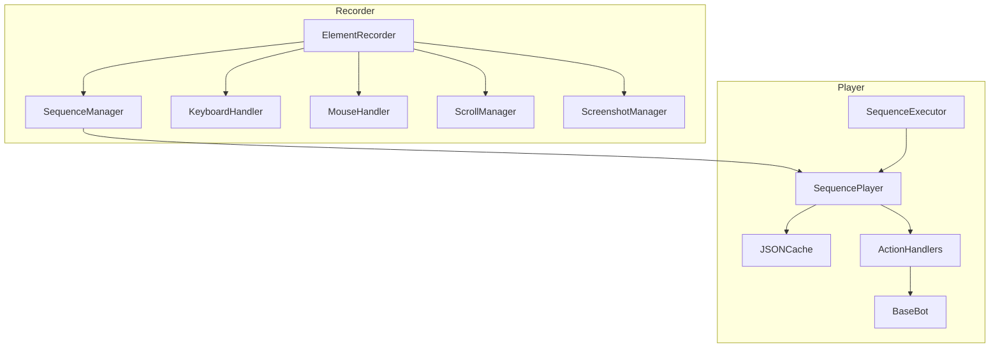

**Diagram sources**
- [element_recorder.py:11-25](file://LoOper/recorder/element_recorder.py#L11-L25)
- [sequence_manager.py:18-24](file://LoOper/recorder/sequence_manager.py#L18-L24)
- [keyboard_handler.py:6-18](file://LoOper/recorder/keyboard_handler.py#L6-L18)
- [mouse_handler.py:6-17](file://LoOper/recorder/mouse_handler.py#L6-L17)
- [scroll_manager.py:4-12](file://LoOper/recorder/scroll_manager.py#L4-L12)
- [screenshot_manager.py:10-19](file://LoOper/recorder/screenshot_manager.py#L10-L19)
- [sequence_player.py:136-161](file://LoOper/player/sequence_player.py#L136-L161)
- [json_cache.py:15-28](file://LoOper/player/json_cache.py#L15-L28)
- [sequence_executor.py:17-25](file://LoOper/player/multi_sequence/sequence_executor.py#L17-L25)
- [action_handlers.py:242-270](file://LoOper/player/action_handlers.py#L242-L270)
- [base_bot.py:242-270](file://LoOper/player/base_bot.py#L242-L270)

**Section sources**
- [element_recorder.py:11-25](file://LoOper/recorder/element_recorder.py#L11-L25)
- [sequence_manager.py:18-24](file://LoOper/recorder/sequence_manager.py#L18-L24)
- [sequence_player.py:136-161](file://LoOper/player/sequence_player.py#L136-L161)
- [json_cache.py:15-28](file://LoOper/player/json_cache.py#L15-L28)

## Core Components
- SequenceManager: central coordinator for appending actions, attaching app context, and persisting sequences to JSON with metadata.
- ElementRecorder: orchestrates capture of mouse, keyboard, scroll, and screenshot events, then forwards actions to SequenceManager.
- ScrollManager: aggregates scroll deltas into cohesive scroll bursts with timing and direction.
- KeyboardHandler: tracks modifiers and converts keystrokes, clipboard shortcuts, and typed strings into normalized actions.
- MouseHandler: detects clicks, double-clicks, and drags; emits standardized action dictionaries.
- ScreenshotManager: captures small regions around click coordinates for visual context.
- SequencePlayer: loads and executes sequences with caching and optimized JSON parsing.
- JSONCache: centralized cache for chains and sequences to avoid repeated IO and parsing.
- SequenceExecutor: resolves expected app context and ensures target applications are ready before playback.
- ActionHandlers and BaseBot: dispatch actions to platform-specific handlers and bots.

**Section sources**
- [sequence_manager.py:18-178](file://LoOper/recorder/sequence_manager.py#L18-L178)
- [element_recorder.py:11-155](file://LoOper/recorder/element_recorder.py#L11-L155)
- [scroll_manager.py:4-97](file://LoOper/recorder/scroll_manager.py#L4-L97)
- [keyboard_handler.py:6-197](file://LoOper/recorder/keyboard_handler.py#L6-L197)
- [mouse_handler.py:6-167](file://LoOper/recorder/mouse_handler.py#L6-L167)
- [screenshot_manager.py:10-49](file://LoOper/recorder/screenshot_manager.py#L10-L49)
- [sequence_player.py:136-252](file://LoOper/player/sequence_player.py#L136-L252)
- [json_cache.py:15-584](file://LoOper/player/json_cache.py#L15-L584)
- [sequence_executor.py:17-121](file://LoOper/player/multi_sequence/sequence_executor.py#L17-L121)
- [action_handlers.py:242-270](file://LoOper/player/action_handlers.py#L242-L270)
- [base_bot.py:242-270](file://LoOper/player/base_bot.py#L242-L270)

## Architecture Overview
The recorder captures user interactions and builds a chronological sequence of actions. The player loads and executes these actions efficiently, leveraging caches and optimized IO.

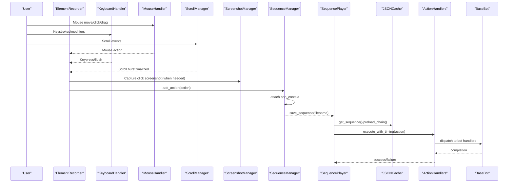

**Diagram sources**
- [element_recorder.py:32-155](file://LoOper/recorder/element_recorder.py#L32-L155)
- [keyboard_handler.py:29-197](file://LoOper/recorder/keyboard_handler.py#L29-L197)
- [mouse_handler.py:25-167](file://LoOper/recorder/mouse_handler.py#L25-L167)
- [scroll_manager.py:13-97](file://LoOper/recorder/scroll_manager.py#L13-L97)
- [screenshot_manager.py:21-49](file://LoOper/recorder/screenshot_manager.py#L21-L49)
- [sequence_manager.py:125-178](file://LoOper/recorder/sequence_manager.py#L125-L178)
- [sequence_player.py:162-252](file://LoOper/player/sequence_player.py#L162-L252)
- [json_cache.py:163-212](file://LoOper/player/json_cache.py#L163-L212)
- [action_handlers.py:242-270](file://LoOper/player/action_handlers.py#L242-L270)
- [base_bot.py:242-270](file://LoOper/player/base_bot.py#L242-L270)

## Detailed Component Analysis

### SequenceManager: Action Collection, App Context, and Serialization
- Chronological ordering: actions are appended in the order received.
- App context attachment: enriches actions with active window/process metadata when available.
- Serialization: writes a JSON structure with metadata and action list; clears caches post-save to keep chains synchronized.

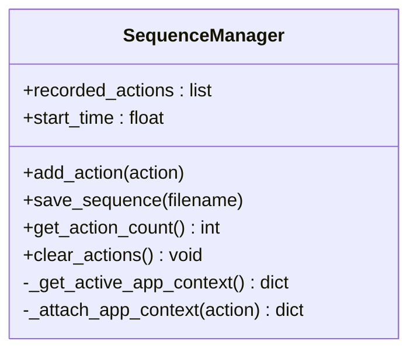

**Diagram sources**
- [sequence_manager.py:18-178](file://LoOper/recorder/sequence_manager.py#L18-L178)

**Section sources**
- [sequence_manager.py:18-178](file://LoOper/recorder/sequence_manager.py#L18-L178)

### ElementRecorder: Coordinated Capture and Action Dispatch
- Orchestrates handlers and screenshot manager, then forwards actions to SequenceManager.
- Specialized behaviors:
  - Clicks: supports absolute click, ctrl-click, shift-click variants based on modifier keys.
  - Scroll: delegates to ScrollManager to finalize bursts.
  - Keyboard: flushes typed strings and records clipboard shortcuts as separate actions.
  - Mouse move with right Ctrl: captures start/end positions to emit a move_to action on release.

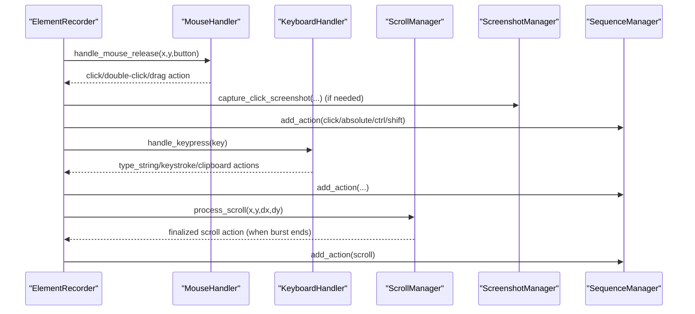

**Diagram sources**
- [element_recorder.py:32-155](file://LoOper/recorder/element_recorder.py#L32-L155)
- [mouse_handler.py:44-167](file://LoOper/recorder/mouse_handler.py#L44-L167)
- [keyboard_handler.py:29-197](file://LoOper/recorder/keyboard_handler.py#L29-L197)
- [scroll_manager.py:13-97](file://LoOper/recorder/scroll_manager.py#L13-L97)
- [screenshot_manager.py:21-49](file://LoOper/recorder/screenshot_manager.py#L21-L49)
- [sequence_manager.py:125-137](file://LoOper/recorder/sequence_manager.py#L125-L137)

**Section sources**
- [element_recorder.py:11-155](file://LoOper/recorder/element_recorder.py#L11-L155)

### ScrollManager: Burst-Based Scroll Grouping
- Aggregates scroll events within a short timeout and same-direction constraint.
- Emits a single scroll action with cumulative delta, start/end positions, duration, and step count.

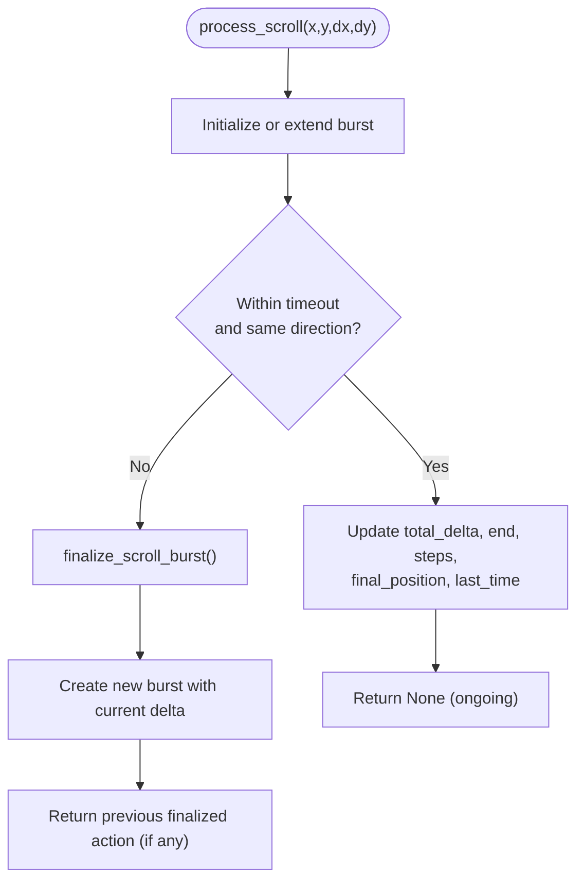

**Diagram sources**
- [scroll_manager.py:13-97](file://LoOper/recorder/scroll_manager.py#L13-L97)

**Section sources**
- [scroll_manager.py:4-97](file://LoOper/recorder/scroll_manager.py#L4-L97)

### KeyboardHandler: Modifier-Aware Typing and Clipboard Actions
- Tracks modifier keys and converts Ctrl+C/X/V/A/Z/Y into clipboard actions.
- Buffers typed characters into a string buffer and flushes to a type_string action when needed.
- Records standalone control keys as keystroke actions.

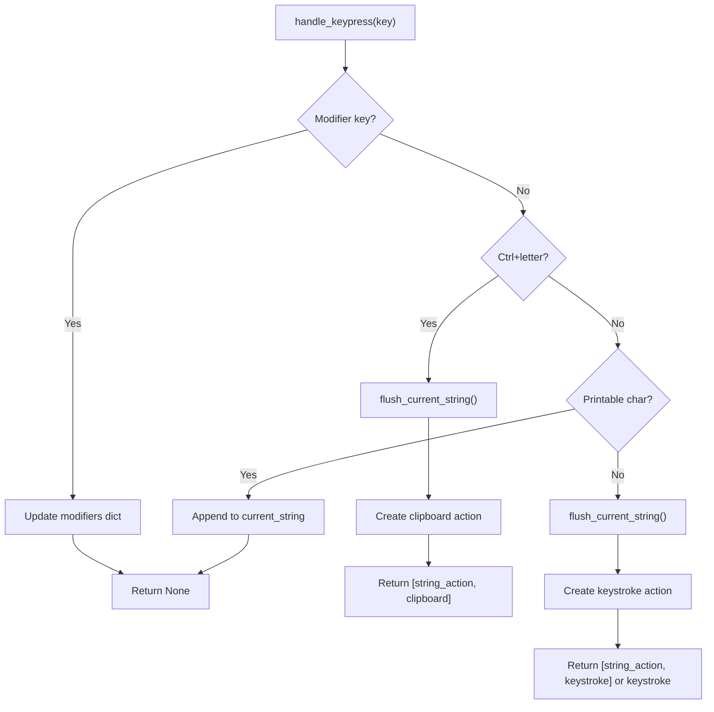

**Diagram sources**
- [keyboard_handler.py:29-197](file://LoOper/recorder/keyboard_handler.py#L29-L197)

**Section sources**
- [keyboard_handler.py:6-197](file://LoOper/recorder/keyboard_handler.py#L6-L197)

### MouseHandler: Click, Double-Click, and Drag Detection
- Detects double-clicks within a time and spatial threshold.
- Treats small movements as clicks; larger movements as drag_drop.
- Emits click actions with a needs_screenshot flag for later capture.

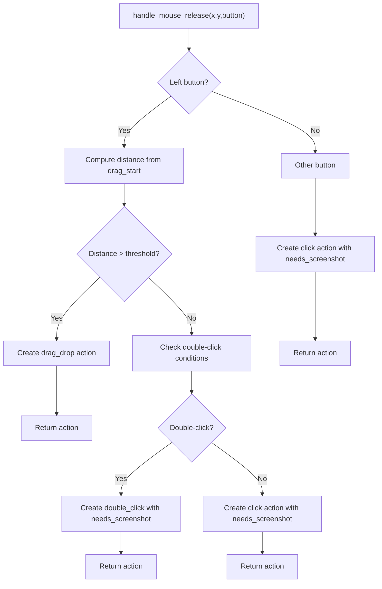

**Diagram sources**
- [mouse_handler.py:44-167](file://LoOper/recorder/mouse_handler.py#L44-L167)

**Section sources**
- [mouse_handler.py:6-167](file://LoOper/recorder/mouse_handler.py#L6-L167)

### ScreenshotManager: Visual Context for Clicks
- Captures a small square region around click coordinates and saves a PNG file.
- Returns the saved path for inclusion in click actions.

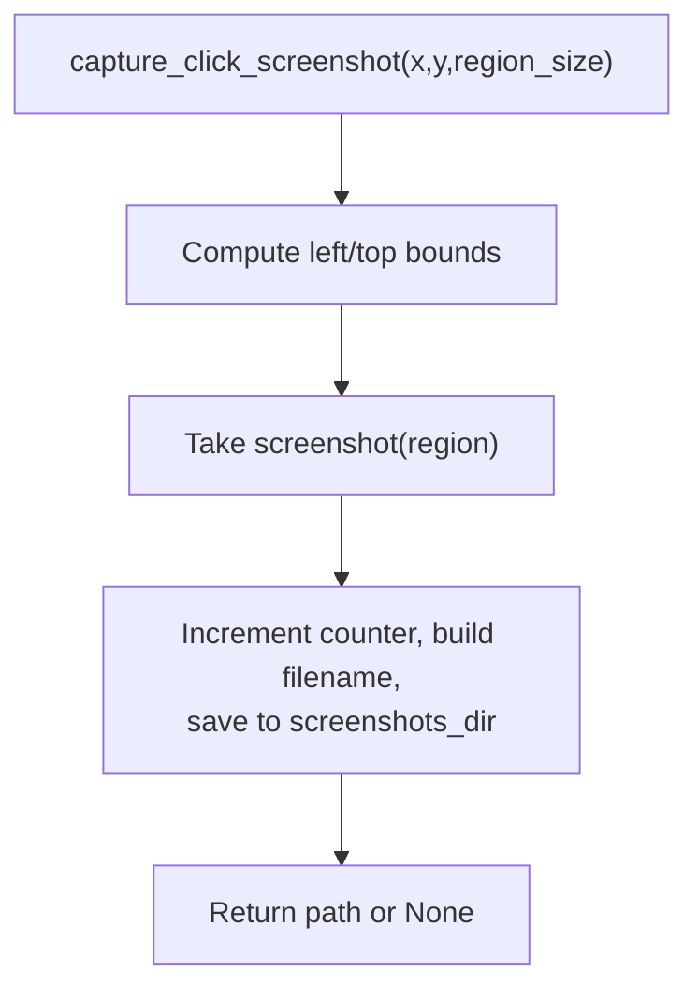

**Diagram sources**
- [screenshot_manager.py:21-49](file://LoOper/recorder/screenshot_manager.py#L21-L49)

**Section sources**
- [screenshot_manager.py:10-49](file://LoOper/recorder/screenshot_manager.py#L10-L49)

### SequencePlayer: Playback with Caching and Fast JSON Loading
- Uses a thread-safe SequenceCache to avoid repeated file IO and parsing.
- Implements optimized JSON loading with buffer sizing and streaming for large files.
- Supports lazy loading and validates sequence structure before playback.

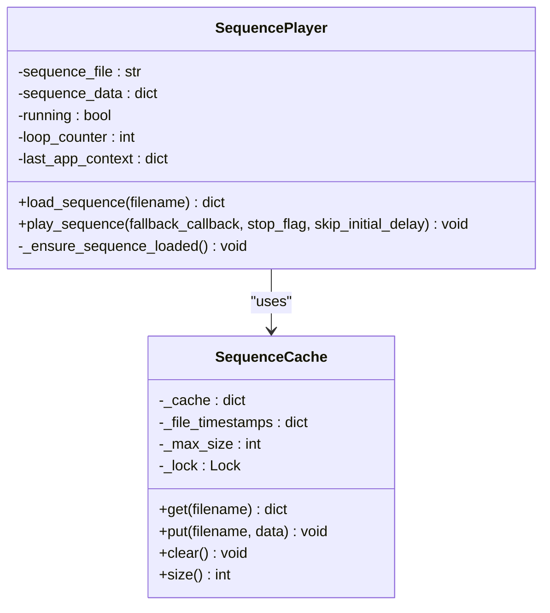

**Diagram sources**
- [sequence_player.py:14-92](file://LoOper/player/sequence_player.py#L14-L92)
- [sequence_player.py:136-252](file://LoOper/player/sequence_player.py#L136-L252)

**Section sources**
- [sequence_player.py:14-92](file://LoOper/player/sequence_player.py#L14-L92)
- [sequence_player.py:136-252](file://LoOper/player/sequence_player.py#L136-L252)

### JSONCache: Centralized Chain and Sequence Caching
- Preloads chains and all referenced sequences to minimize runtime IO.
- Provides path resolution strategies for flexible sequence locations.
- Supports invalidation and dependency tracking to keep caches consistent.

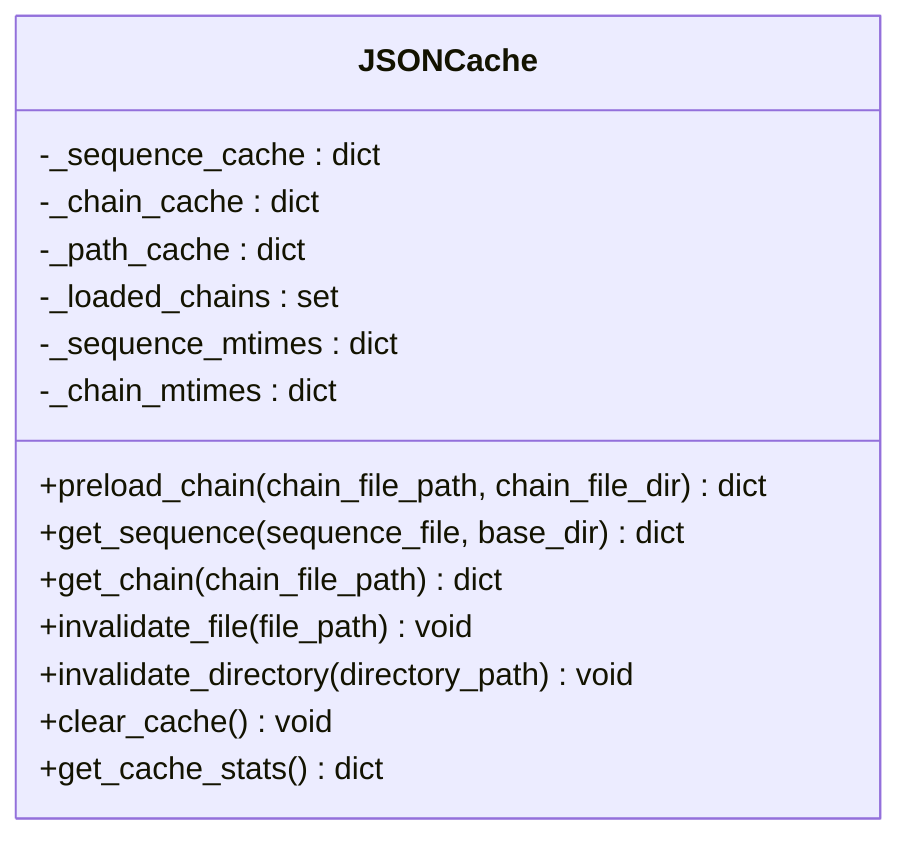

**Diagram sources**
- [json_cache.py:15-584](file://LoOper/player/json_cache.py#L15-L584)

**Section sources**
- [json_cache.py:15-584](file://LoOper/player/json_cache.py#L15-L584)

### SequenceExecutor: App Context Awareness and Foreground Management
- Extracts expected app context from actions and ensures the target application is in the foreground.
- Handles sandboxed execution and RDP agent scenarios for reliable playback.

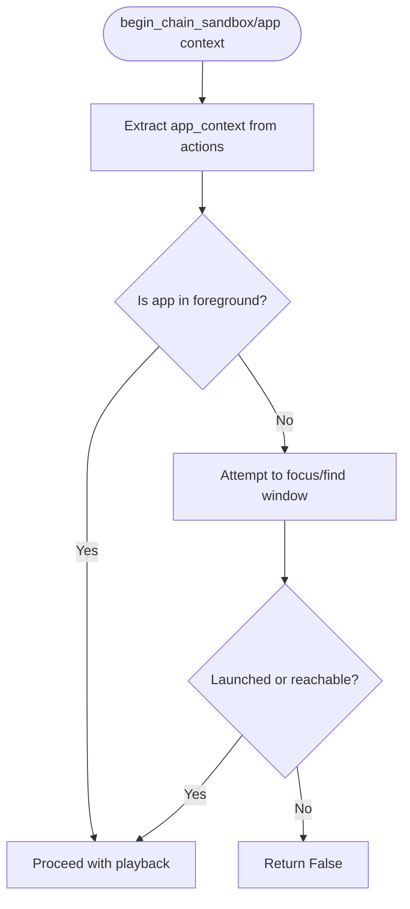

**Diagram sources**
- [sequence_executor.py:26-121](file://LoOper/player/multi_sequence/sequence_executor.py#L26-L121)

**Section sources**
- [sequence_executor.py:17-121](file://LoOper/player/multi_sequence/sequence_executor.py#L17-L121)

### Action Dispatch and Execution
- BaseBot routes actions to specialized handlers based on type.
- ActionHandlers implement platform-specific execution (clicks, scrolls, keystrokes, clipboard, drag).

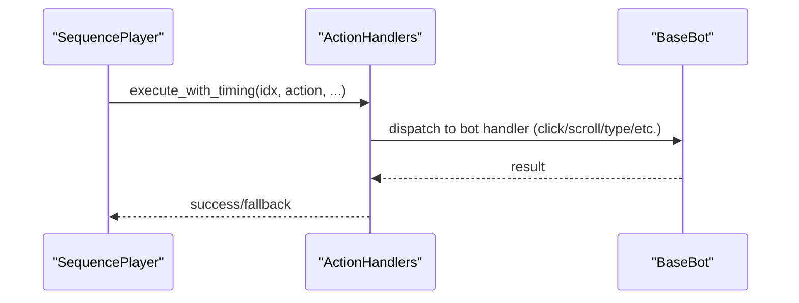

**Diagram sources**
- [base_bot.py:242-270](file://LoOper/player/base_bot.py#L242-L270)
- [action_handlers.py:538-561](file://LoOper/player/action_handlers.py#L538-L561)

**Section sources**
- [base_bot.py:242-270](file://LoOper/player/base_bot.py#L242-L270)
- [action_handlers.py:538-561](file://LoOper/player/action_handlers.py#L538-L561)

## Dependency Analysis
- ElementRecorder depends on all handlers and SequenceManager; it also coordinates ScreenshotManager for click actions.
- SequenceManager depends on JSONCache for cache invalidation after saving sequences.
- SequencePlayer depends on JSONCache for fast retrieval and on ActionHandlers/BaseBot for execution.
- SequenceExecutor depends on app context extraction and OS/windowing APIs to ensure proper foreground state.

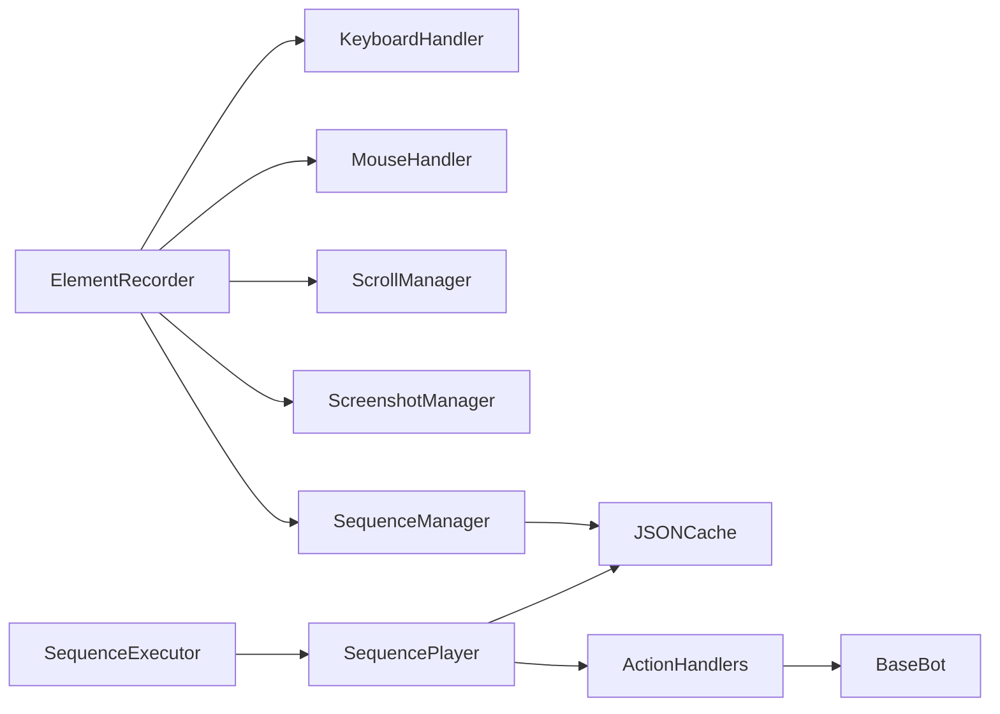

**Diagram sources**
- [element_recorder.py:14-21](file://LoOper/recorder/element_recorder.py#L14-L21)
- [sequence_manager.py:8-16](file://LoOper/recorder/sequence_manager.py#L8-L16)
- [sequence_player.py:12-14](file://LoOper/player/sequence_player.py#L12-L14)
- [sequence_executor.py:17-25](file://LoOper/player/multi_sequence/sequence_executor.py#L17-L25)

**Section sources**
- [element_recorder.py:14-21](file://LoOper/recorder/element_recorder.py#L14-L21)
- [sequence_manager.py:8-16](file://LoOper/recorder/sequence_manager.py#L8-L16)
- [sequence_player.py:12-14](file://LoOper/player/sequence_player.py#L12-L14)
- [sequence_executor.py:17-25](file://LoOper/player/multi_sequence/sequence_executor.py#L17-L25)

## Performance Considerations
- Use SequenceCache and JSONCache to avoid repeated file IO and parsing.
- Prefer lazy loading in SequencePlayer when playback is deferred.
- Optimize JSON loading with buffer sizing and streaming for large sequences.
- Keep screenshot capture selective (only for clicks requiring visual context) to reduce IO overhead.
- Minimize cache churn by invalidating only affected files rather than clearing entire caches.

[No sources needed since this section provides general guidance]

## Troubleshooting Guide
Common issues and remedies:
- Sequence integrity
  - Ensure actions include required fields (e.g., actions array) before playback.
  - Verify app_context presence when targeting specific applications.
- Memory management
  - Monitor cache sizes and clear caches when rebuilding chains or sequences.
  - Use JSONCache invalidation for modified files to avoid stale data.
- Long recording sessions
  - Limit screenshot frequency to reduce disk IO.
  - Use lazy loading and caching to keep playback responsive.
- Playback reliability
  - Confirm the target application is in the foreground or use SequenceExecutor’s foreground management.
  - For sandboxed environments, ensure agent reachability and URLs are valid.

**Section sources**
- [sequence_player.py:162-193](file://LoOper/player/sequence_player.py#L162-L193)
- [json_cache.py:404-448](file://LoOper/player/json_cache.py#L404-L448)
- [sequence_executor.py:122-777](file://LoOper/player/multi_sequence/sequence_executor.py#L122-L777)

## Conclusion
The sequence management subsystem integrates capture, serialization, and playback with thoughtful grouping strategies and performance optimizations. By coordinating handlers, managing app context, and leveraging caching, it enables robust, efficient automation workflows. For long sessions and complex chains, rely on the provided caching mechanisms and careful invalidation to maintain integrity and responsiveness.