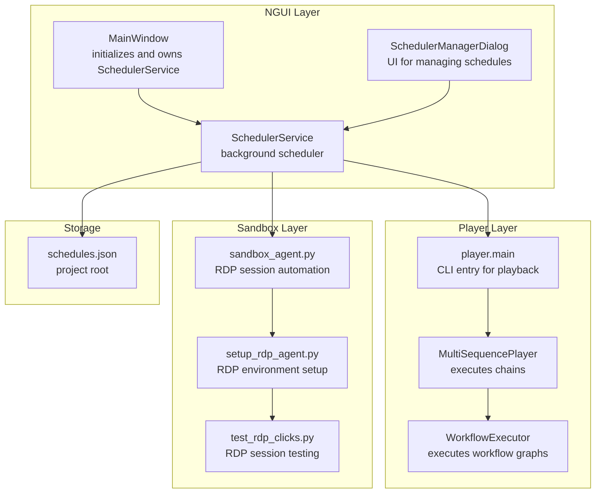
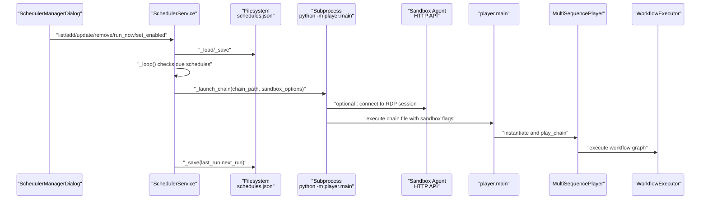
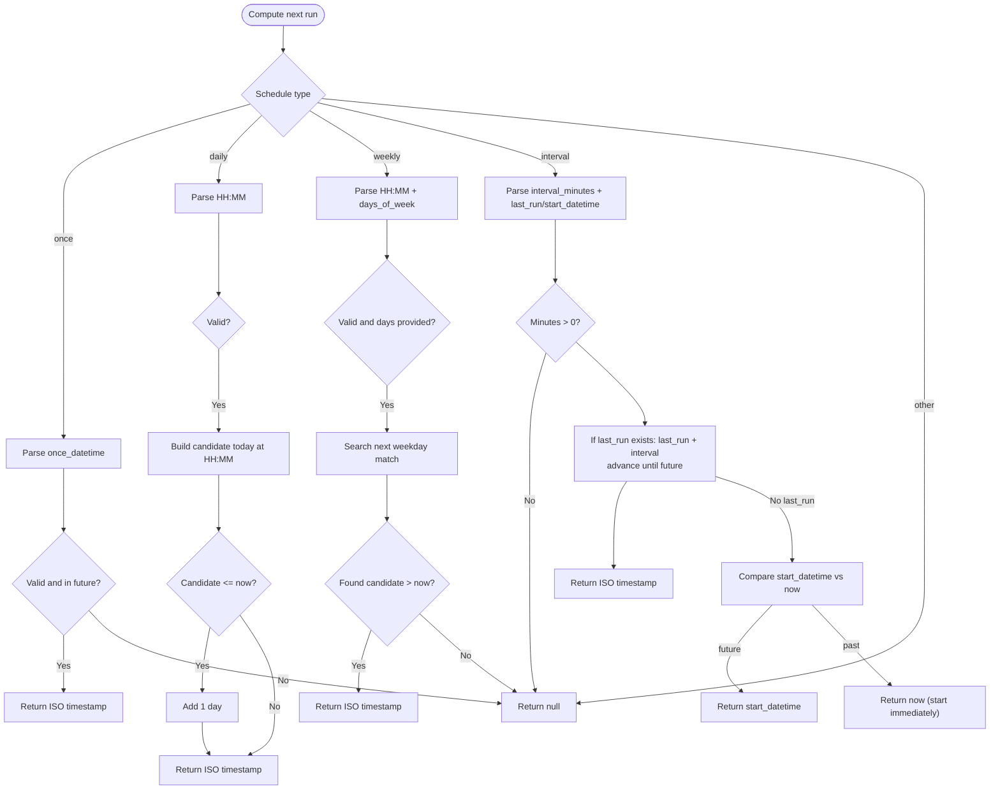
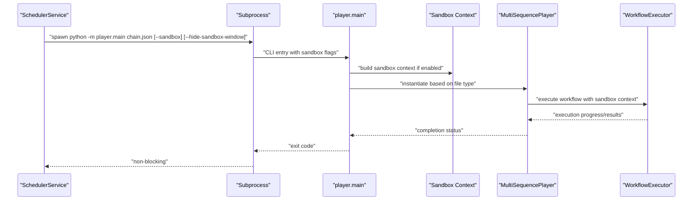
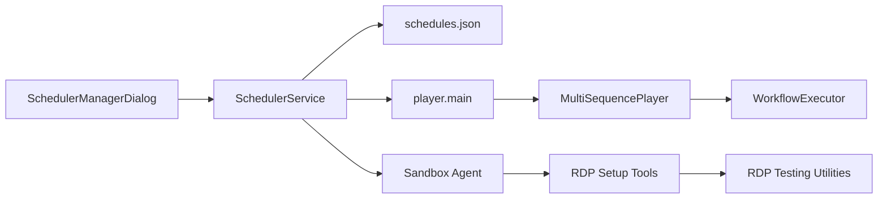

# Scheduler Service

<cite>
**Referenced Files in This Document**
- [scheduler_service.py](file://LoOper/NGUI/scheduler_service.py)
- [scheduler_dialogs.py](file://LoOper/NGUI/dialogs/scheduler_dialogs.py)
- [main_window.py](file://LoOper/NGUI/main_window.py)
- [main.py](file://LoOper/player/main.py)
- [multi_sequence_player.py](file://LoOper/player/multi_sequence_player.py)
- [core.py](file://LoOper/player/multi_sequence/worflow_interpreter_modules/executor_modules/core.py)
- [main.py](file://LoOper/main.py)
- [sandbox_agent.py](file://LoOper/sandbox_agent.py)
- [setup_rdp_agent.py](file://LoOper/setup_rdp_agent.py)
- [test_rdp_clicks.py](file://LoOper/test_rdp_clicks.py)
</cite>

## Update Summary
**Changes Made**
- Added comprehensive documentation for sandbox execution capabilities
- Updated scheduler service to support run_in_sandbox and show_sandbox_window configuration options
- Added visual indicators for sandbox status in the scheduler UI
- Documented command-line argument support for sandbox execution
- Added RDP session isolation and background automation capabilities

## Table of Contents
1. [Introduction](#introduction)
2. [Project Structure](#project-structure)
3. [Core Components](#core-components)
4. [Architecture Overview](#architecture-overview)
5. [Detailed Component Analysis](#detailed-component-analysis)
6. [Sandbox Execution Capabilities](#sandbox-execution-capabilities)
7. [Dependency Analysis](#dependency-analysis)
8. [Performance Considerations](#performance-considerations)
9. [Troubleshooting Guide](#troubleshooting-guide)
10. [Conclusion](#conclusion)

## Introduction
This document explains the scheduler service component responsible for automated workflow execution. It covers cron-like scheduling, persistent storage, execution tracking, schedule types (once, daily, weekly, interval), and integration with the workflow execution system. The scheduler now includes enhanced sandbox execution capabilities for running chains in isolated RDP sessions, providing background automation without interfering with the user's desktop environment. It also documents how schedules are configured via the visual workflow builder and managed through the scheduler UI, and how scheduled tasks are launched as subprocesses with optional sandbox isolation.

## Project Structure
The scheduler lives in the NGUI layer and integrates with the player subsystem to execute chains. The main application initializes the scheduler and exposes a UI to manage schedules. The sandbox execution system adds RDP session isolation for background automation.



**Diagram sources**
- [main_window.py:106-114](file://LoOper/NGUI/main_window.py#L106-L114)
- [scheduler_service.py:20-31](file://LoOper/NGUI/scheduler_service.py#L20-L31)
- [scheduler_dialogs.py:15-126](file://LoOper/NGUI/dialogs/scheduler_dialogs.py#L15-L126)
- [main.py:18-86](file://LoOper/player/main.py#L18-L86)
- [multi_sequence_player.py:304-310](file://LoOper/player/multi_sequence_player.py#L304-L310)
- [core.py:14-98](file://LoOper/player/multi_sequence/worflow_interpreter_modules/executor_modules/core.py#L14-L98)
- [sandbox_agent.py:1-157](file://LoOper/sandbox_agent.py#L1-157)
- [setup_rdp_agent.py:1-208](file://LoOper/setup_rdp_agent.py#L1-208)
- [test_rdp_clicks.py:1-382](file://LoOper/test_rdp_clicks.py#L1-382)

**Section sources**
- [main_window.py:106-114](file://LoOper/NGUI/main_window.py#L106-L114)
- [scheduler_service.py:20-31](file://LoOper/NGUI/scheduler_service.py#L20-L31)

## Core Components
- SchedulerService: Background thread that evaluates schedules, launches executions, persists state, and tracks running jobs. Now includes sandbox execution capabilities.
- SchedulerManagerDialog: UI for listing, adding, editing, enabling/disabling, deleting, and manually running schedules with sandbox configuration options.
- player.main: CLI entry that loads a chain file and executes it via MultiSequencePlayer and WorkflowExecutor, with optional sandbox mode support.
- MainWindow: Initializes the scheduler and exposes the "Manage Schedules" menu.
- Sandbox Agent: HTTP-based automation agent that runs in RDP sessions for background execution.
- RDP Setup Tools: Scripts for configuring Windows RDP environment for sandbox execution.

Key responsibilities:
- Schedule types and computation of next run time.
- Persistence to a JSON file in the project root.
- Subprocess launching of chain execution with optional sandbox isolation.
- Execution tracking and concurrency protection.
- RDP session management and sandbox status visualization.

**Section sources**
- [scheduler_service.py:12-31](file://LoOper/NGUI/scheduler_service.py#L12-L31)
- [scheduler_dialogs.py:15-126](file://LoOper/NGUI/dialogs/scheduler_dialogs.py#L15-L126)
- [main_window.py:736-744](file://LoOper/NGUI/main_window.py#L736-L744)
- [main.py:18-86](file://LoOper/player/main.py#L18-L86)
- [sandbox_agent.py:1-157](file://LoOper/sandbox_agent.py#L1-157)
- [setup_rdp_agent.py:1-208](file://LoOper/setup_rdp_agent.py#L1-208)

## Architecture Overview
The scheduler runs continuously in a dedicated thread, periodically scanning for due schedules. When due, it launches the chain as a subprocess with optional sandbox isolation and updates schedule metadata. The player subsystem loads and executes the chain according to its type (single sequence, legacy chain config, or workflow chain). The sandbox execution system provides isolated RDP sessions for background automation.



**Diagram sources**
- [scheduler_service.py:112-182](file://LoOper/NGUI/scheduler_service.py#L112-L182)
- [scheduler_service.py:184-210](file://LoOper/NGUI/scheduler_service.py#L184-L210)
- [main.py:18-86](file://LoOper/player/main.py#L18-L86)
- [multi_sequence_player.py:304-310](file://LoOper/player/multi_sequence_player.py#L304-L310)
- [core.py:14-98](file://LoOper/player/multi_sequence/worflow_interpreter_modules/executor_modules/core.py#L14-L98)
- [sandbox_agent.py:14-157](file://LoOper/sandbox_agent.py#L14-157)

## Detailed Component Analysis

### SchedulerService
Responsibilities:
- Background loop that evaluates due schedules.
- Computes next run time for each schedule type.
- Persists schedules to JSON and restores on startup.
- Launches chain execution as a subprocess with optional sandbox configuration.
- Tracks currently running schedules to avoid concurrent runs.

Public API highlights:
- start/stop: lifecycle control.
- list_schedules/get_schedule: read-only views with human-readable next run.
- add_schedule/update_schedule/remove_schedule: CRUD with recomputation of next_run.
- set_enabled: toggles schedule and recomputes next_run if enabled.
- run_now: launches a schedule immediately and advances next_run for recurring schedules.

Execution flow:
- _loop scans schedules under lock, collects due IDs, then launches each due schedule outside the lock.
- _launch_chain resolves absolute path, validates existence, and spawns player.main as a subprocess with optional sandbox arguments.
- After successful launch, updates last_run and next_run; disables one-time schedules.

**Updated** Enhanced with sandbox execution support including run_in_sandbox and show_sandbox_window configuration options.

Concurrency and safety:
- Uses an RLock to guard shared state.
- Tracks running schedules in a set to prevent overlapping runs.
- Removes entries from the running set even on exceptions.

Persistence:
- Loads from and saves to a JSON file named schedules.json in the project root.
- Normalizes legacy list format to dictionary keyed by id.
- Stores sandbox configuration options (run_in_sandbox, show_sandbox_window).

Validation and error handling:
- Validates presence of chain_path and existence of the file.
- Gracefully skips invalid or missing next_run entries.
- Exceptions during launch do not crash the loop; running set is cleaned up.

**Section sources**
- [scheduler_service.py:34-110](file://LoOper/NGUI/scheduler_service.py#L34-L110)
- [scheduler_service.py:112-182](file://LoOper/NGUI/scheduler_service.py#L112-L182)
- [scheduler_service.py:184-210](file://LoOper/NGUI/scheduler_service.py#L184-L210)
- [scheduler_service.py:211-266](file://LoOper/NGUI/scheduler_service.py#L211-L266)
- [scheduler_service.py:274-297](file://LoOper/NGUI/scheduler_service.py#L274-L297)
- [scheduler_service.py:299-315](file://LoOper/NGUI/scheduler_service.py#L299-L315)

#### Next Run Computation (Flowchart)


**Diagram sources**
- [scheduler_service.py:211-266](file://LoOper/NGUI/scheduler_service.py#L211-L266)

### SchedulerManagerDialog
Responsibilities:
- Lists all schedules with columns for enabled, name, type, when, next run, chain path, sandbox status, and actions.
- Provides controls to add, edit, delete, enable/disable, refresh, and run a schedule immediately.
- Presents a configuration dialog for creating or editing schedules with type-specific fields and sandbox options.

**Updated** Enhanced with sandbox execution configuration including run_in_sandbox and show_sandbox_window options, plus visual indicators for sandbox status.

Configuration dialog supports:
- once: specific date/time picker.
- daily: time picker.
- weekly: time picker and multiple day toggles.
- interval: minutes spinner with start_datetime auto-filled.
- sandbox: toggle switches for run_in_sandbox and show_sandbox_window with explanatory help text.

Actions:
- Run Now: delegates to SchedulerService.run_now.
- Toggle Enabled: delegates to SchedulerService.set_enabled.
- Edit/Delete: delegates to SchedulerService.update_schedule/remove_schedule.

Visual indicators:
- Sandbox column shows "🖥 Visible" for sandbox sessions with visible windows, "🖥 Hidden" for hidden sandbox sessions, or "-" for direct desktop execution.
- Tooltips explain the current sandbox configuration for each schedule.

**Section sources**
- [scheduler_dialogs.py:15-134](file://LoOper/NGUI/dialogs/scheduler_dialogs.py#L15-L134)
- [scheduler_dialogs.py:285-294](file://LoOper/NGUI/dialogs/scheduler_dialogs.py#L285-L294)
- [scheduler_dialogs.py:310-573](file://LoOper/NGUI/dialogs/scheduler_dialogs.py#L310-L573)

### Player Integration
Execution pipeline:
- SchedulerService._launch_chain constructs a command to run player.main with the selected chain file and optional sandbox arguments.
- player.main inspects the file and dispatches to SequencePlayer (single sequence), legacy MultiSequencePlayer (list format), or modern MultiSequencePlayer (dict with sequences and conditional nodes).
- MultiSequencePlayer initializes and runs WorkflowExecutor to traverse and execute the workflow graph.
- When sandbox mode is enabled, player.main creates a global_app_context_override with sandboxed=True and show_window settings.

**Updated** Enhanced with sandbox execution support through command-line arguments and global application context override.



**Diagram sources**
- [scheduler_service.py:184-210](file://LoOper/NGUI/scheduler_service.py#L184-L210)
- [main.py:18-86](file://LoOper/player/main.py#L18-L86)
- [multi_sequence_player.py:304-310](file://LoOper/player/multi_sequence_player.py#L304-L310)
- [core.py:14-98](file://LoOper/player/multi_sequence/worflow_interpreter_modules/executor_modules/core.py#L14-L98)

**Section sources**
- [scheduler_service.py:184-210](file://LoOper/NGUI/scheduler_service.py#L184-L210)
- [main.py:18-86](file://LoOper/player/main.py#L18-L86)
- [multi_sequence_player.py:304-310](file://LoOper/player/multi_sequence_player.py#L304-L310)
- [core.py:14-98](file://LoOper/player/multi_sequence/worflow_interpreter_modules/executor_modules/core.py#L14-L98)

### Schedule Types and Examples
- once
  - Fields: type=once, once_datetime (ISO), chain_path.
  - Behavior: runs exactly once at the specified time; disables itself after run.
- daily
  - Fields: type=daily, daily_time (HH:MM), chain_path.
  - Behavior: runs every day at the specified time; next run computed as tomorrow if today's candidate has passed.
- weekly
  - Fields: type=weekly, weekly_time (HH:MM), days_of_week (list of integers 0–6), chain_path.
  - Behavior: finds the next occurrence on one of the selected weekdays at the specified time.
- interval
  - Fields: type=interval, interval_minutes (>0), start_datetime (ISO), chain_path.
  - Behavior: runs every N minutes; if last_run exists, next_run = last_run + interval (advanced to future); otherwise uses start_datetime if in future or now if in the past.

Examples from the UI:
- Creating a daily schedule sets daily_time and enables the schedule.
- Creating a weekly schedule selects days and sets weekly_time.
- Creating an interval schedule sets interval_minutes and start_datetime.

**Section sources**
- [scheduler_dialogs.py:375-432](file://LoOper/NGUI/dialogs/scheduler_dialogs.py#L375-L432)
- [scheduler_service.py:211-266](file://LoOper/NGUI/scheduler_service.py#L211-L266)

### Execution Tracking and Concurrency
- Running set: SchedulerService tracks currently executing schedule IDs to avoid overlapping runs.
- Double-checked due verification: re-validates enabled and next_run timestamps before launching.
- Atomic updates: last_run and next_run are updated only after successful launch.
- Persistence: _save writes the latest state to schedules.json.

**Section sources**
- [scheduler_service.py:112-182](file://LoOper/NGUI/scheduler_service.py#L112-L182)
- [scheduler_service.py:292-297](file://LoOper/NGUI/scheduler_service.py#L292-L297)

## Sandbox Execution Capabilities

### Overview
The scheduler now supports running chains in isolated RDP sessions through a comprehensive sandbox execution system. This allows background automation without interfering with the user's desktop environment, providing true isolation for sensitive operations.

### Key Features
- **RDP Session Isolation**: Chains run in separate Windows RDP sessions, preventing interference with foreground desktop activities.
- **Background Execution**: Hidden RDP sessions can run without displaying windows, ideal for unattended automation.
- **HTTP-Based Control**: A sandbox agent provides HTTP endpoints for mouse clicks, keyboard input, screenshots, and other automation actions.
- **Session Management**: Automatic RDP session setup and teardown with configurable persistence options.

### Configuration Options

#### Schedule-Level Configuration
- **run_in_sandbox**: Boolean flag to enable sandbox execution for a specific schedule.
- **show_sandbox_window**: Boolean flag controlling whether the RDP session window is visible (default: True).

#### Command-Line Arguments
- **--sandbox**: Enable sandbox mode for direct player execution.
- **--show-sandbox-window**: Show the RDP sandbox window (default behavior).
- **--hide-sandbox-window**: Hide the RDP sandbox window for background execution.

### Implementation Details

#### Sandbox Agent
The sandbox agent provides HTTP-based automation capabilities:
- **POST /action**: Handles various automation actions (click, type, hotkey, screenshot, scroll, drag operations).
- **Screenshot Capture**: Captures screen images from the RDP session for visual feedback.
- **Mouse and Keyboard Control**: Direct control over mouse movements and keyboard input.
- **HTTP Server**: Runs on configurable ports with automatic IP detection.

#### RDP Environment Setup
The setup script configures the Windows RDP environment:
- **RDPWrap Installation**: Enables hidden background RDP sessions.
- **Agent User Creation**: Creates a dedicated "LoOperAgent" user account.
- **Firewall Configuration**: Opens necessary ports for RDP connectivity.
- **Registry Modifications**: Configures Windows Terminal Services for automation support.

#### Session Lifecycle Management
- **Automatic Session Creation**: RDP sessions are created on-demand for sandboxed chains.
- **Resource Cleanup**: Sessions are properly terminated when no longer needed.
- **Connection Persistence**: Optional session persistence for long-running automation tasks.

### Usage Examples

#### Programmatic Configuration
```python
# Schedule with visible sandbox window
schedule = {
    'name': 'Background Task',
    'type': 'daily',
    'daily_time': '02:00',
    'chain_path': 'chains/background_task.json',
    'run_in_sandbox': True,
    'show_sandbox_window': True
}

# Schedule with hidden sandbox window
schedule_hidden = {
    'name': 'Unattended Task',
    'type': 'interval',
    'interval_minutes': 30,
    'chain_path': 'chains/unattended_task.json',
    'run_in_sandbox': True,
    'show_sandbox_window': False
}
```

#### Command-Line Usage
```bash
# Run a chain in sandbox with visible window
python -m player.main chain.json --sandbox

# Run a chain in hidden sandbox mode
python -m player.main chain.json --sandbox --hide-sandbox-window

# Run a chain in normal desktop mode
python -m player.main chain.json
```

### Visual Indicators
The scheduler UI displays sandbox status with clear visual indicators:
- **"🖥 Visible"**: Chain runs in RDP sandbox with visible window
- **"🖥 Hidden"**: Chain runs in RDP sandbox with hidden window  
- **"-"**: Chain runs directly on desktop without sandbox

### Integration Points
- **Scheduler Service**: Automatically adds sandbox arguments when run_in_sandbox is enabled.
- **Player Main**: Processes sandbox command-line arguments and creates sandbox context.
- **MultiSequencePlayer**: Applies sandbox context globally to all workflow execution.
- **Workflow Executor**: Executes chains within the sandboxed application context.

**Section sources**
- [scheduler_service.py:184-210](file://LoOper/NGUI/scheduler_service.py#L184-L210)
- [main.py:22-28](file://LoOper/player/main.py#L22-L28)
- [main.py:63-73](file://LoOper/player/main.py#L63-L73)
- [sandbox_agent.py:14-157](file://LoOper/sandbox_agent.py#L14-L157)
- [setup_rdp_agent.py:18-84](file://LoOper/setup_rdp_agent.py#L18-84)
- [test_rdp_clicks.py:269-382](file://LoOper/test_rdp_clicks.py#L269-382)

## Dependency Analysis
- SchedulerService depends on:
  - Filesystem for schedules.json.
  - Python subprocess to launch player.main with optional sandbox arguments.
  - Player entry point and execution pipeline for actual chain execution.
  - Sandbox agent for RDP session automation when sandbox mode is enabled.
- UI depends on SchedulerService for schedule CRUD and immediate execution.
- Player depends on MultiSequencePlayer and WorkflowExecutor to interpret and run chains.
- Sandbox system depends on Windows RDP environment and agent infrastructure.



**Diagram sources**
- [scheduler_service.py:20-31](file://LoOper/NGUI/scheduler_service.py#L20-L31)
- [main.py:18-86](file://LoOper/player/main.py#L18-L86)
- [multi_sequence_player.py:304-310](file://LoOper/player/multi_sequence_player.py#L304-L310)
- [core.py:14-98](file://LoOper/player/multi_sequence/worflow_interpreter_modules/executor_modules/core.py#L14-L98)
- [scheduler_dialogs.py:15-126](file://LoOper/NGUI/dialogs/scheduler_dialogs.py#L15-L126)
- [sandbox_agent.py:1-157](file://LoOper/sandbox_agent.py#L1-157)
- [setup_rdp_agent.py:1-208](file://LoOper/setup_rdp_agent.py#L1-208)
- [test_rdp_clicks.py:1-382](file://LoOper/test_rdp_clicks.py#L1-382)

**Section sources**
- [scheduler_service.py:20-31](file://LoOper/NGUI/scheduler_service.py#L20-L31)
- [main_window.py:106-114](file://LoOper/NGUI/main_window.py#L106-L114)

## Performance Considerations
- Check interval: The scheduler sleeps for a configurable number of seconds between loops; keep it reasonable to balance responsiveness and CPU usage.
- Non-blocking launches: Execution occurs outside the lock to avoid blocking the scheduler loop.
- Minimal parsing: Date/time parsing is lightweight; avoid excessive recomputation by updating only when relevant fields change.
- Persistence: JSON I/O is simple and fast for typical schedule counts; consider batching updates if managing many schedules.
- **Sandbox Overhead**: RDP session creation and management adds overhead; use hidden sandbox mode for background tasks to minimize resource usage.
- **Network Latency**: Sandbox agent communication introduces network latency; design workflows to handle asynchronous execution patterns.

## Troubleshooting Guide
Common issues and resolutions:
- Schedule not running
  - Verify enabled state and next_run value.
  - Confirm chain_path exists and is readable.
  - Check that the schedule type and fields are valid (e.g., interval_minutes > 0).
- Duplicate runs
  - The running set prevents concurrent runs; ensure the previous run completed and next_run was updated.
- One-time schedule still enabled
  - After a successful run, one-time schedules are disabled and next_run cleared; confirm _save succeeded.
- Subprocess failures
  - Ensure player.main is reachable and chain_path is valid; on Linux, xvfb-run is used if available.
- Persistence problems
  - If schedules.json is corrupted, SchedulerService falls back to empty state; verify file permissions and disk space.
- UI not reflecting changes
  - Use Refresh in the scheduler manager dialog to reload schedules.
- **Sandbox Issues**
  - Verify RDPWrap installation and agent user creation.
  - Check firewall configuration for RDP connectivity.
  - Ensure sandbox agent is running and accessible.
  - Test RDP session connectivity with provided utilities.

**Updated** Added troubleshooting guidance for sandbox execution issues.

Operational tips:
- Use Run Now to test a schedule immediately.
- Temporarily increase check_interval_seconds for debugging to reduce churn.
- Monitor logs from the scheduler and player for error messages.
- **Sandbox Debugging**: Use show_sandbox_window=True for development and testing; switch to hidden mode for production.
- **RDP Environment**: Ensure proper RDPWrap installation and agent user configuration before enabling sandbox mode.

**Section sources**
- [scheduler_service.py:112-182](file://LoOper/NGUI/scheduler_service.py#L112-L182)
- [scheduler_service.py:184-210](file://LoOper/NGUI/scheduler_service.py#L184-L210)
- [scheduler_service.py:274-297](file://LoOper/NGUI/scheduler_service.py#L274-L297)
- [setup_rdp_agent.py:166-208](file://LoOper/setup_rdp_agent.py#L166-208)
- [test_rdp_clicks.py:269-382](file://LoOper/test_rdp_clicks.py#L269-382)

## Conclusion
The scheduler service provides a robust, lightweight mechanism for automating LoOper chain execution with enhanced sandbox capabilities. It supports multiple schedule types, persists state to JSON, and integrates seamlessly with the player subsystem. The new sandbox execution system enables isolated RDP session automation for background tasks without interfering with the user's desktop environment. The UI enables straightforward configuration and management with visual sandbox status indicators. With careful validation, concurrency safeguards, clear error handling, and comprehensive sandbox support, it offers a reliable foundation for automated workflows in both foreground and background scenarios.