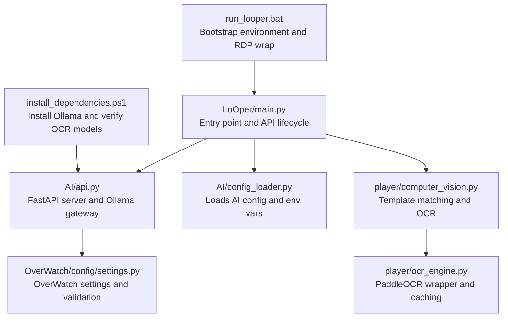
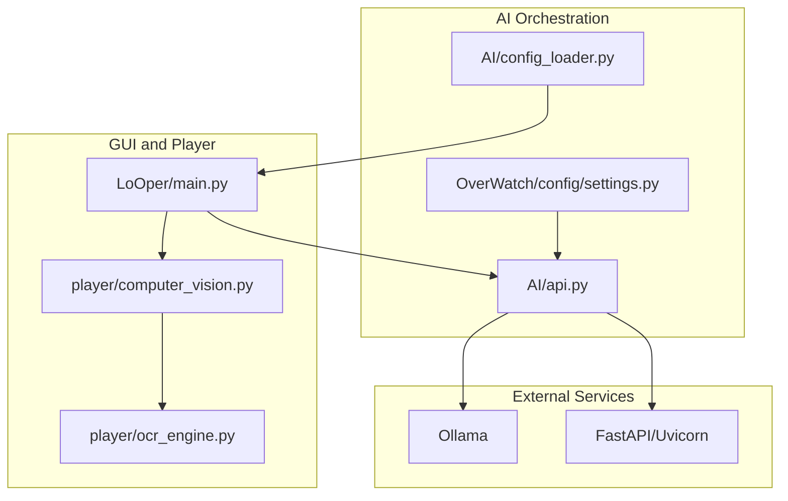
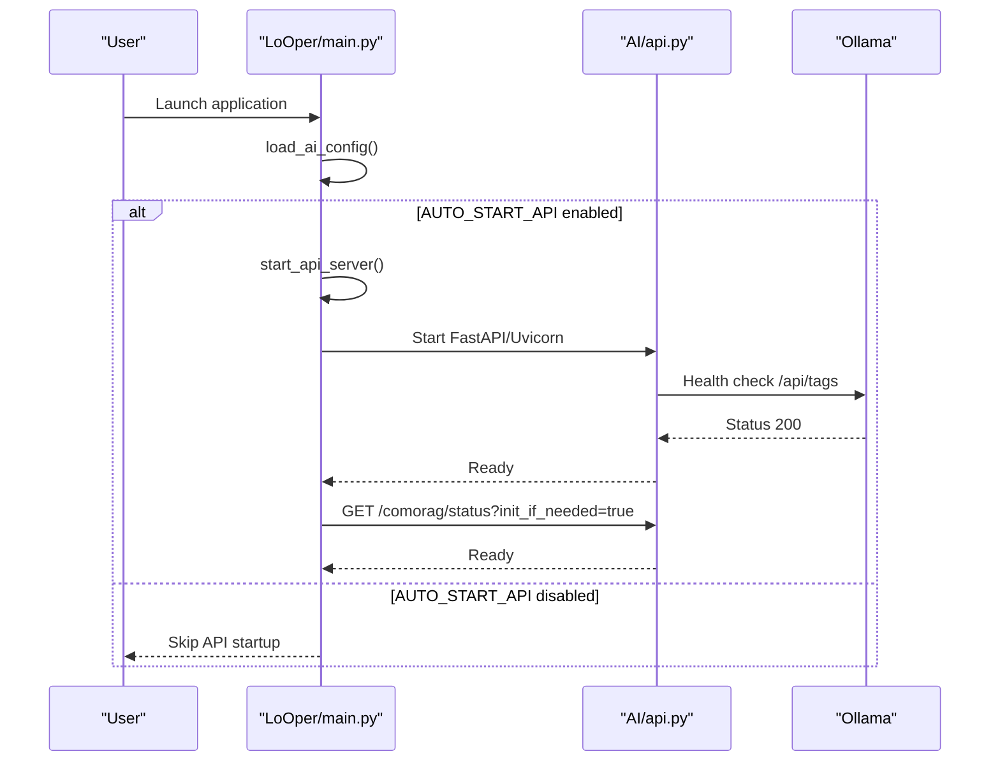
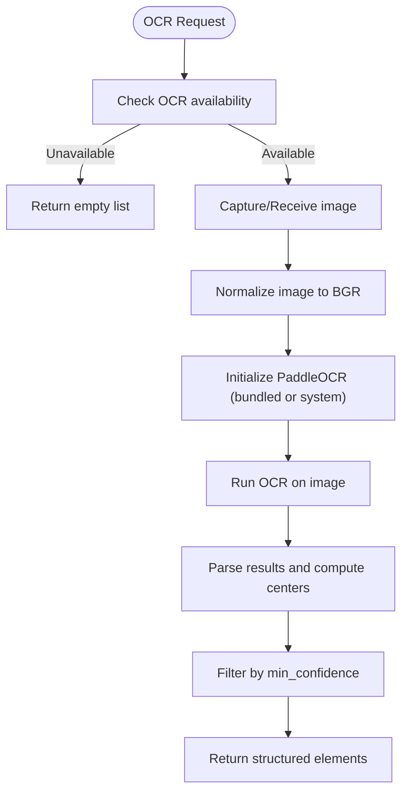
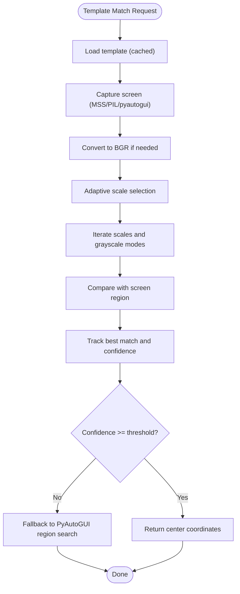
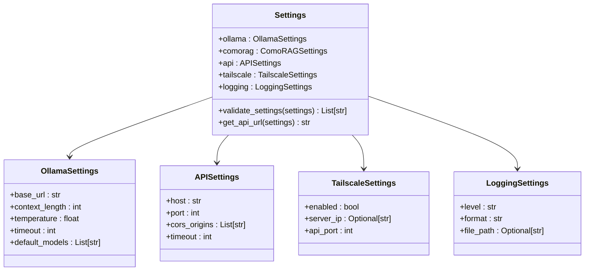
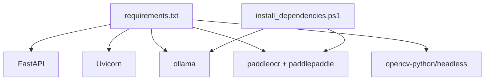

# Troubleshooting and FAQ

<cite>
**Referenced Files in This Document**
- [README.md](file://README.md)
- [requirements.txt](file://requirements.txt)
- [install_dependencies.ps1](file://install_dependencies.ps1)
- [run_looper.bat](file://run_looper.bat)
- [LoOper/main.py](file://LoOper/main.py)
- [LoOper/AI/api.py](file://LoOper/AI/api.py)
- [LoOper/AI/config_loader.py](file://LoOper/AI/config_loader.py)
- [LoOper/AI/OverWatch/config/settings.py](file://LoOper/AI/OverWatch/config/settings.py)
- [LoOper/player/computer_vision.py](file://LoOper/player/computer_vision.py)
- [LoOper/player/ocr_engine.py](file://LoOper/player/ocr_engine.py)
- [automation.log](file://automation.log)
- [run.log](file://run.log)
- [LoOper/run.log](file://LoOper/run.log)
- [LoOper/player/Computer_vision/run.log](file://LoOper/player/Computer_vision/run.log)
</cite>

## Table of Contents
1. [Introduction](#introduction)
2. [Project Structure](#project-structure)
3. [Core Components](#core-components)
4. [Architecture Overview](#architecture-overview)
5. [Detailed Component Analysis](#detailed-component-analysis)
6. [Dependency Analysis](#dependency-analysis)
7. [Performance Considerations](#performance-considerations)
8. [Troubleshooting Guide](#troubleshooting-guide)
9. [Conclusion](#conclusion)
10. [Appendices](#appendices)

## Introduction
This Troubleshooting and FAQ guide focuses on common issues and their solutions for LoOper V2. It covers installation problems (dependency conflicts, Windows compatibility, and Ollama setup), performance troubleshooting (slow execution, memory usage, and computer vision accuracy), configuration errors (AI services, API endpoints, and model management), and debugging techniques (log analysis, error diagnosis, and system monitoring). Step-by-step solutions address frequent scenarios such as failed OCR recognition, LLM connectivity issues, and workflow execution failures. Platform-specific guidance and preventive measures help maintain optimal performance.

## Project Structure
LoOper V2 is organized into modules that support desktop automation, visual workflow authoring, computer vision/OCR, and optional local AI orchestration. Key areas include:
- Application entry and GUI lifecycle
- AI orchestration and API server
- Computer vision and OCR pipeline
- Configuration loading and environment variables
- Installer and dependency bootstrapping scripts

**Diagram sources**
- [LoOper/main.py:1-419](file://LoOper/main.py#L1-L419)
- [LoOper/AI/api.py:1-800](file://LoOper/AI/api.py#L1-L800)
- [LoOper/AI/config_loader.py:1-66](file://LoOper/AI/config_loader.py#L1-L66)
- [LoOper/player/computer_vision.py:1-606](file://LoOper/player/computer_vision.py#L1-L606)
- [LoOper/player/ocr_engine.py:1-367](file://LoOper/player/ocr_engine.py#L1-L367)
- [LoOper/AI/OverWatch/config/settings.py:1-440](file://LoOper/AI/OverWatch/config/settings.py#L1-L440)
- [install_dependencies.ps1:1-62](file://install_dependencies.ps1#L1-L62)
- [run_looper.bat:1-88](file://run_looper.bat#L1-L88)

**Section sources**
- [README.md:107-123](file://README.md#L107-L123)
- [requirements.txt:1-195](file://requirements.txt#L1-L195)

## Core Components
- Application entry and API lifecycle: Initializes environment, starts the API server when configured, and preloads models.
- AI API server: Exposes endpoints for model listing, chat/generation, streaming, and health checks; integrates with Ollama and manages model availability.
- Configuration loader: Reads AI settings from a JSON file and environment variables, sets defaults, and exposes computed API URLs.
- Computer vision and OCR: Provides template matching, region-based search, and OCR text detection with confidence thresholds and stop-flag safety.
- OCR engine: Wraps PaddleOCR, handles model discovery (bundled vs. system), and normalizes results.

**Section sources**
- [LoOper/main.py:135-381](file://LoOper/main.py#L135-L381)
- [LoOper/AI/api.py:547-800](file://LoOper/AI/api.py#L547-L800)
- [LoOper/AI/config_loader.py:9-66](file://LoOper/AI/config_loader.py#L9-L66)
- [LoOper/player/computer_vision.py:47-606](file://LoOper/player/computer_vision.py#L47-L606)
- [LoOper/player/ocr_engine.py:131-367](file://LoOper/player/ocr_engine.py#L131-L367)

## Architecture Overview
The system integrates a GUI application with an optional local API server and AI engines. The API server communicates with Ollama, manages model availability, and exposes endpoints for chat, generation, and health checks. The player module performs computer vision and OCR tasks to locate UI elements and text on screen.

**Diagram sources**
- [LoOper/main.py:135-381](file://LoOper/main.py#L135-L381)
- [LoOper/AI/api.py:547-800](file://LoOper/AI/api.py#L547-L800)
- [LoOper/AI/config_loader.py:9-66](file://LoOper/AI/config_loader.py#L9-L66)
- [LoOper/AI/OverWatch/config/settings.py:265-284](file://LoOper/AI/OverWatch/config/settings.py#L265-L284)
- [LoOper/player/computer_vision.py:47-606](file://LoOper/player/computer_vision.py#L47-L606)
- [LoOper/player/ocr_engine.py:131-367](file://LoOper/player/ocr_engine.py#L131-L367)

## Detailed Component Analysis

### API Server Startup and Health Checks
The GUI entry point can auto-start the API server and verify its readiness, including initializing the ComoRAG engine and refreshing the model cache.

**Diagram sources**
- [LoOper/main.py:135-381](file://LoOper/main.py#L135-L381)
- [LoOper/AI/api.py:581-607](file://LoOper/AI/api.py#L581-L607)

**Section sources**
- [LoOper/main.py:135-381](file://LoOper/main.py#L135-L381)
- [LoOper/AI/api.py:547-607](file://LoOper/AI/api.py#L547-L607)

### OCR Pipeline and Confidence Thresholds
OCR uses PaddleOCR with language normalization and bundled model discovery. Results are filtered by confidence and structured with bounding boxes and centers.

**Diagram sources**
- [LoOper/player/ocr_engine.py:131-367](file://LoOper/player/ocr_engine.py#L131-L367)

**Section sources**
- [LoOper/player/ocr_engine.py:131-367](file://LoOper/player/ocr_engine.py#L131-L367)

### Computer Vision Template Matching and Region Search
Template matching supports multi-scale evaluation and region-based search with adaptive scaling and confidence thresholds. Fallbacks use PyAutoGUI when OpenCV is unavailable.

**Diagram sources**
- [LoOper/player/computer_vision.py:198-450](file://LoOper/player/computer_vision.py#L198-L450)

**Section sources**
- [LoOper/player/computer_vision.py:198-450](file://LoOper/player/computer_vision.py#L198-L450)

### Configuration Loading and Validation
Configuration is loaded from a JSON file and environment variables, with defaults applied. OverWatch settings include validation helpers and environment overrides.

**Diagram sources**
- [LoOper/AI/OverWatch/config/settings.py:16-440](file://LoOper/AI/OverWatch/config/settings.py#L16-L440)

**Section sources**
- [LoOper/AI/config_loader.py:9-66](file://LoOper/AI/config_loader.py#L9-L66)
- [LoOper/AI/OverWatch/config/settings.py:265-440](file://LoOper/AI/OverWatch/config/settings.py#L265-L440)

## Dependency Analysis
Key dependencies include FastAPI/Uvicorn for the API server, Ollama client libraries, PaddleOCR for OCR, and OpenCV for computer vision. The installer script ensures Ollama and OCR assets are present.

**Diagram sources**
- [requirements.txt:1-195](file://requirements.txt#L1-L195)
- [install_dependencies.ps1:1-62](file://install_dependencies.ps1#L1-L62)

**Section sources**
- [requirements.txt:1-195](file://requirements.txt#L1-L195)
- [install_dependencies.ps1:1-62](file://install_dependencies.ps1#L1-L62)

## Performance Considerations
- Computer vision accuracy
  - Increase confidence thresholds cautiously to reduce false positives.
  - Use multi-scale template matching and region-based search to improve robustness.
  - Ensure templates are high contrast and distinct; avoid blurry or low-resolution assets.
- OCR reliability
  - Adjust min_confidence thresholds based on target languages and image quality.
  - Normalize language settings for PaddleOCR to align with expected models.
  - Prefer bundled models when available to avoid model download delays.
- Memory usage
  - Limit concurrent model runs; the API server includes cleanup routines for stopped runners.
  - Reduce model context length and adjust temperature for smaller memory footprints when supported.
- Execution speed
  - Minimize repeated screenshot captures; reuse pre-captured frames when possible.
  - Use region-based search to constrain search areas and reduce computation.
- Windows-specific tips
  - Run with elevated privileges when required by system services.
  - Ensure RDP wrapper and firewall rules are configured for headless or remote sessions.

[No sources needed since this section provides general guidance]

## Troubleshooting Guide

### Installation Problems

- Dependency conflicts
  - Symptom: Import errors or runtime crashes when launching.
  - Solution:
    - Rebuild the virtual environment and reinstall dependencies from the project requirements.
    - Ensure compatible versions of NumPy, OpenCV, and PyTorch are installed.
    - Avoid mixing system and bundled packages; prefer the project’s pinned versions.
  - References:
    - [requirements.txt:1-195](file://requirements.txt#L1-L195)

- Windows compatibility issues
  - Symptom: DLL initialization errors or missing DLLs on startup.
  - Solution:
    - Run the application with elevated privileges when prompted.
    - Ensure DLL load paths are set correctly for PyTorch and related libraries.
    - Use the provided batch script to bootstrap the environment and configure RDP wrapper.
  - References:
    - [LoOper/main.py:68-101](file://LoOper/main.py#L68-L101)
    - [run_looper.bat:1-88](file://run_looper.bat#L1-L88)

- Ollama setup problems
  - Symptom: API server cannot connect to Ollama or models not found.
  - Solution:
    - Verify Ollama is installed and reachable on the configured host/port.
    - Use the installer helper to install Ollama silently if missing.
    - Ensure required models are pulled and available; the API server can bootstrap models automatically.
  - References:
    - [install_dependencies.ps1:18-45](file://install_dependencies.ps1#L18-L45)
    - [LoOper/AI/api.py:79-216](file://LoOper/AI/api.py#L79-L216)
    - [LoOper/AI/config_loader.py:13-18](file://LoOper/AI/config_loader.py#L13-L18)

### Performance Troubleshooting

- Slow execution
  - Symptom: Workflows take longer than expected.
  - Solutions:
    - Reduce template search regions and confidence thresholds to minimize computation.
    - Reuse captured screenshots across steps to avoid repeated captures.
    - Lower model context length and temperature to reduce inference latency.
  - References:
    - [LoOper/player/computer_vision.py:198-450](file://LoOper/player/computer_vision.py#L198-L450)
    - [LoOper/AI/OverWatch/config/settings.py:16-30](file://LoOper/AI/OverWatch/config/settings.py#L16-L30)

- Memory usage spikes
  - Symptom: High RAM usage or system slowdown during OCR or vision tasks.
  - Solutions:
    - Limit concurrent OCR operations and model runs.
    - Clean up stopped model runners and refresh model caches periodically.
  - References:
    - [LoOper/AI/api.py:290-386](file://LoOper/AI/api.py#L290-L386)

- Computer vision accuracy issues
  - Symptom: Templates not found or OCR misreads text.
  - Solutions:
    - Improve template contrast and uniqueness; avoid dynamic or translucent overlays.
    - Adjust OCR min_confidence and language settings; ensure bundled models are used.
    - Use region-based search to constrain matches to known UI areas.
  - References:
    - [LoOper/player/computer_vision.py:452-606](file://LoOper/player/computer_vision.py#L452-L606)
    - [LoOper/player/ocr_engine.py:131-367](file://LoOper/player/ocr_engine.py#L131-L367)

### Configuration Errors

- AI services and API endpoints
  - Symptom: API server not reachable or incorrect host/port.
  - Solutions:
    - Confirm AUTO_START_API setting and API_PORT in configuration.
    - Override host/port via environment variables if needed.
    - Validate Tailscale settings when accessing remotely.
  - References:
    - [LoOper/AI/config_loader.py:50-66](file://LoOper/AI/config_loader.py#L50-L66)
    - [LoOper/AI/OverWatch/config/settings.py:328-379](file://LoOper/AI/OverWatch/config/settings.py#L328-L379)

- Model management
  - Symptom: Models missing or not pulled automatically.
  - Solutions:
    - Ensure Ollama is running and accessible.
    - Trigger model bootstrap or manually pull required models.
    - Verify model names and versions align with hardcoded defaults.
  - References:
    - [LoOper/AI/api.py:147-216](file://LoOper/AI/api.py#L147-L216)

### Debugging Guidance

- Log analysis
  - Locate logs:
    - General logs: [automation.log](file://automation.log), [run.log](file://run.log), [Looper/run.log](file://Looper/run.log)
    - Computer vision logs: [Looper/player/Computer_vision/run.log](file://Looper/player/Computer_vision/run.log)
  - Tips:
    - Review timestamps and error messages for failed OCR or vision operations.
    - Enable higher log levels for deeper diagnostics when supported by settings.
  - References:
    - [LoOper/AI/OverWatch/config/settings.py:286-326](file://Looper/AI/OverWatch/config/settings.py#L286-L326)

- Error diagnosis
  - API health checks:
    - Use the health endpoint to confirm Ollama connectivity and model bootstrap status.
  - OCR failures:
    - Verify OCR availability and language settings; ensure bundled models are present.
  - References:
    - [Looper/AI/api.py:581-607](file://Looper/AI/api.py#L581-L607)
    - [Looper/player/ocr_engine.py:131-137](file://Looper/player/ocr_engine.py#L131-L137)

- System monitoring
  - Monitor CPU and memory usage during OCR and vision tasks.
  - Reduce concurrent operations and consider throttling model usage.
  - References:
    - [Looper/AI/api.py:290-386](file://Looper/AI/api.py#L290-L386)

### Step-by-Step Solutions

- Failed OCR recognition
  1. Verify OCR availability and language settings.
     - References: [Looper/player/ocr_engine.py:131-137](file://Looper/player/ocr_engine.py#L131-L137)
  2. Increase min_confidence slightly and re-run.
     - References: [Looper/player/ocr_engine.py:131-367](file://Looper/player/ocr_engine.py#L131-L367)
  3. Ensure bundled PaddleOCR models are present; if not, trigger model verification via the installer helper.
     - References: [install_dependencies.ps1:47-61](file://install_dependencies.ps1#L47-L61)

- LLM connectivity issues
  1. Confirm Ollama is installed and reachable on the configured host/port.
     - References: [install_dependencies.ps1:18-45](file://install_dependencies.ps1#L18-L45)
  2. Check API health endpoint for Ollama status and bootstrap progress.
     - References: [Looper/AI/api.py:581-607](file://Looper/AI/api.py#L581-L607)
  3. Manually pull required models if missing.
     - References: [Looper/AI/api.py:147-216](file://Looper/AI/api.py#L147-L216)

- Workflow execution failures
  1. Validate template paths and confidence thresholds for template matching.
     - References: [Looper/player/computer_vision.py:198-450](file://Looper/player/computer_vision.py#L198-L450)
  2. Narrow search regions to reduce false positives and improve speed.
     - References: [Looper/player/computer_vision.py:334-450](file://Looper/player/computer_vision.py#L334-L450)
  3. Reuse screenshots across steps to minimize repeated captures.
     - References: [Looper/player/computer_vision.py:92-177](file://Looper/player/computer_vision.py#L92-L177)

### Platform-Specific Issues

- Windows elevation and DLL paths
  - Run with administrative privileges when prompted; ensure DLL load paths are configured for PyTorch and related libraries.
  - References:
    - [Looper/main.py:52-66](file://Looper/main.py#L52-L66)
    - [Looper/main.py:68-101](file://Looper/main.py#L68-L101)

- RDP and remote sessions
  - Use the batch script to install RDP wrapper and configure firewall rules for remote desktop access.
  - References:
    - [run_looper.bat:25-87](file://run_looper.bat#L25-L87)

### Preventive Measures

- Keep dependencies updated according to the project’s pinned versions.
  - References:
    - [requirements.txt:1-195](file://requirements.txt#L1-L195)

- Regularly verify OCR models and pull required LLM models.
  - References:
    - [install_dependencies.ps1:47-61](file://install_dependencies.ps1#L47-L61)
    - [Looper/AI/api.py:147-216](file://Looper/AI/api.py#L147-L216)

- Monitor logs and adjust thresholds based on observed performance.
  - References:
    - [automation.log](file://automation.log)
    - [run.log](file://run.log)
    - [Looper/run.log](file://Looper/run.log)
    - [Looper/player/Computer_vision/run.log](file://Looper/player/Computer_vision/run.log)

## Conclusion
By following this Troubleshooting and FAQ guide, you can resolve common installation, performance, configuration, and debugging challenges in LoOper V2. Use the step-by-step solutions to address frequent issues, apply platform-specific fixes, and adopt preventive measures to maintain reliable automation workflows.

## Appendices

### Quick Reference: Common Environment Variables
- AUTO_START_API: Enable/disable automatic API server startup.
- API_PORT: Port for the local API server.
- OLLAMA_HOST/OLLAMA_PORT: Host and port for Ollama.
- TAILSCALE_SERVER_IP: Remote access via Tailscale (when applicable).
- LOG_LEVEL/LOG_FILE: Logging configuration for OverWatch.

**Section sources**
- [README.md:148-158](file://README.md#L148-L158)
- [Looper/AI/config_loader.py:13-19](file://Looper/AI/config_loader.py#L13-L19)
- [Looper/AI/OverWatch/config/settings.py:132-173](file://Looper/AI/OverWatch/config/settings.py#L132-L173)