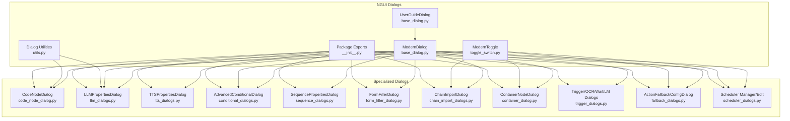
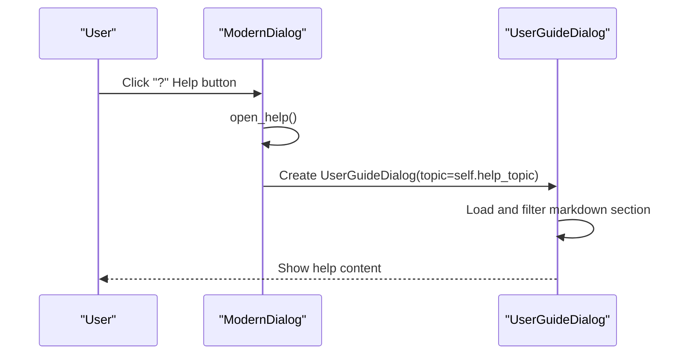
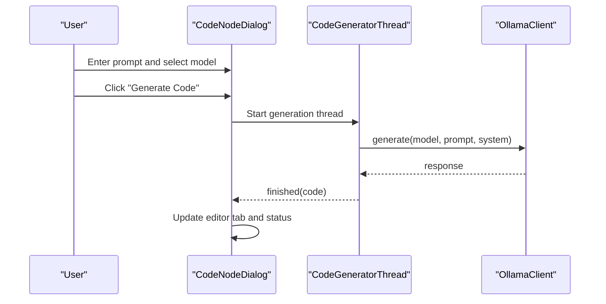
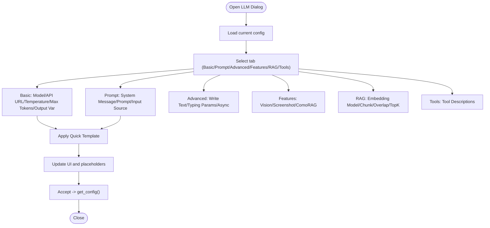
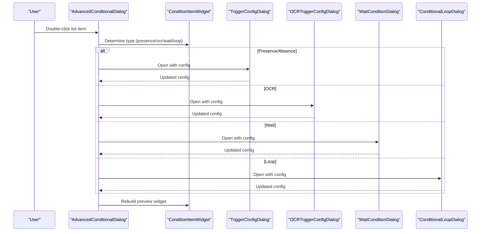
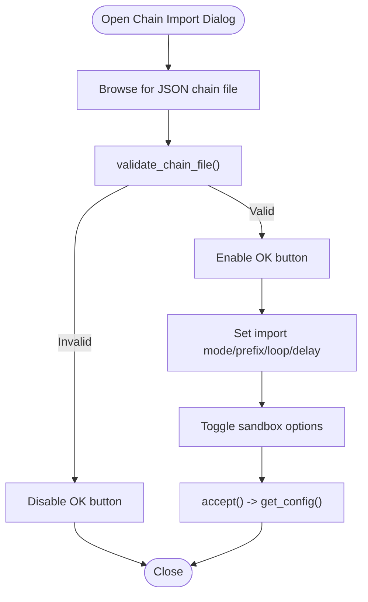
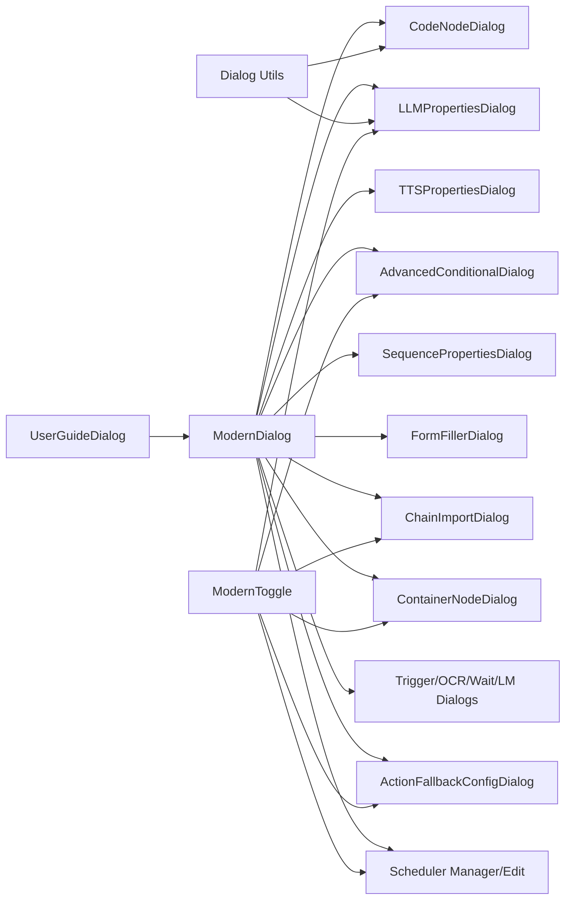

# Dialog System

<cite>
**Referenced Files in This Document**
- [base_dialog.py](file://LoOper/NGUI/dialogs/base_dialog.py)
- [__init__.py](file://LoOper/NGUI/dialogs/__init__.py)
- [utils.py](file://LoOper/NGUI/dialogs/utils.py)
- [code_node_dialog.py](file://LoOper/NGUI/dialogs/code_node_dialog.py)
- [llm_dialogs.py](file://LoOper/NGUI/dialogs/llm_dialogs.py)
- [tts_dialogs.py](file://LoOper/NGUI/dialogs/tts_dialogs.py)
- [conditional_dialogs.py](file://LoOper/NGUI/dialogs/conditional_dialogs.py)
- [sequence_dialogs.py](file://LoOper/NGUI/dialogs/sequence_dialogs.py)
- [form_filler_dialog.py](file://LoOper/NGUI/dialogs/form_filler_dialog.py)
- [chain_import_dialogs.py](file://LoOper/NGUI/dialogs/chain_import_dialogs.py)
- [container_dialog.py](file://LoOper/NGUI/dialogs/container_dialog.py)
- [trigger_dialogs.py](file://LoOper/NGUI/dialogs/trigger_dialogs.py)
- [toggle_switch.py](file://LoOper/NGUI/dialogs/toggle_switch.py)
- [scheduler_dialogs.py](file://LoOper/NGUI/dialogs/scheduler_dialogs.py)
- [fallback_dialogs.py](file://LoOper/NGUI/dialogs/fallback_dialogs.py)
- [ai_settings_dialog.py](file://LoOper/NGUI/dialogs/ai_settings_dialog.py)
- [main_window.py](file://LoOper/NGUI/main_window.py)
- [USER_GUIDE.md](file://docs/USER_GUIDE.md)
</cite>

## Update Summary
**Changes Made**
- Added comprehensive UserGuideDialog system with contextual help integration
- Enhanced help system with help_topic parameters across all specialized dialogs
- Improved error handling for missing configuration data
- Added contextual help system with topic mapping for getting-started, playback, schedules, nodes, node-dialogs, and sandboxing
- Integrated UserGuideDialog into main window and AI settings dialog

## Table of Contents
1. [Introduction](#introduction)
2. [Project Structure](#project-structure)
3. [Core Components](#core-components)
4. [Architecture Overview](#architecture-overview)
5. [Detailed Component Analysis](#detailed-component-analysis)
6. [Dependency Analysis](#dependency-analysis)
7. [Performance Considerations](#performance-considerations)
8. [Troubleshooting Guide](#troubleshooting-guide)
9. [Conclusion](#conclusion)
10. [Appendices](#appendices)

## Introduction
This document describes the dialog system used for node configuration and property editing in the LoOper application. It explains the dialog architecture, base dialog patterns, and shared utilities for property validation and user input handling. It documents specialized dialogs for code nodes, LLM configuration, TTS configuration, conditional logic, sequences, form filling, and chain imports. It also covers dialog lifecycle, property binding mechanisms, validation rules, error handling strategies, context menu editing, inline property editing, accessibility, internationalization, and responsive layouts.

**Updated** Added comprehensive user documentation system with UserGuideDialog, enhanced help integration across all dialogs with help_topic parameters, and improved error handling for missing configuration data. Added contextual help system with topic mapping for getting-started, playback, schedules, nodes, node-dialogs, and sandboxing.

## Project Structure
The dialog system is organized under the NGUI dialogs package. It defines a modern dialog base class and numerous specialized dialogs for different node types. Shared utilities provide configuration and API URL resolution. Internationalization is integrated via a translation function. The system now includes a comprehensive user guide with contextual help integration.

**Diagram sources**
- [base_dialog.py:88-382](file://LoOper/NGUI/dialogs/base_dialog.py#L88-L382)
- [__init__.py:1-35](file://LoOper/NGUI/dialogs/__init__.py#L1-L35)
- [utils.py:1-25](file://LoOper/NGUI/dialogs/utils.py#L1-L25)
- [toggle_switch.py:1-104](file://LoOper/NGUI/dialogs/toggle_switch.py#L1-L104)
- [code_node_dialog.py:73-434](file://LoOper/NGUI/dialogs/code_node_dialog.py#L73-L434)
- [llm_dialogs.py:30-786](file://LoOper/NGUI/dialogs/llm_dialogs.py#L30-L786)
- [tts_dialogs.py:16-88](file://LoOper/NGUI/dialogs/tts_dialogs.py#L16-L88)
- [conditional_dialogs.py:119-790](file://LoOper/NGUI/dialogs/conditional_dialogs.py#L119-L790)
- [sequence_dialogs.py:8-51](file://LoOper/NGUI/dialogs/sequence_dialogs.py#L8-L51)
- [form_filler_dialog.py:17-79](file://LoOper/NGUI/dialogs/form_filler_dialog.py#L17-L79)
- [chain_import_dialogs.py:16-280](file://LoOper/NGUI/dialogs/chain_import_dialogs.py#L16-L280)
- [container_dialog.py:9-117](file://LoOper/NGUI/dialogs/container_dialog.py#L9-L117)
- [trigger_dialogs.py:232-476](file://LoOper/NGUI/dialogs/trigger_dialogs.py#L232-L476)
- [fallback_dialogs.py:12-155](file://LoOper/NGUI/dialogs/fallback_dialogs.py#L12-L155)
- [scheduler_dialogs.py:15-574](file://LoOper/NGUI/dialogs/scheduler_dialogs.py#L15-L574)

**Section sources**
- [base_dialog.py:88-382](file://LoOper/NGUI/dialogs/base_dialog.py#L88-L382)
- [__init__.py:1-35](file://LoOper/NGUI/dialogs/__init__.py#L1-L35)
- [utils.py:1-25](file://LoOper/NGUI/dialogs/utils.py#L1-L25)

## Core Components
- ModernDialog: A themed, frameless dialog with draggable title bar, shadow effect, scrollable content area, and optional help integration. It centralizes styling and layout for all specialized dialogs and now includes help_topic parameter support.
- UserGuideDialog: A comprehensive documentation system that loads and displays contextual help from the USER_GUIDE.md file, filtered by topic mapping.
- Dialog Utilities: Provide default API URL resolution and helper functions for AI integration.
- ModernToggle: A custom animated toggle switch widget used across dialogs for boolean options.
- Specialized Dialogs: Node-specific dialogs for configuration, including code generation, LLM prompts, TTS text, conditional triggers, sequences, form filling, chain imports, containers, scheduling, and fallbacks.

Key responsibilities:
- Base dialog pattern: Consistent theming, layout, drag behavior, and help integration with topic-based contextual help.
- Property binding: Each dialog exposes a get_config method to serialize its state.
- Validation: Dialogs validate inputs and provide user feedback via message boxes and disabled states.
- Internationalization: All user-facing strings are wrapped with a translation function.
- Contextual help: All dialogs support help_topic parameter for topic-based documentation integration.

**Section sources**
- [base_dialog.py:88-382](file://LoOper/NGUI/dialogs/base_dialog.py#L88-L382)
- [base_dialog.py:58-87](file://LoOper/NGUI/dialogs/base_dialog.py#L58-L87)
- [utils.py:22-25](file://LoOper/NGUI/dialogs/utils.py#L22-L25)
- [toggle_switch.py:8-104](file://LoOper/NGUI/dialogs/toggle_switch.py#L8-L104)

## Architecture Overview
The dialog architecture follows a base-specialized pattern with enhanced help integration:
- ModernDialog provides the shell, styling, layout, and help integration with topic support.
- UserGuideDialog loads and displays contextual help from the USER_GUIDE.md documentation file.
- Specialized dialogs subclass ModernDialog and populate content_layout with controls.
- Utilities encapsulate shared logic (e.g., API URL).
- Internationalization is applied consistently across dialogs.
- Contextual help system maps dialog topics to specific sections in the user guide.

```mermaid
classDiagram
class ModernDialog {
+setWindowTitle(title)
+open_help()
+mousePressEvent(event)
+mouseMoveEvent(event)
+mouseReleaseEvent(event)
+help_topic : str
}
class UserGuideDialog {
+__init__(parent, topic, title)
+_load_user_guide_markdown()
+open_help()
}
class CodeNodeDialog {
+get_config() dict
+generate_code()
+refresh_models()
}
class LLMPropertiesDialog {
+get_config() dict
+apply_template(template_name)
+refresh_models()
}
class TTSPropertiesDialog {
+get_config() dict
}
class AdvancedConditionalDialog {
+get_config() dict
+add_* triggers/loops
+edit_* triggers/loops
}
class SequencePropertiesDialog {
+get_properties() dict
}
class FormFillerDialog {
+get_config() dict
}
class ChainImportDialog {
+get_config() dict
+browse_chain_file()
+validate_chain_file()
}
class ContainerNodeDialog {
+get_config() dict
}
class TriggerConfigDialog {
+get_config() dict
+capture_image()
+browse_image()
}
class OCRTriggerConfigDialog {
+get_config() dict
}
class WaitConditionDialog {
+get_config() dict
}
class ConditionalLoopDialog {
+get_config() dict
}
class ActionFallbackConfigDialog {
+get_fallback_config() dict
}
class SchedulerManagerDialog {
+reload()
+add_schedule()
+_edit_schedule()
}
class EditScheduleDialog {
+get_data() dict
}
class ModernToggle {
+paintEvent()
+sizeHint()
}
class DialogUtils {
+get_default_api_url()
}
ModernDialog <|-- UserGuideDialog
ModernDialog <|-- CodeNodeDialog
ModernDialog <|-- LLMPropertiesDialog
ModernDialog <|-- TTSPropertiesDialog
ModernDialog <|-- AdvancedConditionalDialog
ModernDialog <|-- SequencePropertiesDialog
ModernDialog <|-- FormFillerDialog
ModernDialog <|-- ChainImportDialog
ModernDialog <|-- ContainerNodeDialog
ModernDialog <|-- TriggerConfigDialog
ModernDialog <|-- OCRTriggerConfigDialog
ModernDialog <|-- WaitConditionDialog
ModernDialog <|-- ConditionalLoopDialog
ModernDialog <|-- ActionFallbackConfigDialog
ModernDialog <|-- SchedulerManagerDialog
SchedulerManagerDialog <|-- EditScheduleDialog
ModernToggle <.. LLMPropertiesDialog
ModernToggle <.. AdvancedConditionalDialog
ModernToggle <.. ChainImportDialog
ModernToggle <.. ContainerNodeDialog
DialogUtils <.. LLMPropertiesDialog
DialogUtils <.. CodeNodeDialog
```

**Diagram sources**
- [base_dialog.py:88-382](file://LoOper/NGUI/dialogs/base_dialog.py#L88-L382)
- [base_dialog.py:58-87](file://LoOper/NGUI/dialogs/base_dialog.py#L58-L87)
- [code_node_dialog.py:73-434](file://Looper/NGUI/dialogs/code_node_dialog.py#L73-L434)
- [llm_dialogs.py:30-786](file://LoOper/NGUI/dialogs/llm_dialogs.py#L30-L786)
- [tts_dialogs.py:16-88](file://LoOper/NGUI/dialogs/tts_dialogs.py#L16-L88)
- [conditional_dialogs.py:119-790](file://LoOper/NGUI/dialogs/conditional_dialogs.py#L119-L790)
- [sequence_dialogs.py:8-51](file://LoOper/NGUI/dialogs/sequence_dialogs.py#L8-L51)
- [form_filler_dialog.py:17-79](file://LoOper/NGUI/dialogs/form_filler_dialog.py#L17-L79)
- [chain_import_dialogs.py:16-280](file://LoOper/NGUI/dialogs/chain_import_dialogs.py#L16-L280)
- [container_dialog.py:9-117](file://LoOper/NGUI/dialogs/container_dialog.py#L9-L117)
- [trigger_dialogs.py:232-476](file://LoOper/NGUI/dialogs/trigger_dialogs.py#L232-L476)
- [fallback_dialogs.py:12-155](file://LoOper/NGUI/dialogs/fallback_dialogs.py#L12-L155)
- [scheduler_dialogs.py:15-574](file://LoOper/NGUI/dialogs/scheduler_dialogs.py#L15-L574)
- [toggle_switch.py:8-104](file://LoOper/NGUI/dialogs/toggle_switch.py#L8-L104)
- [utils.py:22-25](file://LoOper/NGUI/dialogs/utils.py#L22-L25)

## Detailed Component Analysis

### Base Dialog Pattern (ModernDialog) with Enhanced Help Integration
- Frameless window with draggable title bar and close button.
- Central container with shadow effect and rounded corners.
- Scrollable content area with consistent padding and spacing.
- Theming applied via embedded stylesheets for widgets.
- Help integration opens a UserGuideDialog filtered by topic.
- Drag behavior supports moving the dialog by dragging the title bar.
- Enhanced with help_topic parameter for contextual help support.

**Diagram sources**
- [base_dialog.py:370-372](file://LoOper/NGUI/dialogs/base_dialog.py#L370-L372)

**Section sources**
- [base_dialog.py:88-382](file://LoOper/NGUI/dialogs/base_dialog.py#L88-L382)

### UserGuideDialog System
- Comprehensive documentation system that loads USER_GUIDE.md from the docs directory.
- Topic-based filtering using _USER_GUIDE_TOPIC_TO_HEADING mapping.
- Supports markdown parsing with automatic section extraction.
- Graceful error handling when documentation file is missing.
- Compatible with QTextBrowser's setMarkdown method when available.

**Section sources**
- [base_dialog.py:58-87](file://LoOper/NGUI/dialogs/base_dialog.py#L58-L87)
- [USER_GUIDE.md:1-730](file://docs/USER_GUIDE.md#L1-L730)

### Code Node Dialog (CodeNodeDialog)
- Multi-tab interface: AI Generator, Code Editor, Settings.
- AI code generation via a background thread with model selection and prompt input.
- Code editor with syntax-friendly styling.
- Settings include external file path override, output variable name, execution options, and timeout.
- Validation ensures prompt is provided before generation; errors surfaced via message boxes.
- Enhanced with help_topic="code-node-dialog" for contextual help integration.

**Diagram sources**
- [code_node_dialog.py:27-72](file://LoOper/NGUI/dialogs/code_node_dialog.py#L27-L72)
- [code_node_dialog.py:258-288](file://LoOper/NGUI/dialogs/code_node_dialog.py#L258-L288)

**Section sources**
- [code_node_dialog.py:73-434](file://LoOper/NGUI/dialogs/code_node_dialog.py#L73-L434)

### LLM Properties Dialog (LLMPropertiesDialog)
- Tabbed configuration: Basic, Prompt, Advanced, Features, RAG, Tools.
- Model selection with refresh capability and quick templates.
- Prompt configuration with system message and input source options (OCR, previous node output, clipboard).
- Advanced options include writing text, typing speed parameters, and async processing.
- Features include vision configuration, screenshot toggles, and ComoRAG settings.
- RAG and Tool configuration tabs provide additional knobs.
- Validation and template-driven presets streamline configuration.
- Enhanced with help_topic="llm-dialog" for contextual help integration.

**Diagram sources**
- [llm_dialogs.py:30-786](file://LoOper/NGUI/dialogs/llm_dialogs.py#L30-L786)

**Section sources**
- [llm_dialogs.py:30-786](file://LoOper/NGUI/dialogs/llm_dialogs.py#L30-L786)

### TTS Properties Dialog (TTSPropertiesDialog)
- Simple two-field configuration: text content and language selection.
- Uses localized button labels and stores defaults for initial state.
- get_config returns a dictionary suitable for node properties.
- Enhanced with help_topic="tts-dialog" for contextual help integration.

**Section sources**
- [tts_dialogs.py:16-88](file://LoOper/NGUI/dialogs/tts_dialogs.py#L16-L88)

### Conditional Dialogs (AdvancedConditionalDialog)
- Unified layout without tabs: code condition, presence triggers, OCR triggers, layout match conditionals, and conditional loops.
- List widgets with custom item previews for each trigger/loop type.
- Edit dialogs for each trigger/loop type are launched modally.
- get_config aggregates all configured lists and code condition.
- Enhanced with help_topic="conditional-dialog" for contextual help integration.

**Diagram sources**
- [conditional_dialogs.py:570-654](file://LoOper/NGUI/dialogs/conditional_dialogs.py#L570-L654)
- [trigger_dialogs.py:232-476](file://LoOper/NGUI/dialogs/trigger_dialogs.py#L232-L476)

**Section sources**
- [conditional_dialogs.py:119-790](file://LoOper/NGUI/dialogs/conditional_dialogs.py#L119-L790)

### Sequence Properties Dialog (SequencePropertiesDialog)
- Edits loop count, extra delay, and whether to use app-opened context.
- get_properties returns a normalized dictionary for sequence configuration.
- Enhanced with help_topic="sequence-dialog" for contextual help integration.

**Section sources**
- [sequence_dialogs.py:8-51](file://LoOper/NGUI/dialogs/sequence_dialogs.py#L8-L51)

### Form Filler Dialog (FormFillerDialog)
- Configures instruction text, model selection, and confidence threshold.
- Loads cached models for selection and persists values via get_config.
- Enhanced with help_topic="form-filler-node" for contextual help integration.

**Section sources**
- [form_filler_dialog.py:17-79](file://LoOper/NGUI/dialogs/form_filler_dialog.py#L17-L79)

### Chain Import Dialog (ChainImportDialog)
- Selects chain file, validates existence and node counts, and configures import mode, prefix, loop count, extra delay, and sandbox options.
- Validates inputs before accepting and surfaces errors via message boxes.
- Enhanced with help_topic="chain-import-dialog" for contextual help integration.

**Diagram sources**
- [chain_import_dialogs.py:16-280](file://LoOper/NGUI/dialogs/chain_import_dialogs.py#L16-L280)

**Section sources**
- [chain_import_dialogs.py:16-280](file://LoOper/NGUI/dialogs/chain_import_dialogs.py#L16-L280)

### Container Node Dialog (ContainerNodeDialog)
- Configures ISO path, memory/CPU resources, hide window, execute on input, output variable, and timeout.
- Provides a browse button for ISO selection and returns a structured config via get_config.
- Enhanced with help_topic="container-node" for contextual help integration.

**Section sources**
- [container_dialog.py:9-117](file://LoOper/NGUI/dialogs/container_dialog.py#L9-L117)

### Trigger Dialogs (TriggerConfigDialog, OCRTriggerConfigDialog, WaitConditionDialog, ConditionalLoopDialog)
- TriggerConfigDialog: Image path selection, confidence, and timeout (presence vs absence).
- OCRTriggerConfigDialog: Target text, confidence, and case sensitivity.
- WaitConditionDialog: Wait types and durations/timeouts.
- ConditionalLoopDialog: Loop type, sequence file, and iteration limits.
- All dialogs expose get_config for serialization.
- Enhanced with help_topic="conditional-dialog" for contextual help integration.

**Section sources**
- [trigger_dialogs.py:232-476](file://LoOper/NGUI/dialogs/trigger_dialogs.py#L232-L476)

### Fallback Dialogs (ActionFallbackConfigDialog)
- Enables/disables fallback per action, selects fallback sequence file, and sets retry attempts and delays.
- Returns None when disabled or a structured fallback config when enabled.
- Enhanced with help_topic="playback" for contextual help integration.

**Section sources**
- [fallback_dialogs.py:12-155](file://LoOper/NGUI/dialogs/fallback_dialogs.py#L12-L155)

### Scheduler Dialogs (SchedulerManagerDialog, EditScheduleDialog)
- Manager dialog displays schedules in a styled table with actions to run, edit, or delete.
- Edit dialog configures schedule type (once/daily/weekly/interval), timing, and chain file.
- Uses ModernToggle extensively for enabling/disabling schedules.
- Enhanced with help_topic="schedules" for contextual help integration.

**Section sources**
- [scheduler_dialogs.py:15-574](file://LoOper/NGUI/dialogs/scheduler_dialogs.py#L15-L574)

### AI Settings Dialog with User Guide Integration
- Enhanced AI settings dialog with integrated help system.
- Uses UserGuideDialog for contextual help with topic-based filtering.
- Provides help buttons for different configuration sections.

**Section sources**
- [ai_settings_dialog.py:132-170](file://LoOper/NGUI/dialogs/ai_settings_dialog.py#L132-L170)

### Main Window User Guide Integration
- Main window provides access to the general user guide.
- Includes error handling for missing documentation files.
- Demonstrates proper integration pattern for application-wide help access.

**Section sources**
- [main_window.py:754-760](file://LoOper/NGUI/main_window.py#L754-L760)

## Dependency Analysis
- Base coupling: All specialized dialogs depend on ModernDialog for UI shell, styling, and help integration with topic support.
- UserGuide coupling: UserGuideDialog depends on base_dialog module and USER_GUIDE.md documentation file.
- Utility coupling: LLM and Code dialogs depend on dialog utilities for API URL resolution.
- Widget coupling: Many dialogs use ModernToggle for boolean options.
- Internal imports: Dialogs import from AI modules when available, with safe fallbacks.
- Contextual help: All dialogs support help_topic parameter for topic-based documentation integration.

**Diagram sources**
- [base_dialog.py:88-382](file://LoOper/NGUI/dialogs/base_dialog.py#L88-L382)
- [base_dialog.py:58-87](file://LoOper/NGUI/dialogs/base_dialog.py#L58-L87)
- [utils.py:22-25](file://LoOper/NGUI/dialogs/utils.py#L22-L25)
- [toggle_switch.py:8-104](file://LoOper/NGUI/dialogs/toggle_switch.py#L8-L104)
- [llm_dialogs.py:30-786](file://LoOper/NGUI/dialogs/llm_dialogs.py#L30-L786)
- [code_node_dialog.py:73-434](file://LoOper/NGUI/dialogs/code_node_dialog.py#L73-L434)

**Section sources**
- [__init__.py:1-35](file://LoOper/NGUI/dialogs/__init__.py#L1-L35)

## Performance Considerations
- Asynchronous code generation: CodeNodeDialog uses a background thread to avoid blocking the UI during AI generation.
- Lazy model refresh: LLM dialog refreshes model caches on demand rather than at startup.
- Minimal repaints: ModernDialog applies stylesheets once; toggles animate smoothly with property animations.
- Large content areas: Scrollable content reduces layout overhead for complex dialogs.
- User guide caching: UserGuideDialog loads documentation once and filters sections dynamically.
- Graceful degradation: UserGuideDialog handles missing documentation files without crashing.

## Troubleshooting Guide
Common issues and resolutions:
- Missing prompt in code generation: Dialog prevents generation and shows a warning; ensure prompt is entered.
- No models detected: Refresh models or check API connectivity; dialog informs the user.
- Invalid chain file: Dialog disables OK until a valid JSON file with nodes is selected.
- Absence trigger timeout: Enforced minimum timeout to prevent workflow freezing.
- Toggle state synchronization: Ensure related controls are enabled/disabled when toggles change.
- Missing user guide documentation: UserGuideDialog gracefully handles missing USER_GUIDE.md file.
- Help topic not found: UserGuideDialog falls back to displaying the entire documentation when topic mapping fails.
- Documentation loading errors: Main window includes error handling for user guide access failures.

Validation and error handling examples:
- Code generation error handling via signals and message boxes.
- Chain import validation with file existence checks and node count verification.
- Conditional dialog absence trigger enforced timeout.
- User guide loading with exception handling and graceful fallback messages.
- Contextual help integration with topic-based filtering and section extraction.

**Section sources**
- [code_node_dialog.py:258-288](file://LoOper/NGUI/dialogs/code_node_dialog.py#L258-L288)
- [chain_import_dialogs.py:179-222](file://LoOper/NGUI/dialogs/chain_import_dialogs.py#L179-L222)
- [conditional_dialogs.py:676-681](file://LoOper/NGUI/dialogs/conditional_dialogs.py#L676-L681)
- [base_dialog.py:79-86](file://LoOper/NGUI/dialogs/base_dialog.py#L79-L86)
- [main_window.py:758-760](file://LoOper/NGUI/main_window.py#L758-L760)

## Conclusion
The dialog system provides a consistent, accessible, and extensible framework for node configuration with comprehensive help integration. The ModernDialog base class centralizes UI concerns and now includes robust help system support through the UserGuideDialog. Specialized dialogs encapsulate domain-specific logic while leveraging the contextual help system. Utilities and internationalization support cross-cutting concerns. The system balances usability with robust validation, responsive design, and comprehensive documentation integration.

## Appendices

### Dialog Lifecycle and Property Binding
- Creation: Dialogs initialize UI and optionally load existing configuration with help_topic support.
- Interaction: Users modify controls; intermediate validation occurs (e.g., enabling/disabling controls).
- Accept/Reject: On acceptance, dialogs return a structured configuration via get_config/get_properties/get_fallback_config/get_data.
- Help: Clicking the help button opens a filtered user guide based on the dialog's help_topic.
- User guide integration: UserGuideDialog loads USER_GUIDE.md and filters content by topic mapping.

**Section sources**
- [base_dialog.py:370-372](file://LoOper/NGUI/dialogs/base_dialog.py#L370-L372)
- [base_dialog.py:58-87](file://LoOper/NGUI/dialogs/base_dialog.py#L58-L87)
- [llm_dialogs.py:724-786](file://LoOper/NGUI/dialogs/llm_dialogs.py#L724-L786)
- [code_node_dialog.py:424-433](file://LoOper/NGUI/dialogs/code_node_dialog.py#L424-L433)
- [conditional_dialogs.py:743-789](file://LoOper/NGUI/dialogs/conditional_dialogs.py#L743-L789)
- [sequence_dialogs.py:44-50](file://LoOper/NGUI/dialogs/sequence_dialogs.py#L44-L50)
- [form_filler_dialog.py:64-69](file://LoOper/NGUI/dialogs/form_filler_dialog.py#L64-L69)
- [chain_import_dialogs.py:247-265](file://LoOper/NGUI/dialogs/chain_import_dialogs.py#L247-L265)
- [container_dialog.py:106-116](file://LoOper/NGUI/dialogs/container_dialog.py#L106-L116)
- [fallback_dialogs.py:145-154](file://LoOper/NGUI/dialogs/fallback_dialogs.py#L145-L154)
- [scheduler_dialogs.py:549-573](file://LoOper/NGUI/dialogs/scheduler_dialogs.py#L549-L573)

### Accessibility and Internationalization
- Accessibility: Draggable title bar, focusable controls, and clear button labels.
- Internationalization: All user-facing strings are wrapped with a translation function; button labels are localized.
- Help accessibility: UserGuideDialog supports external links and provides accessible navigation.
- Contextual help: Topic-based help system improves accessibility for different user needs and skill levels.

**Section sources**
- [base_dialog.py:144-198](file://LoOper/NGUI/dialogs/base_dialog.py#L144-L198)
- [llm_dialogs.py:33-86](file://LoOper/NGUI/dialogs/llm_dialogs.py#L33-L86)
- [code_node_dialog.py:117-132](file://LoOper/NGUI/dialogs/code_node_dialog.py#L117-L132)
- [conditional_dialogs.py:152-162](file://LoOper/NGUI/dialogs/conditional_dialogs.py#L152-L162)
- [sequence_dialogs.py:32-42](file://LoOper/NGUI/dialogs/sequence_dialogs.py#L32-L42)
- [form_filler_dialog.py:50-60](file://LoOper/NGUI/dialogs/form_filler_dialog.py#L50-L60)
- [chain_import_dialogs.py:152-161](file://LoOper/NGUI/dialogs/chain_import_dialogs.py#L152-L161)
- [container_dialog.py:97-98](file://LoOper/NGUI/dialogs/container_dialog.py#L97-L98)
- [fallback_dialogs.py:112-124](file://LoOper/NGUI/dialogs/fallback_dialogs.py#L112-L124)
- [scheduler_dialogs.py:110-124](file://LoOper/NGUI/dialogs/scheduler_dialogs.py#L110-L124)

### Creating a New Dialog Type with Help Integration
Steps:
- Subclass ModernDialog with help_topic parameter.
- Define UI in setup_ui and populate self.content_layout.
- Implement get_config/get_properties/get_data to return a serializable dictionary.
- Add localization for user-facing strings.
- Optionally integrate with utilities (e.g., API URL) and use ModernToggle for boolean options.
- Register in package exports if needed.
- Add topic mapping in _USER_GUIDE_TOPIC_TO_HEADING for contextual help.

Example references:
- [base_dialog.py:88-382](file://LoOper/NGUI/dialogs/base_dialog.py#L88-L382)
- [base_dialog.py:10-25](file://LoOper/NGUI/dialogs/base_dialog.py#L10-L25)
- [llm_dialogs.py:30-786](file://LoOper/NGUI/dialogs/llm_dialogs.py#L30-L786)
- [toggle_switch.py:8-104](file://LoOper/NGUI/dialogs/toggle_switch.py#L8-L104)
- [utils.py:22-25](file://LoOper/NGUI/dialogs/utils.py#L22-L25)
- [__init__.py:18-35](file://LoOper/NGUI/dialogs/__init__.py#L18-L35)

**Section sources**
- [base_dialog.py:88-382](file://LoOper/NGUI/dialogs/base_dialog.py#L88-L382)
- [base_dialog.py:10-25](file://LoOper/NGUI/dialogs/base_dialog.py#L10-L25)
- [toggle_switch.py:8-104](file://LoOper/NGUI/dialogs/toggle_switch.py#L8-L104)
- [utils.py:22-25](file://LoOper/NGUI/dialogs/utils.py#L22-L25)
- [__init__.py:18-35](file://LoOper/NGUI/dialogs/__init__.py#L18-L35)

### Contextual Help System Architecture
The contextual help system consists of:
- Topic mapping: _USER_GUIDE_TOPIC_TO_HEADING dictionary mapping dialog topics to USER_GUIDE.md headings.
- Section extraction: _extract_markdown_section function parses USER_GUIDE.md and extracts specific sections.
- UserGuideDialog: Loads documentation and displays filtered content based on topic.
- Dialog integration: ModernDialog instances pass their help_topic to UserGuideDialog for contextual help.

**Section sources**
- [base_dialog.py:10-25](file://LoOper/NGUI/dialogs/base_dialog.py#L10-L25)
- [base_dialog.py:28-55](file://LoOper/NGUI/dialogs/base_dialog.py#L28-L55)
- [base_dialog.py:58-87](file://LoOper/NGUI/dialogs/base_dialog.py#L58-L87)
- [USER_GUIDE.md:1-730](file://docs/USER_GUIDE.md#L1-L730)