# Graph Operations

<cite>
**Referenced Files in This Document**
- [clipboard_manager.py](file://LoOper/NGUI/graph_elements/clipboard_manager.py)
- [dnd_manager.py](file://LoOper/NGUI/graph_elements/dnd_manager.py)
- [export_utils.py](file://LoOper/NGUI/graph_elements/export_utils.py)
- [node_transforms.py](file://LoOper/NGUI/graph_elements/node_transforms.py)
- [ui_components.py](file://LoOper/NGUI/graph_elements/ui_components.py)
- [view_manager.py](file://LoOper/NGUI/graph_elements/view_manager.py)
- [config_manager.py](file://LoOper/NGUI/graph_elements/config_manager.py)
- [graph_manager.py](file://LoOper/NGUI/graph_elements/graph_manager.py)
- [base_node.py](file://LoOper/NGUI/nodes_resources/base_node.py)
- [sequence_node.py](file://LoOper/NGUI/nodes_resources/sequence_node.py)
- [conditional_node.py](file://LoOper/NGUI/nodes_resources/conditional_node.py)
- [llm_node.py](file://LoOper/NGUI/nodes_resources/llm_node.py)
</cite>

## Table of Contents
1. [Introduction](#introduction)
2. [Project Structure](#project-structure)
3. [Core Components](#core-components)
4. [Architecture Overview](#architecture-overview)
5. [Detailed Component Analysis](#detailed-component-analysis)
6. [Dependency Analysis](#dependency-analysis)
7. [Performance Considerations](#performance-considerations)
8. [Troubleshooting Guide](#troubleshooting-guide)
9. [Conclusion](#conclusion)
10. [Appendices](#appendices)

## Introduction
This document explains the graph operations and manipulation systems used to build, edit, and serialize automated workflows. It covers node lifecycle operations (creation, deletion, duplication), transformation between node types, clipboard and drag-and-drop workflows, export utilities, UI interaction and selection, and guidance for extending the system with custom operations while preserving graph integrity.

## Project Structure
The graph operations subsystem centers around a modular set of managers and node resources:
- Graph infrastructure: node registration, graph widget setup, and basic operations
- Node resources: typed node classes with standardized ports and properties
- Interaction managers: clipboard, drag-and-drop, and view management
- Serialization: configuration capture and export to executable scripts
- UI scaffolding: layout and toolbar integration

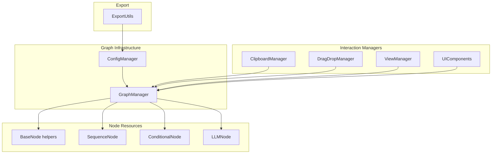

**Diagram sources**
- [graph_manager.py:51-445](file://LoOper/NGUI/graph_elements/graph_manager.py#L51-L445)
- [config_manager.py:30-800](file://LoOper/NGUI/graph_elements/config_manager.py#L30-L800)
- [clipboard_manager.py:5-243](file://LoOper/NGUI/graph_elements/clipboard_manager.py#L5-L243)
- [dnd_manager.py:7-342](file://LoOper/NGUI/graph_elements/dnd_manager.py#L7-L342)
- [view_manager.py:26-295](file://LoOper/NGUI/graph_elements/view_manager.py#L26-L295)
- [ui_components.py:30-174](file://LoOper/NGUI/graph_elements/ui_components.py#L30-L174)
- [export_utils.py:32-370](file://LoOper/NGUI/graph_elements/export_utils.py#L32-L370)
- [base_node.py:1-60](file://LoOper/NGUI/nodes_resources/base_node.py#L1-L60)
- [sequence_node.py:12-127](file://LoOper/NGUI/nodes_resources/sequence_node.py#L12-L127)
- [conditional_node.py:10-162](file://LoOper/NGUI/nodes_resources/conditional_node.py#L10-L162)
- [llm_node.py:11-390](file://LoOper/NGUI/nodes_resources/llm_node.py#L11-L390)

**Section sources**
- [graph_manager.py:51-445](file://LoOper/NGUI/graph_elements/graph_manager.py#L51-L445)
- [config_manager.py:30-800](file://LoOper/NGUI/graph_elements/config_manager.py#L30-L800)
- [clipboard_manager.py:5-243](file://LoOper/NGUI/graph_elements/clipboard_manager.py#L5-L243)
- [dnd_manager.py:7-342](file://LoOper/NGUI/graph_elements/dnd_manager.py#L7-L342)
- [view_manager.py:26-295](file://LoOper/NGUI/graph_elements/view_manager.py#L26-L295)
- [ui_components.py:30-174](file://LoOper/NGUI/graph_elements/ui_components.py#L30-L174)
- [export_utils.py:32-370](file://LoOper/NGUI/graph_elements/export_utils.py#L32-L370)
- [base_node.py:1-60](file://LoOper/NGUI/nodes_resources/base_node.py#L1-L60)
- [sequence_node.py:12-127](file://LoOper/NGUI/nodes_resources/sequence_node.py#L12-L127)
- [conditional_node.py:10-162](file://LoOper/NGUI/nodes_resources/conditional_node.py#L10-L162)
- [llm_node.py:11-390](file://LoOper/NGUI/nodes_resources/llm_node.py#L11-L390)

## Core Components
- GraphManager: registers node types, sets up the NodeGraphQt widget, manages node creation/deletion, connections, and snapping.
- ConfigManager: captures the current graph state into a structured configuration, supports loading/saving JSON chains, and rebuilds the graph from configuration.
- ClipboardManager: copies selected nodes with whitelisted properties and reconstructs connections when pasting; handles special node configurations.
- DragDropManager: installs drag-and-drop handlers, computes drop positions, and creates nodes from drag events.
- NodeTransforms: converts between node types (e.g., Sequence ↔ Conditional, Conditional ↔ LLM) while preserving connections and properties.
- ViewManager: toggles visibility of node types and auto-layouts only visible nodes.
- ExportUtils: generates executable scripts and Python scripts from the current chain configuration.
- UIComponents: builds the main UI layout with sidebars, toolbars, and graph container.
- Node resources: SequenceNode, ConditionalNode, LLMNode define ports, properties, and specialized behaviors.

**Section sources**
- [graph_manager.py:51-445](file://LoOper/NGUI/graph_elements/graph_manager.py#L51-L445)
- [config_manager.py:30-800](file://LoOper/NGUI/graph_elements/config_manager.py#L30-L800)
- [clipboard_manager.py:5-243](file://LoOper/NGUI/graph_elements/clipboard_manager.py#L5-L243)
- [dnd_manager.py:7-342](file://LoOper/NGUI/graph_elements/dnd_manager.py#L7-L342)
- [node_transforms.py:22-506](file://LoOper/NGUI/graph_elements/node_transforms.py#L22-L506)
- [view_manager.py:26-295](file://LoOper/NGUI/graph_elements/view_manager.py#L26-L295)
- [export_utils.py:32-370](file://LoOper/NGUI/graph_elements/export_utils.py#L32-L370)
- [ui_components.py:30-174](file://LoOper/NGUI/graph_elements/ui_components.py#L30-L174)
- [sequence_node.py:12-127](file://LoOper/NGUI/nodes_resources/sequence_node.py#L12-L127)
- [conditional_node.py:10-162](file://LoOper/NGUI/nodes_resources/conditional_node.py#L10-L162)
- [llm_node.py:11-390](file://LoOper/NGUI/nodes_resources/llm_node.py#L11-L390)

## Architecture Overview
The system integrates UI, node graph, and persistence layers. The managers orchestrate operations, while node resources encapsulate behavior and properties.

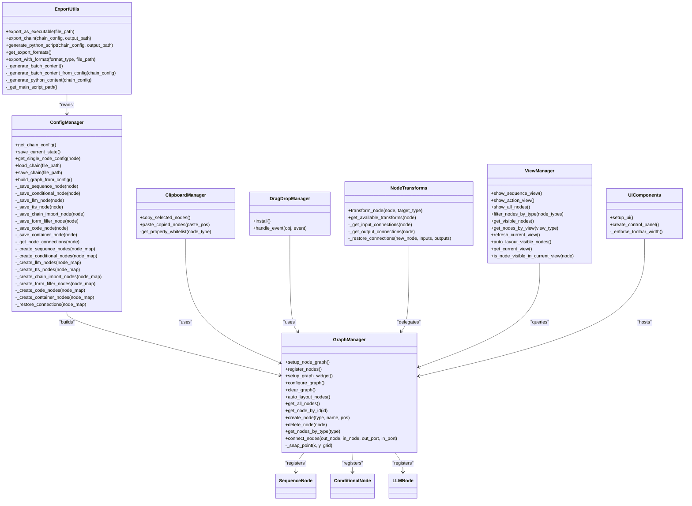

**Diagram sources**
- [graph_manager.py:51-445](file://LoOper/NGUI/graph_elements/graph_manager.py#L51-L445)
- [config_manager.py:30-800](file://LoOper/NGUI/graph_elements/config_manager.py#L30-L800)
- [clipboard_manager.py:5-243](file://LoOper/NGUI/graph_elements/clipboard_manager.py#L5-L243)
- [dnd_manager.py:7-342](file://LoOper/NGUI/graph_elements/dnd_manager.py#L7-L342)
- [node_transforms.py:22-506](file://LoOper/NGUI/graph_elements/node_transforms.py#L22-L506)
- [view_manager.py:26-295](file://LoOper/NGUI/graph_elements/view_manager.py#L26-L295)
- [export_utils.py:32-370](file://LoOper/NGUI/graph_elements/export_utils.py#L32-L370)
- [ui_components.py:30-174](file://LoOper/NGUI/graph_elements/ui_components.py#L30-L174)
- [sequence_node.py:12-127](file://LoOper/NGUI/nodes_resources/sequence_node.py#L12-L127)
- [conditional_node.py:10-162](file://LoOper/NGUI/nodes_resources/conditional_node.py#L10-L162)
- [llm_node.py:11-390](file://LoOper/NGUI/nodes_resources/llm_node.py#L11-L390)

## Detailed Component Analysis

### Clipboard Manager
ClipboardManager serializes selected nodes with a property whitelist tailored per node type, captures intra-selection connections, and reconstructs nodes and edges upon paste. It computes paste positions and applies snapping.

Key behaviors:
- Whitelist selection per node type to preserve relevant properties.
- Special handling for SequenceNode and ChainImportNode configurations.
- Connection reconstruction by mapping original node IDs to newly created nodes.
- Selection reset and multi-node selection after paste.

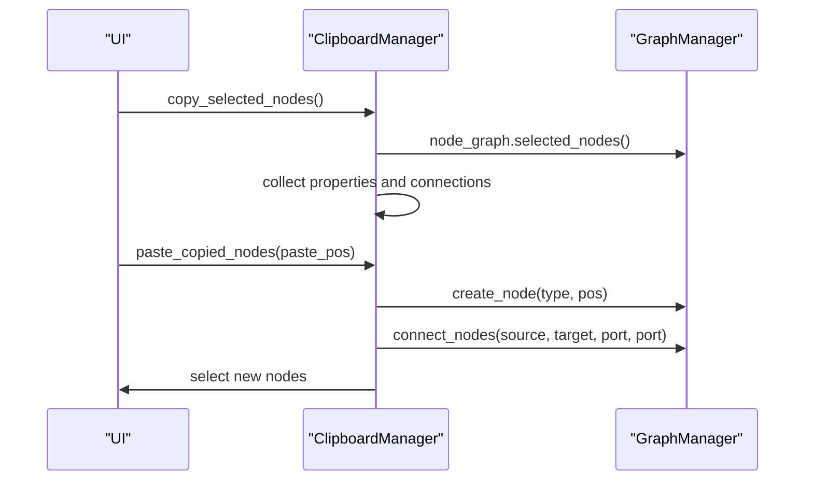

**Diagram sources**
- [clipboard_manager.py:38-243](file://LoOper/NGUI/graph_elements/clipboard_manager.py#L38-L243)
- [graph_manager.py:277-436](file://LoOper/NGUI/graph_elements/graph_manager.py#L277-L436)

**Section sources**
- [clipboard_manager.py:5-243](file://LoOper/NGUI/graph_elements/clipboard_manager.py#L5-L243)

### Drag-and-Drop Management
DragDropManager installs event filters on the graph widget and scene, tracks pending drop positions, and creates nodes from drag events. It supports multiple node types and optional file-based initialization for certain nodes.

Highlights:
- MIME-based node type identification.
- Scene-to-widget coordinate mapping for accurate placement.
- Snapping and delayed application of positions.
- Special handling for sequence and chain import nodes.

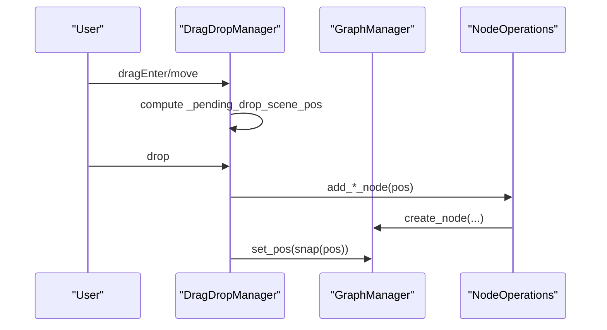

**Diagram sources**
- [dnd_manager.py:71-342](file://LoOper/NGUI/graph_elements/dnd_manager.py#L71-L342)
- [graph_manager.py:277-333](file://LoOper/NGUI/graph_elements/graph_manager.py#L277-L333)

**Section sources**
- [dnd_manager.py:7-342](file://LoOper/NGUI/graph_elements/dnd_manager.py#L7-L342)

### Node Transform System
NodeTransforms converts between compatible node types while preserving connections and sensible defaults. It supports:
- Sequence → Conditional
- Sequence → LLM
- Conditional → Sequence
- Conditional → LLM
- LLM → Conditional (not yet implemented for Sequence → LLM)

Connection restoration is performed by matching ports by name or falling back to first available ports.

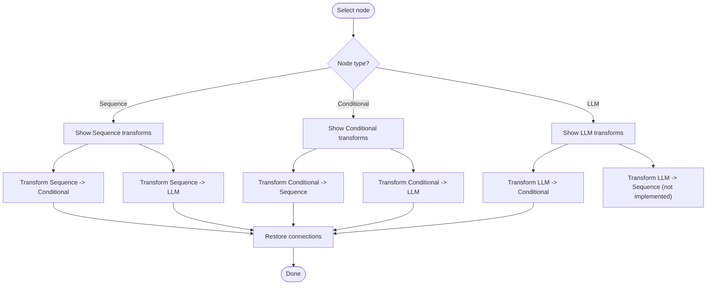

**Diagram sources**
- [node_transforms.py:446-506](file://LoOper/NGUI/graph_elements/node_transforms.py#L446-L506)
- [node_transforms.py:35-499](file://LoOper/NGUI/graph_elements/node_transforms.py#L35-L499)

**Section sources**
- [node_transforms.py:22-506](file://LoOper/NGUI/graph_elements/node_transforms.py#L22-L506)

### Graph Operations and Node Lifecycle
GraphManager provides the core operations:
- Node creation with snapping and multi-port support.
- Node deletion and bulk clearing.
- Connection creation by port name or default selection.
- Auto-layout and visibility queries.

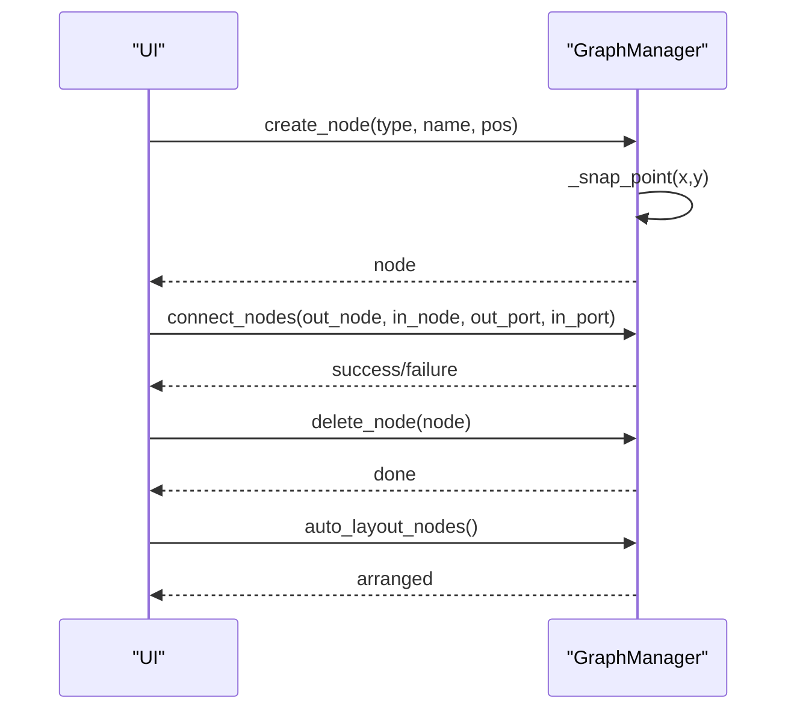

**Diagram sources**
- [graph_manager.py:277-445](file://LoOper/NGUI/graph_elements/graph_manager.py#L277-L445)

**Section sources**
- [graph_manager.py:51-445](file://LoOper/NGUI/graph_elements/graph_manager.py#L51-L445)

### Configuration Capture and Persistence
ConfigManager serializes the graph into a structured configuration, including node properties, positions, and connections. It supports loading/saving JSON files and rebuilding the graph from configuration.

Key points:
- Per-node serialization with robust property extraction.
- Connection capture and restoration during rebuild.
- Cache invalidation on save to keep chain libraries fresh.

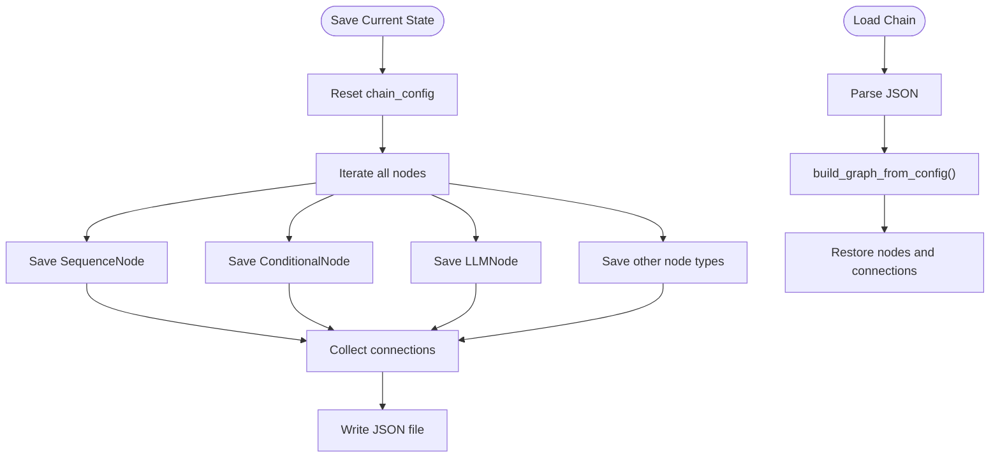

**Diagram sources**
- [config_manager.py:56-352](file://LoOper/NGUI/graph_elements/config_manager.py#L56-L352)

**Section sources**
- [config_manager.py:30-800](file://LoOper/NGUI/graph_elements/config_manager.py#L30-L800)

### Export Utilities
ExportUtils generates executable batch files and Python scripts from the current chain configuration. It also exposes supported formats and a generic export method.

Capabilities:
- Batch file generation with chained execution commands.
- Python script generation with placeholders for execution functions.
- Error handling and user feedback via message boxes.

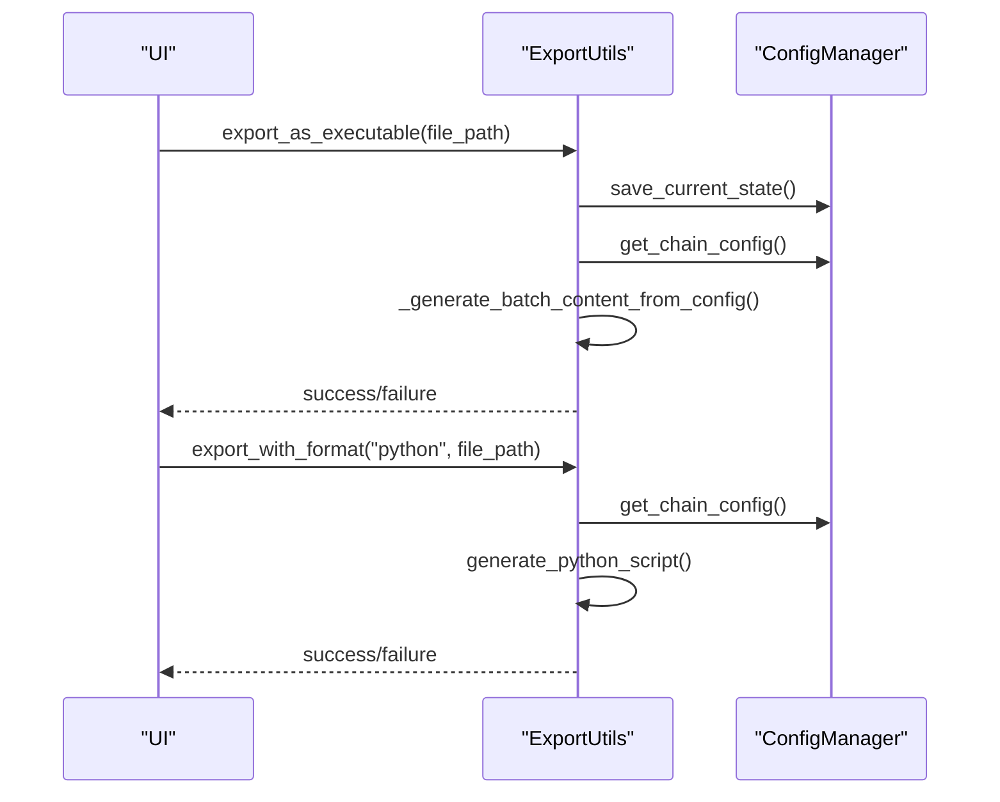

**Diagram sources**
- [export_utils.py:44-370](file://LoOper/NGUI/graph_elements/export_utils.py#L44-L370)
- [config_manager.py:44-54](file://LoOper/NGUI/graph_elements/config_manager.py#L44-L54)

**Section sources**
- [export_utils.py:32-370](file://LoOper/NGUI/graph_elements/export_utils.py#L32-L370)

### UI Components and Views
UIComponents constructs the main layout with collapsible toolbars and a central graph area. ViewManager controls which node types are visible and can auto-layout only visible nodes.

Highlights:
- Splitter-based responsive layout.
- Collapsible toolbars and search bar integration.
- Visibility toggling and auto-layout for performance.

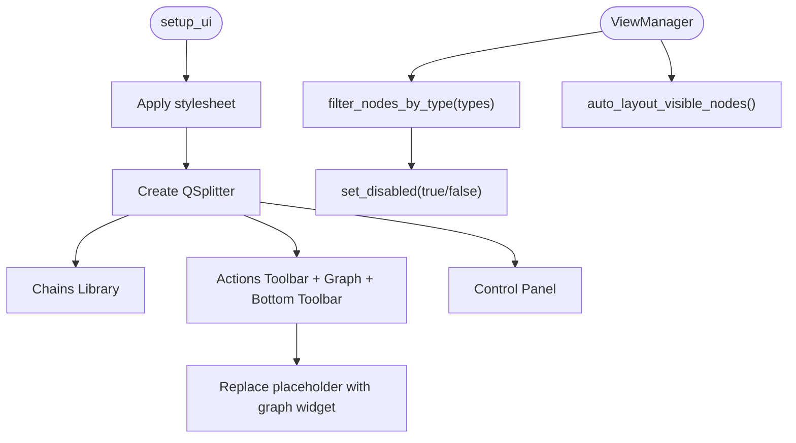

**Diagram sources**
- [ui_components.py:42-174](file://LoOper/NGUI/graph_elements/ui_components.py#L42-L174)
- [view_manager.py:137-295](file://LoOper/NGUI/graph_elements/view_manager.py#L137-L295)

**Section sources**
- [ui_components.py:30-174](file://LoOper/NGUI/graph_elements/ui_components.py#L30-L174)
- [view_manager.py:26-295](file://LoOper/NGUI/graph_elements/view_manager.py#L26-L295)

### Node Types and Properties
Node resources define ports and properties consistently across node types. BaseNode helpers ensure multi-connection ports and safe property registration.

- SequenceNode: multi-input, multi-output, properties for sequence file, loops, delays, and app-opened flag.
- ConditionalNode: multi-input with true/false outputs, comprehensive condition properties.
- LLMNode: multi-inputs (input, tools, context), multi-outputs (output, context), extensive LLM configuration.

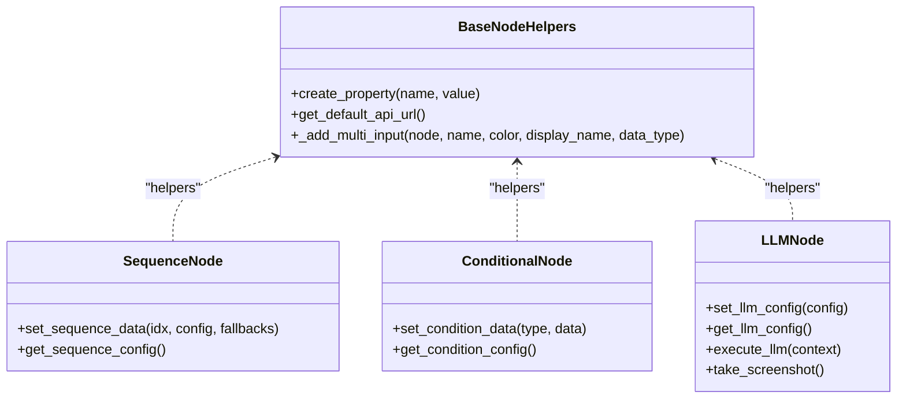

**Diagram sources**
- [base_node.py:1-60](file://LoOper/NGUI/nodes_resources/base_node.py#L1-L60)
- [sequence_node.py:12-127](file://LoOper/NGUI/nodes_resources/sequence_node.py#L12-L127)
- [conditional_node.py:10-162](file://LoOper/NGUI/nodes_resources/conditional_node.py#L10-L162)
- [llm_node.py:11-390](file://LoOper/NGUI/nodes_resources/llm_node.py#L11-L390)

**Section sources**
- [base_node.py:1-60](file://LoOper/NGUI/nodes_resources/base_node.py#L1-L60)
- [sequence_node.py:12-127](file://LoOper/NGUI/nodes_resources/sequence_node.py#L12-L127)
- [conditional_node.py:10-162](file://LoOper/NGUI/nodes_resources/conditional_node.py#L10-L162)
- [llm_node.py:11-390](file://LoOper/NGUI/nodes_resources/llm_node.py#L11-L390)

## Dependency Analysis
The managers depend on GraphManager for node operations, ConfigManager for serialization, and UIComponents for layout. NodeTransforms relies on GraphManager and NodeOperations to create new nodes and restore connections.

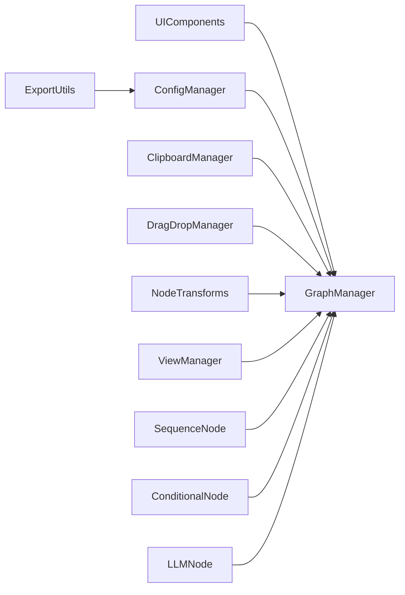

**Diagram sources**
- [graph_manager.py:51-445](file://LoOper/NGUI/graph_elements/graph_manager.py#L51-L445)
- [config_manager.py:30-800](file://LoOper/NGUI/graph_elements/config_manager.py#L30-L800)
- [clipboard_manager.py:5-243](file://LoOper/NGUI/graph_elements/clipboard_manager.py#L5-L243)
- [dnd_manager.py:7-342](file://LoOper/NGUI/graph_elements/dnd_manager.py#L7-L342)
- [node_transforms.py:22-506](file://LoOper/NGUI/graph_elements/node_transforms.py#L22-L506)
- [view_manager.py:26-295](file://LoOper/NGUI/graph_elements/view_manager.py#L26-L295)
- [export_utils.py:32-370](file://LoOper/NGUI/graph_elements/export_utils.py#L32-L370)
- [sequence_node.py:12-127](file://LoOper/NGUI/nodes_resources/sequence_node.py#L12-L127)
- [conditional_node.py:10-162](file://LoOper/NGUI/nodes_resources/conditional_node.py#L10-L162)
- [llm_node.py:11-390](file://LoOper/NGUI/nodes_resources/llm_node.py#L11-L390)

**Section sources**
- [graph_manager.py:51-445](file://LoOper/NGUI/graph_elements/graph_manager.py#L51-L445)
- [config_manager.py:30-800](file://LoOper/NGUI/graph_elements/config_manager.py#L30-L800)
- [clipboard_manager.py:5-243](file://LoOper/NGUI/graph_elements/clipboard_manager.py#L5-L243)
- [dnd_manager.py:7-342](file://LoOper/NGUI/graph_elements/dnd_manager.py#L7-L342)
- [node_transforms.py:22-506](file://LoOper/NGUI/graph_elements/node_transforms.py#L22-L506)
- [view_manager.py:26-295](file://LoOper/NGUI/graph_elements/view_manager.py#L26-L295)
- [export_utils.py:32-370](file://LoOper/NGUI/graph_elements/export_utils.py#L32-L370)
- [sequence_node.py:12-127](file://LoOper/NGUI/nodes_resources/sequence_node.py#L12-L127)
- [conditional_node.py:10-162](file://LoOper/NGUI/nodes_resources/conditional_node.py#L10-L162)
- [llm_node.py:11-390](file://LoOper/NGUI/nodes_resources/llm_node.py#L11-L390)

## Performance Considerations
- Large graphs: Use ViewManager’s visibility filtering and auto-layout only visible nodes to reduce computation.
- Multi-connection ports: Enabling multi-connection reduces overhead for complex wiring.
- Snapping: Grid-based snapping minimizes layout drift and improves readability.
- Export generation: Batch and Python exports are generated from the current configuration snapshot; ensure frequent saves to avoid recomputation.

[No sources needed since this section provides general guidance]

## Troubleshooting Guide
Common issues and resolutions:
- KeyError in node movement: A monkey patch prevents crashes when node views exist without corresponding model nodes.
- Paste position fallback: If scene mapping fails, paste positions are offset incrementally to avoid overlap.
- Unknown node type on drop: Logs unknown types and skips creation.
- Transform errors: Transform operations show critical messages and return None on failure.
- Export failures: Errors are caught and surfaced via message boxes; verify file paths and permissions.

**Section sources**
- [graph_manager.py:19-48](file://LoOper/NGUI/graph_elements/graph_manager.py#L19-L48)
- [clipboard_manager.py:92-243](file://LoOper/NGUI/graph_elements/clipboard_manager.py#L92-L243)
- [dnd_manager.py:128-204](file://LoOper/NGUI/graph_elements/dnd_manager.py#L128-L204)
- [node_transforms.py:89-96](file://LoOper/NGUI/graph_elements/node_transforms.py#L89-L96)
- [export_utils.py:84-92](file://LoOper/NGUI/graph_elements/export_utils.py#L84-L92)

## Conclusion
The graph operations system provides a robust foundation for creating, manipulating, and exporting workflows. With clear separation of concerns—managers for operations, nodes for behavior, and UI for interaction—you can extend the system by adding new node types, custom transforms, and export formats while maintaining graph integrity and performance.

[No sources needed since this section summarizes without analyzing specific files]

## Appendices

### Practical Examples

- Copy and paste nodes with preserved connections:
  - Select nodes, copy, then paste at a new location; connections between copied nodes are reconstructed.
  - Reference: [clipboard_manager.py:38-243](file://LoOper/NGUI/graph_elements/clipboard_manager.py#L38-L243)

- Drag-and-drop nodes onto the canvas:
  - Drag a node type from the toolbar; drop at the desired location; node is created and snapped to grid.
  - Reference: [dnd_manager.py:71-342](file://LoOper/NGUI/graph_elements/dnd_manager.py#L71-L342)

- Transform a node type:
  - Choose a transform from available options; connections are preserved and defaults are applied.
  - Reference: [node_transforms.py:446-506](file://LoOper/NGUI/graph_elements/node_transforms.py#L446-L506)

- Serialize and export a workflow:
  - Save the chain to JSON; export as batch or Python script for external execution.
  - References: [config_manager.py:214-254](file://LoOper/NGUI/graph_elements/config_manager.py#L214-L254), [export_utils.py:44-370](file://LoOper/NGUI/graph_elements/export_utils.py#L44-L370)

- Manage visibility and auto-layout:
  - Switch views to focus on specific node types; auto-layout only visible nodes for performance.
  - References: [view_manager.py:39-295](file://LoOper/NGUI/graph_elements/view_manager.py#L39-L295)

### Extending the System
- Add a new node type:
  - Define a new node class inheriting from BaseNode with ports and properties.
  - Register the node type in GraphManager.
  - Reference: [sequence_node.py:12-127](file://LoOper/NGUI/nodes_resources/sequence_node.py#L12-L127), [graph_manager.py:93-119](file://LoOper/NGUI/graph_elements/graph_manager.py#L93-L119)

- Implement a custom transform:
  - Extend NodeTransforms with a new transform method that preserves connections and sets defaults.
  - Reference: [node_transforms.py:22-506](file://LoOper/NGUI/graph_elements/node_transforms.py#L22-L506)

- Add export formats:
  - Extend ExportUtils with new format handlers and content generators.
  - Reference: [export_utils.py:329-370](file://LoOper/NGUI/graph_elements/export_utils.py#L329-L370)

- Maintain graph integrity:
  - Always restore connections after node creation or transformation.
  - Use ConfigManager to capture and rebuild the graph accurately.
  - References: [config_manager.py:256-352](file://LoOper/NGUI/graph_elements/config_manager.py#L256-L352), [node_transforms.py:398-445](file://LoOper/NGUI/graph_elements/node_transforms.py#L398-L445)