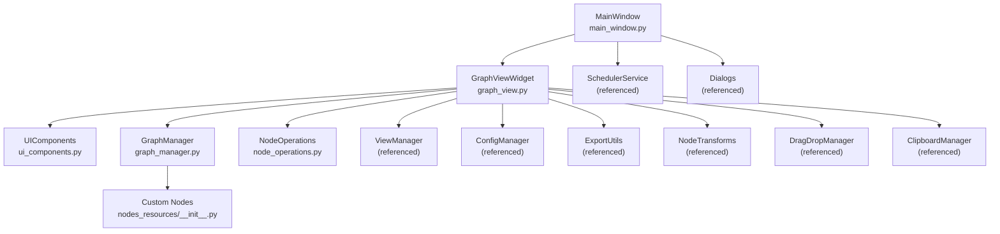
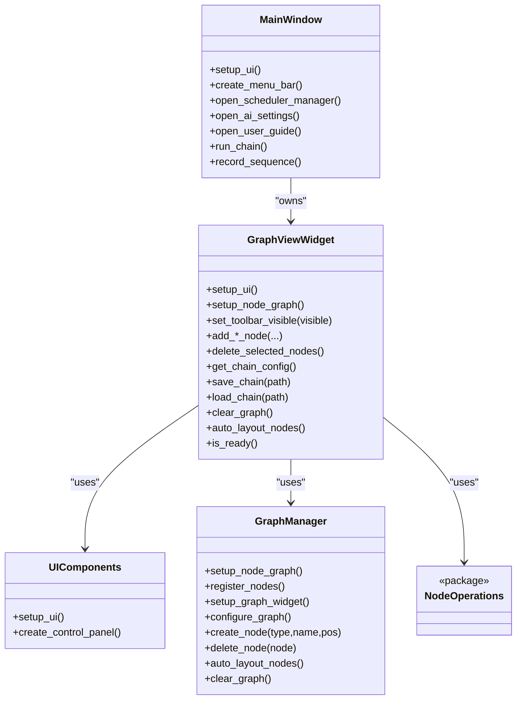
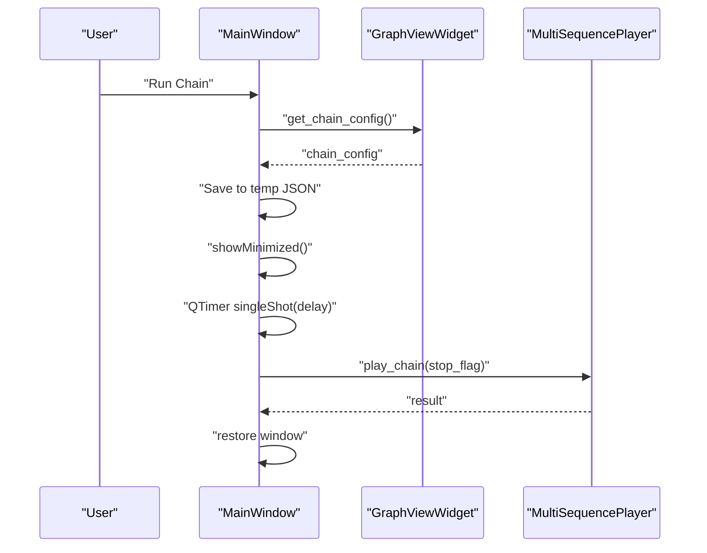
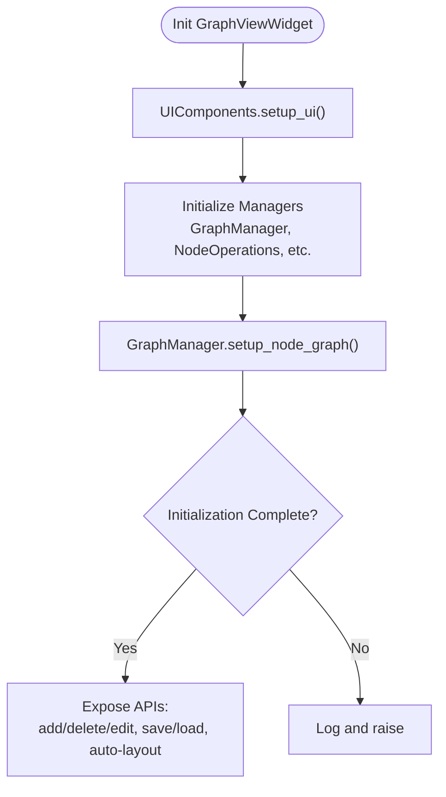
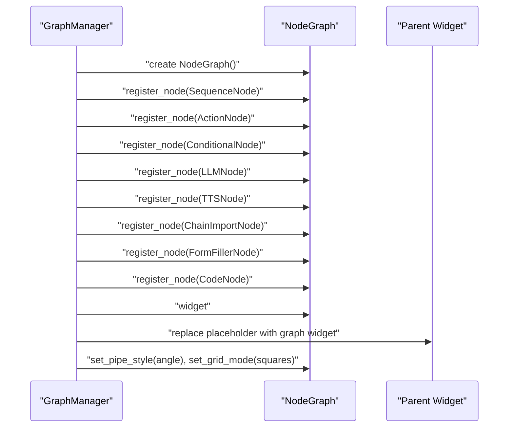
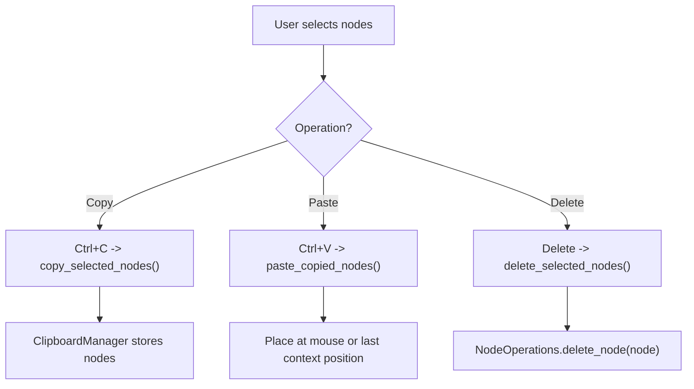
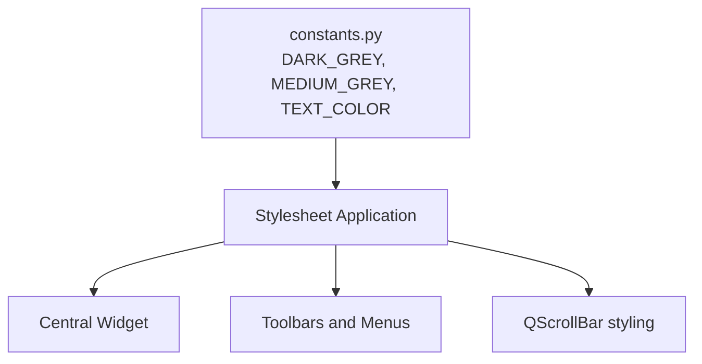
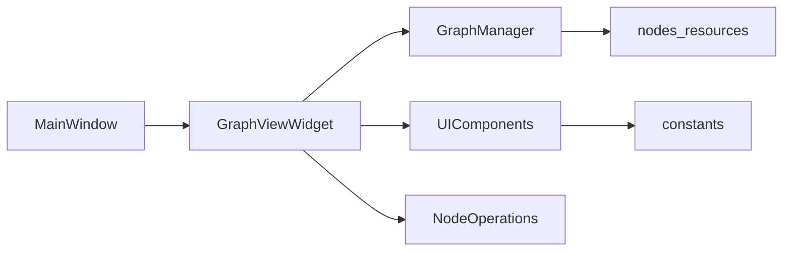

# Node Graph Editor

<cite>
**Referenced Files in This Document**
- [main_window.py](file://LoOper/NGUI/main_window.py)
- [graph_view.py](file://LoOper/NGUI/graph_view.py)
- [constants.py](file://LoOper/NGUI/constants.py)
- [ui_components.py](file://LoOper/NGUI/graph_elements/ui_components.py)
- [graph_manager.py](file://LoOper/NGUI/graph_elements/graph_manager.py)
- [node_operations.py](file://LoOper/NGUI/graph_elements/node_operations.py)
- [__init__.py](file://LoOper/NGUI/graph_elements/__init__.py)
- [__init__.py](file://LoOper/NGUI/nodes_resources/__init__.py)
</cite>

## Table of Contents
1. [Introduction](#introduction)
2. [Project Structure](#project-structure)
3. [Core Components](#core-components)
4. [Architecture Overview](#architecture-overview)
5. [Detailed Component Analysis](#detailed-component-analysis)
6. [Dependency Analysis](#dependency-analysis)
7. [Performance Considerations](#performance-considerations)
8. [Troubleshooting Guide](#troubleshooting-guide)
9. [Conclusion](#conclusion)
10. [Appendices](#appendices)

## Introduction
This document describes the node graph editor component built on PyQt5 and NodeGraphQt. It explains the main window architecture, graph view management, and node rendering system. It documents graph operations such as node creation, deletion, connection management, and selection handling. It also covers the dark theme implementation, UI customization options, and responsive design patterns. Practical examples show how to initialize the graph editor, handle user interactions, and manage graph state. The relationship between the graph editor and related components (dialog system and node operations) is addressed, along with performance considerations, memory management, and troubleshooting guidance.

## Project Structure
The node graph editor resides under the NGUI package and integrates tightly with the main application window. The structure emphasizes modularity:
- Main window orchestrates menus, dialogs, and background services.
- Graph view encapsulates the NodeGraphQt integration, UI layout, and graph operations.
- Modular managers handle UI components, graph lifecycle, node operations, view modes, configuration, exports, transforms, and drag-and-drop.

**Diagram sources**
- [main_window.py:85-120](file://LoOper/NGUI/main_window.py#L85-L120)
- [graph_view.py:43-128](file://LoOper/NGUI/graph_view.py#L43-L128)
- [ui_components.py:30-174](file://LoOper/NGUI/graph_elements/ui_components.py#L30-L174)
- [graph_manager.py:51-120](file://LoOper/NGUI/graph_elements/graph_manager.py#L51-L120)
- [node_operations.py:1-2](file://LoOper/NGUI/graph_elements/node_operations.py#L1-L2)
- [constants.py:1-32](file://LoOper/NGUI/constants.py#L1-L32)
- [__init__.py:1-19](file://LoOper/NGUI/graph_elements/__init__.py#L1-L19)
- [__init__.py:1-25](file://LoOper/NGUI/nodes_resources/__init__.py#L1-L25)

**Section sources**
- [main_window.py:85-120](file://LoOper/NGUI/main_window.py#L85-L120)
- [graph_view.py:43-128](file://LoOper/NGUI/graph_view.py#L43-L128)
- [ui_components.py:30-174](file://LoOper/NGUI/graph_elements/ui_components.py#L30-L174)
- [graph_manager.py:51-120](file://LoOper/NGUI/graph_elements/graph_manager.py#L51-L120)
- [node_operations.py:1-2](file://LoOper/NGUI/graph_elements/node_operations.py#L1-L2)
- [__init__.py:1-19](file://LoOper/NGUI/graph_elements/__init__.py#L1-L19)
- [__init__.py:1-25](file://LoOper/NGUI/nodes_resources/__init__.py#L1-L25)

## Core Components
- MainWindow: Creates the main application window, sets up the menu bar, initializes background services, and delegates graph operations to GraphViewWidget. It also opens dialogs for scheduling, AI settings, and user guide.
- GraphViewWidget: Central widget that composes modular managers, handles UI layout, keyboard shortcuts, drag-and-drop, context menus, and exposes APIs for node creation, deletion, selection, and graph state persistence.
- UIComponents: Manages the splitter-based layout with collapsible side panels, action toolbars, and the central graph area. Applies dark theme styling consistently.
- GraphManager: Initializes NodeGraphQt, registers custom node types, embeds the graph widget into the UI, configures pipes/grid, and provides node creation/deletion and auto-layout.
- NodeOperations: Orchestrates node creation/editing/deletion and supports specialized operations like conditional branches and sequence/action management.
- Constants: Defines the dark theme palette and port colors used across the UI and node visuals.

Key responsibilities:
- Initialization and lifecycle: MainWindow constructs GraphViewWidget; GraphViewWidget initializes managers and sets up the UI.
- Rendering and interaction: GraphManager embeds the NodeGraphQt widget and applies styling; GraphViewWidget wires keyboard shortcuts and context menus.
- State management: GraphViewWidget maintains chain configuration and exposes save/load/build operations via ConfigManager.
- Theming: Dark theme is enforced via stylesheet application in UIComponents and constants.

**Section sources**
- [main_window.py:85-120](file://LoOper/NGUI/main_window.py#L85-L120)
- [graph_view.py:43-128](file://LoOper/NGUI/graph_view.py#L43-L128)
- [ui_components.py:30-174](file://LoOper/NGUI/graph_elements/ui_components.py#L30-L174)
- [graph_manager.py:51-120](file://LoOper/NGUI/graph_elements/graph_manager.py#L51-L120)
- [constants.py:1-32](file://LoOper/NGUI/constants.py#L1-L32)

## Architecture Overview
The architecture follows a layered, modular design:
- Presentation layer: MainWindow and GraphViewWidget.
- UI composition: UIComponents manages layout and styling.
- Graph engine: GraphManager wraps NodeGraphQt, registers nodes, and embeds the view.
- Operations: NodeOperations coordinates node-specific actions.
- Utilities: Drag-and-drop, clipboard, transforms, and export utilities are integrated via managers.

**Diagram sources**
- [main_window.py:85-120](file://LoOper/NGUI/main_window.py#L85-L120)
- [graph_view.py:43-128](file://LoOper/NGUI/graph_view.py#L43-L128)
- [ui_components.py:30-174](file://LoOper/NGUI/graph_elements/ui_components.py#L30-L174)
- [graph_manager.py:51-120](file://LoOper/NGUI/graph_elements/graph_manager.py#L51-L120)
- [node_operations.py:1-2](file://LoOper/NGUI/graph_elements/node_operations.py#L1-L2)

## Detailed Component Analysis

### Main Window Architecture
- Window setup: Initializes the main window, sets geometry and icon, and applies central widget styling.
- Menu bar: Provides menus for File, Settings, Environment, View, Scheduler, and Documentation. The View menu toggles the right toolbar via GraphViewWidget.
- Background services: Starts a scheduler service and ensures graceful shutdown.
- Dialog orchestration: Opens dialogs for AI settings, scheduler management, and user guide.
- Chain execution: Saves current chain to a temporary JSON and runs it via a background thread while minimizing the window and restoring it upon completion.

**Diagram sources**
- [main_window.py:410-452](file://LoOper/NGUI/main_window.py#L410-L452)
- [graph_view.py:548-557](file://LoOper/NGUI/graph_view.py#L548-L557)

**Section sources**
- [main_window.py:85-120](file://LoOper/NGUI/main_window.py#L85-L120)
- [main_window.py:151-257](file://LoOper/NGUI/main_window.py#L151-L257)
- [main_window.py:410-452](file://LoOper/NGUI/main_window.py#L410-L452)

### Graph View Management
- Initialization: Sets up UI components, creates modular managers, and initializes the NodeGraphQt graph. Stores references to the graph widget and view for later operations.
- Layout and toolbars: Uses a splitter with collapsible left/right panels and top/bottom toolbars. Provides a method to toggle the right toolbar’s visibility.
- Keyboard shortcuts: Implements copy, paste, and delete shortcuts; delegates focus to the graph view.
- Event filtering: Handles drag-and-drop and snapping moved nodes to a grid.
- Node operations: Exposes convenience methods for adding/removing nodes, editing properties, and managing conditional branches. Delegates to NodeOperations.
- State management: Provides save/load/build operations and validation helpers.

**Diagram sources**
- [graph_view.py:43-128](file://LoOper/NGUI/graph_view.py#L43-L128)
- [graph_manager.py:64-92](file://LoOper/NGUI/graph_elements/graph_manager.py#L64-L92)

**Section sources**
- [graph_view.py:43-128](file://LoOper/NGUI/graph_view.py#L43-L128)
- [graph_view.py:129-186](file://LoOper/NGUI/graph_view.py#L129-L186)
- [graph_view.py:188-239](file://LoOper/NGUI/graph_view.py#L188-L239)
- [graph_view.py:240-272](file://LoOper/NGUI/graph_view.py#L240-L272)

### Node Rendering System
- Node registration: GraphManager registers custom node types with NodeGraphQt.
- Embedding the view: The NodeGraphQt widget is embedded into the UI container and replaces a placeholder widget.
- Styling and configuration: Applies pipe layout, grid mode, and focus policy to the graph widget.
- Multi-connection ports: Enables multi-connection capability on input and output ports for flexible wiring.

**Diagram sources**
- [graph_manager.py:93-120](file://LoOper/NGUI/graph_elements/graph_manager.py#L93-L120)
- [graph_manager.py:121-196](file://LoOper/NGUI/graph_elements/graph_manager.py#L121-L196)
- [graph_manager.py:198-214](file://LoOper/NGUI/graph_elements/graph_manager.py#L198-L214)
- [__init__.py:1-25](file://LoOper/NGUI/nodes_resources/__init__.py#L1-L25)

**Section sources**
- [graph_manager.py:93-120](file://LoOper/NGUI/graph_elements/graph_manager.py#L93-L120)
- [graph_manager.py:121-196](file://LoOper/NGUI/graph_elements/graph_manager.py#L121-L196)
- [graph_manager.py:198-214](file://LoOper/NGUI/graph_elements/graph_manager.py#L198-L214)
- [__init__.py:1-25](file://LoOper/NGUI/nodes_resources/__init__.py#L1-L25)

### Graph Operations: Creation, Deletion, Connections, Selection
- Node creation: GraphViewWidget exposes methods to add conditional, LLM, TTS, chain-import, and code nodes. Positions are resolved via a deterministic strategy.
- Node deletion: Supports deleting selected nodes and individual nodes; clears selection afterward.
- Connections: GraphManager provides a robust connect_nodes method with port resolution by name or default.
- Selection handling: Keyboard shortcuts for copy/paste/delete; event filter snaps moved nodes to grid.

**Diagram sources**
- [graph_view.py:192-217](file://LoOper/NGUI/graph_view.py#L192-L217)
- [graph_view.py:845-869](file://LoOper/NGUI/graph_view.py#L845-L869)
- [graph_manager.py:366-436](file://LoOper/NGUI/graph_elements/graph_manager.py#L366-L436)

**Section sources**
- [graph_view.py:320-423](file://LoOper/NGUI/graph_view.py#L320-L423)
- [graph_view.py:845-869](file://LoOper/NGUI/graph_view.py#L845-L869)
- [graph_manager.py:366-436](file://LoOper/NGUI/graph_elements/graph_manager.py#L366-L436)

### Dark Theme and UI Customization
- Color palette: Defined in constants for dark backgrounds, medium grays, light accents, and node-specific colors.
- Stylesheets: Applied at the central widget and toolbar level to enforce consistent dark theme across the UI.
- Scrollbar styling: Custom scrollbar appearance for vertical scroll areas.
- Responsive layout: Splitter-based layout with collapsible panels allows dynamic resizing and hiding of toolbars.

**Diagram sources**
- [constants.py:1-32](file://LoOper/NGUI/constants.py#L1-L32)
- [ui_components.py:46-71](file://LoOper/NGUI/graph_elements/ui_components.py#L46-L71)
- [ui_components.py:151-174](file://LoOper/NGUI/graph_elements/ui_components.py#L151-L174)

**Section sources**
- [constants.py:1-32](file://LoOper/NGUI/constants.py#L1-L32)
- [ui_components.py:46-71](file://LoOper/NGUI/graph_elements/ui_components.py#L46-L71)
- [ui_components.py:151-174](file://LoOper/NGUI/graph_elements/ui_components.py#L151-L174)

### Relationship to Dialog System and Node Operations
- Dialogs: MainWindow opens scheduler, AI settings, and user guide dialogs.
- Node operations: GraphViewWidget delegates node editing and specialized operations to NodeOperations (via the package re-export).
- Clipboard and drag-and-drop: Integrated via ClipboardManager and DragDropManager to support copy/paste and DnD from the toolbar.

**Section sources**
- [main_window.py:736-760](file://LoOper/NGUI/main_window.py#L736-L760)
- [node_operations.py:1-2](file://LoOper/NGUI/graph_elements/node_operations.py#L1-L2)
- [graph_view.py:112-113](file://LoOper/NGUI/graph_view.py#L112-L113)

## Dependency Analysis
- Module boundaries: GraphViewWidget composes managers from graph_elements; GraphManager depends on NodeGraphQt and nodes_resources; UIComponents depends on widgets and constants.
- External dependencies: NodeGraphQt for graph rendering and NodeGraphQt-based node types.
- Circular dependencies: None observed; managers are initialized in GraphViewWidget and used by it.

**Diagram sources**
- [graph_view.py:96-113](file://LoOper/NGUI/graph_view.py#L96-L113)
- [graph_manager.py:93-120](file://LoOper/NGUI/graph_elements/graph_manager.py#L93-L120)
- [ui_components.py:30-174](file://LoOper/NGUI/graph_elements/ui_components.py#L30-L174)
- [__init__.py:1-19](file://LoOper/NGUI/graph_elements/__init__.py#L1-L19)
- [__init__.py:1-25](file://LoOper/NGUI/nodes_resources/__init__.py#L1-L25)
- [main_window.py:85-120](file://LoOper/NGUI/main_window.py#L85-L120)

**Section sources**
- [graph_view.py:96-113](file://LoOper/NGUI/graph_view.py#L96-L113)
- [graph_manager.py:93-120](file://LoOper/NGUI/graph_elements/graph_manager.py#L93-L120)
- [ui_components.py:30-174](file://LoOper/NGUI/graph_elements/ui_components.py#L30-L174)
- [__init__.py:1-19](file://LoOper/NGUI/graph_elements/__init__.py#L1-L19)
- [__init__.py:1-25](file://LoOper/NGUI/nodes_resources/__init__.py#L1-L25)
- [main_window.py:85-120](file://LoOper/NGUI/main_window.py#L85-L120)

## Performance Considerations
- Large graphs: Auto-layout and connection operations can be expensive. Use auto-layout sparingly and batch operations when possible.
- Memory management: Clear sessions and delete nodes explicitly to avoid accumulating node instances. Use clear_graph to reset state.
- Rendering stability: The code includes a monkey patch to prevent KeyError during node movement, improving resilience for dynamic graph updates.
- Threading: Long-running tasks (recording, playback) run in background threads; ensure UI restoration occurs via Qt mechanisms to maintain responsiveness.

[No sources needed since this section provides general guidance]

## Troubleshooting Guide
Common issues and resolutions:
- Rendering problems: If nodes flicker or connections fail, verify that the graph widget is embedded correctly and that NodeGraphQt is initialized. The monkey patch helps mitigate KeyError during node movement.
- Selection conflicts: Ensure focus is delegated to the graph view when the widget gains focus. Use keyboard shortcuts to confirm selection state.
- UI responsiveness: When performing heavy operations, avoid blocking the UI thread. The code demonstrates background execution for chain playback and recording.
- Toolbar visibility: Use the View menu to toggle the right toolbar; if it does not respond, check splitter and toolbar widget references.

**Section sources**
- [graph_manager.py:19-47](file://LoOper/NGUI/graph_elements/graph_manager.py#L19-L47)
- [graph_view.py:219-239](file://LoOper/NGUI/graph_view.py#L219-L239)
- [main_window.py:316-384](file://LoOper/NGUI/main_window.py#L316-L384)

## Conclusion
The node graph editor integrates PyQt5 and NodeGraphQt into a cohesive, dark-themed visual programming environment. Its modular design separates concerns across UI composition, graph lifecycle, operations, and utilities. The system supports essential graph operations, robust state management, and responsive UI patterns. By following the documented initialization and interaction patterns, developers can extend functionality, optimize performance for large graphs, and troubleshoot common issues effectively.

[No sources needed since this section summarizes without analyzing specific files]

## Appendices

### Practical Examples

- Initialize the graph editor:
  - Create MainWindow, which constructs GraphViewWidget and sets up the UI and menu bar.
  - GraphViewWidget initializes UIComponents and GraphManager, then embeds the NodeGraphQt widget.

- Handle user interactions:
  - Keyboard shortcuts: Copy, paste, and delete nodes; GraphViewWidget routes these to clipboard and node operations.
  - Context menu: Right-click triggers a custom context menu managed by NodeContextMenuManager.

- Manage graph state:
  - Save/load chain configurations via GraphViewWidget’s save_chain and load_chain.
  - Build the graph from a configuration using build_graph_from_config.
  - Clear the graph with clear_graph to reset the session.

**Section sources**
- [main_window.py:85-120](file://LoOper/NGUI/main_window.py#L85-L120)
- [graph_view.py:129-186](file://LoOper/NGUI/graph_view.py#L129-L186)
- [graph_view.py:575-622](file://LoOper/NGUI/graph_view.py#L575-L622)
- [graph_view.py:530-537](file://LoOper/NGUI/graph_view.py#L530-L537)