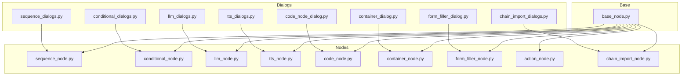
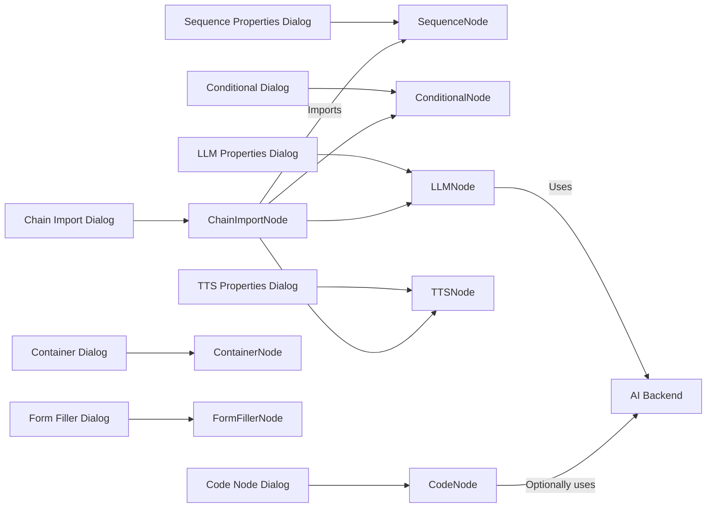

# Node Types

<cite>
**Referenced Files in This Document**
- [base_node.py](file://LoOper/NGUI/nodes_resources/base_node.py)
- [sequence_node.py](file://LoOper/NGUI/nodes_resources/sequence_node.py)
- [conditional_node.py](file://LoOper/NGUI/nodes_resources/conditional_node.py)
- [llm_node.py](file://LoOper/NGUI/nodes_resources/llm_node.py)
- [tts_node.py](file://LoOper/NGUI/nodes_resources/tts_node.py)
- [code_node.py](file://LoOper/NGUI/nodes_resources/code_node.py)
- [container_node.py](file://LoOper/NGUI/nodes_resources/container_node.py)
- [form_filler_node.py](file://LoOper/NGUI/nodes_resources/form_filler_node.py)
- [action_node.py](file://LoOper/NGUI/nodes_resources/action_node.py)
- [chain_import_node.py](file://LoOper/NGUI/nodes_resources/chain_import_node.py)
- [sequence_dialogs.py](file://LoOper/NGUI/dialogs/sequence_dialogs.py)
- [conditional_dialogs.py](file://LoOper/NGUI/dialogs/conditional_dialogs.py)
- [llm_dialogs.py](file://LoOper/NGUI/dialogs/llm_dialogs.py)
- [tts_dialogs.py](file://LoOper/NGUI/dialogs/tts_dialogs.py)
- [code_node_dialog.py](file://LoOper/NGUI/dialogs/code_node_dialog.py)
- [container_dialog.py](file://LoOper/NGUI/dialogs/container_dialog.py)
- [form_filler_dialog.py](file://LoOper/NGUI/dialogs/form_filler_dialog.py)
- [chain_import_dialogs.py](file://LoOper/NGUI/dialogs/chain_import_dialogs.py)
</cite>

## Table of Contents
1. [Introduction](#introduction)
2. [Project Structure](#project-structure)
3. [Core Components](#core-components)
4. [Architecture Overview](#architecture-overview)
5. [Detailed Component Analysis](#detailed-component-analysis)
6. [Dependency Analysis](#dependency-analysis)
7. [Performance Considerations](#performance-considerations)
8. [Troubleshooting Guide](#troubleshooting-guide)
9. [Conclusion](#conclusion)
10. [Appendices](#appendices)

## Introduction
This document describes all node types in the visual workflow builder system. It explains the base node architecture, shared functionality, and the properties, configuration options, inputs/outputs, and execution behavior for each node type. It also covers node transformation capabilities, validation rules, error handling, performance considerations, and guidance for extending the system with custom node types.

## Project Structure
The node system is organized around a base node abstraction and specialized node implementations. Each node exposes properties and ports, and dialogs provide configuration UIs. The base utilities centralize multi-input port creation and default API URL resolution.

**Diagram sources**
- [base_node.py:1-60](file://LoOper/NGUI/nodes_resources/base_node.py#L1-L60)
- [sequence_node.py:1-127](file://LoOper/NGUI/nodes_resources/sequence_node.py#L1-L127)
- [conditional_node.py:1-162](file://LoOper/NGUI/nodes_resources/conditional_node.py#L1-L162)
- [llm_node.py:1-390](file://LoOper/NGUI/nodes_resources/llm_node.py#L1-L390)
- [tts_node.py:1-150](file://LoOper/NGUI/nodes_resources/tts_node.py#L1-L150)
- [code_node.py:1-141](file://LoOper/NGUI/nodes_resources/code_node.py#L1-L141)
- [container_node.py:1-74](file://LoOper/NGUI/nodes_resources/container_node.py#L1-L74)
- [form_filler_node.py:1-57](file://LoOper/NGUI/nodes_resources/form_filler_node.py#L1-L57)
- [action_node.py:1-109](file://LoOper/NGUI/nodes_resources/action_node.py#L1-L109)
- [chain_import_node.py:1-156](file://LoOper/NGUI/nodes_resources/chain_import_node.py#L1-L156)
- [sequence_dialogs.py:1-51](file://LoOper/NGUI/dialogs/sequence_dialogs.py#L1-L51)
- [conditional_dialogs.py:1-790](file://LoOper/NGUI/dialogs/conditional_dialogs.py#L1-L790)
- [llm_dialogs.py:1-1145](file://LoOper/NGUI/dialogs/llm_dialogs.py#L1-L1145)
- [tts_dialogs.py:1-88](file://LoOper/NGUI/dialogs/tts_dialogs.py#L1-L88)
- [code_node_dialog.py:1-434](file://LoOper/NGUI/dialogs/code_node_dialog.py#L1-L434)
- [container_dialog.py:1-117](file://LoOper/NGUI/dialogs/container_dialog.py#L1-L117)
- [form_filler_dialog.py:1-79](file://LoOper/NGUI/dialogs/form_filler_dialog.py#L1-L79)
- [chain_import_dialogs.py:1-280](file://LoOper/NGUI/dialogs/chain_import_dialogs.py#L1-L280)

**Section sources**
- [base_node.py:1-60](file://LoOper/NGUI/nodes_resources/base_node.py#L1-L60)
- [sequence_node.py:1-127](file://LoOper/NGUI/nodes_resources/sequence_node.py#L1-L127)
- [conditional_node.py:1-162](file://LoOper/NGUI/nodes_resources/conditional_node.py#L1-L162)
- [llm_node.py:1-390](file://LoOper/NGUI/nodes_resources/llm_node.py#L1-L390)
- [tts_node.py:1-150](file://LoOper/NGUI/nodes_resources/tts_node.py#L1-L150)
- [code_node.py:1-141](file://LoOper/NGUI/nodes_resources/code_node.py#L1-L141)
- [container_node.py:1-74](file://LoOper/NGUI/nodes_resources/container_node.py#L1-L74)
- [form_filler_node.py:1-57](file://LoOper/NGUI/nodes_resources/form_filler_node.py#L1-L57)
- [action_node.py:1-109](file://LoOper/NGUI/nodes_resources/action_node.py#L1-L109)
- [chain_import_node.py:1-156](file://LoOper/NGUI/nodes_resources/chain_import_node.py#L1-L156)

## Core Components
- Base node utilities:
  - Multi-input port helper with fallbacks for different NodeGraphQt versions.
  - Default API URL resolver using environment variables.
- Node base class: All node classes inherit from the NodeGraphQt BaseNode and register properties via a uniform API.

Key behaviors:
- Ports are added with multi-connection support when applicable.
- Properties are registered without rendering inline widgets to keep the graph clean.
- Node colors and fonts are styled consistently.

**Section sources**
- [base_node.py:1-60](file://LoOper/NGUI/nodes_resources/base_node.py#L1-L60)

## Architecture Overview
The node architecture follows a layered pattern:
- Base utilities encapsulate cross-cutting concerns (ports, defaults).
- Each node defines its ports and properties, and optionally exposes an execution method.
- Dialogs provide configuration UIs and validation for node properties.

```mermaid
classDiagram
class BaseNode {
+create_property(name, value)
+add_multi_input(...)
+get_default_api_url()
}
class SequenceNode {
+set_sequence_data(idx, config, fallbacks)
+get_sequence_config() dict
}
class ConditionalNode {
+set_condition_data(type, data)
+get_condition_config() dict
}
class LLMNode {
+set_llm_config(config)
+get_llm_config() dict
+execute_llm(ctx) dict
}
class TTSNode {
+set_tts_config(config)
+get_tts_config() dict
+execute_tts(ctx) dict
}
class CodeNode {
+get_code_config() dict
+execute_code(input_data, args, runtime_code) dict
}
class ContainerNode {
+get_container_config() dict
}
class FormFillerNode {
+get_form_filler_config() dict
}
class ActionNode {
+set_action_data(seq_idx, action_idx, data, has_fallback)
}
class ChainImportNode {
+set_chain_import_data(path, mode, prefix, loops, delay, enabled)
+get_chain_import_config() dict
+is_valid_chain() bool
}
BaseNode <|-- SequenceNode
BaseNode <|-- ConditionalNode
BaseNode <|-- LLMNode
BaseNode <|-- TTSNode
BaseNode <|-- CodeNode
BaseNode <|-- ContainerNode
BaseNode <|-- FormFillerNode
BaseNode <|-- ActionNode
BaseNode <|-- ChainImportNode
```

**Diagram sources**
- [base_node.py:1-60](file://LoOper/NGUI/nodes_resources/base_node.py#L1-L60)
- [sequence_node.py:1-127](file://LoOper/NGUI/nodes_resources/sequence_node.py#L1-L127)
- [conditional_node.py:1-162](file://LoOper/NGUI/nodes_resources/conditional_node.py#L1-L162)
- [llm_node.py:1-390](file://LoOper/NGUI/nodes_resources/llm_node.py#L1-L390)
- [tts_node.py:1-150](file://LoOper/NGUI/nodes_resources/tts_node.py#L1-L150)
- [code_node.py:1-141](file://LoOper/NGUI/nodes_resources/code_node.py#L1-L141)
- [container_node.py:1-74](file://LoOper/NGUI/nodes_resources/container_node.py#L1-L74)
- [form_filler_node.py:1-57](file://LoOper/NGUI/nodes_resources/form_filler_node.py#L1-L57)
- [action_node.py:1-109](file://LoOper/NGUI/nodes_resources/action_node.py#L1-L109)
- [chain_import_node.py:1-156](file://LoOper/NGUI/nodes_resources/chain_import_node.py#L1-L156)

## Detailed Component Analysis

### Base Node Architecture
- Purpose: Provide compatibility and convenience helpers for port creation and default API URL resolution.
- Multi-input port helper:
  - Attempts multiple APIs to attach a multi-connection port.
  - Safely avoids overwriting internal type metadata that NodeGraphQt relies on.
- Default API URL:
  - Reads TAILSCALE_SERVER_IP and API_PORT environment variables with sensible defaults.

Validation and error handling:
- Graceful fallbacks for missing APIs and attributes.
- Safe property registration to avoid breaking node creation.

**Section sources**
- [base_node.py:1-60](file://LoOper/NGUI/nodes_resources/base_node.py#L1-L60)

### Sequence Node
- Purpose: Represents a sequence in the chain; drives action execution with optional looping and delays.
- Ports:
  - Input: multi-input (universal type).
  - Output: multi-output (universal type).
- Properties:
  - sequence_file: target sequence file (stored as filename).
  - loop_count: number of repetitions.
  - extra_delay: seconds to wait between loops.
  - use_app_opened: whether to use recorded app context.
- Behavior:
  - Accepts a sequence configuration (legacy string or dict).
  - Stores only the filename to prevent GUI numbering interference.
  - Updates node color based on fallback presence.

Execution:
- Playback uses the stored filename to locate the sequence file.

**Section sources**
- [sequence_node.py:1-127](file://LoOper/NGUI/nodes_resources/sequence_node.py#L1-L127)
- [sequence_dialogs.py:1-51](file://LoOper/NGUI/dialogs/sequence_dialogs.py#L1-L51)

### Conditional Node
- Purpose: Decision-making node controlling flow with multiple condition types (presence/absence, OCR, loops, code).
- Ports:
  - Input: multi-input (universal type).
  - Outputs: true/false (colored).
- Properties:
  - condition_type, image_path, confidence, timeout.
  - OCR: target_text, case_sensitive.
  - Loops: loop_type, loop_position, sequence_file, iteration_delay, loop_condition.
  - Code: code snippet with timeout.
  - Additional: max_loops, max_attempts, delay_between_attempts, wait_time.
- Behavior:
  - Persists condition data and updates node name to reflect type.
  - Builds a configuration dict for downstream consumers.

Validation:
- Enforces timeouts for absence triggers.
- Provides UI previews for condition items.

**Section sources**
- [conditional_node.py:1-162](file://LoOper/NGUI/nodes_resources/conditional_node.py#L1-L162)
- [conditional_dialogs.py:1-790](file://LoOper/NGUI/dialogs/conditional_dialogs.py#L1-L790)

### LLM Node
- Purpose: Integrates with an LLM backend to generate text and optionally drive text typing.
- Ports:
  - input: multi-input (universal).
  - tools: multi-input (universal).
  - context: multi-input (universal).
  - output: multi-output (universal).
  - context: multi-output (universal).
- Properties (selected):
  - model, prompt, system_message, temperature, max_tokens, output_variable.
  - api_url, write_text, use_vision, vision_model, use_advanced_vision.
  - screenshot_enabled, use_comorag, max_cycles, memory_size.
  - typing_batch_size, typing_batch_delay, input_source, ocr_confidence, ocr_preprocessing.
  - use_async, use_direct_rag, rag_* settings, rag_documents, tool_descriptions.
- Execution:
  - execute_llm replaces context variables in prompt, optionally captures screenshots for vision, and calls the backend.
  - Cleans up screenshots after use.
- Vision detection:
  - Uses model capability checks and can auto-screenshot when enabled.

Validation:
- Converts string booleans to proper types.
- JSON-serializes rag_documents and tool_descriptions safely.

**Section sources**
- [llm_node.py:1-390](file://LoOper/NGUI/nodes_resources/llm_node.py#L1-L390)
- [llm_dialogs.py:1-1145](file://LoOper/NGUI/dialogs/llm_dialogs.py#L1-L1145)

### TTS Node
- Purpose: Synthesizes speech from text using a local TTS engine.
- Ports:
  - Input: multi-input (universal).
  - Output: multi-output (universal).
- Properties:
  - text, language, rate, volume, voice_id, save_to_file, output_file, wait_for_completion.
- Execution:
  - Replaces context variables in text.
  - Initializes engine, sets rate/volume/voice, speaks or saves to file depending on settings.

Validation:
- Gracefully handles missing TTS library and runtime errors.

**Section sources**
- [tts_node.py:1-150](file://LoOper/NGUI/nodes_resources/tts_node.py#L1-L150)
- [tts_dialogs.py:1-88](file://LoOper/NGUI/dialogs/tts_dialogs.py#L1-L88)

### Code Node
- Purpose: Executes arbitrary Python code on input triggers; supports external scripts and AI-assisted generation.
- Ports:
  - Input: multi-input (universal).
  - Output: multi-output (universal).
- Properties:
  - code, file_path, execute_on_input, output_variable, timeout, gen_model, gen_prompt.
- Execution:
  - Loads code from file if provided; otherwise uses embedded code.
  - Executes in a controlled local scope and extracts the result variable.
- AI generation:
  - Uses an LLM to generate code based on a prompt and model.

Validation:
- Ensures non-empty code before execution.
- Threaded generation with status feedback.

**Section sources**
- [code_node.py:1-141](file://LoOper/NGUI/nodes_resources/code_node.py#L1-L141)
- [code_node_dialog.py:1-434](file://LoOper/NGUI/dialogs/code_node_dialog.py#L1-L434)

### Container Node
- Purpose: Runs headless tasks inside a virtualized environment (e.g., Windows Sandbox).
- Ports:
  - Input: multi-input (universal).
  - Output: multi-output (universal).
- Properties:
  - iso_path, memory_mb, cpu_cores, hide_window, execute_on_input, output_variable, timeout.
- Execution:
  - Intended to orchestrate VM-based execution; configuration is exposed via dialog.

Validation:
- Numeric ranges enforced for memory and CPU.
- File path selection via dialog.

**Section sources**
- [container_node.py:1-74](file://LoOper/NGUI/nodes_resources/container_node.py#L1-L74)
- [container_dialog.py:1-117](file://LoOper/NGUI/dialogs/container_dialog.py#L1-L117)

### Form Filler Node
- Purpose: Deprecated form-filling node (placeholder).
- Ports:
  - Input: single input.
  - Output: single output.
- Properties:
  - instruction, model, confidence_threshold.
- Note:
  - Node name is marked as deprecated; kept for backward compatibility.

**Section sources**
- [form_filler_node.py:1-57](file://LoOper/NGUI/nodes_resources/form_filler_node.py#L1-L57)
- [form_filler_dialog.py:1-79](file://LoOper/NGUI/dialogs/form_filler_dialog.py#L1-L79)

### Action Node
- Purpose: Represents an individual action within a sequence (click, key, scroll, delay).
- Ports:
  - Input: multi-input (universal).
  - Output: multi-output (universal).
- Properties:
  - action_type, details.
- Behavior:
  - Sets node name based on action type and coordinates/description.
  - Adjusts color based on fallback presence or screenshot requirement.

**Section sources**
- [action_node.py:1-109](file://LoOper/NGUI/nodes_resources/action_node.py#L1-L109)

### Chain Import Node
- Purpose: Imports another chain to compose larger automations; supports modes and sandbox execution.
- Ports:
  - Input: multi-input (universal).
  - Output: multi-output (universal).
- Properties:
  - chain_file, run_in_sandbox, show_sandbox_window, import_mode, prefix, loop_count, extra_delay, enabled.
- Validation:
  - Validates existence and readability of the chain file.
  - Computes counts of sequences and node types for display.
  - Enables OK only when the chain contains supported node types.

**Section sources**
- [chain_import_node.py:1-156](file://LoOper/NGUI/nodes_resources/chain_import_node.py#L1-L156)
- [chain_import_dialogs.py:1-280](file://LoOper/NGUI/dialogs/chain_import_dialogs.py#L1-L280)

## Dependency Analysis
- Node-to-Dialog coupling:
  - Each node’s configuration dialog reads/writes the node’s properties and validates inputs.
- Cross-node dependencies:
  - LLM and Code nodes can feed into other nodes via universal ports.
  - Conditional nodes branch execution to true/false outputs.
  - Chain Import node can inject sequences and nodes into the graph.
- External integrations:
  - LLM node integrates with AI backend and optional vision/screenshot utilities.
  - Code node dialog optionally integrates with AI for code generation.
  - Container node dialog manages VM file paths and resource settings.

**Diagram sources**
- [sequence_dialogs.py:1-51](file://LoOper/NGUI/dialogs/sequence_dialogs.py#L1-L51)
- [conditional_dialogs.py:1-790](file://LoOper/NGUI/dialogs/conditional_dialogs.py#L1-L790)
- [llm_dialogs.py:1-1145](file://LoOper/NGUI/dialogs/llm_dialogs.py#L1-L1145)
- [tts_dialogs.py:1-88](file://LoOper/NGUI/dialogs/tts_dialogs.py#L1-L88)
- [code_node_dialog.py:1-434](file://LoOper/NGUI/dialogs/code_node_dialog.py#L1-L434)
- [container_dialog.py:1-117](file://LoOper/NGUI/dialogs/container_dialog.py#L1-L117)
- [form_filler_dialog.py:1-79](file://LoOper/NGUI/dialogs/form_filler_dialog.py#L1-L79)
- [chain_import_dialogs.py:1-280](file://LoOper/NGUI/dialogs/chain_import_dialogs.py#L1-L280)
- [sequence_node.py:1-127](file://LoOper/NGUI/nodes_resources/sequence_node.py#L1-L127)
- [conditional_node.py:1-162](file://LoOper/NGUI/nodes_resources/conditional_node.py#L1-L162)
- [llm_node.py:1-390](file://LoOper/NGUI/nodes_resources/llm_node.py#L1-L390)
- [tts_node.py:1-150](file://LoOper/NGUI/nodes_resources/tts_node.py#L1-L150)
- [code_node.py:1-141](file://LoOper/NGUI/nodes_resources/code_node.py#L1-L141)
- [container_node.py:1-74](file://LoOper/NGUI/nodes_resources/container_node.py#L1-L74)
- [form_filler_node.py:1-57](file://LoOper/NGUI/nodes_resources/form_filler_node.py#L1-L57)
- [chain_import_node.py:1-156](file://LoOper/NGUI/nodes_resources/chain_import_node.py#L1-L156)

**Section sources**
- [sequence_dialogs.py:1-51](file://LoOper/NGUI/dialogs/sequence_dialogs.py#L1-L51)
- [conditional_dialogs.py:1-790](file://LoOper/NGUI/dialogs/conditional_dialogs.py#L1-L790)
- [llm_dialogs.py:1-1145](file://LoOper/NGUI/dialogs/llm_dialogs.py#L1-L1145)
- [tts_dialogs.py:1-88](file://LoOper/NGUI/dialogs/tts_dialogs.py#L1-L88)
- [code_node_dialog.py:1-434](file://LoOper/NGUI/dialogs/code_node_dialog.py#L1-L434)
- [container_dialog.py:1-117](file://LoOper/NGUI/dialogs/container_dialog.py#L1-L117)
- [form_filler_dialog.py:1-79](file://LoOper/NGUI/dialogs/form_filler_dialog.py#L1-L79)
- [chain_import_dialogs.py:1-280](file://LoOper/NGUI/dialogs/chain_import_dialogs.py#L1-L280)

## Performance Considerations
- Asynchronous processing:
  - LLM nodes support asynchronous execution to avoid blocking the workflow.
- Typing optimization:
  - LLM nodes can batch typing to reduce latency.
- Multi-connection ports:
  - Reduce overhead by connecting multiple upstream nodes to a single input/output.
- Vision and screenshots:
  - Screenshots are taken only when vision is enabled and cleaned up after use.
- Container execution:
  - Resource limits (memory/CPU) and timeouts should be tuned to avoid long hangs.
- Conditional loops:
  - Enforce max attempts and iteration delays to prevent infinite loops.

[No sources needed since this section provides general guidance]

## Troubleshooting Guide
Common issues and resolutions:
- Missing TTS engine:
  - Symptom: TTS execution fails with a library error.
  - Resolution: Install the required TTS library as indicated by the error message.
- LLM execution failures:
  - Symptom: LLM returns an error response.
  - Resolution: Verify API URL, model availability, and network connectivity; check OCR and vision settings.
- Empty or invalid code:
  - Symptom: Code node reports “No code to execute”.
  - Resolution: Provide either an internal code snippet or a valid external file path.
- Chain import errors:
  - Symptom: Node name shows error or OK button disabled.
  - Resolution: Select a valid JSON chain file containing supported node types.
- Conditional absence triggers:
  - Symptom: Workflow stalls unexpectedly.
  - Resolution: Ensure a positive timeout is set for absence triggers.

**Section sources**
- [tts_node.py:142-150](file://LoOper/NGUI/nodes_resources/tts_node.py#L142-L150)
- [llm_node.py:388-390](file://LoOper/NGUI/nodes_resources/llm_node.py#L388-L390)
- [code_node.py:109-111](file://LoOper/NGUI/nodes_resources/code_node.py#L109-L111)
- [chain_import_dialogs.py:179-222](file://LoOper/NGUI/dialogs/chain_import_dialogs.py#L179-L222)
- [conditional_dialogs.py:675-681](file://LoOper/NGUI/dialogs/conditional_dialogs.py#L675-L681)

## Conclusion
The node system provides a robust, extensible foundation for building visual workflows. Each node type encapsulates clear responsibilities, exposes consistent properties and ports, and integrates with dialogs for configuration. By leveraging multi-connection ports, asynchronous execution, and validation helpers, the system supports complex automation scenarios while maintaining usability and reliability.

[No sources needed since this section summarizes without analyzing specific files]

## Appendices

### Node Transformation Capabilities
- Multi-input ports:
  - Nodes use a helper to add multi-connection inputs with fallbacks for different NodeGraphQt versions.
- Property registration:
  - All nodes register properties without rendering inline widgets, keeping the UI clean.
- Color and styling:
  - Nodes set colors and fonts for better visual distinction.

**Section sources**
- [base_node.py:25-60](file://LoOper/NGUI/nodes_resources/base_node.py#L25-L60)

### Validation Rules and Error Handling
- Base utilities:
  - Fallbacks for missing APIs and attributes; safe property registration.
- Conditional node:
  - Enforces absence trigger timeouts.
- Chain import:
  - Validates file existence and node counts; enables OK only when valid.
- LLM/TTS/Code:
  - Graceful error handling with informative messages.

**Section sources**
- [base_node.py:1-60](file://LoOper/NGUI/nodes_resources/base_node.py#L1-L60)
- [conditional_dialogs.py:675-681](file://LoOper/NGUI/dialogs/conditional_dialogs.py#L675-L681)
- [chain_import_dialogs.py:179-222](file://LoOper/NGUI/dialogs/chain_import_dialogs.py#L179-L222)
- [tts_node.py:142-150](file://LoOper/NGUI/nodes_resources/tts_node.py#L142-L150)
- [code_node.py:135-141](file://LoOper/NGUI/nodes_resources/code_node.py#L135-L141)

### Example Workflows
- LLM-driven text typing:
  - Place an LLM node with a prompt and enable writing text; connect output to a downstream node that requires text input.
- Conditional branching:
  - Add a Conditional node with a presence trigger; connect true/false outputs to different downstream nodes.
- Sequence chaining:
  - Connect multiple Sequence nodes; configure loop counts and delays in the Sequence Properties dialog.
- Chain composition:
  - Use a Chain Import node to embed another chain; choose import mode and prefix as needed.

[No sources needed since this section provides general guidance]

### Extending the System with Custom Node Types
Steps to add a new node:
1. Create a new class inheriting from the base node utility.
2. Define ports (inputs/outputs) and register properties.
3. Implement configuration dialogs to manage properties.
4. Add execution logic if the node performs actions.
5. Wire up UI interactions and validation in the dialog.
6. Test multi-connection behavior and property persistence.

Guidelines:
- Use the multi-input helper for consistent port behavior.
- Keep property registration separate from UI rendering.
- Provide sensible defaults and validation in the dialog.

**Section sources**
- [base_node.py:1-60](file://LoOper/NGUI/nodes_resources/base_node.py#L1-L60)
- [llm_dialogs.py:1-1145](file://LoOper/NGUI/dialogs/llm_dialogs.py#L1-L1145)
- [code_node_dialog.py:1-434](file://LoOper/NGUI/dialogs/code_node_dialog.py#L1-L434)
- [chain_import_dialogs.py:1-280](file://LoOper/NGUI/dialogs/chain_import_dialogs.py#L1-L280)