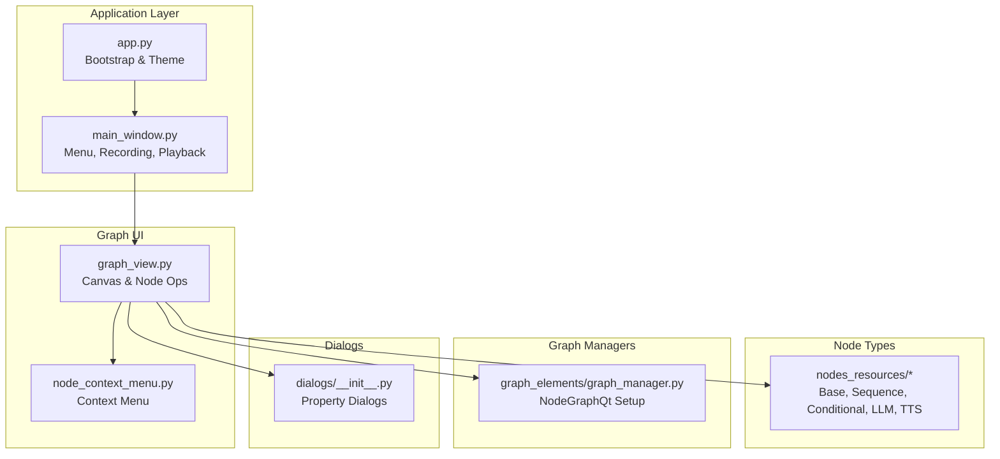
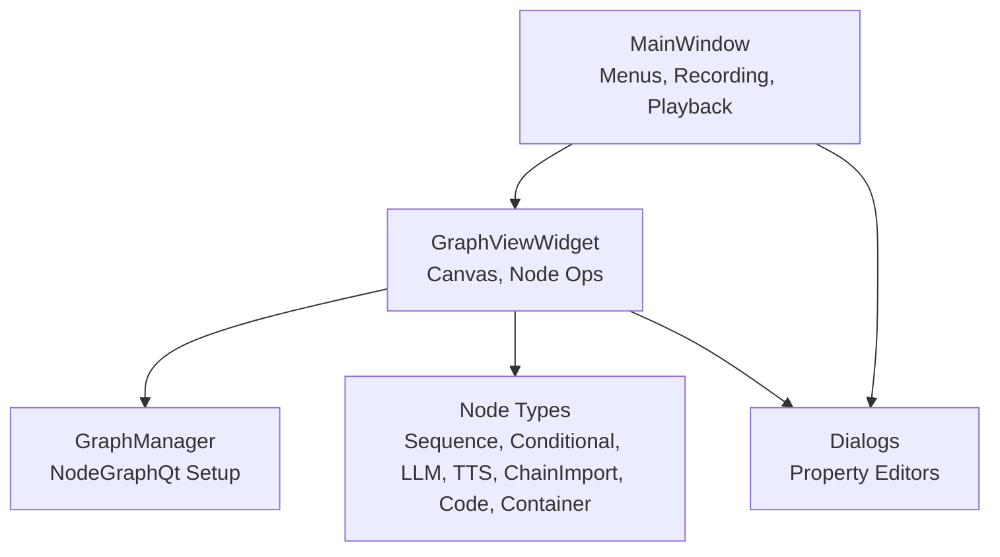
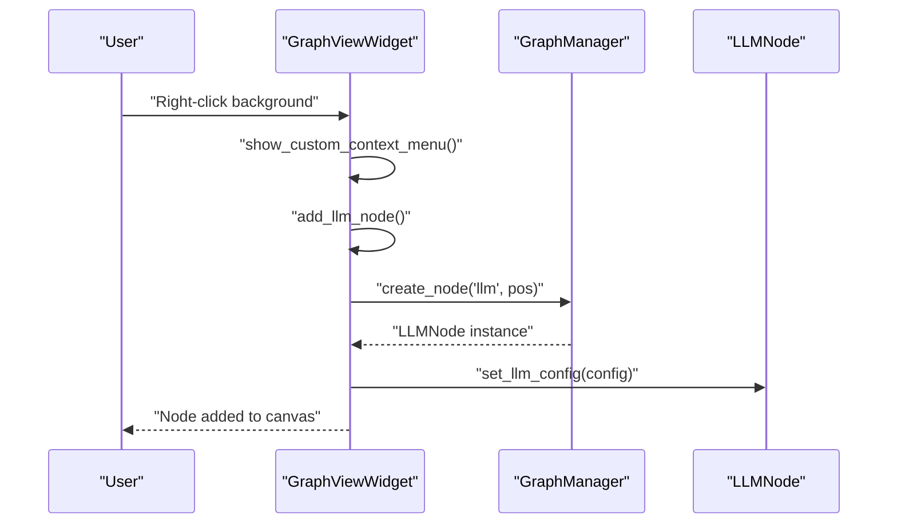
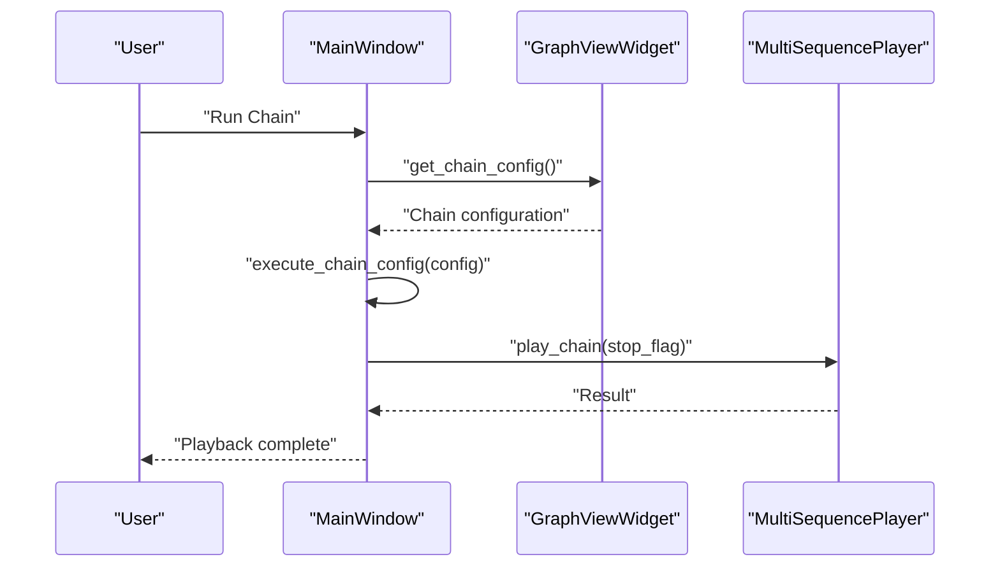
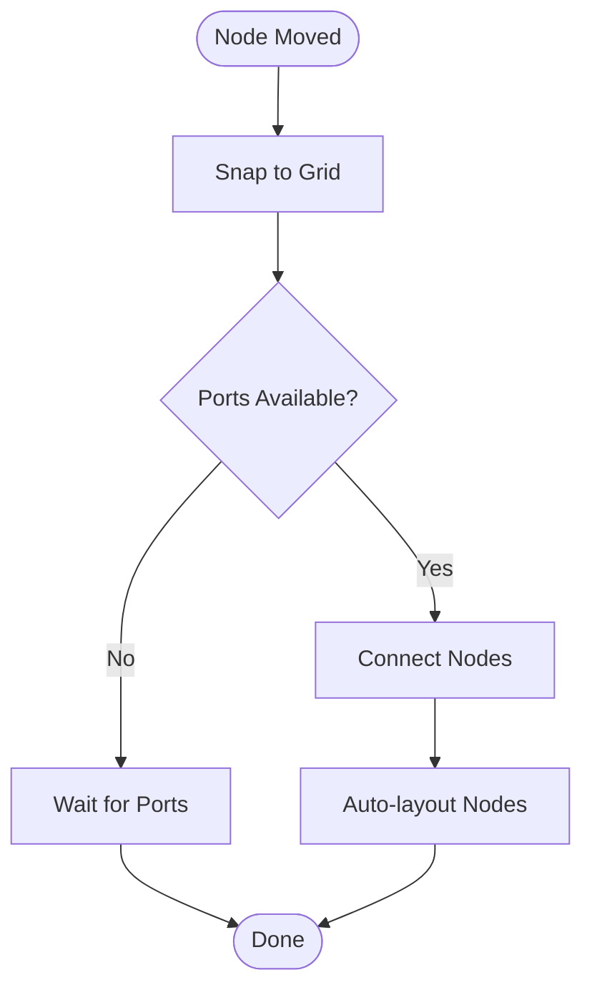
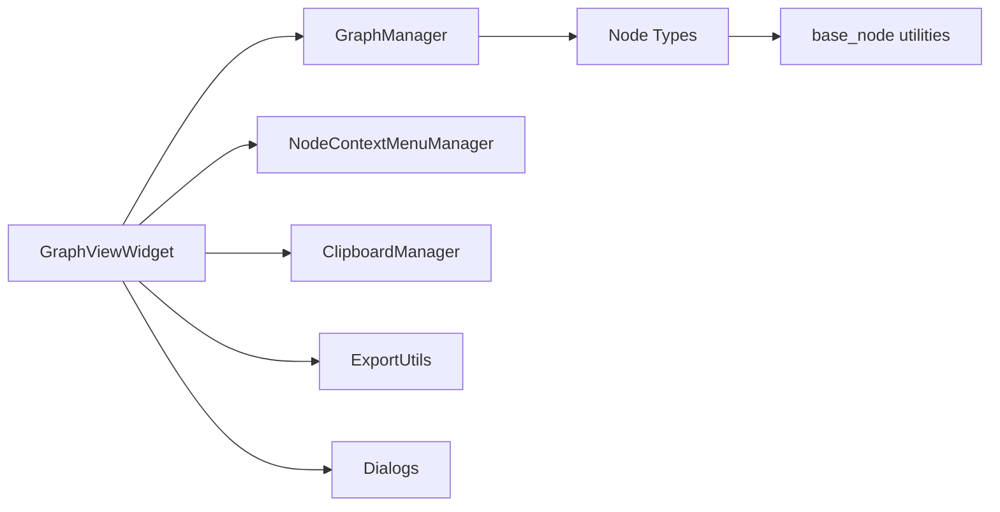

# Visual Workflow Builder (NGUI)

<cite>
**Referenced Files in This Document**
- [app.py](file://LoOper/NGUI/app.py)
- [main_window.py](file://LoOper/NGUI/main_window.py)
- [graph_view.py](file://LoOper/NGUI/graph_view.py)
- [node_context_menu.py](file://LoOper/NGUI/node_context_menu.py)
- [nodes.py](file://LoOper/NGUI/nodes.py)
- [nodes_resources/__init__.py](file://LoOper/NGUI/nodes_resources/__init__.py)
- [nodes_resources/base_node.py](file://LoOper/NGUI/nodes_resources/base_node.py)
- [nodes_resources/conditional_node.py](file://LoOper/NGUI/nodes_resources/conditional_node.py)
- [nodes_resources/sequence_node.py](file://LoOper/NGUI/nodes_resources/sequence_node.py)
- [nodes_resources/llm_node.py](file://LoOper/NGUI/nodes_resources/llm_node.py)
- [nodes_resources/tts_node.py](file://LoOper/NGUI/nodes_resources/tts_node.py)
- [graph_elements/__init__.py](file://LoOper/NGUI/graph_elements/__init__.py)
- [graph_elements/graph_manager.py](file://LoOper/NGUI/graph_elements/graph_manager.py)
- [dialogs/__init__.py](file://LoOper/NGUI/dialogs/__init__.py)
</cite>

## Table of Contents
1. [Introduction](#introduction)
2. [Project Structure](#project-structure)
3. [Core Components](#core-components)
4. [Architecture Overview](#architecture-overview)
5. [Detailed Component Analysis](#detailed-component-analysis)
6. [Dependency Analysis](#dependency-analysis)
7. [Performance Considerations](#performance-considerations)
8. [Troubleshooting Guide](#troubleshooting-guide)
9. [Conclusion](#conclusion)

## Introduction
This document explains the visual workflow builder component built on PyQt5 and NodeGraphQt. It covers the node-based visual programming interface, node types (sequence, conditional, LLM, TTS, chain import, code, container), dialog-driven configuration, context menu editing, and integration with the recording system and playback engine. It also addresses node transformation, graph validation, and performance optimization to help both beginners and advanced developers understand and extend the system.

## Project Structure
The visual workflow builder is organized around a main window hosting a NodeGraphQt-based canvas, modular graph managers, node resource definitions, and dialog-driven property editors. The structure emphasizes separation of concerns:
- Application bootstrap and theming
- Main window orchestration (menu, recording, playback)
- Graph view widget (canvas, node creation, selection, context menu)
- Node types and their properties
- Modular graph elements (managers, transforms, clipboard, DnD)
- Dialogs for node configuration and chain expansion

**Diagram sources**
- [app.py:11-153](file://LoOper/NGUI/app.py#L11-L153)
- [main_window.py:85-120](file://LoOper/NGUI/main_window.py#L85-L120)
- [graph_view.py:43-128](file://LoOper/NGUI/graph_view.py#L43-L128)
- [node_context_menu.py:8-44](file://LoOper/NGUI/node_context_menu.py#L8-L44)
- [nodes_resources/__init__.py:1-25](file://LoOper/NGUI/nodes_resources/__init__.py#L1-L25)
- [graph_elements/graph_manager.py:51-92](file://LoOper/NGUI/graph_elements/graph_manager.py#L51-L92)
- [dialogs/__init__.py:18-35](file://LoOper/NGUI/dialogs/__init__.py#L18-L35)

**Section sources**
- [app.py:11-153](file://LoOper/NGUI/app.py#L11-L153)
- [main_window.py:85-120](file://LoOper/NGUI/main_window.py#L85-L120)
- [graph_view.py:43-128](file://LoOper/NGUI/graph_view.py#L43-L128)
- [node_context_menu.py:8-44](file://LoOper/NGUI/node_context_menu.py#L8-L44)
- [nodes_resources/__init__.py:1-25](file://LoOper/NGUI/nodes_resources/__init__.py#L1-L25)
- [graph_elements/graph_manager.py:51-92](file://LoOper/NGUI/graph_elements/graph_manager.py#L51-L92)
- [dialogs/__init__.py:18-35](file://LoOper/NGUI/dialogs/__init__.py#L18-L35)

## Core Components
- Application bootstrap and theme: Initializes DPI awareness, high-DPI scaling, and applies a dark theme stylesheet.
- Main window: Provides menus, recording, playback, and scheduler integration; delegates graph operations to the GraphViewWidget.
- GraphViewWidget: Central canvas for node graph operations, including node creation, selection, context menu, clipboard, drag-and-drop, and graph state persistence.
- Node types: Sequence, Conditional, LLM, TTS, Chain Import, Code, Container, and deprecated Form Filler.
- Graph managers: NodeGraphQt setup, node registration, connections, auto-layout, and validation.
- Dialog system: Property dialogs for each node type and chain expansion dialog.

Key responsibilities:
- Node creation and editing via context menu actions routed through GraphViewWidget.
- Property management via dialogs; node properties stored as NodeGraphQt properties.
- Execution orchestration: Recording sequences, saving/loading chains, and running chains through the playback engine.

**Section sources**
- [app.py:11-153](file://LoOper/NGUI/app.py#L11-L153)
- [main_window.py:151-247](file://LoOper/NGUI/main_window.py#L151-L247)
- [graph_view.py:164-186](file://LoOper/NGUI/graph_view.py#L164-L186)
- [graph_elements/graph_manager.py:93-120](file://LoOper/NGUI/graph_elements/graph_manager.py#L93-L120)
- [dialogs/__init__.py:18-35](file://LoOper/NGUI/dialogs/__init__.py#L18-L35)

## Architecture Overview
The system follows a layered architecture:
- Presentation layer: PyQt5 widgets and NodeGraphQt canvas.
- Orchestration layer: MainWindow and GraphViewWidget coordinate UI actions.
- Domain layer: Node types encapsulate behavior and properties.
- Persistence and execution: GraphViewWidget saves/loads chain configurations; MainWindow triggers playback.

**Diagram sources**
- [main_window.py:85-120](file://LoOper/NGUI/main_window.py#L85-L120)
- [graph_view.py:43-128](file://LoOper/NGUI/graph_view.py#L43-L128)
- [graph_elements/graph_manager.py:51-92](file://LoOper/NGUI/graph_elements/graph_manager.py#L51-L92)
- [nodes_resources/__init__.py:1-25](file://LoOper/NGUI/nodes_resources/__init__.py#L1-L25)
- [dialogs/__init__.py:18-35](file://LoOper/NGUI/dialogs/__init__.py#L18-L35)

## Detailed Component Analysis

### Node Types and Properties
The system defines seven primary node types with distinct ports and properties:

- SequenceNode
  - Purpose: Represents a named sequence file with loop count and delays.
  - Ports: One multi-input “input” and one multi-output “output”.
  - Properties: sequence_file, loop_count, extra_delay, use_app_opened.
  - Behavior: Stores only the filename to ensure reliable playback.

- ConditionalNode
  - Purpose: Controls flow with multiple condition types (presence, OCR, code, loops).
  - Ports: One multi-input “input”; two outputs “true” and “false”.
  - Properties: condition_type, image_path, confidence, threshold, timeout, wait_time, max_loops, max_attempts, delay_between_attempts, target_x/y/w/h, position_tolerance, target_text, ocr_text, case_sensitive, loop_type, loop_position, sequence_file, iteration_delay, loop_condition, code.
  - Behavior: Exposes set_condition_data and get_condition_config to serialize/deserialize condition settings.

- LLMNode
  - Purpose: Generates text using a configured model and optional vision.
  - Ports: Multi-input “input”, “tools”, “context”; multi-output “output” and “context”.
  - Properties: model, prompt, system_message, temperature, max_tokens, output_variable, api_url, write_text, use_vision, vision_model, use_advanced_vision, screenshot_enabled, use_comorag, max_cycles, memory_size, input_source, ocr_confidence, ocr_preprocessing, use_async, typing_batch_size, typing_batch_delay, plus RAG and tool-related settings.
  - Behavior: Provides get_llm_config and execute_llm for runtime use.

- TTSNode
  - Purpose: Converts text to speech with configurable language and engine settings.
  - Ports: Multi-input “input”, multi-output “output”.
  - Properties: text, language, rate, volume, voice_id, save_to_file, output_file, wait_for_completion.
  - Behavior: Provides get_tts_config and execute_tts for runtime synthesis.

- ChainImportNode
  - Purpose: Imports another chain for reuse; expanded via a separate editor dialog.
  - Ports: Inputs/Outputs depend on the imported chain’s structure.
  - Properties: chain reference and expansion controls.
  - Behavior: Expand via ChainExpansionDialog.

- CodeNode
  - Purpose: Executes arbitrary Python code in the workflow.
  - Ports: Inputs/Outputs for data flow.
  - Properties: code body and runtime context.
  - Behavior: Editable via CodeNodeDialog.

- ContainerNode
  - Purpose: Groups related nodes for organization.
  - Ports: Inputs/Outputs as needed.
  - Properties: container metadata and layout hints.
  - Behavior: Editable via ContainerNodeDialog.

- Deprecated FormFillerNode
  - Not creatable; context menu indicates deprecation.

Implementation highlights:
- Node registration occurs in GraphManager.setup_node_graph.
- Multi-input ports are normalized via _add_multi_input in base_node.py.
- Node names reflect current configuration for clarity.

**Section sources**
- [nodes_resources/sequence_node.py:12-127](file://LoOper/NGUI/nodes_resources/sequence_node.py#L12-L127)
- [nodes_resources/conditional_node.py:10-162](file://LoOper/NGUI/nodes_resources/conditional_node.py#L10-L162)
- [nodes_resources/llm_node.py:11-390](file://LoOper/NGUI/nodes_resources/llm_node.py#L11-L390)
- [nodes_resources/tts_node.py:9-150](file://LoOper/NGUI/nodes_resources/tts_node.py#L9-L150)
- [nodes_resources/base_node.py:25-60](file://LoOper/NGUI/nodes_resources/base_node.py#L25-L60)
- [graph_elements/graph_manager.py:93-120](file://LoOper/NGUI/graph_elements/graph_manager.py#L93-L120)

### Dialog System and Property Management
- Dialogs are exposed via dialogs/__init__.py and include property dialogs for each node type and a chain expansion dialog.
- GraphViewWidget routes edit_* calls to NodeOperations, which opens the appropriate dialog.
- Node properties are stored as NodeGraphQt properties and retrieved via get_*_config methods on nodes.

Common patterns:
- Edit actions in context menu trigger GraphViewWidget.edit_* methods.
- Dialogs return validated configuration that nodes set via set_*_config or set_*_data.

**Section sources**
- [dialogs/__init__.py:18-35](file://LoOper/NGUI/dialogs/__init__.py#L18-L35)
- [graph_view.py:644-721](file://LoOper/NGUI/graph_view.py#L644-L721)
- [node_context_menu.py:45-124](file://LoOper/NGUI/node_context_menu.py#L45-L124)

### Context Menu Editing and User Interaction
- NodeContextMenuManager constructs context menus based on node type and exposes actions like Edit Properties, Edit Conditionals, Edit LLM Configuration, Edit TTS Properties, Edit Chain Import Configuration, Edit Code, Edit Container Configuration, and Expand Chain.
- Background graph actions include Add Conditional Node, Add LLM Node, Add Code Node, Add Container Node, Add TTS Node, and Add Chain Import Node.

User interaction flow:
- Right-click on a node or background to open the context menu.
- Select an action to edit properties or add nodes.
- GraphViewWidget delegates to NodeOperations and GraphManager for execution.

**Section sources**
- [node_context_menu.py:14-44](file://LoOper/NGUI/node_context_menu.py#L14-L44)
- [node_context_menu.py:127-158](file://LoOper/NGUI/node_context_menu.py#L127-L158)
- [graph_view.py:282-310](file://LoOper/NGUI/graph_view.py#L282-L310)

### Node-Based Logic Composition and Connections
- Nodes are created via GraphViewWidget.add_* methods, which delegate to NodeOperations.
- Connections are established using GraphManager.connect_nodes with automatic port resolution.
- Auto-layout is supported via GraphManager.auto_layout_nodes.

**Diagram sources**
- [graph_view.py:337-353](file://LoOper/NGUI/graph_view.py#L337-L353)
- [graph_elements/graph_manager.py:277-334](file://LoOper/NGUI/graph_elements/graph_manager.py#L277-L334)
- [nodes_resources/llm_node.py:143-186](file://LoOper/NGUI/nodes_resources/llm_node.py#L143-L186)

### Recording System and Playback Engine Integration
- Recording: MainWindow.start_recording initializes ElementRecorder and starts listeners; sequences are saved to the sequences directory and the JSON cache is refreshed.
- Playback: MainWindow.run_chain gathers the current chain configuration from GraphViewWidget, validates node counts, and executes via MultiSequencePlayer in a background thread. Keyboard monitoring supports ESC abort.
- Chain import: GraphViewWidget.edit_chain_import_node opens ChainExpansionDialog for editing imported chains.

**Diagram sources**
- [main_window.py:410-452](file://LoOper/NGUI/main_window.py#L410-L452)
- [graph_view.py:548-574](file://LoOper/NGUI/graph_view.py#L548-L574)

**Section sources**
- [main_window.py:262-408](file://LoOper/NGUI/main_window.py#L262-L408)
- [graph_view.py:575-622](file://LoOper/NGUI/graph_view.py#L575-L622)

### Node Transformation and Validation
- Node snapping and grid alignment occur during drag-and-drop and mouse release events.
- Auto-layout is available to improve readability.
- Conditional node validation is performed via ExportUtils.validate_conditional_nodes.

**Diagram sources**
- [graph_view.py:248-271](file://LoOper/NGUI/graph_view.py#L248-L271)
- [graph_elements/graph_manager.py:230-242](file://LoOper/NGUI/graph_elements/graph_manager.py#L230-L242)

**Section sources**
- [graph_view.py:313-320](file://LoOper/NGUI/graph_view.py#L313-L320)
- [graph_view.py:521-529](file://LoOper/NGUI/graph_view.py#L521-L529)
- [graph_view.py:539-547](file://LoOper/NGUI/graph_view.py#L539-L547)

## Dependency Analysis
The system exhibits clear modularity:
- GraphViewWidget depends on GraphManager, NodeOperations, NodeContextMenuManager, ClipboardManager, and ExportUtils.
- Node types depend on base_node utilities for port configuration.
- Dialogs are decoupled and invoked by GraphViewWidget.

**Diagram sources**
- [graph_view.py:94-114](file://LoOper/NGUI/graph_view.py#L94-L114)
- [nodes_resources/base_node.py:25-60](file://LoOper/NGUI/nodes_resources/base_node.py#L25-L60)
- [graph_elements/graph_manager.py:93-120](file://LoOper/NGUI/graph_elements/graph_manager.py#L93-L120)

**Section sources**
- [graph_view.py:94-114](file://LoOper/NGUI/graph_view.py#L94-L114)
- [nodes_resources/base_node.py:25-60](file://LoOper/NGUI/nodes_resources/base_node.py#L25-L60)
- [graph_elements/graph_manager.py:93-120](file://LoOper/NGUI/graph_elements/graph_manager.py#L93-L120)

## Performance Considerations
- Asynchronous execution: LLMNode supports use_async to avoid blocking the UI.
- Batch typing: LLMNode uses configurable batch size and delay to optimize text output.
- Auto-layout: Use sparingly in large graphs to reduce layout computation overhead.
- Clipboard operations: Copy/paste nodes efficiently via ClipboardManager; avoid excessive deep copies in large graphs.
- DPI and scaling: Bootstrap applies high-DPI settings to prevent redraw overhead on scaled displays.

[No sources needed since this section provides general guidance]

## Troubleshooting Guide
Common issues and resolutions:
- NodeGraphQt KeyError during move: A monkey patch prevents crashes when node views exist without corresponding model nodes.
- Graph readiness: Ensure GraphViewWidget.is_ready returns True before loading/saving or recording.
- Clipboard and paste positions: Use paste_copied_nodes with optional scene position derived from mouse coordinates.
- Conditional node validation: Run validate_conditional_nodes to catch misconfigured nodes before export/execution.
- Recording errors: MainWindow handles exceptions during recording and playback, restoring the window and displaying error messages.

**Section sources**
- [graph_elements/graph_manager.py:19-47](file://LoOper/NGUI/graph_elements/graph_manager.py#L19-L47)
- [graph_view.py:569-574](file://LoOper/NGUI/graph_view.py#L569-L574)
- [graph_view.py:279-281](file://LoOper/NGUI/graph_view.py#L279-L281)
- [graph_view.py:539-547](file://LoOper/NGUI/graph_view.py#L539-L547)
- [main_window.py:726-734](file://LoOper/NGUI/main_window.py#L726-L734)

## Conclusion
The visual workflow builder integrates PyQt5 and NodeGraphQt to deliver a robust, extensible node-based authoring environment. Its modular design separates UI orchestration, graph management, node definitions, and dialogs, enabling straightforward extension and maintenance. By leveraging dialogs for property editing, context menus for quick actions, and a clear separation between recording and playback, the system supports both rapid prototyping and production-grade automation workflows.