# Arrow (LoOper) — Technical Architecture & Codebase Reference

Arrow is a Windows desktop platform for building, running, and scheduling intelligent automation entirely on local hardware: record any interaction once, compose it into a visual workflow graph, and execute it deterministically — with local AI (llama.cpp / Ollama), local vision, local OCR, and local speech. No cloud, no telemetry, no per-token fees.

On top of that deterministic core, Arrow is an **agent platform you own**: a chat you talk to ("agent mode") backed by a **workspace** — one agent plus its own folder of chains, whose routing is learned from use, a side-docked **assisted builder** that reads the chain on the canvas and writes its permanent description, and an **Android phone client** that reaches the host over a peer-to-peer link — no IP address, no VPN, no server-served page. And if local models are not enough, **BYOK** lets any node or agent reason through your own cloud keys (or a local model server) while everything else stays on-device.

This document is the **technical reference** for the current codebase: architecture, every subsystem, the frameworks it is built on, the data formats it reads and writes, and the engineering doctrine behind its implementations. The internal package name is still `LoOper`; the product brand is **Arrow**.

---

## Contents

1. Platform overview
2. Workspaces — one agent, its own chains
3. Technology stack
4. High-level architecture
5. Runtime topology
6. The chain workflow model (nodes, ports, data flow)
7. The execution engine
8. Recording subsystems (desktop + web)
9. Playback & grounding (desktop + web)
10. AI stack (inference, retrieval, vision, speech, BYOK)
11. Agent mode (workspaces, derived catalog, learned plans, orchestrator mode)
12. The assisted builder — a read-only chain analyst and flow annotator
13. Memory & context
14. Specialized subsystems (form filler, handle, MCP, code)
15. The phone client (P2P Android app)
16. Scheduling, sandbox & remote access
17. Export & build pipeline (agents, MSI, APK)
18. Configuration, environment & data
19. Engineering doctrine (methodologies)
20. Testing & verification
21. Repository layout
22. Licensing & distribution

---

## 1. Platform overview

### 1.1 What Arrow is

- **A visual automation platform.** Workflows ("chains") are node graphs, not scripts. Recorded desktop sequences and browser flows are first-class nodes you connect, branch, loop, and nest.
- **A deterministic execution engine with embedded AI.** The graph is a symbolic program; LLM nodes, conditional gates, decision inputs, and the orchestrator add fuzzy reasoning only at the seams. Nothing critical depends on a model producing well-formed output.
- **An agent platform you own.** Agent mode has no hardcoded behaviour: a **workspace** is one agent plus its own folder of chains (`workspaces/<slug>/`). The agent reads each chain's description — derived from the chain itself — picks an order, runs it on the same engine as manual playback, and records the plan, so its orchestrator is *learned from use* instead of hand-wired (see §2 and §11). The **assisted builder** (§12) reads the chain on the canvas and writes its permanent flow metadata; the **phone client** (§15) talks to the agent over a P2P link.
- **Fully on-device.** Bundled GGUF models via llama.cpp, ONNX vision, PaddleOCR, Piper TTS, Vosk STT. Works offline and in air-gapped environments. **BYOK** (§10.7) is the opt-in exception: your own cloud API keys, your own local model server, per node or per agent.
- **Composable approval and memory primitives.** Approvals are Input nodes plus branch routing; memory is Context nodes plus an inspectable SQLite store and Graph RAG.

### 1.2 Capability map

| Capability | What it does | Primary code |
|---|---|---|
| Node-graph editor | Author, edit, expand, and run chains | `NGUI/` (PyQt5 + NodeGraphQt) |
| Workspaces | One agent per workspace; its own chains folder gates the library and what the agent may route over | `player/workspace.py`, `NGUI/widgets/workspace_bar.py` |
| Chain brief | The routing line, derived from the chain's own `flow` metadata + ports (replaces hand-written descriptions) | `player/chain_brief.py` |
| Assisted builder | Chat that reads the chain on the canvas and writes its permanent flow metadata (summary, section boxes, **a line per node**, per-step text); a visual smoke test rings each step; it never edits, wires, runs or tests | `NGUI/widgets/builder_panel.py`, `player/builder/` |
| Desktop recorder | Capture clicks, typing, scrolls, drags, clipboard + screenshots + UIA elements | `recorder/`, `NGUI/widgets/recording_overlay.py` |
| Web recorder | DOM-level browser capture via CDP injection; selector-based sessions | `player/web/` (recorder, picker, inject) |
| Execution engine | Dependency-gated scheduler loop over typed nodes; branches, loops, sub-chains | `player/multi_sequence_player.py`, `player/multi_sequence/worflow_interpreter_modules/` |
| Desktop replay | Element-first (UIA) + template-matching cascade, OCR conditions, human-like pacing | `player/action_handlers.py`, `player/computer_vision.py`, `player/uia_locator.py`, `player/ocr_engine.py` |
| Web replay | Native-first CDP ladder, durable shared browser profile, entity-driven | `player/web/engine.py`, `player/web/handlers/` |
| Local AI | llama.cpp GGUF + Ollama; chat/generate/embed endpoints | `AI/llama_cpp_engine.py`, `AI/ollama_engine.py`, `AI/api.py` |
| BYOK providers | Cloud OpenAI-compatible providers, local model servers, CLI tools, behind the same gateway | `AI/byok.py`, `NGUI/dialogs/ai_settings_dialog.py`, `NGUI/dialogs/engine_options.py` |
| Semantic retrieval | ComoRAG probe-driven retrieval; embeddings; Graph RAG | `AI/comorag_engine.py`, `AI/embedding_server.py`, `AI/graph_rag.py` |
| Laya engine | Embedded System-1 decision engine (typed choice/score/noul, CPU) | `AI/laya_client.py`, `AI/laya_hooks.py`, `AI/laya_bench.py`, `AI/bin/laya.exe`, `AI/models/laya-GGUF/` |
| Vision | VLM screen understanding (LFM2.5-VL), ONNX object detection, PaddleOCR | `AI/recursive_vision_reasoner.py`, `player/computer_vision.py`, `player/ocr_engine.py` |
| Speech | Piper neural TTS, Vosk STT (voice mode, desktop + phone) | `player/tts_engine.py`, `player/stt_engine.py` |
| Agent mode | Workspace agent: derived chain catalog, Laya + planner routing, learned plans | `player/agentic_ops/`, `NGUI/widgets/agent_overlay.py`, `NGUI/widgets/agent_mode.py` |
| Agent transport | Local aiohttp API (`/ws`, `/stt`, `/tts`) + P2P Pear/Bare sidecar | `NGUI/widgets/agent_web_server.py`, `agent_sidecar/` |
| Phone client | Android app (WebView + Pear worklet + QR scanner + notifications) | `phone_client/` (Kotlin + JS), `build_pipeline/build_phone_apk.ps1` |
| Orchestrator (optional) | Goal loop, but as an **LLM-node mode**: `tools` = deterministic chains, `brains` = sub-brains; LLM/Laya picker; trace + synthesis | `player/…/executor_modules/orchestrator_ops.py`, `NGUI/nodes_resources/llm_node.py` (`orchestrator_mode`) |
| Persistent goals | Wake-driven goal ledger; blocked lifecycle | `player/agentic_ops/goal_ledger.py` |
| Memory | Turn-based in-run context + SQLite persistence + RAG + consolidation + activity timeline | `port_store.py`, `AI/context_database.py`, `context_ops.py`, `player/agentic_ops/run_memory.py` |
| Scheduling | once / daily / weekly / interval, JSON-persisted, in-process runs | `NGUI/scheduler_service.py` |
| RDP sandbox | Run automation inside an isolated Windows session | `sandbox_agent.py`, `setup_rdp_agent.py`, `utils/rdpwrap/` |
| Agent export | Compile a workspace agent's pinned brain chain + transitive assets into a standalone exe | `builder/agent_exporter.py`, `builder/agent_standalone_entry.py` |
| Licensing | Offline HMAC-signed license files bound to hardware | `keygen/` |

---

## 2. Workspaces — one agent, its own chains

### 2.1 A workspace is the unit

A **workspace** is one agent plus the chains it may use. It is a real folder, not a tag:

```
LoOper/workspaces/
├── index.json                  # {"active": "<slug>", "migrated": true}
└── job-hunt/
    ├── workspace.json          # name + agent {name, model, policy, legacy_brain}
    ├── chains/*.json           # every chain this agent may see or route over
    └── plans.json              # what it learned from running them
```

The workspace selector sits on the canvas (`NGUI/widgets/workspace_bar.py`, `＋` creates one: workspace name, agent name, and the model the agent reasons with — chosen in the app-wide engine/model selector, `NGUI/widgets/agent_model_dialog.py`, never typed by hand). The active workspace decides what the chains library lists, what the agent may route over, and where a new chain is saved; `NGUI/app_state.py` remembers it across restarts. Because a workspace's `chains/` folder IS the scope, moving a chain between workspaces is a file move — `player/workspace.py:move_chain` rewrites the imports that pointed at it.

### 2.2 The agent builds its own orchestrator

The agent is **learned, not wired**. It has no hand-designed brain chain: it reads a catalog built from the chains themselves and records what worked.

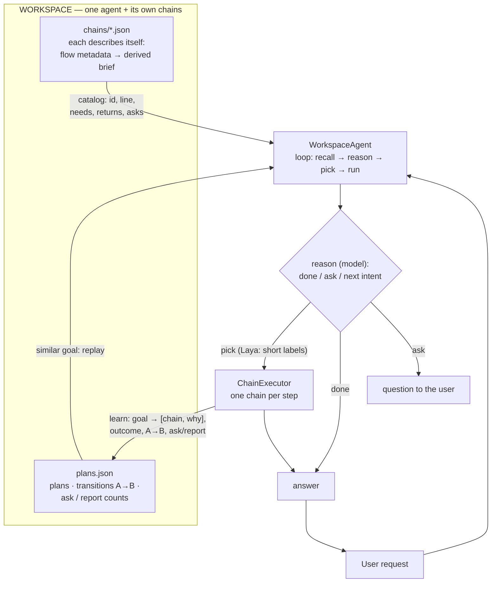

- **Catalog** (`player/agentic_ops/catalog.py`) — one entry per chain, built from the chain itself: its derived brief (`player/chain_brief.py`), what it needs, what it returns, whether it stops to ask the user, the requests it already answered (`routing.examples`), and **what each node inside it does** (`flow.nodes`, up to four lines in the prompt). A chain that has never been described in the Builder is not routable; the library shows its structural line so the gap is visible.
- **Descriptions keep themselves current** (`player/chain_refresh.py`) — binding agent mode to a workspace (every reload: a fresh window, entering agent mode, switching the agent, the reload button) sweeps that workspace's chain files and rewrites only the ones whose `flow.stamp` no longer matches their nodes. No model is called: the per-node lines are re-derived from the file (`flow.complete_static`), each stored sentence carries the fingerprint of the node version it describes so **only the edited node's line changes**, and an unchanged file is not rewritten at all (measured on the LinkedIn workspace: first sweep `updated 4 / current 0`, second sweep `updated 0 / current 4`).
- **Routing order, deterministic at every step** — (1) a chain pinned as the agent's brain, (2) a learned plan that matches the request *and is still winning*, (3) Laya over the chains' **short labels** — the name, then each past request — with one same-task verdict on the winner, (4) the only routable chain, (5) the planner model, which gets the learned transitions as evidence. Anything unroutable raises with the reason; there is no hidden fallback.
- **Why short labels** — an entailment score rises with the length of the candidate, so a chain advertising a long brief outranked the atomic tool that actually matched (measured on the bundled encoder: `go to linkedin.com` → auto-apply loop 0.80, `open linkedin` 0.54). Scored by **name** instead, the same request separates cleanly (`open linkedin` 0.85, others ≤ 0.60), and a past request is user text like the new one. The long brief is what the *planner model* reads, never what the encoder scores.
- **The reasoner model is a CHOICE in agent mode** — `workspace.json → agent.model`, picked with the **MODEL** button (and when a workspace is created) through the same selector the rest of the app uses: an ENGINE list (llama.cpp, Ollama, every configured BYOK provider) and the models that engine serves, plus free text for a model the gateway does not list. Nothing is defaulted: an empty value means *no reasoner chosen*, and the agent then runs one tool and says so. The reasoner call goes through the gateway's streamed path, so any provider works, not just the local engine.
- **Learning is an episode graph** (`player/agentic_ops/plans.py`) — every run freezes `goal → [{chain, why}]` plus the **outcome**, the **transitions** (after A, B followed, with outcomes) and whether the run had to **ask** and did **report**. `similar()` recalls a past episode by the same-question verdict over stored goals; `evidence()` renders it (order, each step's *why*, wins/losses) into the reasoner's prompt. An episode replays only while `ok > 0 and ok >= fail`; a losing one is kept as evidence and the request goes through the loop. The agent therefore grows with use: which chain, in what order, when to ask, when to report — all data.
- **A run is a LOOP, not one route** (§11.1) — memory reassurance (only the same request at ≥0.97 and ≥2 wins replays) → **understand** (one reasoning pass writes the task list and restates the request) → per task: **Laya picks the chain** → run → **verify** (answered / ask / one missing task) → freeze.

### 2.3 No system chains

`collection` and `is_default` are retired. A chain file carries its `workspace` and its `flow` metadata; nothing marks an agent brain:

- The first launch of a build that still has the old flat `LoOper/chains/` folder **migrates it once** (`player/workspace.py:migrate`): ordinary chains move into a workspace named after their collection, every `chain_file_path` / `shared_context_chain_file` is rewritten by basename (which also repairs the dead absolute paths older builds wrote), and a `collection: "System"` chain is **absorbed as an ordinary chain** into the workspace that holds most of the chains it imports — no "System" workspace is created and nothing is pinned automatically.
- `workspace.json → agent.legacy_brain` remains a manual escape hatch: pin a chain there and that workspace answers with it alone. New workspaces leave it empty and compose their own.
- The old Orchestrator **node type** is gone from the editor too. It survives as an **LLM-node mode** (`orchestrator_mode`) for people who want an explicit goal loop; loading a chain that still carries `orchestrator_nodes` folds each one into an LLM node and re-points its `brains` / `chains` edges at the node's `tools` port (see §11.2).

### 2.4 Every run leaves evidence

Agent runs land in `<workspace>/plans.json` (plan, outcome counters, ask/report evidence and the transition table), and in the activity timeline (`run_memory.db`, §13): every chain run, node execution and chat turn. A chain run can still be rated in the overlay — for a chain with no flow metadata the rating can reword its description, while a chain that describes itself keeps its derived line (the rating is recorded, the brief is not overwritten). ESC aborts any run; a workspace with no routable chain refuses the request with the reason instead of inventing a route.

---

## 3. Technology stack

### 3.1 Core frameworks

| Domain | Technology |
|---|---|
| Language / runtime | Python ≥ 3.10 (Windows), `multiprocessing`, threads + Qt event loop |
| Desktop UI | **PyQt5** (dark theme, high-DPI), **NodeGraphQt** (graph editor), `pytablericons` (vector icons), `i18n` (EN/ES) |
| Local HTTP API | **FastAPI** + **uvicorn** (chat, generate, embeddings, llama.cpp lifecycle, vision bootstrap, BYOK gateway) |
| Agent transport | **aiohttp** (`/ws`, `/stt`, `/tts`) + **Pear / Bare** sidecar (**hyperdht** byte-pipe, Ed25519 keys) |
| LLM inference | **llama.cpp** (bundled `llama-server.exe`, GGUF, Vulkan backends), **Ollama** (HTTP), and **BYOK** providers (OpenAI-compatible chat completions, local model servers, CLI tools) |
| Embeddings | Dedicated llama.cpp embedding mode (`embeddinggemma-300M GGUF`) |
| Desktop input | `pynput` / low-level Windows hooks, `PyAutoGUI`, `pyperclip`, `keyboard` |
| Computer vision | **OpenCV** (multi-scale template matching), `mss` (capture), Pillow, scikit-image, SciPy |
| Detection / OCR | **ultralytics ONNX YOLO** object detection, **PaddleOCR** (det/rec/cls) |
| Vision-Language | LFM2.5-VL (450M GGUF + projector) via `llama-mtmd-cli` |
| Web automation | **Selenium** + **undetected-chromedriver**, CDP (Chrome DevTools Protocol) injection, `websocket-client` |
| Speech | **Piper** (ONNX neural TTS), **Vosk** (Kaldi-based offline STT) |
| Memory / data | **SQLite** (`SQLAlchemy`), JSON files, atomic tmp+replace writes |
| System-1 decisions | **Laya** (ModernBERT-large, typed noul/choice questions, one encoder pass), embedded CPU runtime |
| Documents | `PyPDF2` (PDF extraction), `python-docx` (Word) |
| Phone client | **Kotlin** Android app (WebView + Pear bare-kit worklet + ZXing QR scan + foreground service), **Node.js** host sidecar (`hyperdht`, `b4a`) |
| Packaging | **PyInstaller** (onedir), **WiX Toolset** (per-user MSI), **Gradle / AGP + NDK** (Android APK), PowerShell build pipeline |
| Security | `cryptography` (offline HMAC license validation) |

### 3.2 Optional dependency extras (`pyproject.toml`)

| Extra | Contents | When |
|---|---|---|
| `vision` | torch, torchvision, sentence-transformers, ultralytics (Python < 3.13) | Full vision/ML stack on the MSI |
| `vision313_win` | torch, torchvision (Python 3.13+, Windows) | Vision support on newer Pythons |
| `overwatch` | FastAPI, LangChain, loguru, pandas… | OverWatch companion service and its utilities |

Web automation dependencies (`selenium`, `undetected-chromedriver`, `keyboard`) are declared in `LoOper/requirements.txt`; everything else is pinned in `pyproject.toml`. The phone client and the agent sidecar carry their own `package.json` files (`LoOper/phone_client/`, `LoOper/agent_sidecar/`).

---

## 4. High-level architecture

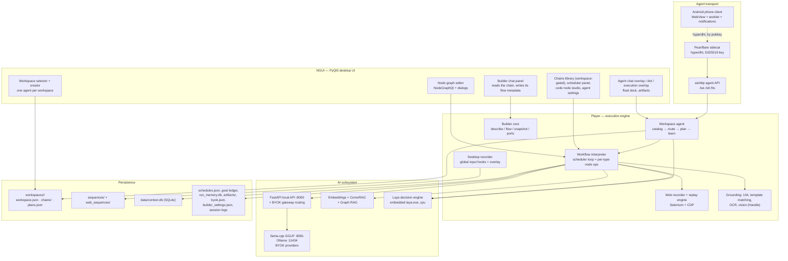

**The three pillars:**

1. **NGUI** — the editor and all runtime surfaces (overlays, panels, builder chat). Graph authoring with typed nodes, dialogs for configuration, the **workspace selector** that scopes the chain library, scheduler UI, the agent chat/phone surfaces, and the side-docked builder panel.
2. **Player** — the execution engine and all input/output machinery: the workflow interpreter (builder → executor → navigator), the **workspace agent** (`player/agentic_ops/`: catalog → route → plan → learn), the desktop recorder, the web recorder/replay engine, the grounding stack (UIA, template matching, OCR, vision), and the builder core (`player/builder/`: describe / flow / snapshot / ports).
3. **AI** — the local inference and retrieval stack: a FastAPI server exposing chat/generate/embed over llama.cpp, Ollama and BYOK providers, the embedding server, ComoRAG/GraphRAG retrieval, and the embedded Laya decision engine (the workspace agent's first-choice router).

Around the pillars sit two satellite surfaces: the **agent transport** (aiohttp API + P2P sidecar + Android app) and the **persistence** layer (workspaces, recordings, databases, ledgers).

---

## 5. Runtime topology

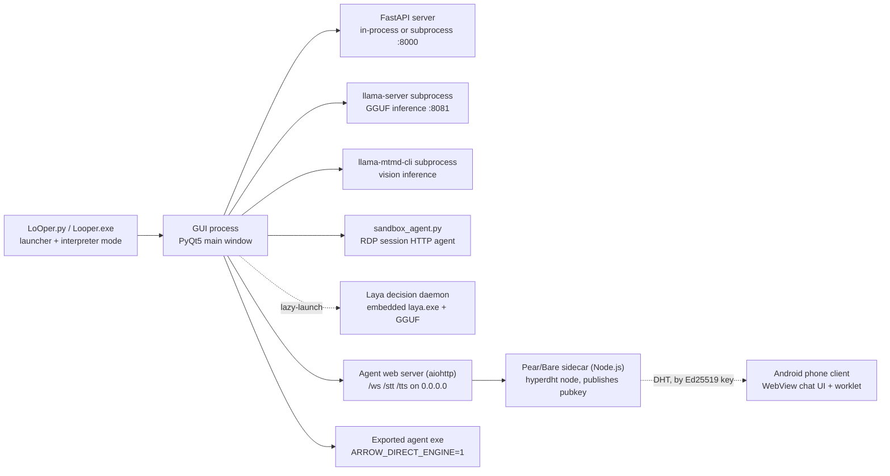

- **Launcher (`LoOper.py`)** — a bootstrap process that can run the GUI, or execute a `.py` argument directly (interpreter mode), which is how the RDP sandbox agent and exported agents are spawned.
- **GUI process** — PyQt5 main window; hosts the graph editor, overlays, builder panel, scheduler thread, recorder listeners, and (by default) the FastAPI server.
- **llama.cpp subprocess** — the bundled `llama-server.exe` (default port 8081) serves all GGUF inference; engine lifecycle is managed by `AI/llama_cpp_engine.py` (start on demand, health-check, release).
- **Vision subprocess** — multimodal inference runs through `llama-mtmd-cli` with a GGUF + mmproj projector pair.
- **Laya engine** — embedded, lazy-launched daemon (`AI/bin/laya.exe` + `AI/models/laya-GGUF/`), `None` on failure; every consumer falls back to LLM paths automatically.
- **Agent web server** — an aiohttp server (bound to `0.0.0.0`) exposing the agent protocol (`/ws` chat + panels, `/stt`, `/tts`, `/status`). It serves **no HTML** — the chat UI ships inside the phone app.
- **Pear/Bare sidecar** — a Node.js child process (`agent_sidecar/looper-agent-sidecar.js`) that publishes an Ed25519 public key on the DHT and byte-pipes connected peers to the aiohttp server's local port. Its key persists in `%LOCALAPPDATA%\LoOper\agent-key.json`, so the scannable code stays stable. When the sidecar cannot run, the server falls back to a plain `http://<tailscale-or-lan-ip>:<port>` URL.
- **Phone client** — the Android app scans the `pear://<pubkey>` QR (or accepts a pasted key), dials the host over hyperdht, and drives the host's API through a loopback pipe (§15).
- **Exported agents** — standalone executables that embed the app, the workspace agent's pinned brain chain (when one is pinned) and that chain's transitive chains; they run with `ARROW_DIRECT_ENGINE=1` (no external API dependency at all).

---

## 6. The chain workflow model

### 6.1 Chain JSON format

A chain is a JSON document whose top-level sections each hold a list of typed nodes (the visual graph is stored as node lists + connections, not as an opaque blob):

| Section | Node type | Purpose |
|---|---|---|
| `sequences` | Sequence | Replay a recorded desktop sequence |
| `web_sequences` | Web Sequence | Replay a recorded browser session |
| `conditional_nodes` | Conditional | Branch on image / OCR / wait / web conditions (`true` / `false` ports) |
| `llm_nodes` | LLM | Local inference: reasoning, tools, vision, structured output, TTS |
| `chain_import_nodes` | Chain Import | Run another chain as a sub-workflow / tool |
| `form_filler_nodes` | Form Filler | Document-grounded multi-field form completion |
| `code_nodes` | Code | Custom Python with JSON in/out |
| `container_nodes` | Container | Legacy VM-grouping node (deprecated; kept for file compatibility) |
| `context_nodes` | Context | Persistent cross-chain memory |
| `input_nodes` | Input | Value injection, questions, decision routing, media acceptance |
| `handle_nodes` | Handle | Vision-based click/scroll/zoom grounding |
| `mcp_nodes` | MCP | Model Context Protocol server tools |
| `output_nodes` | Output | Expose results to the overlay / outside the chain |
| `orchestrator_nodes` | (legacy) | Folded into an LLM node in `orchestrator_mode` when a file is loaded |
| `tts_nodes` | (legacy) | Auto-migrated into LLM nodes with TTS enabled |

Chain metadata: `name`, `workspace` (the slug whose folder holds the file), `flow` (the Builder's own metadata: `summary`, `sections`, `nodes`, `steps`) and `description` — which is **derived**, not typed: `player/chain_brief.py` builds it from `flow` plus the chain's input/output labels on every save, and every reader (catalog, agent routing, library tooltip) uses that same line. There is no `collection` and no `is_default` any more; a workspace is a folder (§2.1).

```json
{
  "name": "My Chain",
  "workspace": "job-hunt",
  "description": "Searches job boards and keeps matches; search → collect; needs terms",
  "flow": {
    "summary": "Searches job boards and keeps the matching postings.",
    "sections": [{"title": "search", "nodes": ["0x…"]}],
    "nodes": [{"node": "0x…", "does": "supplies the search terms"},
              {"node": "0x…", "does": "writes the shortlist"}],
    "steps": [{"node": "0x…", "does": "queries the boards"}]
  },
  "llm_nodes": [ { "type": "llm", "label": "Reason", "node_id": "0x…", "connections": [] } ],
  "chain_import_nodes": [],
  "input_nodes": [],
  "output_nodes": []
}
```

### 6.2 Node catalog

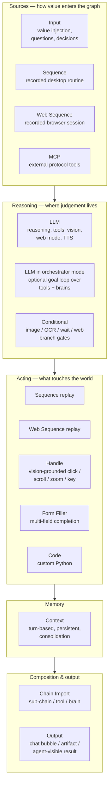

| Node | Role | Notable behaviour |
|---|---|---|
| Sequence | Desktop replay unit | Loops, delays, per-action fallbacks |
| Web Sequence | Browser replay unit | Element-driven, never absolute coordinates |
| Conditional | Symbolic branch | Image/OCR/wait/web conditions; `true`/`false` ports; loop modes |
| Input | Value injector + interaction gate | Resolve cascade, decision routing, question modes, media |
| LLM | Reasoning node | Tools, vision, structured output, web mode, TTS, consolidation |
| Chain Import | Composition | Sub-chain in-player or as an LLM tool; classified *brain* (contains an orchestrator) vs *deterministic chain* |
| Form Filler | Structured data entry | Knowledge base + repair loops + review gate |
| Code | Extension point | Inline/file Python, JSON arguments, named IO ports, output variables |
| Container | Legacy VM grouping | Deprecated — the builder does not create nodes at all; existing files still load |
| Context | Memory | Turn-based history, SQLite persistence, consolidation |
| Handle | Vision action | VLM scene understanding + LLM reasoning for click/scroll/zoom |
| MCP | External tools | Discovered tools exposed to the router model |
| Output | Sink | Chat bubble / popup / interactive HTML artifact / agent-visible results |
| Orchestrator (mode) | Optional goal loop | Set on an LLM node: `tools` = deterministic chains, `brains` = sub-brains; runs frozen chains first, else picks a brain; synthesizes the final answer |

### 6.3 Ports and data flow

Every node exposes **named ports**. Execution flows along **exec edges** (base ports such as `output` → `input`); values flow along **data edges** (`data`, `true`/`false`, `trace`, `blocked`, `files`, `brains`, `chains`, …). The distinction is what keeps the engine predictable: a data edge never triggers execution, an exec edge never smuggles values.

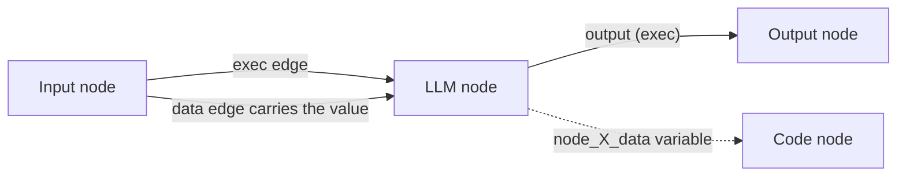

- All port values are stored per chain in the **PortScopedStore** and exposed as `node_<id>_<port>` variables; downstream nodes read only ports they are explicitly connected to.
- The port contract is enforced in one place (`executor_modules/ports.py` — the single publisher + resolver): base ports (`''`, `output`, `true`, `false`, `error`, `route`) drive **execution only** and carry **no data** — a consumer reached through one sees `None`. Every other port (`data`, `context`, `ctx_out`, and any custom port a Code node declares in its IO tab) carries **data**, published under the port's own name and resolved by that name. The LLM `context` output is the plain response text; the structured `{user_input, response}` envelope is internal metadata and never reaches a data port, so no consumer has to unwrap it.
- Chain-to-chain state rides explicit variables: `_chain_input_context` (the prompt channel into sub-chains), `selected_by_llm`, tool results, etc. There is no hidden global state between chains.
- Branch-capable nodes are: Conditional nodes, Input nodes with **decision mode**, and Input nodes with **routed yes/no questions**. They own `true` / `false` output ports.
- **Router ports make the source a subroutine.** A node whose execution edges land *only* on a router input port (an LLM node's `tools`, the `tools`/`brains` of an LLM node in orchestrator mode) is flagged `tool_provider` once at graph build — generically, for every node type, after stale edges are dropped — and never runs in the main loop: its router invokes it. `selected_by_llm` rides along as a dispatch/reporting marker, never as an execution grant.

### 6.4 Branching and loops

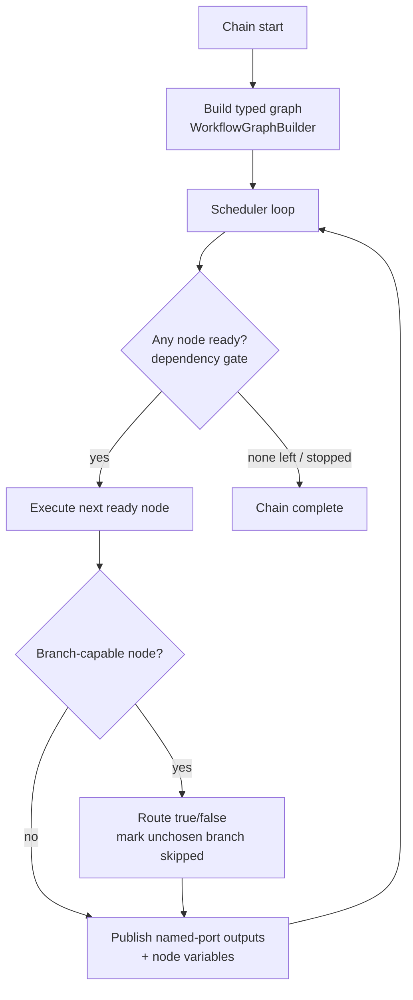

- Branch sweep: when a branch-capable node resolves, the unchosen branch is recursively **marked skipped** (shared `_mark_skipped` machinery) so merges never stall. The sweep is **edge-exact**: its reachability walk never expands back *through* the gating conditional, and a node proven to be on the chosen side is never swept — a loop-back edge on the unchosen leg must not leak the chosen branch's nodes into the skipped set.
- Loop-backs re-inject context: an Input node re-resolves on every pass, which is how iterative workflows (search-refine, retry ladders) are built with pure topology.
- **A pass with no work is a dead end, not a loop.** A generalized loop-back re-iterates only when the pass actually executed at least one **work** node; a pass made up solely of outputs/conditionals cannot make progress, so the chain completes there instead of spinning (and never re-arms the nodes it had un-skipped).
- Decision and routed questions are re-evaluated per loop pass, keeping gates accurate inside iterating workflows.

---

## 7. The execution engine

### 7.1 Components

| Component | File | Responsibility |
|---|---|---|
| Entry | `player/multi_sequence_player.py` | Load + migrate a chain, preload caches, orchestrate one run |
| Builder | `…/worflow_interpreter_modules/builder.py` | Turn chain JSON into a typed graph dict (ports, edges, tool-provider gating) |
| Navigator | `…/navigator.py` | Decide the next node to execute from the ready set |
| Executor | `…/executor_modules/core.py` | The scheduler loop, dispatch, branch routing, skip sweep, stop flag |
| Per-type ops | `…/executor_modules/*_ops.py` | One module per node family (input, llm, chain, conditional, code, context, handle, mcp, form filler, orchestrator, output, sequence, container) |
| Dependencies | `…/executor_modules/dependencies.py` | Readiness gate: exec edges, data edges, branch-source rules |
| Port store | `…/executor_modules/port_store.py` | Named-port values + turn-based history per chain |
| Port contract | `…/executor_modules/ports.py` | Single publisher + resolver: exec-only ports carry no data, data ports resolve by name |

### 7.2 Execution semantics

- **Dependency-gated scheduling.** A node runs only when every incoming edge it needs is settled: exec edges fire in order, data edges only gate consumers that actually read them. Branch sweeps pre-settle the unchosen side so merges proceed; the sweep is edge-exact (it never traverses back through the gating conditional) and never sweeps a node on the chosen side.
- **Tool-provider gating.** Chain-import nodes wired to a tool consumer (an LLM node's `tools` port, an orchestrator-mode node's `brains` port) are *tool providers*: they never start the chain standalone, they only run when selected.
- **Stop semantics.** A single stop flag is polled everywhere (including inside model calls); ESC aborts a run immediately, and pending ask-user waits are released (the answer is discarded, not eaten by the next query).
- **Failure model is fail-closed.** Unparseable model answers route to the configured default branch; missing criteria fail without a model call; extraction errors degrade to logged fallbacks — never a crash, never a silent wrong turn.
- **Serialized model access.** LLM calls share one managed engine and a serialization lock; the engine is never preloaded at startup and is released after inactivity bursts. Local inference runs **without timeouts** — interruption is a stop-flag concern, not a timeout concern.

---

## 8. Recording subsystems

### 8.1 Desktop recorder

| Module | Role |
|---|---|
| `recorder/element_recorder.py` | Session coordinator; merges handlers into one action stream |
| `recorder/mouse_handler.py` | Click/drag detection (drag threshold, button identity) |
| `recorder/keyboard_handler.py` | Modifier tracking, hotkey recognition, text buffering |
| `recorder/scroll_manager.py` | Scroll-burst grouping into single actions |
| `recorder/screenshot_manager.py` | Cropped screenshot per click for visual grounding |
| `NGUI/widgets/recording_overlay.py` | On-screen recording controls + UIA element capture |

Capture policy highlights (all recorded alongside the action): the **cropped image** of the click target, the **Windows UIA element** the click landed on (ControlType + bounding box), and precise coordinates. The recorder groups rapid scrolls into one action, buffers typed text into one type action, and recognizes clipboard shortcuts. When the target is a browser and you record a Web Sequence node, the same workflow hands over to the web recorder (below) so browser steps are captured as DOM entities instead of images.

### 8.2 Web recorder

| Module | Role |
|---|---|
| `player/web/recorder.py` | Orchestrates a CDP recording session on a real, visible browser |
| `player/web/chrome_capture.py` | Chrome process/session capture and CDP bridge |
| `player/web/inject/recorder.js` | In-page event capture (clicks, typing, keys, scroll, popups) |
| `player/web/inject/picker.js` | Element picker used during recording |
| `player/web/inject/locators.js` | Selector derivation for recorded elements |
| `player/web/events.py` / `session.py` | Event schema + durable session storage |

Recordings are stored as **web sequences** (`web_sequences/*.json`): element-driven steps with selector identities, **never absolute coordinates**. Identity rules favour stable attributes (`data-*`, ids, text containment), exclude outer containers from repeating-element matches, and treat repeated items as entities with cursor semantics for replay. Every locator additionally records a **structural path** — `tag` + `nth-of-type` at every level, at FULL depth, with no id / class / text — i.e. the element's *kind and place*; that is what a **picked container** (form-filler page scope, conditional targets) resolves by when the content-derived tokens have all rotated between instances.

---

## 9. Playback & grounding

### 9.1 Desktop replay — two independent locators

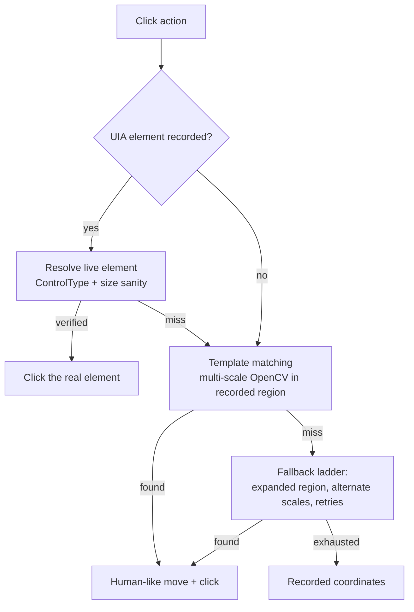

- **Element-first (Windows UI Automation)** — `player/uia_locator.py` resolves the recorded element's *live* bounding box, surviving moved windows, theme/DPI changes, and scrolled lists. Anti-misfire: a resolved element is trusted only when ControlType matches and the box is plausible.
- **Template matching** — `player/computer_vision.py` performs multi-scale OpenCV matching within region constraints and confidence thresholds; `action_handlers.py` owns the click cascade.
- **OCR conditions** — `player/ocr_engine.py` + `ocr_worker.py` (PaddleOCR) power text conditions in Conditional nodes.
- **Human-like behaviour** — jittered click targets, curved mouse paths, variable timing.

### 9.2 Web replay engine

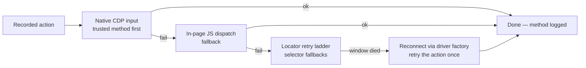

- One **handler class per action type** (`player/web/handlers/`: pointer, keyboard, focus, navigation, chrome); every handler runs the deterministic ladder and reports **which method worked**, so logs read `Web action 4 (click) OK via native`.
- Replay is **visible-browser by default** (headless is an opt-in flag) with human-like pacing; ESC cancel is honoured via the stop flag.
- **One shared durable Chrome profile** for the whole app: cookies/logins recorded once are present in every later run and survive restarts (pages are never restored).
- Web-dominant chains run through the DOM engine so web replay never captures the user's physical cursor; mixed topology (web nodes interleaved with control nodes) is routed accordingly.

---

## 10. AI stack

### 10.1 Inference engines

| Engine | Transport | Notes |
|---|---|---|
| **llama.cpp** | `llama-server.exe` subprocess, port 8081, HTTP | GGUF models, GPU-layer offload (Vulkan), embedding mode for the embedding server |
| **Ollama** | HTTP :11434 | Alternative provider; model pulled/selected by name |
| **BYOK providers** | HTTPS (OpenAI-compatible chat completions) / HTTP (local servers) / subprocess (CLI tools) | Your own cloud keys, LM Studio, Claude/Codex CLI — see §10.7 |
| **llama-mtmd-cli** | subprocess per inference | Multimodal vision (GGUF + mmproj projector) |

`AI/model_cache.py` and `AI/model_downloads.py` manage model inventory and downloads; `AI/gguf_model_info.py` inspects GGUF geometry (context limits, layer counts) to size runtime parameters. The engine is authoritative about context size — the app caps requests to the model's training context.

### 10.2 Local API surface (`AI/api.py`, FastAPI)

| Endpoint | Purpose |
|---|---|
| `/health`, `/models`, `/bootstrap/status` | Liveness, model inventory, startup state |
| `/chat`, `/generate`, `/generate_stream` | Unified chat/generation (routes to the active provider — llama.cpp, Ollama, or BYOK) |
| `/embeddings` | Embedding vectors (embedding server) |
| `/llamacpp/*` (`chat`, `generate`, `generate_stream`, `start`, `stop`, `status`, `models`, `release`) | Direct llama.cpp lifecycle + inference |
| `/vision-models` | Vision model inventory |
| `/cleanup` | Free engines after bursts |

**BYOK gateway routing.** One logical endpoint, three wire routes (llama.cpp engine / Ollama / BYOK providers). Resolution order for every LLM and embedding route:

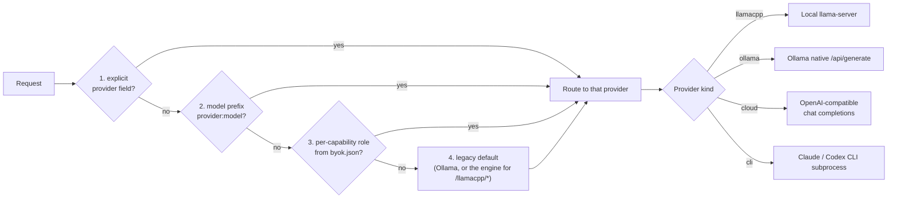

Roles are the cross-device switch: embeddings on the local engine + chat on a cloud provider is just `roles.embeddings="llamacpp"`, `roles.chat="openai"` in `byok.json`.

### 10.3 Embeddings & semantic retrieval

- `AI/embedding_server.py` — lazy thread-safe singleton: own llama.cpp embedding process, batching, health-check/restart, atexit shutdown.
- `AI/comorag_engine.py` — **ComoRAG** retrieval: the embedding space is used as a detached sparse attention layer over large context sources.

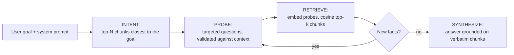

- `AI/graph_rag.py` — Graph RAG over stored context (nano-graphrag lineage): surfaces relevant past knowledge to reasoning nodes and records execution fragments so the agent can reason about what happened.
- `AI/laya_hooks.py` — the Laya verdicts wired into the ComoRAG pipeline **by default** (both for LLM nodes and for the form filler): **fact creation** (per-finding relevance verdict before a finding enters the memory pool), **probing assessment / consumption** (the sufficiency judge that ends the sweep with `ANSWER:` or keeps probing with `MISSING:`), and **choice picking** (`choose_option`, the form filler's semantic option rail — argmax with a confidence floor, `None` when no option clearly wins so the field is asked). Typed noul questions via the embedded engine, LLM evaluators as the fallback, `LOOPER_LAYA=off` back to LLM-only.

### 10.4 Laya System-1 decision engine

An embedded **typed-decision model** (Laya — the open reproduction of TypeSafe Jev: ModernBERT-large 421M, `noul`/`choice`/`score` questions answered in one encoder pass, no token generation) that answers the questions the pipelines used to ask a small LLM: *which worker fits this goal best*, *does this text satisfy this criterion*, *is this finding on topic* and *is the goal answerable yet*. It runs as a lazy-launched child process (`AI/bin/laya.exe daemon`, newline JSON-RPC on stdin/stdout — a ~1.7 MB self-contained CPU build) managed by `AI/laya_client.py`, and it is **always optional**: every consumer calls it once, gets `None` on any failure, and falls back to the LLM path. **Consumers, all Laya-first by default**: the orchestrator-mode picker (done-probe + worker-only choice + conservative ask, in `orchestrator_ops.py`), its deterministic-chains gate and per-step verifier, the Input-node decision evaluator, the ComoRAG fact-curation verdict + sufficiency judge (LLM nodes), the form filler's CRAG retrieval evaluator (one calibrated relevance score per retrieved passage, `AI/crag/evaluator.py`), and the workspace agent's router (`AI/laya_client.rerank` over the catalog summaries plus one `decision` confirm) together with its learned-plan matcher (`same_question_verdict`, `player/agentic_ops/plans.py`). `AI/laya_bench.py` is the gate harness (brain-picking and decision benchmarks, exit codes for shipping Laya options on/off). A `LOOPER_LAYA=off` kill switch forces every consumer onto LLM paths (`LOOPER_JEV` is honored as the legacy name). The English quants ship in `AI/models/laya-GGUF/` (`ud_q4_k_m` default, `q8_0`, `f16`; `LOOPER_LAYA_MODEL` overrides) — the model loads once in ~2 s, deltas per verdict after that. **It is a burst resource, not a resident one**: the daemon starts on the first request and unloads once the burst ends (`LOOPER_LAYA_KEEP_ALIVE_SECONDS`, default 2 s), and `AI/llama_cpp_engine.LlamaCppEngine.start_server()` releases it before allocating the (much larger) llama-server model — on the native/APU builds the two share one memory pool, and measured 2026-09-23 a resident scorer collapsed the llama.cpp native context 262144 → 1024 tokens and OOM'd the Vulkan KV-cache allocation. The next request simply relaunches it (~2 s).

### 10.5 Vision & document understanding

| Layer | Technology | Used by |
|---|---|---|
| Screen VLM | LFM2.5-VL 450M + projector (mtmd) | Handle node scene understanding, vision LLM nodes |
| Object detection | ONNX YOLO-based detector (~44 MB) | UI element detection, click targeting supplements |
| OCR | PaddleOCR (det/rec/cls, bundled models) | Conditional text conditions, form filler, doc pipelines |
| Document extraction | PyPDF2 (PDF), python-docx (Word), txt | Input-node media, form filler grounding |

### 10.6 Speech

- **TTS** — Piper ONNX voices (`LoOper/data/piper_voices/`): spoken input prompts, spoken results, TTS-capable nodes with variable interpolation. Legacy standalone TTS nodes are auto-migrated into LLM nodes. The agent transport exposes `/tts` so the phone app speaks every agent output.
- **STT** — Vosk (`LoOper/data/vosk_models/`): voice mode for agent chat, on the desktop and over the phone's `/stt` endpoint; transcriptions go through the same dispatch path as typed text.

### 10.7 BYOK — bring your own keys, without giving up the local core

`AI/byok.py` is one Python module for user-owned cloud keys, local model servers and CLI tools, behind the same generation API every node uses. Ported behavior (not shape) from the retired TS `utils/byok-runtime`:

- **Provider manifest** — cloud providers all speak the OpenAI-compatible chat-completions subset: `anthropic`, `openai`, `google`, `xai`, `openrouter`, `groq`, `mistral`, `deepseek`, `deepinfra`, `together`, `fireworks`; local model servers speak their native wire: `ollama`, `lm-studio`; CLI providers spawn local commands: `claude`, `codex`. `llamacpp` is the pseudo-provider owned by the local gateway (the built-in engine); `pool` is the future P2P compute pool, visible in the UI but disabled ("coming soon").
- **Selection surfaces** — the AI Settings dialog (`NGUI/dialogs/ai_settings_dialog.py`) stores settings and API keys; `NGUI/dialogs/engine_options.py` is the single source of truth for every engine selector in the app (LLM nodes, code nodes, conditionals, form filler, Code Node Studio). Selecting a provider persists as a `"<provider>:<model>"` prefix on the model field, which the gateway dispatches — the engine is derivable from the stored model, so no new chain field was needed. Role presets (`byok.json`) pick providers per capability (chat / embeddings / vision).
- **Safety properties** — settings live in `byok.json` inside the durable runtime dir (host-owned storage), are sanitized on load, and **API keys are never logged and never written into `AI/config.json`**. 429 rate-limit retries (2, `Retry-After` honored, backoff capped at 10 s), friendly error messages, model listing and connection tests are built in.
- **The assisted builder** picks its own engine from `builder_settings.json` (any llama.cpp / Ollama / BYOK model) and uses it only to write prose about the chain it is reading; the builder cannot dispatch, wire or run anything (§12).

---

## 11. Agent mode

### 11.1 The workspace agent — the interleaved loop

Each workspace is one selectable agent. Agent mode (chat overlay, full-screen agent workspace, phone client) sends the request to `SimpleChainRouter`, which resolves the active workspace and hands the turn to `WorkspaceAgent` (`player/agentic_ops/agent.py`). There is no hand-designed brain and no hand-designed workflow list: the agent runs a **loop**, and each role in it is kept separate so a small model can do its part.

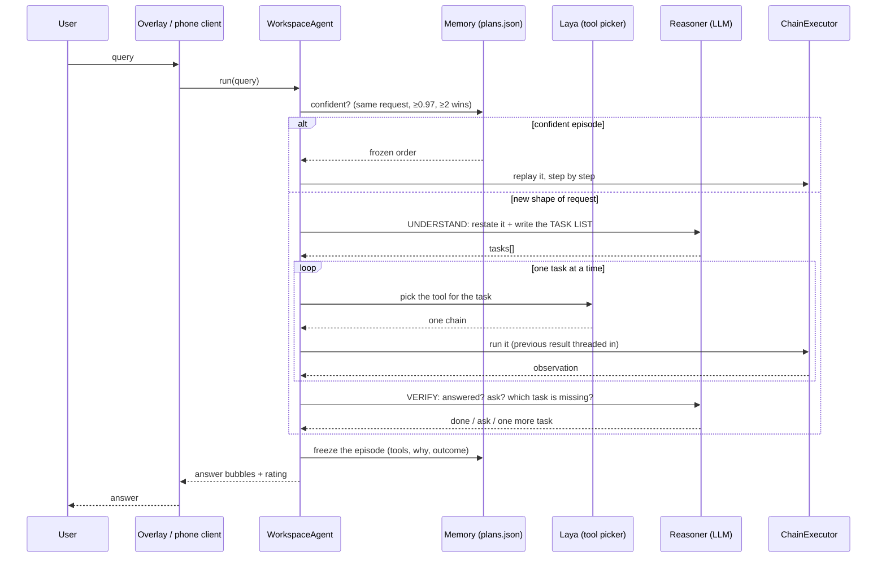

- **The loop** — understand → pick+run per task → verify → freeze. Chains give the agent hands, the model gives it reason, the memory gives it reassurance:
  1. **memory** (`plans.py`) is REASSURANCE, not a shortcut on everything: an episode answers alone only when the request is the SAME one — exact text, or a same-question verdict at **0.97** (`SAME_REQUEST_GATE`) — *and* the episode has won at least twice and is not losing (`PlanStore.confident`). Anything merely similar goes through reasoning, with the episode as evidence;
  2. **understand** (the workspace's model) — one initial reasoning pass: a one-line restatement of what the user wants plus the **TASK LIST**, one task per thing they asked for, in their words. This is what stops a blind single-tool run: the model has to show it understood, and it never names a chain;
  3. **pick + run, per task** (Laya + `ChainExecutor`) — the picker maps one task onto one chain over short labels (§2.2), the chain runs with the previous result threaded into the request. A task no chain covers is **reported** (`No chain in this workspace can do: …`), never silently dropped;
  4. **verify** — one pass at the end of the list: answered → the reply; ambiguous → ask the user and use the answer as a task; incomplete → it names the ONE missing task and the loop appends it (bounded by `policy.max_steps`);
  5. **freeze** writes the episode back (`goal → [{chain, why}]`), so the next similar request starts from what worked.
- **Frozen knowledge is the fast path, deliberately narrow.** Only a near-verbatim repeat of a request that has already won twice replays its tool order without a model call. The loop is for everything else — which is how the agent gets better with use: the set of frozen episodes grows and the set of requests that need reasoning shrinks.
- **When to ask** is a reasoning verdict, not a rule: the reasoner asks before acting when the request is too vague, and at verification when the result is ambiguous; the reply becomes a task. (A chain's own `user_prompt` Input still pauses the run through the same callbacks — §11.4.)
- **No reasoner, no pretence** — with no model chosen the loop runs exactly ONE tool (the one Laya or the confident episode picks), logs `no reasoner model, single-tool run`, and says it in the answer: *"Stopped after one step … set one with the MODEL button"*. It never fakes a multi-step plan and never silently picks a model the user did not choose.
- **The browser belongs to the run, not to the step** — an agent step is one chain of a longer session, so `ChainExecutor.run_chain(keep_web_browser=True)` tells the engine to leave the chain's browser OPEN when the chain ends (a chain-linked or attached browser is never killed either way). Without it the browser was quit between two agent steps: the second step started on a fresh page with no login, and the user saw the window vanish after the first order.

- **Dispatch** (`player/agentic_ops/simple_agent.py`) binds agent mode to a workspace: the sidebar lists one entry per workspace (`Name · Agent`), selecting one sets `workspace_slug` and the chains folder it routes over. A workspace whose manifest pins `agent.legacy_brain` answers with that chain alone; otherwise the turn goes to the composed agent. With no workspace at all the router answers *"No agent available"* — no fallback, no hidden classifier.
- **Catalog routing for small models** — the agent never asks a model to invent a tool schema, and the tool choice is not the model's. The catalog gives one short, derived line per chain; the *picker* (Laya) scores a bounded set of short labels and one same-task verdict confirms the pick. A model is only involved in the reasoning turn, which names an INTENT — never a chain — and in `plan()`, the one-shot decomposition used when a plan is wanted without running it (strict JSON validated against the catalog; an unknown chain or a step over `policy.max_steps` is refused). Each chain then extracts its own values from its Input nodes.
- **Learning is data, not weights** (`player/agentic_ops/plans.py`) — every episode is frozen as `goal → [{chain, why}]` plus the outcome, the transitions (`after A, B`, with outcomes) and the ask/report counters, in `<workspace>/plans.json`. `similar()` retrieves a past episode by Laya's same-question verdict over the stored goals, and `evidence()` renders it — order, each step's `why`, wins/losses — into the reasoner's prompt. That retrieval is why a second run of the same problem starts from the order that worked, and why a losing episode is kept as evidence instead of being retried blindly.
- **Ask-user v2** — any Input node with a prompt pauses the run and asks through the richest available channel — chat overlay with buttons for yes/no or multiple choices, attach/paste affordances for documents and images — answerable from desktop **or phone**; a reply that names a file becomes an attachment. Both the composed agent and a pinned brain pass the same callbacks. Legacy ask-user consumers (form filler) keep working unchanged.
- **Activity memory & memory-only chat** — `player/agentic_ops/run_memory.py` keeps ONE append-only SQLite timeline per install (`LoOper/data/run_memory.db`, the durable runtime dir when frozen): every chain run, every node that executed, every chat turn and schedule lifecycle, timestamped and scoped (agent / manual / schedule). Temporal questions ("what did we do yesterday") are answered by filtering that record — the model reads timestamped lines and never computes dates. Memory-only chat mode answers strictly from this timeline and never dispatches a chain. `LOOPER_RUN_MEMORY=off` disables recording; `LOOPER_RUN_MEMORY_DB` overrides the path.

### 11.2 Orchestrator mode — the optional goal loop

The agent does not need it (§11.1 learns its own order), but an **LLM node can be switched into orchestrator mode** (`orchestrator_mode` in the LLM dialog): the retired Orchestrator *node type* is folded into this mode when an old chain loads, and its `brains` / `chains` edges land on the node's `tools` port. In this mode the node exposes two router input ports — `tools` (deterministic chains, and tools) and `brains` (sub-brains) — and instead of one brain, several mini-brain chains are wired to `brains`, and the node loops toward the goal: it **scopes one step at a time** and asks the picked specialist brain to run it, reading the output back to drive the next turn. A brain may itself be a tool router (an LLM node with atomic tool chains on its `tools` port): the orchestrator never names tools — its scoped step rides into the brain, and the brain's own router picks which tool serves it (`linkedin.json` → verify with the vision brain → `jobsearch.json` → `repairtest.json`).

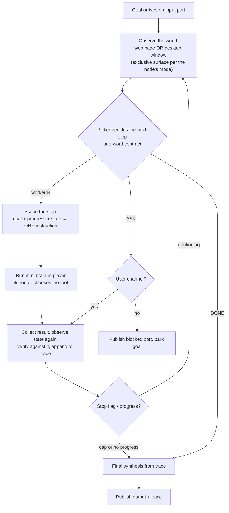

- **Three inputs to every decision** — the GOAL, what WAS DONE (the step result and the trace) and **the world NOW** (the observed state digest). A result is the brain's own prose: it reads *"opened LinkedIn"* whether or not anything moved, so the digest is what lets the model *confirm* a step instead of assuming it (measured 2026-09-23: a failed web sequence reported success, Laya verified it, and the loop closed as done). The digest is one read per iteration, shared by the chains gate, the picker, the scoper and the verifier; sources are optional and read-only — the chain's own live browser page (URL, title, visible text with shadow roots and frames, never launched, never navigated) and the desktop foreground window (title + process). The surface is **exclusive**, picked by the node's Web Mode toggle: **web** reads the live browser page (when this chain owns no session, it reads the SHARED browser the dispatched web chains opened), **desktop** reads the focused window **on the monitor under the cursor** (multi-monitor aware; the topmost window on that monitor is the fallback). Empty when nothing is observable; `LOOPER_ORCH_STATE=off` disables it.
- **Web/desktop scope + headless** — Web Mode ON makes the orchestrator **web-exclusive** (observe/verify on the shared browser), OFF **desktop-exclusive**. A web orchestrator may also be **headless** (`orch_headless`, the "Headless web" toggle shown only under Web Mode): its dispatched web chains run in an invisible browser (`web.session.run_headless`) and never attach to the visible workbench.
- **Workers** — mini brains are the unit of dispatch; each brain's runtime-derived description (chain description + `[inputs: …]` + a router brain's `[tools: …]` names as context) is what the picker chooses on. A worker may be a whole chain (`chain_import` on `brains`) **or a single node** (sequence, web sequence, conditional, code, LLM, form filler, handle, MCP): the node's own **description** field is then the routing text (its label + type + one structural hint otherwise), and a conditional worker evaluates once and publishes its verdict — a *check* step, never branch navigation.
- **Picker** — `llm` (one strictly-parsed token: worker number, `DONE`, `ASK`; one stricter retry) or `laya` (done-probe + worker-only choice + conservative ask via the embedded engine; zero parsing). Either way, unparseable → stop with the trace as the answer; no prose scanning.
- **Step scoping** — after the pick, one short turn turns the covered scope + progress + the observed state into ONE imperative instruction (`Your next step: …`): the orchestrator scopes, the brain picks the tool. The worker's prompt is its **MISSION** (the task(s) inside its scope) plus progress — the original request never rides along. When that turn yields nothing, the description-as-task prompt is used (previous behavior). **Scope integrity**: a scope that silently DROPS one of a compound directive's actions is refused (the dispatch does not happen, the directive is handed back) — measured 2026-09-24: the scope *"Open LinkedIn.com and click on your network."* cost the request its `home` action. Single-action directives are not policed this way — paraphrasing (`home button` → *the house icon*) is the scoper's job.
- **Verification looks at the world** — the per-step verdict's premise carries the step result **and** the state digest, and a step the executor reported as failed (it returned no next node — the same convention the main loop turns into *"Node X execution failed"*) is `ok=False` without a scorer forward.
- **Guards** — step cap (default 15), no-progress detector (identical worker + identical step + identical result twice), stop flag checked between steps; sub-brains run through the normal chain-import path with `_chain_input_context` carrying goal + progress **plus the propagation packet** (`_chain_root_goal`, `_chain_plan`, `_chain_state` — see the handback contract in 11.3). An unresolvable chain import (no path, or the file is gone) now **fails the node** instead of skipping ahead — a run of broken imports used to log ERRORs and still report success end to end (measured 2026-09-23).
- **Synthesis** — one final short LLM pass turns the trace into a plain-language answer (the rendered trace is the fallback). The full step log is published on the `trace` port; `blocked` marks a goal parked for the user.
- **Composition** — mini brains are ordinary chains (they never run standalone); every brain file is loaded from disk at dispatch time. A chain with **no orchestrator-mode node** is a plain chain (LLM + tools + memory + outputs) and works exactly like that; removing the brain wiring leaves the router with the remaining `tools` chains, and a node with neither port does no routing at all. Routing never falls back to a hidden classifier.
- **Steering a worker** — the scoped step arrives as `Your next step: …` alongside the goal and progress (carried verbatim on an entry **carry** input), while an **`agent_modifiable`** input runs one extraction turn that pulls its single parameter (query, item, filter…) out of that prompt — its **label** is the filter. To build one: add an Input node, set its label to the parameter it should supply (e.g. *Search query*), tick *agent-modifiable*, forward it downstream. Two budgets to know: the extraction sees the parent context capped at 500 chars per input (the goal comes first, so it survives — keep long briefs on a carry input and let agent-modifiable inputs own the parameters), and in manual runs without an agent session agent-modifiable inputs behave as carries, so the brain still executes.

### 11.3 Deterministic chains and the freeze loop (orchestrator mode)

The orchestrator-mode node's second input port carries **deterministic chains**: orchestrator-free compositions that answer a known request end to end with **no routing inference**. One rule decides which kind a chain is — *does it contain an orchestrator, directly or through its imports?* — and that same rule drives the port it may be wired to, its node color (`import_kind`), and what may be frozen.

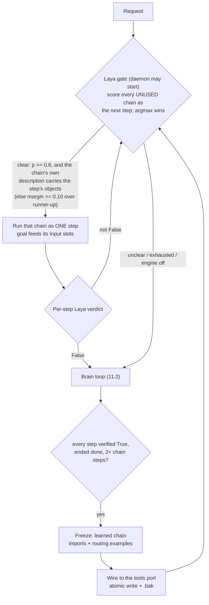

- **The port is a selector, not an executor.** A deterministic hit runs through the same chain-import path a brain uses (`_chain_input_context` carries the goal); the fast path adds only the router stage, so execution semantics are unchanged.
- **The ladder is applied per level, recursively — brains hand lists to brains.** At every orchestrator: (1) *can ONE chain do the WHOLE job?*; (2) if not, *which brain may be able to?* — a brain that is **itself an orchestrator** receives the **tasks its description covers** as one dispatch: the consecutive directives that the same typed question ("which worker serves this step?", asked per directive) assigns to it — **never the whole request** (a 40-page goal must not ride into every instance; each worker gets the scope it needs), and it re-runs this exact ladder at its level: whole-chain → its own chains per directive → *its* brains. **Brains are OPTIONAL at any level**: a level with zero brains is a legitimate shape, never a crippled one — brains are the dynamic processing (a brain *learns* something new), the `tools` port is the mechanical worker, and the successful run is later frozen into a learned chain: the cerebellum records what the brain learned. A sub-brain level may be added to — or left out of — any part of the tree, in any amount, without implying that level's chains cannot do the work; when a chains-only level truly cannot serve a step the log says exactly that ("this step is unserved at this level"), never that brains were required. A **specialist** chain (no orchestrator inside) keeps the one-step contract: the orchestrator scopes ONE directive and the specialist routes it to a tool. A verified delegated list completes the whole remaining span. When a nested brain comes back with work unaccomplished it appends a machine-readable **handback** to its published output — `[ORCH-REMAINING] ["…", "…"]`, only on relayed runs, never on a top-level answer — and the parent **advances past the prefix that WAS accomplished** and re-routes only the untouched tail (a report that does not line up with the parent's span is ignored), excluding that brain for the span until other routes were tried. The contract is **two-way**: *marker absence means the sub-run ended `done`*, so the whole delegated span is complete by construction and the parent completes it structurally — no probe, no re-dispatch (measured 2026-09-24: without that signal the parent had no way to know the delegated work had finished and kept routing). And a reported remainder **overrides the verify read**: a sub-brain that explicitly says what it could NOT do is never treated as done, even when the scorer reads True. The recursion is bidirectional. Beside the marker rides `[ORCH-OUTCOME]` — a JSON object with the child's `stop_reason`, its last ≤8 step records and its observed state; the parent strips it from the prose and records it on the trace entry (`outcome`) for inspection — observability only, never a routing input.
- **The ladder decides routing, per activation.** First: *is there a LEARNED chain that does this job?* — a deterministic, scorer-free match (measured 2026-09-24: the neural version of this rung picked an **atomic** chain as "the whole answer" — 0.869 vs the learned chain's 0.765 — and the state digest flipped the order again), judged on **intent coverage, not verbatim text**: the artifact's COMPOSITION is expanded at routing time (each step's name + description, in order — "1) go to linkedin — navigates to linkedin.com on chrome; 2) messages — clicks on the messages button"), every step's salient word must be asked for and every requested action must belong to a step. A request covering only part of the artifact (it would execute a step nobody asked for) or more than it (an action would be left undone) is refused *with the exact gap in the log* (`steps nobody asked for: …` / `actions no step serves: …`) and falls to the step ladder. Second: the goal is **listed as its steps by one planning turn** — the LIST is the model's work, and the *protocol* is what makes a 1B-class model able to do it: one short question ("list the steps this request is made of, in order"), one step per line, verb-first with a worked shape example, nothing else — measured live 2026-09-24 with SmolLM3 on the request that used to fail: `navigate to linkedin, click on my messages, then on my network and then press the home button` → `navigate to linkedin` / `click on my messages` / **`click on my network`** / `press the home button` (the model itself supplied the elliptical verb). **Nothing here ever cuts the request**: a regex split into fragments is what disconnected a step from its chain — the verbless piece `on my network` read 0.578 against the tool "clicks on my network button", fell under the floor, and the action stayed unserved while the named one read 0.641. What the code does instead is *validate* the reply: reasoning blocks dropped, numbering/bullets/shape cleaned character by character, narration and request preamble dropped, lines capped (`_ORCH_DIRECTIVE_CHARS`), duplicates collapsed by object across the whole plan, plan capped — and a reply that cannot be a plan (the request joins clauses but ONE line came back — see `_orchestrator_looks_compound`) is asked once more with the protocol's example. A reply that is still one line stands as ONE directive and the ladder's picker / scoper / done-probe own it, exactly as when the planning turn is unavailable. Two deterministic shortcuts remain, both because the input is *already* discrete: the numbered/bulleted **handoff list** a parent level writes is read line by line (its lines ARE steps — re-planning one is how a clean four-item list lost `jobs`), and a **verbless line** is completed by grammar (`_orchestrator_inherit_verbs`: a step opening with a function word continues the action before it, `click on my messages` + `on my network` → `click on my network`; `press the home button` keeps its own verb).
- **A partial fit is ASSEMBLED, not re-derived.** When no artifact covers the request but its PARTS do, the plan picks one deterministic **unit** per consecutive run of directives — a whole learned artifact first (its composition covers that span exactly), else one of its step files, else an atomic chain on the port — materializes them as ONE continuous chain (`.pending_` name) and runs it as the whole answer: one dispatch, zero scorer reads. The plan must contain an artifact: a plain atomic sequence stays on the per-directive path, which verifies every step separately and freezes the same variation at the end anyway. A verified assembly is renamed into `learned_…` and **wired as the new learned artifact for that variation** — learned chains composed of learned chains, not only of atomic tools; a failed verification deletes the pending file and the ladder takes over (an unverified run is never persisted). Ambiguity is never a guess — two candidates for one run decline the whole plan. Measured 2026-09-24 on the real library: `['open linkedin', 'click my network', 'click my messages', 'click jobs']` → `[the 3-step artifact, jobs.json]` ✓, `['click the button']` (two descriptions contain it) → no plan ✓.
- **The gate asks the step question — a chain may serve SEVERAL steps, learned artifacts never appear here.** The port is the human's action space: every wired chain (except learned artifacts) is scored for the directive, one `noul` forward each, judged against the CURRENT DIRECTIVE (never the compound request): *"The next step toward the goal is to `<description | routing.examples>`."* Alignment comes from the **floor `_CHAIN_GATE_MIN = 0.6`** plus the human description itself: the candidates whose description **names at least one object the step names** form the pool, the best neural score in it wins, and a pick that names **more objects than the runner-up** is CONFIRMED (`margin` irrelevant). Measured live 2026-09-24 on the 7 wired chains, both directions: `click on my network` read 0.641 against the tool "clicks on my network button" while an unrelated chain read 0.620 (margin 0.021 — a perfect match the margin alone declined), and for `press my network button` the scorer picked the WRONG chain by 0.001 (home 0.656 vs `clicks on "my network" button` 0.655) while only the right chain named the step's object. A tie in objects named is real ambiguity and `margin >= _CHAIN_GATE_MARGIN = 0.10` over the runner-up decides. Correct picks measured 0.625–0.81, the tiny model's noise band at or below ~0.51 (measured 2026-09-24: `messages` read 0.506 for a home-button directive and ran while the floor was 0.5) — a miss costs one brain round, a false positive runs the wrong chain. **A chain is not one action**: after a verified step the plan advances by the SPAN that chain's own description names — a routine chain ("opens linkedin and clicks on messages") serves several consecutive directives without per-action routing, a step-sized chain advances exactly one, and the count is computed, never assumed. Learned chains are excluded entirely (one scored 0.756 because its example IS a goal text). **Discovery stays at the current level** — an orchestrator learns its own chains and brains, and a brain's description surfaces only what it ROUTES WITH (`tools` / `brains` ports, one level at the boundary); a nested orchestrator's deterministic `tools` is that level's own action space (learned artifacts keep accumulating there) and is never flattened upward, or a deep agent (3 brains per level, ten levels) would OOM its context before it ran. The OBJECT comparisons around the gate (plan dedupe, learned composition coverage, assembly units) assume **no vocabulary at all**: the library classifies its own generic terms from the wired chains' signals — a word many chains share names no object for that library (`click`, `button`, `page` in an English UI set) while a word only some carry does — and plurals/third-person are stemmed as language glue. Rename a chain, add a language, rewire the port: the classification follows the data.
- **A verified step advances the directive; a completed plan ends the run.** When a step's verdict is True the next directive becomes the routing unit (its own steps are its progress). Once **every** directive of a real decomposition was executed and verified, the level ends `done` structurally: the plan IS the goal decomposition, so covering it covers the goal — the picker, the scoper and the done-probe are never consulted for work to invent (measured 2026-09-24: on a fully achieved LinkedIn goal the done-probe read 0.394 on a steps-only premise and the scoper then fabricated *"select 'Send a Message'"* for `jobsearch`, which ran and looped until ESC). The probe keeps its role while the plan can still be unfinished: mid-plan, and for an **unsplit** plan — a single directive that echoes the goal, the planner's *already one action* / *could not split* answer — where the picker / done-probe ends the run exactly as before (a multi-step goal like *"find the cheapest monitor"* still loops past its first verified step).
- **Laya is a burst resource** (`LOOPER_LAYA_KEEP_ALIVE_SECONDS`, see §18.2) — the daemon is normally unloaded between steps, so the gate **starts** it (~2 s) when a chain set is wired; a machine with the engine disabled for the session (kill switch / no exe / no model) keeps the fast path closed without probing.
- **A step the node itself reported as failed is never dressed as success.** Node executors return the next node id on success and `None` on failure (the same convention the main loop turns into *"Node X execution failed"*); the orchestrator records `Outcome: FAILED (<type>) — the node aborted before completing` and the trace's `ok` is False without paying a scorer forward. (Measured 2026-09-23: a failed web sequence used to report *"ran successfully"*, Laya verified it True, and the loop closed as done.)
- **Per-step verification** — after every dispatched step (brain or frozen chain) one Laya forward answers *"did this step accomplish what it was asked?"* and the verdict rides on the trace as `ok` (True / False / None when the engine is down). Its premise includes the step's result — unlike the goal-level done-probe, which judges from steps alone because result prose reads as a completed claim. `picker=laya` runs and the fast path may relaunch the engine for the verdict; a `picker=llm` run keeps the no-launch rule.
- **The freeze is data, not weights.** A run compiles into a learned chain only when it ended naturally (`done`, never after ESC/stop), **every** step verified True, every step was a library chain, and there were at least two steps (a single step *is* the library chain). The artifact is **composition-only** — one `chain_import` per step, `input → imports → output`, plus a `routing` block (verbatim past requests, provenance, counters) — so a library fix propagates to every learned chain and the file stays tiny. Two guards keep it honest: one artifact per goal (a repeat run rebuilds its own file instead of piling up timestamped twins), and the source chain must **host this orchestrator** (its id must be in that file) or the freeze is skipped — the artifact never lands in a chain that never ran it. **The artifact describes itself in steps**: each step's description is read from the atomic chain it imports and persisted with the artifact (`steps[]` + a step-wise `description`), so the orchestrator judges what it DOES without opening a file (and a later artifact that composes this one inherits that step list as its step description). Artifacts and host-file edits are written as **pure-ASCII JSON** (non-ASCII escaped) and the chain editor reads/writes chains as UTF-8 — measured 2026-09-24: a single `→` in a learned description plus a locale-codec load made the file (and a chain with an em dash) unloadable in the editor, which looked like a broken orchestrator. The wiring target resolves the orchestrator's id the way the builder stores it (`data.node_id`; a built orchestrator node carries no top-level `id`) — reading only `node['id']` left every learned chain on disk but unwired.
- **Routing signal is the chain itself** — `routing.examples` (verbatim past requests that worked, ≤5 × 200 chars) is the criterion text the gate's step read is made on, and the routing `description` is the DERIVED brief (`player/chain_brief.py`) — not hand-written prose. A chain with neither is skipped with a warning — no signal, no route.
- **Slots stay open** — goal-varying values remain bound through the `agent_modifiable` Input nodes of the library chains; the freeze never bakes the learning run's values in.
- **Where it lives** — `chains/learned/learned_<stamp>_<slug>.json`, wired automatically into the running chain file (atomic write, one-time `.bak`, never twice). Frozen builds write and resolve under the runtime dir. `LOOPER_LEARN=off` disables the freeze; without the Laya engine the fast path stays closed and the loop handles everything.
- **Authoring surfaces** — sequence, web sequence and conditional dialogs carry the **description** the picker routes on, an orchestrator-mode LLM node uses its own, the handle node uses its goal description, and chain-import nodes are painted by `import_kind`. A chain the Builder has described routes on its derived brief.

### 11.4 Input node v2 — interaction gates

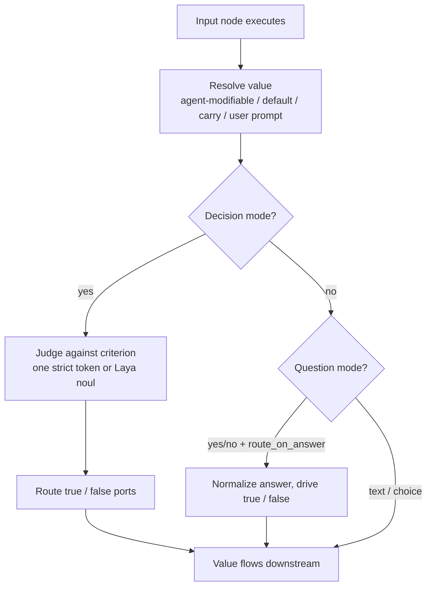

- **Decision mode** — a natural-language criterion evaluated with one strictly-contracted model turn (reasoning strips, single-token answer, one stricter retry, fail-closed default) or the Laya noul evaluator (zero parsing). This replaces brittle Input+Conditional pairs.
- **Question modes** — free text, yes/no, or a choice list (`[{label, value}]` pairs); answers are normalized against the options (exact label/value, case-insensitive; one re-ask, then default).
- **Accepted media** — `accept_text` / `accept_images` / `accept_documents`; documents are text-extracted (PDF/Word/txt), images contribute their path; attachments ride the `data` port payload and a `node_<id>_files` side channel into downstream code nodes.

### 11.5 Persistent goals (wake-driven)

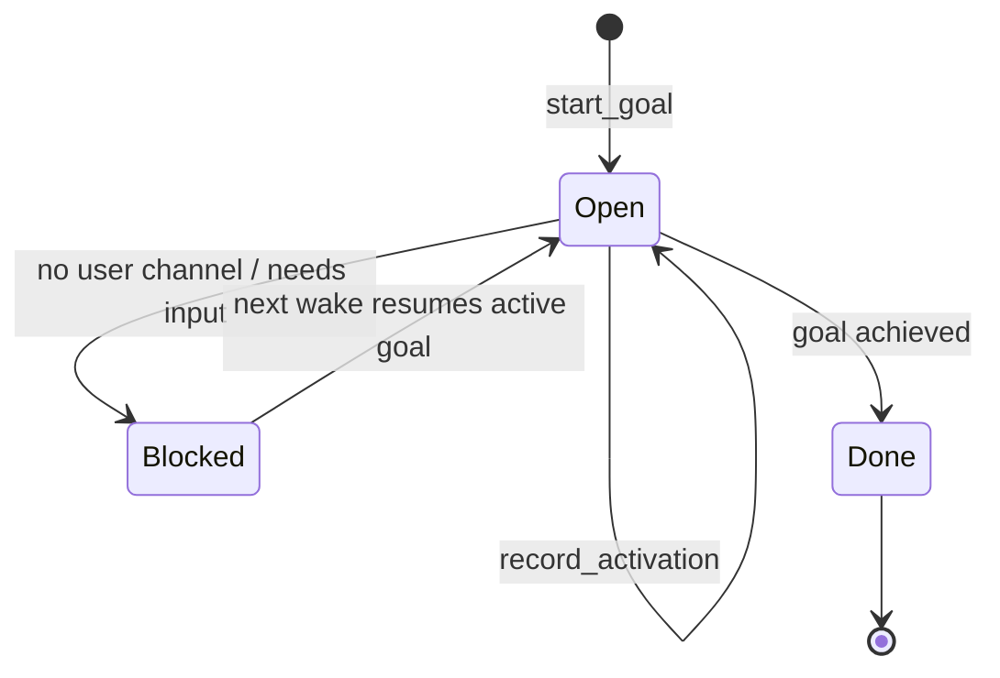

- `player/agentic_ops/goal_ledger.py` — atomic tmp+replace writes to `LoOper/data/agent_goals.json`; corrupt-safe load; a single active goal; per-activation trace records.
- Enable `use_goal_ledger` on the Orchestrator: a blocked goal parks itself (`blocked` port) and **resumes on the next activation** — wake-driven persistence, not a busy daemon. Schedule the chain to create the wakes (see §16).

### 11.6 Agent surfaces

- **Chat overlay** — a floating rounded overlay (toggleable) and a full workspace (`File > Agent`), chat bubbles with a transcript per workspace agent, stop/ratings, voice mode.
- **Float dock** — the overlay bars are no longer edge-docked: one floating row of three toggle buttons (Actions / Library / Nodes) sits where the top bar used to be, each sliding its panel down under the row; the Library panel carries a per-node-type sub-dock, and the **workspace selector** floats beside the dock row. One panel open at a time, so the canvas stays readable and the builder chat keeps its column.
- **Interactive HTML artifacts** — an Output node with `render_mode='html'` makes the agent's answer a self-contained artifact (HTML + CSS + JS): persisted to a durable, browsable `artifacts/` folder (`NGUI/widgets/artifacts.py` normalizes fenced model output), rendered interactively in the desktop overlay (QWebEngineView) and in the web/phone client (sandboxed iframe).
- **Phone client** — the chat UI ships inside the Android app and reaches the host over a P2P link by public key (`pear://<pubkey>` QR — no IP, no VPN); runs started from either surface are answerable and stoppable from either; history syncs on reconnect (§15).
- **Exported agents** — a workspace agent whose pinned brain chain is set can be compiled into a standalone `.exe` (see §17) with the agent surfaces intact.

### 11.7 Routing diagnostics — derived action graph & plan projection

Two log-only shadows render what routing *could* go on; nothing dispatches on them yet.

- **Derived action graph** (`…/executor_modules/action_graph.py`) — per chain file, a typed graph built from what the EXECUTOR actually reads, never from descriptions: web-sequence actions render verb + the locator's literal text (`click "Easy Apply"`), plus sequence names, handle goals, and input/llm/conditional/mcp/form/code labels. Label-less nodes are skipped and counted (the coverage number is honest, not padded). Edges are the executor thread (output connections; tool ports excluded) with a deterministic order; chain imports collapse ONE level (`jobs: click "Jobs"`), cycle-guarded. Graphs are content-hash cached — rebuilt only when a file's bytes change — and bare web-sequence refs only resolve inside files carrying `mode: web` (a chain sharing the sequence's name must never win).
- **`Action graph (shadow)`** — per activation, per wired worker: coverage (`rendered/nodes`), skipped kinds, entity lines and `-> call "…" (k child line(s))` imports. A worker that renders `0/N` has no own executable payload — its routing rests on its description and its imports' child lines.
- **`Plan projection (shadow)`** — every planned directive matched against the wired workers' candidate lines (own entities + one-level import children) with the picker's own stemmed vocabulary (verb and ambient state words excluded): `directive -> worker: line (shared: …) | UNMATCHED`, closed by `(projection: k/n directive(s) matched at least one action line)`. UNMATCHED names intents no wired action covers — bad plan wording, a missing capability, or an unnamed chain; the matched count is the funnel metric behind most "wrong brain" runs. Measured on the current library (2026-09-26): the observation-plan of a "what is in the website i opened?" request matched 1/3 directives.

Both blocks ride at INFO and are silenced with `LOOPER_ORCH_GRAPH=off`. The projection is the measurement substrate for the planned planner work.

---

## 12. The assisted builder — a read-only chain analyst and flow annotator

### 12.1 The panel and the boundary

The **builder chat** (`NGUI/widgets/builder_panel.py`, side-docked on the right of the main window) explains the chain on the canvas and writes that chain's own permanent metadata. It is deliberately **read-only over behaviour**: its whole tool surface is `read_graph`, `describe_chain` and `read_node` (`player/builder/tools.py`), so it cannot create, edit, wire, delete, record, run or test anything. The canvas stays visible and editable on the left the whole time.

It writes two things, and neither changes what the chain does:

- **The chain's flow metadata** (`player/builder/flow.py`) — `summary`, section **boxes** (drawn on the canvas as titled, coloured frames by `NGUI/graph_elements/flow_overlay.py`), **a line per node** (`nodes`: what THAT node does with its own values) and per-step sentences. It is saved with the chain, so the chain describes itself permanently; the routing line every reader uses is derived from it (`player/chain_brief.py`, §6.1).
- **Content the user hands it** — with a single node selected, the paperclip opens a system file dialog and writes the chosen file into the field that node reads at run time (`player/builder/content.py`).

Grounding is deterministic: `player/builder/snapshot.py` reads the live canvas once and resolves every port to a role (`ports.py`), and `describe.py` builds the digest (start, execution walk, branches, loops, phases, **node content**, defects). The model only writes prose over that digest; it never guesses the topology.

**Every node says what IT does.** The digest's **NODE CONTENT** section carries one line per node — built by `describe.does_of` from that node's OWN settings: the label it supplies, the criterion a `conditional` decides on (`condition_type` + the code / prompt / locator behind it), the instruction an `llm` writes from (or its `semantic_description`), the recording a `web_sequence` replays, the Python a `code` node runs, the tool an `mcp` node calls — followed by a compact wire summary (runs after X, hands execution to Y, reads/emits which data). `read_node` answers with a **DOES** line as its first fact after the role. A type-level purpose is never the answer to "what does this node do": the type is shared by every node of that kind.

**The per-node lines are stored, not just spoken.** A turn's `flow` gains a `nodes: [{"node", "does"}]` list; the panel then completes it deterministically (`flow.complete`) with `describe.does_of` for every node the model left out — its own words always win — so the chain file says what each thing does even when the model answered in one paragraph, and the walkthrough speaks those lines (`flow.steps`). That is what agent mode reads: `chain_brief` uses the trail when the chain has no section titles, and `catalog.digest` gives the reasoner the first four node lines.

**Nothing here is required on demand.** Each stored sentence is stamped with the fingerprint of the node version it describes, and `player/chain_refresh.py` sweeps a workspace when agent mode reloads: only chains whose nodes changed are rewritten, and inside such a chain only the changed node's line is re-derived — with no model call at all. Describing by hand is for the wording you want; keeping it true is automatic.

**An atomic tool is its node.** A chain can be ONE node with no wires. Its topology says nothing, so `player/builder/artifacts.py` opens the file the node points at and summarises it: for a `web_sequence`, the recording's own name, its action count and kinds and the URLs it opens; for a `sequence`, the same for the desktop recording; for a `chain_import`, the imported chain's derived brief (a live node names it `chain_file`, a chain file `chain_file_path` — both are read). A recording that is missing, unreadable or empty is a **reported defect** — "replays nothing" and "the recording could not be read" are different facts and are never merged.

One turn, end to end:

- **The model writes prose only.** Its engine (any llama.cpp / Ollama / BYOK model, from `builder_settings.json`) answers ONE JSON envelope: `{"reply", "actions": [{"name", "arguments"}], "flow": {...}, "walk": true}`. `actions` are read-only reads; `flow` becomes the chain's metadata; `walk` requests the visual walkthrough. A malformed envelope raises `BuilderProtocolError` — nothing is silently dropped.
- **Python applies it.** The panel validates the flow metadata, resolves every node reference against the canvas (a stale id is a hard error), draws the boxes and writes the chain file when one is open — so the derived description is refreshed immediately.
- **If the model is unusable**, the turn fails with the reason (model markup from a chat template is parsed as a tool round, never accepted as prose). There is no fallback action list.

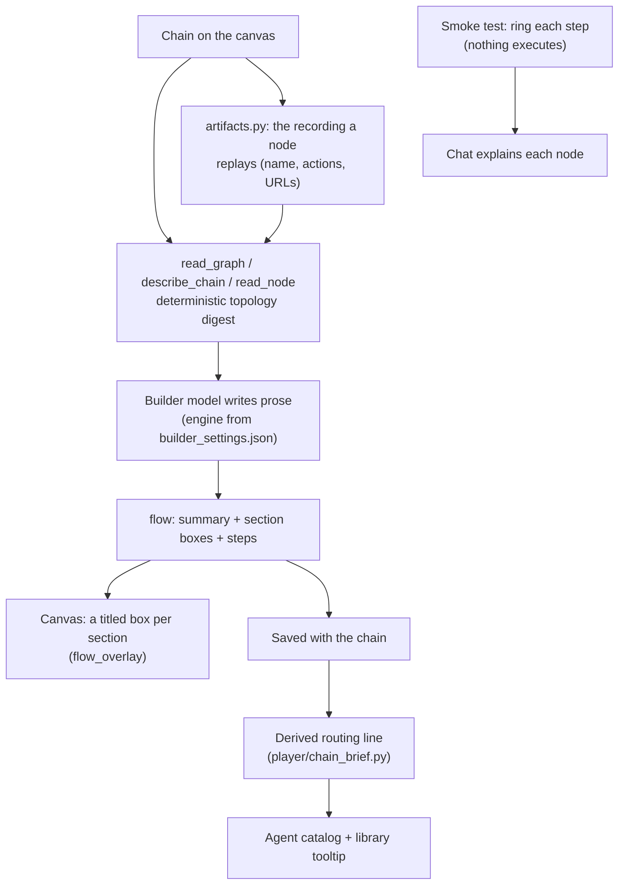

- **Read tools, not actions.** `describe_chain` answers from the resolved canvas — the start node, the execution walk, branches, loops, phases, **what each node replays or runs**, a single node, a subtree — with every port's role (execution vs data, prompt vs context vs named IO). `read_node` returns one node's config, ports, wires and artifact. That is why "what does this chain do?" is answered from the topology and the recordings instead of from prose.
- **Annotations are not chain content.** The boxes and the walk ring are plain `QGraphicsItem`s on the scene (`NGUI/graph_elements/flow_overlay.py`): no ports, not saved into the chain, dropped when the graph is rebuilt, and they follow dragged nodes (a 300 ms refit).

### 12.2 The smoke test — a visual walk, not a run

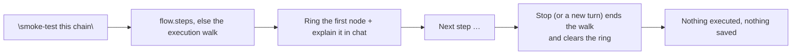

- Steps are deterministic (`player/builder/flow.py:steps`): the order is the execution walk, and each line comes from the node's own config and wires plus the authored sentence where the config says nothing.
- The walk is a **drawing**, so a chain can be explained without touching the machine: no recorder, no browser, no model call per step. The chat says what each node does and how it connects; the ring only marks where the story is.

### 12.3 The runbook — one source of truth for nodes

`player/builder/runbook.py` is the structured node reference every builder component consumes: what each node is FOR, the ports it exposes (collected from `NGUI/nodes_resources/*.py`), the fields that matter (aligned with `node_templates.NODE_EDIT_FIELDS`), when to use it, and when the builder must ASK the user instead of guessing. `node_templates.py` turns it into the type registry and the per-type edit fields the read tools report; the same source renders `docs/NODE_RUNBOOK.md` (`python -m player.builder.runbook --write`). It no longer drives canvas mutations, because the builder makes none. On-the-fly chain learning (the freeze loop) is a runtime feature of orchestrator mode (§11.3), never a build-time one.

---

## 13. Memory & context

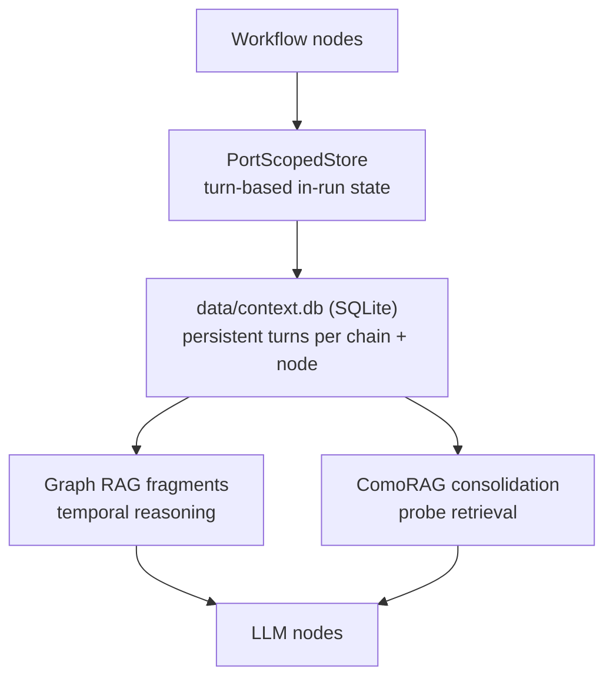

- **In-run state** — the PortScopedStore keeps named-port values plus a turn-based history (user turn, tool turn, result) per chain; `clear_on_finish` context nodes are scoped to exactly one execution run.
- **Persistence** — Context nodes write to `context.db` (`AI/context_database.py`): append-only turns with per-(chain, node) rolling caps, cross-chain sharing, and merge policies.
- **Retrieval** — Graph RAG surfaces relevant past knowledge to reasoning nodes; ComoRAG consolidation distills large sources into grounded facts via probe-retrieval cycles (§10.3).
- **Consolidation** — LLM nodes with `use_context_consolidation` enable a probe-driven memory-organization loop; turn history is trimmed to `max_history` with amortized counters.
- **Activity timeline** — `run_memory.db` records every chain run, node execution, chat turn and schedule lifecycle (§11.1) — the audit substrate for temporal questions and memory-only chat.
- **Inspection** — the Agent Settings dialog renders a goal-relationship graph with tabbed panels for executions and feedback: memory is reviewable, correctable, clearable.

---

## 14. Specialized subsystems

### 14.1 Form Filler node

Document-grounded multi-field completion: field discovery on live pages/apps, knowledge-file lookups (including learned ask-user answers), per-field validation, page-rejected field repair loops, and a review gate before submission. Choice controls (select / combo / merged radio-checkbox groups) are resolved by the **Laya** semantic picker — every option is scored against the value the model meant, and the pick is taken only when it clears a confidence floor and a margin over the runner-up; an unclear pick is refused so the field is **asked** instead of guessed. A **list-backed** control is never skipped on a pre-filled value (a `<select>` rests on its first option), so a page default is corrected from the context and the field is only rewritten when the answer differs; a text field the page already filled stays untouched. Fact composition parses composer findings in every form a small model emits (bare / markdown-bolded / numbered) and keeps only findings traceable to the retrieved excerpts. Its ask-user path keeps the legacy callback signature — fully compatible with the ask-user v2 channel. A **picked page-scope container** is resolved by **position, not content**: the pick's structural path (kind + place) leads the scope ladder and the recorded id / hashed class / text fall back behind it, so the same container is re-found on another form with the same layout. A pick that is **present but does not resolve** on the current page **fails closed** — the node acts on nothing rather than widening to the whole page (where the site's own chrome behind the form, e.g. a header search box that also declares itself a combobox, would be resolved and its list opened — a click outside the form that closes the form's own popup). Only **no pick at all** still means the whole document, as before; every path that ACTS is confined to that scope — the write, the read-back, the choice/switch write and the two combo snippets — and every form-fill CLICK passes ONE scope-checked choke point (a combo's option list and a choice's label must be inside the scope too), so a control on the page behind the form (a header search box, a base-page radio or label) can never be clicked and close the form's own dialog. The page's Laya-navigable element **tree is layer-confined** to the layer actually on screen (an open modal / popup) — the same layers the field enumerator and the write/read scope use — so a control on the page behind a dialog (a header search box) is never read or branched on. A **learned answer arrives with no evidence** (the learned fast-path skips the probe), so it stands as its own source for the option scorer; on a **selection field** (a typeahead/combo or any list-backed control) the record is pinned onto one of the page's OWN options — typing it to open the list — instead of being written as raw text the control cannot commit. A list-backed value is then **committed by CLICKING its option**, as separate polled turns (trigger → type → click): holding an option's TEXT is not a selection, and re-typing the value the field already holds changes nothing — so a controlled typeahead never even pops its list and there is nothing to pick. The field reads back correct while the form stalls on 'Next'; only a control that will not commit falls through to the plain write.

### 14.2 Handle node (vision grounding)

Combines VLM scene understanding (LFM2.5-VL) with LLM reasoning to issue grounded click/scroll/zoom/key actions on screen content that lacks selectors — vision-reasoning-action for arbitrary UIs.

### 14.3 MCP node

Connects Model Context Protocol servers as workflow nodes; discovered tools are exposed to the router model as individually selectable actions (same name-only selection contract as chains).

### 14.4 Code node & Code Node Studio

Inline or file-based Python with JSON arguments, named IO ports and output variables; runs pure-Python execution with strict outputs. The Code Node Studio provides an editing panel with an Aider-style iterative local-agent loop for authoring code inside the graph.

---

## 15. The phone client (P2P Android app)

The phone client is a **standalone Pear / Bare app** (Android) and a companion to agent mode — it is not part of the Python/NGUI app. It dials the LoOper host by its **Ed25519 public key over `hyperdht`** and exposes the connection on a loopback port: **no IP address, no VPN, no server-served page**. The chat UI is bundled in the APK (`android/app/src/main/assets/web/index.html`) and drives the host's transport API (`/ws`, `/stt`, `/tts`) through the pipe — the phone controls the agent from anywhere.

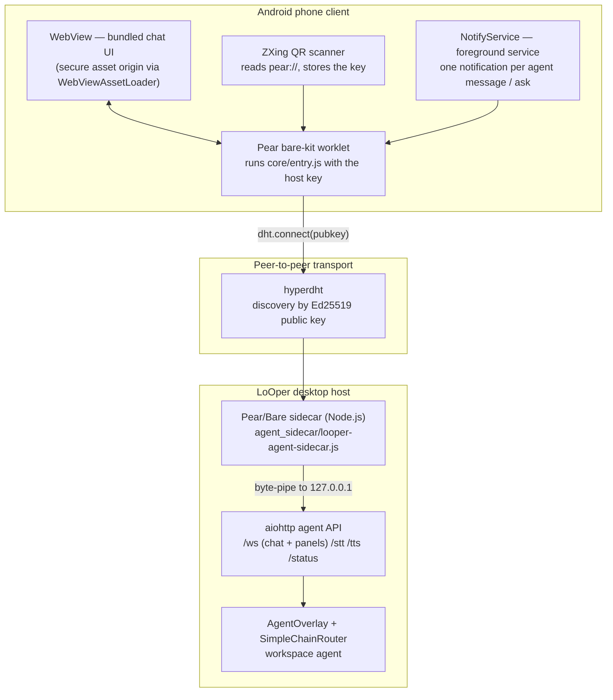

- **How it connects** — the host publishes `pear://<pubkey>` behind its QR code (the sidecar's persistent key lives in `%LOCALAPPDATA%\LoOper\agent-key.json`, so the code stays stable; `AGENT_PEAR_PUBKEY` in `AI/config.json` can pin a specific key). The app scans the QR or accepts a pasted key, stores it, auto-reconnects on the next launch, and starts a worklet running `core/entry.js` with the pubkey; the worklet byte-pipes the stream to `127.0.0.1:<port>`, where the WebView opens `ws://…/ws` — piped to the host's `/ws`. When the sidecar cannot run, the agent-mode panel falls back to a plain `http://<tailscale-or-lan-ip>:<port>` URL (legacy LAN/Tailnet path).
- **Notifications + background** — one system notification per agent message / ask prompt; a **foreground service** (`NotifyService`, type `dataSync`) keeps the worklet + pipe alive while the UI is hidden (there is no push server — a P2P link must stay up) and shows an ongoing "Connected" notification. Suppressed while the UI is in the foreground. Permissions at launch: `RECORD_AUDIO` (voice) and, on Android 13+, `POST_NOTIFICATIONS`.
- **Voice** — text-to-speech: every agent output (and every ask question) is spoken via the host's `/tts`, per message. Speech-to-text: hold (or tap, during an ask) the mic button; audio is captured at the device rate, resampled to 16 kHz, and POSTed to `/stt`.
- **Layout — one core, many shells** — `core/connect.js` (dial by key, byte-pipe to loopback), `core/entry.js` (read the key from Bare.argv, report readiness over IPC/stdout); `android/` (Kotlin `MainActivity` worklet + WebView + QR, `NotifyService`, manifest); `package.json` (`hyperdht`, `bare-net`, `b4a`); `pear.json` (Pear manifest — `pear .` on desktop works too). Generated build output (gradle wrapper, `bare-kit` prebuild, linked addons, `app.bundle`) is git-ignored and recreated by the build.
- **Current limits** (from the client's own README) — `minSdk = 26`; cleartext HTTP enabled app-wide for the loopback hop; `dataSync` foreground service is capped ~6 h/day on Android 15+ (a permanent link needs `specialUse`); trust-on-first-use key acceptance (an allow-list check against a pinned host key is on the TODO); the iOS shell is not built yet — the same `core/` packs as a worklet + `WKWebView`.
- **Desktop development run** — `cd LoOper/phone_client && npm install && npm start -- <64-char-host-pubkey>` prints `{"type":"ready","port":8081}`; open `http://127.0.0.1:8081/` in a browser (`bare` must be on PATH).

---

## 16. Scheduling, sandbox & remote access

### 16.1 Scheduler

`NGUI/scheduler_service.py` runs any chain on a schedule — **once, daily, weekly, interval** — with enable/disable, next-run display, and run-now. Schedules persist to `schedules.json`; execution is **in-process** through the same `MultiSequencePlayer` path as manual playback. Schedule wakes are also what resume persistent goals (§11.5).

### 16.2 RDP sandbox

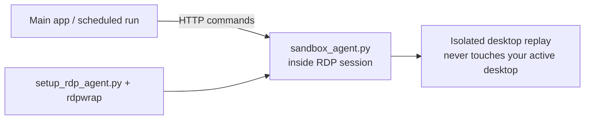

Automation runs inside an isolated Windows session via a local HTTP agent; the desktop you are using stays untouched. Chains can opt into sandbox mode (`run_in_sandbox`) per sequence/chain-import.

### 16.3 Remote access

- **Primary: P2P by key.** The agent chat is reached from the Android app over hyperdht using the host's public key (§15) — no IP, no VPN, no exposed port. The QR in agent mode carries `pear://<pubkey>`; scanning it pairs the phone to the host.
- **Fallback: LAN / Tailnet.** When the Pear sidecar cannot run, the same aiohttp API is reachable at `http://<tailscale-or-lan-ip>:<port>` (`AGENT_TAILSCALE_IP` in `AI/config.json` supplies the displayed address) — the legacy path, still supported.
- Remote clients receive the same busy lifecycle, transcripts, history sync, and pending-question replay as the desktop overlay; runs started from either surface are answerable and stoppable from either.

---

## 17. Export & build pipeline

### 17.1 Standalone agent export

```mermaid
flowchart TB
    Root["Workspace agent's pinned brain chain"] --> Collect["collect_dependencies:<br/>transitive chain_import scan<br/>+ sequences, screenshots, models"]
    Collect --> Spec["Generate PyInstaller spec<br/>datas + hiddenimports + engines"]
    Spec --> Build["PyInstaller onedir build"]
    Build --> Agent["Standalone agent exe<br/>ARROW_DIRECT_ENGINE=1"]
```

- `builder/agent_exporter.py` resolves every chain referenced transitively (including orchestrator-mode brains), bundles chains/sequences/models, and builds a one-folder executable. It needs a **single root chain** to start from — a workspace agent that composes its chains has none, so exporting requires a pinned `agent.legacy_brain` (the export dialog says so instead of picking a random chain).
- Exported agents run **directly on the local engines** (`ARROW_DIRECT_ENGINE=1`): no FastAPI dependency, fully offline; in frozen builds without the engine, Laya paths degrade to LLM automatically.

### 17.2 Application build (MSI)

`build_pipeline/` drives the product build: dependency staging (llama.cpp binaries, Chrome, model files), PyInstaller via `LoOperApp.spec`, runtime hooks for ONNX Runtime/torch, WiX source generation (`generate_wxs.py` → `arrow.wxs`), and `build_msi.ps1` producing the per-user MSI with custom UI and EULA.

### 17.3 Phone client build (Android APK)

- **One-shot prerequisites** — `Arrow_setup.bat` installs Node.js, JDK 17, GitHub CLI, Android Studio, the Android SDK command-line tools + platform 35 + NDK 27.2.12479018, and a portable Gradle, then generates the project's Gradle wrapper (`SKIP_PHONE=1` skips the phone prerequisites).
- **Build** — `build_pipeline/build_phone_apk.ps1` (debug by default, `-Configuration Release` for release, `-SkipNpmInstall` when deps are installed): it checks prerequisites, auto-detects the SDK (`%LOCALAPPDATA%\Android\Sdk`), the JDK 17 install and `.tools\gradle` (no env vars needed), fetches the `bare-kit` prebuild via `gh` (unless already present), runs `npm install`, then `gradle assemble<Debug|Release>`; the Gradle `preBuild` runs `link` (bare-link → native addons) and `pack` (bare-pack → `app.bundle`). Output: `android/app/build/outputs/apk/debug/app-debug.apk`; install with `adb install -r`.

### 17.4 Packaged build: native DLLs & CPU compatibility

The MSI does **not** ship the llama.cpp engine and does **not** bake any CPU instruction set. Instead the installer **builds the engine on the host machine** (`install_dependencies.ps1` → `setup_llama_engine.ps1`): it detects the host, installs the C++ toolchain (CMake + VS Build Tools) when a local build is required, compiles the vendored fork with `GGML_CPU_ALL_VARIANTS` (runtime ISA dispatch), verifies the result (`llama-server --version`), and falls back to the official portable prebuilt if the build cannot run. An engine built on a developer machine can therefore never conflict with the end user's CPU.

Components a fresh, stripped, or "N"-edition Windows lacks are shipped beside the app:

| Absent on the target | Bundled by the build | Symptom when missing |
|---|---|---|
| MSVC runtime (`vcruntime140_1`, `msvcp140`, …) | beside every native EXE (`_internal/bin/`, plus `_internal/`) | child EXEs die `0xC0000135` (`STATUS_DLL_NOT_FOUND`) |
| Media Foundation (`MF.dll`, `MFReadWrite.dll`, `mfplat.dll`, `mfcore.dll`) | `_internal/` | `cv2.pyd` cannot load → "OpenCV not available" |

llama.cpp's CMake defaults `GGML_AVX2/FMA/F16C=ON`, and on MSVC that bakes `/arch:AVX2` into the CPU backend, so any fixed-ISA `ggml-cpu.dll` runs **only** on AVX2-capable CPUs and aborts everywhere older. That is why the engine is built **on the target host** as all ISA variants behind a runtime dispatcher — AVX2/AVX512 where the CPU supports them, the SSE4.2 baseline otherwise.

**CPU compatibility exception — `0xC000001D` (`STATUS_ILLEGAL_INSTRUCTION`).** The bundled **PaddlePaddle** runtime (PaddleOCR) executes AVX-class instructions, so on a CPU that does not support them importing `paddle` aborts the process with a native fault and **no Python traceback** (try/except cannot catch it). Two rules follow:

- The **main process never imports `paddle`**. The startup native health check probes it with `importlib.util.find_spec` (presence only) and actually imports only `numpy`/`cv2`.
- **Paddle OCR runs in an isolated subprocess** (`player/ocr_worker.py`): a native crash kills only that child and the caller falls back to an empty result.

On an AVX-less CPU the app therefore opens and runs normally; OCR simply returns nothing.

---

## 18. Configuration, environment & data

### 18.1 `AI/config.json` (key entries)

| Key | Meaning |
|---|---|
| `LLAMA_CPP.model_path` | Default GGUF for LLM nodes |
| `LLAMA_CPP.embedding_model_path` | Embedding GGUF |
| `LLAMA_CPP.gpu_layers` / `threads` / `context_size` / `batch_size` | Engine tuning (0 = model defaults) |
| `API_PORT`, `AUTO_START_API` | Local API control (default 8000 / true) |
| `OLLAMA_HOST`, `OLLAMA_PORT` | Ollama endpoint |
| `AGENT_TAILSCALE_IP` | Displayed remote address for the legacy LAN/Tailnet fallback (§16.3) |
| `AGENT_PEAR_PUBKEY` | Pinned host key for the P2P agent transport (default identity persists in `%LOCALAPPDATA%\LoOper\agent-key.json`) |
| `AGENT_WEB_SERVER_ENABLED` | Start the aiohttp agent API + sidecar |

BYOK settings and API keys live in **`byok.json`** (durable runtime dir), sanitized on load — keys are never logged and never written into `config.json`. The assisted builder's own engine/model preferences live in **`builder_settings.json`** (engine, model, reasoning toggle, max steps).

### 18.2 Environment variables

| Variable | Purpose |
|---|---|
| `API_PORT`, `AUTO_START_API`, `API_TIMEOUT` | Local API networking |
| `OLLAMA_HOST`, `OLLAMA_PORT`, `OVERWATCH_API_URL` | External service endpoints |
| `TAILSCALE_SERVER_IP`, `AGENT_TAILSCALE_IP` | Legacy remote access |
| `LOOPER_AGENT_PORT` | RDP sandbox agent port |
| `LOOPER_LAYA` | `off` forces all Laya consumers onto LLM paths (`LOOPER_JEV` honored as the legacy name) |
| `LOOPER_LAYA_MODEL`, `LOOPER_LAYA_THREADS`, `LOOPER_LAYA_EXE` | Quant override (name or path) / CPU worker count / engine binary override |
| `LOOPER_LAYA_KEEP_ALIVE_SECONDS` | Grace after the last request before the scorer is unloaded (default `2`; negative pins it resident). The daemon is a **burst** resource — released before every llama-server start so the two models never fight for one memory pool |
| `LOOPER_ORCH_STATE` | `off` disables the orchestrator's per-step state digest (its web page OR desktop digest, per the node's web/desktop scope) — the loop then decides from goal + results alone |
| `LOOPER_ORCH_GRAPH` | `off` silences the orchestrator's routing shadows (derived action-graph block + plan projection) — diagnostics only, nothing routes on them |
| `LOOPER_LEARN` | `off` disables freezing verified runs into learned chains (the `tools` port keeps working) |
| `LOOPER_RUN_MEMORY`, `LOOPER_RUN_MEMORY_DB` | `off` disables the agent activity timeline (`data/run_memory.db`); DB path override for tests / portable installs |
| `OPENJEV_*` | Legacy openjev overrides (archived pre-Laya tooling in `utils/openjev/tools/`) |
| `LOOPER_GOAL_LEDGER` | Override goal ledger path |
| `ARROW_SESSION_ID` | Unified telemetry session id (subprocess log merge) |
| `ARROW_DIRECT_ENGINE` | `1` in exported agents: direct engines, no API calls |
| `KMP_DUPLICATE_LIB_OK`, `FLAGS_use_mkldnn`, `FLAGS_enable_mkldnn` | Native library compatibility shims |
| `YOLO_AUTOINSTALL` | Disable ultralytics auto-install |
| `QT_ENABLE_HIGHDPI_SCALING`, `QT_AUTO_SCREEN_SCALE_FACTOR` | High-DPI behaviour |

### 18.3 Data persistence

| Data | Storage | Location |
|---|---|---|
| Chains | JSON | `LoOper/workspaces/<slug>/chains/*.json` |
| Workspaces + agents | JSON | `LoOper/workspaces/index.json`, `<slug>/workspace.json` |
| Learned plans | JSON (plans · transitions · ask/report) | `LoOper/workspaces/<slug>/plans.json` |
| Learned chains (orchestrator mode) | JSON (composition + routing) | `LoOper/chains/learned/*.json` (runtime dir in frozen builds) |
| Desktop sequences | JSON | `LoOper/sequences/*.json` |
| Web sequences | JSON | `LoOper/web_sequences/*.json` |
| Context memory | SQLite | `LoOper/data/context.db` |
| Schedules | JSON | `schedules.json` |
| Goal ledger | JSON (atomic) | `LoOper/data/agent_goals.json` |
| Run memory (activity timeline) | SQLite (WAL) | `LoOper/data/run_memory.db` (durable runtime dir in frozen builds) |
| BYOK settings + keys | JSON (sanitized) | `byok.json` (durable runtime dir) |
| Builder settings | JSON | `builder_settings.json` (durable runtime dir) |
| HTML artifacts | HTML files | `LoOper/data/artifacts/` (durable runtime dir in frozen builds) |
| Sidecar identity key | JSON | `%LOCALAPPDATA%\LoOper\agent-key.json` |
| TTS/STT models | ONNX / Vosk | `LoOper/data/piper_voices/`, `LoOper/data/vosk_models/` |
| Logs | text | `logs/session_*.md`, `automation.log`, `run.log` |

### 18.4 Logging

Unified telemetry: a root logging dispatch fans every record out to the colorized console, `automation.log`, and a per-session markdown log (`logs/session_*.md`) — including records from subprocesses (API, engines) that join the parent session by id. Long model outputs are written as titled log blocks instead of inline blobs.

---

## 19. Engineering doctrine (methodologies)

These are the load-bearing design principles the codebase is held to; they explain most of the “why” behind the implementations above.

1. **Neuro-symbolic execution.** The graph is a deterministic program. AI is used only where fuzzy judgment adds value — never as a single point of failure for micro-decisions. Every AI touchpoint has a symbolic fallback or a fail-closed default.
2. **Small-model discipline.** Every model interaction is shaped for 1–4B models: stepped protocols (pick a name, then extract one field at a time), strict single-token contracts, reasoning-tag stripping instead of prose parsing, bounded retries, and prompts sized to the model window.
3. **Named-port contracts, no implicit state.** Values move only along explicit edges; ports are named and namespaced per chain. Exec-only ports carry no data; data ports resolve by name (one publisher, one resolver — `executor_modules/ports.py`). What a node does is decided by topology + configuration, never by its position in the graph.
4. **A chain describes itself.** Every routing line is derived from the chain's own `flow` metadata and ports (`player/chain_brief.py`) and written back on save, so editing a topology instantly changes how the agent and the library see it — there is no second description to maintain and nothing to drift.
5. **Fail-closed defaults, byte-identical off states.** New capabilities ship as default-off toggles; chains that do not use them behave exactly as before. Unparseable answers route to configured defaults (e.g. decision default = false) and log loudly.
6. **Entity-first grounding over coordinates.** Web replay resolves recorded entities via stable selectors (never absolute coordinates); desktop replay tries the recorded UIA element before image templates. Two independent locators beat one clever matcher.
7. **No timeouts on local model execution.** Long inference is legal; interruption is a stop-flag concern. Timeouts are reserved for network-ish edges with retry policies.
8. **Serialized, on-demand model lifecycle.** No model preload at startup; one shared engine with a serialization lock; burst-aware cleanup; RAM-aware context sizing (the engine, not the request, owns the effective context).
9. **Approvals and memory are primitives, not features.** An approval is an Input question plus branch routing; memory is Context nodes plus an inspectable SQLite store. Users compose them; the platform does not hardcode policy.
10. **The model proposes, Python writes.** Models never emit chain JSON, file writes or wire calls: the orchestrator-mode loop is code, the agent's plan is a strict-JSON object validated against the catalog, and the builder's only canvas change is the flow metadata it authored (validated node by node). Structure is never a model decision; a model that can only propose cannot corrupt the artifact.
11. **The agent is plain data.** A workspace is a folder — a manifest, its chains, and what the agent learned (`plans.json`: plans, transitions, ask/report evidence). Routing, ordering and the ask/report behaviour are recorded facts, not weights: copy the folder, diff the plans, delete the workspace. Sweep the freeze loop and it freezes into data too; audit traces, ratings, shadows and the activity timeline are the feedback loop.
12. **Offline and telemetry-free.** All inference, storage, and licensing work without network access; nothing leaves the machine. BYOK is the opt-in exception, isolated to the providers you configure.
13. **Everything inspectable and reversible.** Execution logs, memory panels, trace ports, blocked states, and rated outputs give the operator a full audit surface — and ESC always aborts.
14. **Test discipline.** Non-trivial logic leaves a runnable check behind; behavior-affecting changes land with regression tests (see §20), and UI logic is testable headless via offscreen Qt.

---

## 20. Testing & verification

- **Framework** — pytest under `LoOper/tests/` (~100 test modules, ~1,900 tests collected as of the current tree) plus standalone unittest harnesses for subsystems with special lifecycles (e.g. execution skip/loop regressions).
- **Headless UI** — Qt tests run offscreen (`QT_QPA_PLATFORM=offscreen`) with lightweight fakes for graph views and overlays; overlay/bg-thread flows are exercised with stub web servers and message capture.
- **Execution semantics** — the skip/loop regression harness covers branch sweeps, convergence, loops, decision routing, and tool-provider gating; graph fixtures are built exactly like the player builds them. The orchestrator suites (node in `tests/test_orchestrator_node.py` — including the propagation packet and the shadow blocks — the derived substrate in `tests/test_action_graph.py`, assets in `tests/test_orchestrator_assets.py`, gating in `tests/test_tool_provider_flag.py`) cover node brains, the `tools`-port gate and fast path, the freeze gates, and a shipped-asset classification sweep; `tests/test_chain_config_encoding.py` pins the chain editor's UTF-8 load/save round-trip (locale-codec reads mojibaked non-ASCII and crashed on bytes cp1252 leaves undefined). Branch-sweep reachability and the loop dead-end guard have focused regressions of their own (`tests/test_conditional_branch_skip_reachability.py`, `tests/test_loop_deadend_guard.py`), and the form-filler suites pin the position-first page scope and the layer-confined element tree.
- **Workspaces & agent routing** — `tests/test_workspace_agent.py` (registry, migration, derived brief, catalog, short routing labels vs the long brief, refused verdict, planner model per workspace, learned plans/transitions, ask/report), `test_chain_refresh.py` (a stamp blind to ids and order, only a described chain refreshed, one edited node = one rewritten line, unchanged files untouched, broken files reported, the agent's workspace binding triggers the sweep), `test_workspace_gui.py` (a real canvas: migration into workspaces, library gating, workspace switch), `test_chain_brief.py` (the derived line, structural fallback, bounded), `test_simple_agent.py` (workspace dispatch, pinned brain), `test_app_state.py` (resume), `test_canvas_focus.py` (a loaded chain is framed on screen), `test_agent_overlay_agent_model.py` (the MODEL control writes the workspace and follows the selected agent).
- **Assisted builder** — `tests/test_builder_analyst.py` (the read tools, topology digest, flow validation, envelope parsing), `test_builder_node_metadata.py` (every node type gets its own action line from its LIVE property names, a lone non-recording node is described, `read_node` answers with DOES, stored `flow.nodes` covers every node and survives validation), `test_builder_atomic.py` (a live node's config is read from NodeGraphQt's nested `custom` block, an atomic tool is described from its recording, a missing/empty recording is a reported defect), `test_builder_flow_persist.py` (flow metadata + derived description survive save/load, per-node entries translate onto a reloaded chain's ids, boxes draw on open), `test_builder_panel_sessions.py` (one chat session per chain).
- **Agent model selector** — `tests/test_agent_model_selector.py` (every engine offered, engine switch filters the model list, a model can be typed, "use no model" clears, a gateway error is reported, and importing it never loads NodeGraphQt — `NGUI/dialogs/__init__.py` now resolves its classes lazily), `test_model_path_repair.py` (a configured GGUF path from a moved checkout resolves by basename).
- **BYOK & provider routing** — `tests/test_byok.py` (manifest, sanitization, retries), `test_byok_dialog_smoke.py`, `test_gateway_byok_routing.py` (resolution order), `test_engine_selectors.py`, `test_node_dialogs_model_dropdowns.py`.
- **Ports & data flow** — `tests/test_ports.py` pins the exec-only vs data-port contract and the single resolver; `test_code_node_port_flow.py` covers Code-node IO wiring.
- **Transport & artifacts** — `tests/test_agent_overlay_server_lifetime.py`, `test_artifacts.py`, plus `test_embedding_server_burst.py`, `test_orphan_reap.py`, `test_model_downloads.py` for the engine lifecycle.
- **Isolation** — tests use temp trees and monkeypatched roots (config, exporter, ledger) so nothing touches real user data.

Run the suite:

```bash
python -m pytest LoOper/tests/ -q
```

---

## 21. Repository layout

```
LoOperV2/
├── LoOper/
│   ├── main.py                  # GUI entry (delegates to NGUI/app.py)
│   ├── NGUI/                    # PyQt5 UI: editor, dialogs, overlays, panels, scheduler, builder chat
│   ├── player/                  # Execution engine, recorder, web recorder/replay, grounding
│   │   ├── workspace.py         # workspace registry, chain membership, one-time collection migration
│   │   ├── chain_brief.py       # the derived routing line every reader uses
│   │   ├── chain_refresh.py     # background sweep: refreshes only the chains whose nodes changed
│   │   ├── multi_sequence/      # Interpreter (builder, navigator, executor_modules/*)
│   │   ├── agentic_ops/         # Workspace agent (catalog, plans, chain executor, run memory, goal ledger)
│   │   ├── builder/             # Builder core (assistant = chain analyst, describe, flow, snapshot,
│   │   │                        #   ports, tools, content, artifacts, node_templates, runbook, reasoning, settings, trace)
│   │   └── web/                 # CDP recorder, replay engine, handlers, inject scripts
│   ├── recorder/                # Desktop recorder (mouse/keyboard/scroll/screenshot)
│   ├── AI/                      # FastAPI server, engines, embeddings, RAG, BYOK, Laya engine, models, bin
│   ├── agent_sidecar/           # Host-side Pear/Bare P2P transport (Node.js: hyperdht, b4a)
│   ├── phone_client/            # Android app + Pear core (Kotlin + JS): WebView, worklet, QR, notifications
│   ├── builder/                 # Standalone agent exporter + standalone entry
│   ├── chains/                  # Legacy flat chains folder (migrated into workspaces/ on first launch)
│   ├── workspaces/              # Per-agent folders: workspace.json + chains/ + plans.json
│   ├── sequences/ web_sequences/ data/  # Recordings, context.db, models, voices, artifacts/
│   └── tests/                   # Pytest suite (~100 modules)
├── build_pipeline/              # PyInstaller spec, WiX MSI generator, APK build, PowerShell scripts
├── keygen/                      # Offline license generation/validation
├── utils/                       # Vendored engines and toolkits (llama.cpp, ComoRAG, nano-graphrag,
│                                #   openjev (checkpoint + archived pre-Laya tools), aider, little-coder, rdpwrap, playwright-mcp, …)
├── docs/                        # User guide, NODE_RUNBOOK.md, business analyses, compatibility docs
├── runtime/                     # Runtime shims
└── tests/                       # Standalone harnesses (execution skip regressions, …)
```

---

## 22. Licensing & distribution

- Individual use is free: every automation feature and node type, no execution limits.
- License files are **offline HMAC-signed and hardware-bound** (`keygen/`); no activation servers.
- The enterprise right is **agent export** — compiling a complete agent (the agent's pinned brain chain + transitive assets) into a distributable executable.
- The packaged MSI installer (WiX) is the recommended path for end users; source runs use `Arrow_setup.bat` (one-shot bootstrap + launcher) or `LoOper.py` (see the root `README.md` for the customer-facing quick start; this file is the technical reference). The Android phone client installs from the APK built by `build_pipeline/build_phone_apk.ps1`.

---

*This document describes the current implementation, including the workspace model with its learned agent (§2), the derived chain brief (§6.1), the optional orchestrator mode with deterministic chains and the freeze loop (§11.2–11.3), Input node v2 interaction gates, the embedded Laya decision engine, the read-only assisted builder (§12), BYOK provider routing (§10.7), the P2P phone client (§15), and the goal ledger. It replaces the legacy README that predated the chain-import, agent-mode, web-automation, memory, builder, and phone-client subsystems.*
