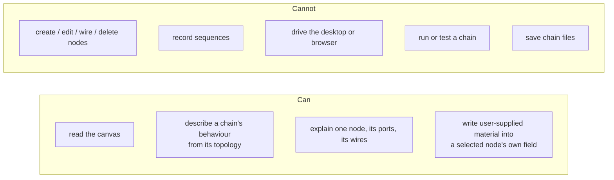
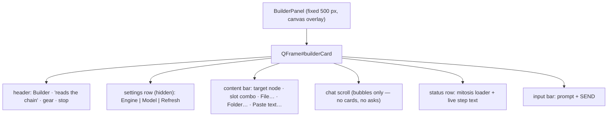
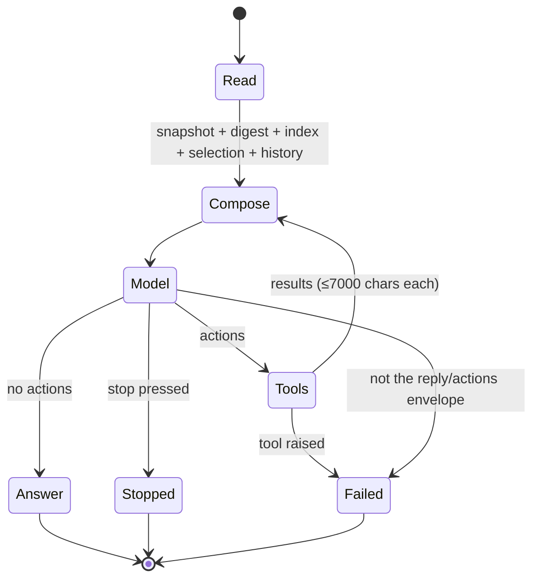

# Builder Panel — Implementation Reference (read-only analyst)

This replaces the previous architecture document. The builder is no longer a
chain creator: it is a **read-only analyst** beside the canvas plus a
**content loader** that writes user-supplied material into the field a node
reads at run time.

Everything below describes the code as implemented in
`LoOper/player/builder/*` and `LoOper/NGUI/widgets/builder_panel.py`.

---

## 1. What the builder can and cannot do



The tool surface is exactly three read tools
(`read_graph`, `describe_chain`, `read_node`). The only write path in the
whole panel is the content loader, and it is driven by the user's click,
never by the model.

---

## 2. Module map

| File | Responsibility |
|---|---|
| `player/builder/ports.py` | The role of every port on every node, and what an edge through it means. Raises on an unclassified port. |
| `player/builder/snapshot.py` | One read of the live canvas → `Snapshot` (nodes, ports with roles, peers, edges with kinds). |
| `player/builder/describe.py` | The deterministic topology digest: start, execution walk, branches, loops, phases, data flows, defects; node/subtree detail. |
| `player/builder/tools.py` | The three read tools + selection reports. |
| `player/builder/assistant.py` | One analyst turn: system prompt, turn prompt, envelope parsing, ≤3 drill-down rounds, streaming reply. |
| `player/builder/content.py` | Parse user material (md/txt/json/csv/log/docx/pdf/folder/pasted text) and write it into a node's field. |
| `player/builder/reasoning.py` | The gateway call: streaming only, raises on every failure. |
| `player/builder/settings.py` | `engine` + `model`, atomic, raises on a corrupt file. |
| `player/builder/errors.py` | `BuilderError` and the hard-failure family. |
| `player/builder/node_templates.py` | Node vocabulary: types, role words, descriptive fields, type normalisation. |
| `player/builder/runbook.py` | What each node is for, its ports and wiring rule (prompt knowledge + generated doc). |
| `player/builder/trace.py` | One `[BUILDER]` log line, mirrored to the panel. |
| `NGUI/widgets/builder_panel.py` | The panel: chat, settings, content bar, ingestion worker, turn worker. |

---

## 3. UI



- The panel is a floating overlay (`UIComponents.set_builder_panel` /
  `set_builder_width`), so the canvas keeps its full width. `PANEL_WIDTH = 500`,
  reserved slide width 536.
- Opened by `Ctrl+Shift+B` (`main_window._toggle_builder`) or the canvas-side
  Builder button; both call the same show/hide slide.
- The content bar is **selection-driven**: a 250 ms timer (started on
  `showEvent`, stopped on `hideEvent`) reads
  `graph_view.node_graph.selected_nodes()` and enables the bar only when
  exactly one node is selected. No node → the bar is disabled and says so.
- The slot combo lists the destinations of the selected node type
  (`content.slots_for`), so the user never types a field name.

---

## 4. Threading

```mermaid
sequenceDiagram
    autonumber
    participant U as User
    participant P as BuilderPanel (GUI)
    participant W as QThread TurnWorker
    participant A as BuilderAssistant
    participant M as Gateway (stream)
    participant T as tools/snapshot
    participant N as Canvas

    U->>P: type a question + Enter
    P->>P: _append user bubble, _remember
    P->>W: start(ctx, query, assistant)
    W->>A: route(query, progress_cb, trace, on_reply_delta)
    A->>T: read_snapshot(ctx)
    T->>P: _GuiProxy.call(build)
    P->>N: get_all_nodes / ports / connections
    N-->>P: live nodes
    P-->>T: Snapshot
    A->>A: digest + canvas index + selection
    A->>M: generate(prompt, system, __on_delta, __cancel)
    M-->>A: NDJSON {"text": accumulated}
    A-->>P: reply_delta (partial reply only)
    loop ≤3 rounds
        A->>T: execute(tool, args)
        T->>P: _GuiProxy.call(read)
        T-->>A: text result
    end
    A-->>W: {'reply', 'text', 'steps', 'stopped'}
    W-->>P: finished_turn(reply) / failed(message)
    P->>P: settle bubble, clear busy; failure → error bubble + dialog
```

- `_GuiProxy` marshals every canvas touch with `Qt.BlockingQueuedConnection`
  and runs inline when already on the GUI thread (no self-deadlock).
- `_TurnWorker` reports `failed` for **any** exception; the panel renders it
  as an error bubble **and** a modal `QMessageBox.critical`.
- The content loader has its own `_IngestWorker`: document extraction (PDF,
  docx) runs off the GUI thread; only the property write is marshalled back.

---

## 5. The `ctx` contract

| Key | Shape | Used by |
|---|---|---|
| `graph_manager` | `() -> GraphManager` (via GUI) | snapshot |
| `run_on_gui` | `(fn) -> result` | snapshot, tools, content |
| `stop` | `() -> bool` | round loop, stream cancel |
| `selection_node_ids` | `() -> [id]` | selection reports |
| `history` | `[{role, text}]` (last 10) | turn prompt |

That is the whole surface — no `ask`, no `position_hint`, no `state`, no
chains directory.

---

## 6. Port roles — the core fix

The old builder treated every wire as an "input/output connection". The new
model separates two edge kinds and gives every port a meaning.

### 6.1 Roles

| Role | Meaning |
|---|---|
| `exec_in` / `exec_out` | decides **when** a node runs |
| `branch_true` / `branch_false` | conditional routing |
| `loop_out` | the single continuation of a FILE-LOOP conditional |
| `data_in` / `data_out` | a value the node consumes / produces |
| `prompt_in` | text that **REPLACES** an LLM's prompt template |
| `context_in` / `context_out` | history appended / turn record emitted |
| `tools_in` / `brains_in` | orchestrator inputs (chains / sub-brains) |
| `trace_out` / `route_out` | orchestrator outputs |
| `error_out` | a code node's failure branch |
| `named_in` / `named_out` | a code node's declared IO variables |

`edge_kind(src_role, dst_role)` returns `exec`, `data` or **`illegal`**. An
illegal pair is not dropped and not "tolerated": it is reported as a
topology defect with the reason (`illegal_edge_reason`).

### 6.2 Per-node port sets (`ports.PORT_TABLE`)

| Node | Inputs | Outputs |
|---|---|---|
| input | `input` (exec) | `output` (exec), `data`, `true`/`false` when decision routing |
| output | `input` (exec) | `output` (exec) |
| llm | `input` (exec), `prompt` (replaces), `context` (history), `tools`/`brains` (orchestrator) | `output` (exec), `context`, `trace`/`route` (orchestrator) |
| code | `input` (exec) + declared named inputs | `output` (exec), `error`, declared named outputs |
| conditional | `input` (exec) | `true`, `false`; `output` when a file loop |
| chain_import | `input` (exec) | `output` (exec) |
| sequence / action | `input` (exec) | `output` (exec) |
| web_sequence | `input` (exec) | `output` (exec), `ctx_out` |
| form_filler | `input` (exec), `ctx_in` | `output` (exec), `ctx_out` |
| handle | `input` (exec), `data` | `output` (exec), `data` |
| context | `ctx_in` (data only) | `ctx_out` (data only) — **passive, never executed** |
| mcp / container | `input` (exec) | `output` (exec) |

An unknown port on a known node type raises `UnknownPortError`; there is no
"assume it's a data port" path.

---

## 7. Snapshot

`snapshot.build(graph_manager)` (GUI thread) reads:

- every node: id, short type, name, role word (`ACT`/`THINK`/`CHECK`/`LOOP`/
  `BRAIN`/`VALUE`/`REPORT`/`MEMORY`/`COMPUTE`), position, descriptive
  properties (declared ones with values), input/output `PortView`s with roles,
  meanings and peer connections;
- every edge: source port → destination port with both roles and its kind.

Reading failures (`ports`, `connections`, `position`, node listing) raise
`BuilderCanvasError` — a partially-read canvas is never described.

---

## 8. The topology digest (`describe.py`)

Example shape:

```
CHAIN TOPOLOGY — 6 node(s), 4 execution edge(s), 3 data edge(s)
TYPES: conditional x1, context x1, input x1, llm x1, output x2

START: 0x1 input "query"

EXECUTION WALK (execution order only; data edges listed separately):
01 0x1 input "query" [VALUE]
  02 0x2 llm "answer" [THINK]
    03 0x3 conditional "ok?" [CHECK]
      true  04 0x4 output "result" [REPORT] — via true
      false 05 0x5 output "check failed" [REPORT] — via false

PHASES (main path; a CHECK/LOOP closes a phase):
  P1 (2 step(s), THINK/VALUE): "query" → "answer"
  P2 (1 step(s), CHECK): "ok?"

MEMORY POOLS (consulted through data ports; never executed):
  0x6 context "memory" — served to 0x2; written by 0x2
    documents: ["a.md"]

TOPOLOGY DEFECTS (0):
  none
```

Sections: header/type counts → start nodes → execution walk (branches
indented, loops marked `↺`, joins marked, `loop_count` marked) → phases →
memory pools (who writes, who reads, which streams) → defects.

Data flows are their own scope and carry the destination's semantics:

```
DATA FLOWS (3):
  0x1.data → 0x2.prompt   text wired here REPLACES the prompt template …
  0x2.context → 0x6.ctx_in   value appended to the pool …
  0x6.ctx_out → 0x2.context   the pool's whole material: documents + skills + …
```

### 8.1 Defects it reports

- illegal wires (exec out → data in, and the reverse), with the reason;
- a conditional with a branch that goes nowhere;
- a file-loop conditional with no continuation;
- a dead end (execution node whose outputs go nowhere);
- more than one start node, or none;
- nodes not reachable in the walk;
- no report node receiving anything;
- a `sequence`/`web_sequence` with no recording file;
- a `chain_import` with no chain file;
- an `input` with `passthrough` OFF (it types on the real desktop);
- an `llm.prompt` fed by more than one wire (only one can replace it).

### 8.2 Scopes

| Scope | Content |
|---|---|
| `overview` (default) | header + start + walk + phases + pools + defects (≤12 000 chars, explicit clip marker) |
| `walk` | header + execution walk |
| `data` | header + every data edge with its meaning |
| `phases` | header + phases + defects |
| `node` | one node: role, config (clipped), ports with roles and peers, wires |
| `subtree` | the walk downstream of one node (loop-safe, ≤300 steps) |

---

## 9. Tools and the assistant turn

### 9.1 Tools (`tools.py`) — all read-only

| Tool | Arguments | Returns |
|---|---|---|
| `read_graph` | `{}` | canvas index: every node with `in:`/`out:` port lists rendered as `name (role)` |
| `describe_chain` | `{"scope": "...", "node": "..."}` | one digest scope |
| `read_node` | `{"node": "<id or exact name>"}` | one node in full |

Resolution accepts an id, an exact name, or a case-insensitive unique name;
an ambiguous name raises `BuilderCanvasError` listing the candidates. An
unknown tool raises `UnknownToolError`.

### 9.2 Turn



- `MAX_ROUNDS = 3`; the digest is already in the prompt, so the model calls a
  tool only when it needs detail.
- The prompt carries: `RECENT CHAT` (≤2200 chars), `CHAIN TOPOLOGY` (≤9000),
  `CANVAS INDEX` (≤4000), `SELECTED NODES` (≤5000), `TOOL RESULTS`, `USER`.
- The system prompt states the port doctrine (exec vs data, prompt replaces,
  context stores/serves, code named IO, orchestrator tools/brains), the
  describe procedure (goal → start → phases → checks → loops → data per step
  → reports → defects), and that the builder cannot change the canvas: a
  change request is answered with the exact place to change it.
- The reply streams into one growing bubble via `partial_reply`; the
  authoritative text settles at the end.
- A reply that is not a `{"reply", "actions"}` envelope raises
  `BuilderProtocolError` (with the offending text) — it is not treated as
  prose.

---

## 10. Content loading (`content.py`)

### 10.1 Destination slots

| Node | Slots (property) |
|---|---|
| context | `documents` (file paths the pool reads), `skills` (notes / skill files) |
| llm | `system_message`, `prompt` |
| input | `default_value`, `user_prompt` |
| output | `tts_text`, `label` |
| code | `code` |
| conditional | `llm_prompt`, `code`, `description` |
| handle | `goal_description`, `target_description` |
| form_filler | `instruction` |
| chain_import | `chain_file_path` (path mode) |
| sequence | `sequence_file` (path mode) |
| web_sequence | `session_file` (path mode) |
| action / mcp / container | `label` |

Defaults: a **file** goes to the file stream (`documents`), **pasted text**
to the note stream (`skills`), a recording file to the recording property,
anything else to the node's first slot. A file whose type the pool cannot
read is refused before anything is written.

### 10.2 Readers (same code the runtime uses)

| Extension | Reader |
|---|---|
| `.txt .md .csv .json .log` | `rag_utils._read_text_file` |
| `.docx` | `rag_utils._extract_docx_text` |
| `.pdf` | `rag_utils._extract_pdf_text` |

Text slots additionally accept `.markdown .yaml .yml .ini .cfg .py .html
.htm .xml .tsv` (read as UTF-8). Anything else raises
`UnsupportedContentError` listing the supported set. An empty extraction
(scanned PDF, damaged docx) raises `ContentError` — the run would get
nothing from it, so it is not stored.

### 10.3 Writes

- **files slot** (`documents` / `skills`): append the path (or the literal
  note), dedupe exact entries, store `json.dumps(list)`.
- **text slot**: set the property to the extracted text (≤200 000 chars,
  otherwise `ContentTooLargeError`).
- **path slot**: must be an existing `.json`; `chain_import` goes through
  `set_chain_import_data` so its ports rebuild.

The write is marshalled to the GUI thread; the extraction is not.

### 10.4 Sources

`File…` (any file), `Folder…` (every supported file, non-recursive),
`Paste text…` (dialog), or drag-and-drop of file URLs / text onto the panel.
Every source goes through `_IngestWorker`; a failure raises and is shown as
an error bubble plus a modal dialog with the traceback.

> Context streams are the two the executor actually serves:
> `context_ops._ctx_list_text` reads `documents` and `skills` at run time and
> prepends them to the pool output (`## Documents`, `## Skills`). Writing a
> path there is therefore the same content the run will see.

---

## 11. Hard-error policy

| Failure | Behaviour |
|---|---|
| gateway unreachable / no model | `BuilderConfigError` → error bubble + dialog |
| HTTP status ≠ 200, transport error | `BuilderModelError` with the status/body |
| stream line not JSON / no `text` | `BuilderProtocolError` |
| empty generation | `BuilderModelError` |
| reply not the envelope | `BuilderProtocolError` with the text |
| unknown tool / bad arguments | `UnknownToolError` / `ToolArgumentError` |
| unreadable canvas / unknown port | `BuilderCanvasError` / `UnknownPortError` |
| unreadable / unsupported / oversized content | `ContentError` family |
| corrupt `builder_settings.json` | `BuilderConfigError` |

Nothing is swallowed: every one of these reaches the user as a visible
message. The package has no `except: pass` left.

---

## 12. Model usage

One model, one call shape.

| Item | Value |
|---|---|
| Endpoint | `POST {gateway}/generate_stream` (NDJSON `{"text": accumulated}`) |
| Provider routing | explicit `provider` when the engine is a BYOK id, or when the model ends in `.gguf` (→ `llamacpp`) |
| Model | `settings.model` → engine default (`get_default_llm_model`) → error |
| Timeout | none (local engines load and generate at their own pace) |
| Cancel | the panel's Stop breaks the stream and keeps the partial reply |
| Budgets | digest 9 000 / index 4 000 / selection 5 000 / chat 2 200 / tool result 7 000 chars |
| Rounds | 3 per message |

No vision model, no Laya, no second provider, no chain-execution model: the
builder reads text and writes text.

---

## 13. Removed surface (blast radius)

Deleted modules and why:

| Removed | Was |
|---|---|
| `devtools.py` (3 670 lines) | 15 mutating tools, needle routers, legacy `### BUILDER:` markers, teach/test/agentic handlers |
| `agent_loop.py`, `web_act.py` | real-input demonstration loops |
| `teach_capture.py`, `teach_overlay.py` | the Teach recorder and its merged overlay |
| `context_builder.py` | LFM2.5-VL scene description + LocateAnything grounding |
| `runtime.py`, `wrap.py`, `composer.py`, `planner.py` | decomposition, sub-chain writing, freeze, composition, Laya+needle planning |
| `laya_grades.py` | the encoder gates |
| `runtime_tools.py` | chat-mode chain binding (unused) |
| `settings` keys `reasoning`, `max_steps`, `agentic*` | dead once creation/demonstration left |

Panel removals: Teach button, capture cards, record cards, pending-ask state,
agentic/max-steps controls, `_position_hint`, chains/sequences folders in
`ctx`.

Deleted tests (features gone): `test_builder_agent_loop`,
`test_builder_web_act`, `test_builder_composer`, `test_builder_planner`,
`test_builder_laya_grades`, `test_builder_runtime_binding`,
`test_builder_tools`, `test_builder_assistant`, `test_builder_settings`,
`test_builder_panel_smoke`.

---

## 14. Tests

| File | Pins |
|---|---|
| `LoOper/tests/test_builder_analyst.py` | port roles and illegal pairs, code named IO, snapshot edges, digest sections, defects, phases on long chains, node detail, the three tools and their errors, envelope parsing, a full `route` with a tool drill-down, content slots/streams/refusals, settings defaults + corrupt file |
| `LoOper/tests/test_runbook.py` | every node type documented and in the port table, every descriptive field documented, runbook port tuples ⊆ role table, capability registry, generated doc in sync |

Run:

```
d:\Arrow\.venv\Scripts\python.exe -m pytest LoOper/tests/test_builder_analyst.py LoOper/tests/test_runbook.py -q
```

---

## 15. Invariants

1. **Read-only.** The model has three tools and none of them writes.
2. **Roles, not names.** Every edge is classified by port role; an illegal
   pair is reported, never silently accepted.
3. **Deterministic grounding.** The digest is built by Python from the live
   canvas; the model only writes prose over it.
4. **One write path.** Content enters a node only through the panel's
   content bar, into the field that node reads at run time.
5. **Hard errors.** No fallback, no silent degradation, no "assume".
6. **GUI confinement.** Canvas access goes through `_GuiProxy`; extraction and
   model calls run on worker threads.
